# Seen: evaluation report

Generated 2026-10-11T02:39:32+00:00 by `python -m eval.run_all` (Lane G, independent of the trainers). Every number below is produced by a script in this repo; nothing is typed in by hand. Real-data and synthetic-data results are kept in separate sections and are never averaged together. Intervals are 95%: Wilson for proportions, percentile bootstrap over images/clips for everything else.

**Hardware:** bench: NVIDIA RTX PRO 5000 Blackwell (CUDA_VISIBLE_DEVICES=1); bench_gpu: NVIDIA RTX PRO 5000 Blackwell (CUDA_VISIBLE_DEVICES=1); bench_nvidia_smi: NVIDIA RTX PRO 5000 Blackwell, 595.84, 48935 MiB | NVIDIA RTX PRO 5000 Blackwell, 595.84, 48935 MiB; bench_torch: 2.14.1+cu130; bench_cuda_runtime: 13.0; bench_onnxruntime: 1.31.0; bench_cpu_threads: 32; bench_io_pressure: full: avg10=0.00 avg60=0.16 avg300=0.41 total=17852377795; bench_gpu_contention: 0 other processes on the GPU, utilisation 7 %, memory used 15746 MiB

## Coverage

- Lanes with results: e2e, flow, ident, inspect, ops, router, sim.
- Lanes with no results yet: none.
- Result files read: `eval_results.json` (3 valid), `flow_results.json` (316 valid), `ident_results.json` (104 valid), `inspect_results.json` (31 valid), `ops_cascade_results.json` (7 valid), `ops_results.json` (43 valid), `sim_results.json` (15 valid).

Last `eval.run_all` steps:

| step | status |
|---|---|
| cuda | True |
| jury_media | 96 items; staged 0 new files to /home/amirkhon/seen_fast/eval/jury (0.30 GB); manifest -> /mnt/bigdrive/amirkhon/seen/runs/eval/latest/eval/manifests/jury.jsonl (pull into eval/manifests/) (1s) |
| adopt | ok: 5/5 adopted (1s) |
| pools | ok: 5 pools scanned; 9 jury items appear in some lane pool (excluded from the clean subset) (1s) |
| audit | ok: 11 training lists audited against ['jury'], all PASS; not audited (> 30000 files, crop lists): ['ident/ocr_main (126578 files)', 'ident/ocr_real_only (62086 files)', 'ops/heads_v1 (78379 files)'] (2s) |
| jury | ok (116s) |
| bench | ok (849s) |
| cost | ok (0s) |
| failures | 89 cases (10s) |
| lane_predictors_present | flow, ident, inspect, ops |
| report | ok: 519 components from {'eval_results.json': 3, 'flow_results.json': 316, 'ident_results.json': 104, 'inspect_results.json': 31, 'ops_cascade_results.json': 7, 'ops_results.json': 43, 'sim_results.json': 15}, 0 collection problems; lanes missing: [] (1s) |

Leakage audit (training lists vs held-out manifests, pHash <= 4 = near-identical):

| lane/exp | n train | verdict | details |
|---|---|---|---|
| flow/ft_large | 9216 | PASS | jury: path 0, near-dup 0 |
| ident/det_full_small | 5704 | PASS | jury: path 0, near-dup 0 |
| ident/det_uz_only_small | 2304 | PASS | jury: path 0, near-dup 0 |
| inspect/dmg_A | 12244 | PASS | jury: path 0, near-dup 0 |
| inspect/dmg_B | 14516 | PASS | jury: path 0, near-dup 0 |
| inspect/dot_chars | 3496 | PASS | jury: path 0, near-dup 0 |
| inspect/dot_region | 158 | PASS | jury: path 0, near-dup 0 |
| inspect/parts | 3968 | PASS | jury: path 0, near-dup 0 |
| inspect/tyre_dino_lr | 1341 | PASS | jury: path 0, near-dup 0 |
| inspect/tyre_dino_lr3 | 1888 | PASS | jury: path 0, near-dup 0 |
| ops/heads_v0 | 21069 | PASS | jury: path 0, near-dup 0 |

## 1. Real-data results

Each component is tested on real public data held out by source (manifests in `eval/manifests/`). Domain is stated per row: most tests are not service-bay CCTV.

### Lane A (identification)

#### Plate OCR exact-match/char-acc [argmax] (`ident.ocr.baseline_cct_s_v2_global.test_autoria_kz.argmax`)

dataset **AUTO.RIA OCR KZ**; domain AUTO.RIA crops, KZ plates (marketplace photos); split test (native split); n = **279**; model cct_s_v2_global.

| metric | value [95% CI] |
|---|---|
| exact_match | 30.8% [25.7%, 36.5%] |
| char_accuracy | 74.3% [71.4%, 77.3%] |
| within_1_char | 52.3% [46.5%, 58.1%] |

Per-sample predictions: `runs/ident/baseline_cct_s_v2_global/preds_test_autoria_kz_argmax.csv`

Notes: decoding=argmax; orientation_search=False; wall time 0.85 ms/crop incl. decode (batch 256, cuda:0) [run: baseline_cct_s_v2_global]

#### Plate OCR exact-match/char-acc [argmax] (`ident.ocr.baseline_cct_s_v2_global.test_autoria_kg.argmax`)

dataset **AUTO.RIA OCR KG**; domain AUTO.RIA crops, KG plates (marketplace photos); split test (native split); n = **1068**; model cct_s_v2_global.

| metric | value [95% CI] |
|---|---|
| exact_match | 67.7% [64.8%, 70.4%] |
| char_accuracy | 90.9% [90.1%, 91.8%] |
| within_1_char | 71.3% [68.6%, 74.0%] |

Per-sample predictions: `runs/ident/baseline_cct_s_v2_global/preds_test_autoria_kg_argmax.csv`

Notes: decoding=argmax; orientation_search=False; wall time 0.18 ms/crop incl. decode (batch 256, cuda:0) [run: baseline_cct_s_v2_global]

#### Plate OCR exact-match/char-acc [argmax] (`ident.ocr.baseline_cct_s_v2_global.test_autoria_ru.argmax`)

dataset **AUTO.RIA OCR RU**; domain AUTO.RIA crops, RU plates (marketplace photos); split test (native split); n = **2845**; model cct_s_v2_global.

| metric | value [95% CI] |
|---|---|
| exact_match | 27.3% [25.7%, 29.0%] |
| char_accuracy | 79.9% [79.2%, 80.5%] |
| within_1_char | 48.1% [46.3%, 50.0%] |

Per-sample predictions: `runs/ident/baseline_cct_s_v2_global/preds_test_autoria_ru_argmax.csv`

Notes: decoding=argmax; orientation_search=False; wall time 0.18 ms/crop incl. decode (batch 256, cuda:0) [run: baseline_cct_s_v2_global]

#### Plate OCR exact-match/char-acc [argmax] (`ident.ocr.baseline_cct_s_v2_global.test_uz_real.argmax_upright`)

dataset **Roboflow Uzbek_Plates valid originals**; domain Uzbek vehicle-inspection station photos, GT-box crops upright; split held-out cars (test); n = **299**; model cct_s_v2_global.

| metric | value [95% CI] |
|---|---|
| exact_match | 33.4% [28.3%, 39.0%] |
| char_accuracy | 76.1% [73.7%, 78.5%] |
| within_1_char | 40.1% [34.7%, 45.8%] |

Per-sample predictions: `runs/ident/baseline_cct_s_v2_global/preds_test_uz_real_argmax.csv`

Notes: decoding=argmax; orientation_search=False; wall time 4.80 ms/crop incl. decode (batch 256, cuda:0) [run: baseline_cct_s_v2_global]

#### Plate OCR exact-match/char-acc [argmax] (`ident.ocr.baseline_cct_s_v2_global.test_uz_real_raw.argmax_orient_search`)

dataset **Roboflow Uzbek_Plates valid originals**; domain Uzbek vehicle-inspection station photos, GT-box crops in raw orientation; split held-out cars (test); n = **299**; model cct_s_v2_global.

| metric | value [95% CI] |
|---|---|
| exact_match | 33.4% [28.3%, 39.0%] |
| char_accuracy | 56.3% [51.5%, 60.8%] |
| within_1_char | 38.8% [33.4%, 44.4%] |

Per-sample predictions: `runs/ident/baseline_cct_s_v2_global/preds_test_uz_real_raw_argmax.csv`

Notes: decoding=argmax; orientation_search=True; wall time 15.05 ms/crop incl. decode (batch 256, cuda:0) [run: baseline_cct_s_v2_global]

#### End-to-end plate read: detector + OCR on real Uzbek photos (`ident.e2e.baseline_e2e.uz_real`)

dataset **Roboflow Uzbek_Plates valid originals**; domain Uzbek vehicle-inspection station photos (stretched 640x640); split held-out cars; n = **299**; model det=fastalpr; ocr=cct_s_v2_global; mode=argmax; orient=False.

| metric | value [95% CI] |
|---|---|
| e2e_exact_match(all GT plates) | 15.7% [12.0%, 20.3%] |
| detected@IoU0.5 | 46.2% [40.6%, 51.8%] |
| exact_match\|detected | 34.1% [26.7%, 42.3%] |

Notes: labels verified by Claude (AI), pending human spot-check; 2 unreadable/partial crops excluded; det conf>=0.25 [run: baseline_e2e]

#### Plate detection recall/precision @IoU0.5, AP50 (`ident.det.baseline_fastalpr.uz_real_test`)

dataset **Roboflow Uzbek_Plates valid originals**; domain Uzbek vehicle-inspection station photos (stretched 640x640); split held-out cars; n = **301**; model fastalpr.

| metric | value [95% CI] |
|---|---|
| recall@IoU0.5(conf>=0.25) | 46.2% [40.6%, 51.8%] |
| precision@IoU0.5(conf>=0.25) | 73.5% [66.8%, 79.3%] |
| AP@IoU0.5 | 44.4% [38.0%, 49.6%] |
| recall@IoU0.75(conf>=0.25) | 18.6% [14.6%, 23.4%] |
| latency_p50_ms_per_image | 10.8 ms |
| latency_p95_ms_per_image | 15.4 ms |

Notes: 301 GT plates; recall/precision at conf>=0.25; AP over conf>=0.05; latency = batch-1 per image incl. pre/post-processing on cuda:0 [run: baseline_fastalpr]

#### Plate detection recall/precision @IoU0.5, AP50 (`ident.det.baseline_fastalpr.rodosol_test`)

dataset **RodoSol-ALPR (cars only, Kaggle mirror)**; domain fixed toll cameras (BR/Mercosur), day+night, rain; split block-split test; n = **1000**; model fastalpr.

| metric | value [95% CI] |
|---|---|
| recall@IoU0.5(conf>=0.25) | 99.6% [99.0%, 99.8%] |
| precision@IoU0.5(conf>=0.25) | 98.7% [97.8%, 99.2%] |
| AP@IoU0.5 | 99.8% [99.5%, 100.0%] |
| recall@IoU0.75(conf>=0.25) | 95.0% [93.5%, 96.2%] |
| latency_p50_ms_per_image | 11.2 ms |
| latency_p95_ms_per_image | 19.1 ms |

Notes: 1000 GT plates; recall/precision at conf>=0.25; AP over conf>=0.05; latency = batch-1 per image incl. pre/post-processing on cuda:0 [run: baseline_fastalpr]

#### Plate detection recall/precision @IoU0.5, AP50 (`ident.det.baseline_fastalpr.ccpd_db`)

dataset **CCPD2019 ccpd_db**; domain CCPD-DB: very bright/dark/uneven illumination (Chinese plates); split subset sample; n = **511**; model fastalpr.

| metric | value [95% CI] |
|---|---|
| recall@IoU0.5(conf>=0.25) | 89.8% [86.9%, 92.2%] |
| precision@IoU0.5(conf>=0.25) | 90.0% [87.1%, 92.3%] |
| AP@IoU0.5 | 90.3% [87.5%, 93.2%] |
| recall@IoU0.75(conf>=0.25) | 71.6% [67.6%, 75.4%] |
| latency_p50_ms_per_image | 14.2 ms |
| latency_p95_ms_per_image | 23.4 ms |

Notes: 511 GT plates; recall/precision at conf>=0.25; AP over conf>=0.05; latency = batch-1 per image incl. pre/post-processing on cuda:0 [run: baseline_fastalpr]

#### Plate detection recall/precision @IoU0.5, AP50 (`ident.det.baseline_fastalpr.ccpd_weather`)

dataset **CCPD2019 ccpd_weather**; domain CCPD-Weather: rain/snow/fog (Chinese plates); split subset sample; n = **511**; model fastalpr.

| metric | value [95% CI] |
|---|---|
| recall@IoU0.5(conf>=0.25) | 100.0% [99.3%, 100.0%] |
| precision@IoU0.5(conf>=0.25) | 98.3% [96.7%, 99.1%] |
| AP@IoU0.5 | 100.0% [100.0%, 100.0%] |
| recall@IoU0.75(conf>=0.25) | 91.8% [89.1%, 93.9%] |
| latency_p50_ms_per_image | 15.6 ms |
| latency_p95_ms_per_image | 24.5 ms |

Notes: 511 GT plates; recall/precision at conf>=0.25; AP over conf>=0.05; latency = batch-1 per image incl. pre/post-processing on cuda:0 [run: baseline_fastalpr]

#### Plate detection recall/precision @IoU0.5, AP50 (`ident.det.baseline_fastalpr.ccpd_challenge`)

dataset **CCPD2019 ccpd_challenge**; domain CCPD-Challenge: hardest cases (Chinese plates); split subset sample; n = **597**; model fastalpr.

| metric | value [95% CI] |
|---|---|
| recall@IoU0.5(conf>=0.25) | 98.2% [96.7%, 99.0%] |
| precision@IoU0.5(conf>=0.25) | 93.6% [91.4%, 95.3%] |
| AP@IoU0.5 | 98.1% [96.4%, 99.4%] |
| recall@IoU0.75(conf>=0.25) | 87.4% [84.5%, 89.9%] |
| latency_p50_ms_per_image | 16.7 ms |
| latency_p95_ms_per_image | 26.4 ms |

Notes: 597 GT plates; recall/precision at conf>=0.25; AP over conf>=0.05; latency = batch-1 per image incl. pre/post-processing on cuda:0 [run: baseline_fastalpr]

#### Plate OCR exact-match/char-acc [argmax] (`ident.ocr.baseline_global_mobile_vit_v2_ocr.test_autoria_kz.argmax`)

dataset **AUTO.RIA OCR KZ**; domain AUTO.RIA crops, KZ plates (marketplace photos); split test (native split); n = **279**; model global_mobile_vit_v2_ocr.

| metric | value [95% CI] |
|---|---|
| exact_match | 65.9% [60.2%, 71.3%] |
| char_accuracy | 91.9% [90.1%, 93.6%] |
| within_1_char | 87.1% [82.7%, 90.5%] |

Per-sample predictions: `runs/ident/baseline_global_mobile_vit_v2_ocr/preds_test_autoria_kz_argmax.csv`

Notes: decoding=argmax; orientation_search=False; wall time 14.60 ms/crop incl. decode (batch 256, cuda:0) [run: baseline_global_mobile_vit_v2_ocr]

#### Plate OCR exact-match/char-acc [argmax] (`ident.ocr.baseline_global_mobile_vit_v2_ocr.test_autoria_kg.argmax`)

dataset **AUTO.RIA OCR KG**; domain AUTO.RIA crops, KG plates (marketplace photos); split test (native split); n = **1068**; model global_mobile_vit_v2_ocr.

| metric | value [95% CI] |
|---|---|
| exact_match | 65.8% [62.9%, 68.6%] |
| char_accuracy | 91.0% [90.1%, 91.8%] |
| within_1_char | 78.8% [76.3%, 81.2%] |

Per-sample predictions: `runs/ident/baseline_global_mobile_vit_v2_ocr/preds_test_autoria_kg_argmax.csv`

Notes: decoding=argmax; orientation_search=False; wall time 0.09 ms/crop incl. decode (batch 256, cuda:0) [run: baseline_global_mobile_vit_v2_ocr]

#### Plate OCR exact-match/char-acc [argmax] (`ident.ocr.baseline_global_mobile_vit_v2_ocr.test_autoria_ru.argmax`)

dataset **AUTO.RIA OCR RU**; domain AUTO.RIA crops, RU plates (marketplace photos); split test (native split); n = **2845**; model global_mobile_vit_v2_ocr.

| metric | value [95% CI] |
|---|---|
| exact_match | 40.8% [39.0%, 42.6%] |
| char_accuracy | 87.6% [87.1%, 88.1%] |
| within_1_char | 68.0% [66.3%, 69.7%] |

Per-sample predictions: `runs/ident/baseline_global_mobile_vit_v2_ocr/preds_test_autoria_ru_argmax.csv`

Notes: decoding=argmax; orientation_search=False; wall time 0.07 ms/crop incl. decode (batch 256, cuda:0) [run: baseline_global_mobile_vit_v2_ocr]

#### Plate OCR exact-match/char-acc [argmax] (`ident.ocr.baseline_global_mobile_vit_v2_ocr.test_uz_real.argmax_upright`)

dataset **Roboflow Uzbek_Plates valid originals**; domain Uzbek vehicle-inspection station photos, GT-box crops upright; split held-out cars (test); n = **299**; model global_mobile_vit_v2_ocr.

| metric | value [95% CI] |
|---|---|
| exact_match | 26.8% [22.1%, 32.0%] |
| char_accuracy | 80.5% [78.5%, 82.4%] |
| within_1_char | 54.2% [48.5%, 59.7%] |

Per-sample predictions: `runs/ident/baseline_global_mobile_vit_v2_ocr/preds_test_uz_real_argmax.csv`

Notes: decoding=argmax; orientation_search=False; wall time 5.80 ms/crop incl. decode (batch 256, cuda:0) [run: baseline_global_mobile_vit_v2_ocr]

#### Plate OCR exact-match/char-acc [argmax] (`ident.ocr.baseline_global_mobile_vit_v2_ocr.test_uz_real_raw.argmax_orient_search`)

dataset **Roboflow Uzbek_Plates valid originals**; domain Uzbek vehicle-inspection station photos, GT-box crops in raw orientation; split held-out cars (test); n = **299**; model global_mobile_vit_v2_ocr.

| metric | value [95% CI] |
|---|---|
| exact_match | 26.8% [22.1%, 32.0%] |
| char_accuracy | 64.5% [60.4%, 68.7%] |
| within_1_char | 49.5% [43.9%, 55.1%] |

Per-sample predictions: `runs/ident/baseline_global_mobile_vit_v2_ocr/preds_test_uz_real_raw_argmax.csv`

Notes: decoding=argmax; orientation_search=True; wall time 2.66 ms/crop incl. decode (batch 256, cuda:0) [run: baseline_global_mobile_vit_v2_ocr]

#### Plate OCR exact-match/char-acc [argmax] (`ident.ocr.final.test_autoria_kz.argmax`)

dataset **AUTO.RIA OCR KZ**; domain AUTO.RIA crops, KZ plates (marketplace photos); split test (native split); n = **279**; model model.

| metric | value [95% CI] |
|---|---|
| exact_match | 99.3% [97.4%, 99.8%] |
| char_accuracy | 99.9% [99.8%, 100.0%] |
| within_1_char | 100.0% [98.6%, 100.0%] |
| format_head_acc(5-class visual head) | 100.0% [98.6%, 100.0%] |

Per-sample predictions: `runs/ident/final/preds_test_autoria_kz_argmax.csv`

Notes: decoding=argmax; orientation_search=False; wall time 2.23 ms/crop incl. decode (batch 256, cuda:0) [run: final]

#### Plate OCR exact-match/char-acc [constrained] (`ident.ocr.final.test_autoria_kz.constrained`)

dataset **AUTO.RIA OCR KZ**; domain AUTO.RIA crops, KZ plates (marketplace photos); split test (native split); n = **279**; model model.

| metric | value [95% CI] |
|---|---|
| exact_match | 0.0% [0.0%, 1.4%] |
| char_accuracy | 50.8% [50.2%, 51.4%] |
| within_1_char | 0.0% [0.0%, 1.4%] |
| format_head_acc(5-class visual head) | 100.0% [98.6%, 100.0%] |

Per-sample predictions: `runs/ident/final/preds_test_autoria_kz_constrained.csv`

Notes: decoding=constrained; orientation_search=False; wall time 1.72 ms/crop incl. decode (batch 256, cuda:0) [run: final]

#### Plate OCR exact-match/char-acc [auto] (`ident.ocr.final.test_autoria_kz.auto`)

dataset **AUTO.RIA OCR KZ**; domain AUTO.RIA crops, KZ plates (marketplace photos); split test (native split); n = **279**; model model.

| metric | value [95% CI] |
|---|---|
| exact_match | 99.3% [97.4%, 99.8%] |
| char_accuracy | 99.9% [99.8%, 100.0%] |
| within_1_char | 100.0% [98.6%, 100.0%] |
| format_head_acc(5-class visual head) | 100.0% [98.6%, 100.0%] |

Per-sample predictions: `runs/ident/final/preds_test_autoria_kz_auto.csv`

Notes: decoding=auto; orientation_search=False; wall time 1.57 ms/crop incl. decode (batch 256, cuda:0) [run: final]

#### Plate OCR exact-match/char-acc [argmax] (`ident.ocr.final.test_autoria_kg.argmax`)

dataset **AUTO.RIA OCR KG**; domain AUTO.RIA crops, KG plates (marketplace photos); split test (native split); n = **1068**; model model.

| metric | value [95% CI] |
|---|---|
| exact_match | 98.9% [98.0%, 99.4%] |
| char_accuracy | 99.8% [99.6%, 99.9%] |
| within_1_char | 99.8% [99.3%, 99.9%] |
| format_head_acc(5-class visual head) | 100.0% [99.6%, 100.0%] |

Per-sample predictions: `runs/ident/final/preds_test_autoria_kg_argmax.csv`

Notes: decoding=argmax; orientation_search=False; wall time 1.59 ms/crop incl. decode (batch 256, cuda:0) [run: final]

#### Plate OCR exact-match/char-acc [constrained] (`ident.ocr.final.test_autoria_kg.constrained`)

dataset **AUTO.RIA OCR KG**; domain AUTO.RIA crops, KG plates (marketplace photos); split test (native split); n = **1068**; model model.

| metric | value [95% CI] |
|---|---|
| exact_match | 32.2% [29.5%, 35.1%] |
| char_accuracy | 84.0% [83.1%, 84.8%] |
| within_1_char | 70.2% [67.4%, 72.9%] |
| format_head_acc(5-class visual head) | 100.0% [99.6%, 100.0%] |

Per-sample predictions: `runs/ident/final/preds_test_autoria_kg_constrained.csv`

Notes: decoding=constrained; orientation_search=False; wall time 1.57 ms/crop incl. decode (batch 256, cuda:0) [run: final]

#### Plate OCR exact-match/char-acc [auto] (`ident.ocr.final.test_autoria_kg.auto`)

dataset **AUTO.RIA OCR KG**; domain AUTO.RIA crops, KG plates (marketplace photos); split test (native split); n = **1068**; model model.

| metric | value [95% CI] |
|---|---|
| exact_match | 98.5% [97.6%, 99.1%] |
| char_accuracy | 99.7% [99.5%, 99.8%] |
| within_1_char | 99.8% [99.3%, 99.9%] |
| format_head_acc(5-class visual head) | 100.0% [99.6%, 100.0%] |

Per-sample predictions: `runs/ident/final/preds_test_autoria_kg_auto.csv`

Notes: decoding=auto; orientation_search=False; wall time 1.62 ms/crop incl. decode (batch 256, cuda:0) [run: final]

#### Plate OCR exact-match/char-acc [argmax] (`ident.ocr.final.test_autoria_ru.argmax`)

dataset **AUTO.RIA OCR RU**; domain AUTO.RIA crops, RU plates (marketplace photos); split test (native split); n = **2845**; model model.

| metric | value [95% CI] |
|---|---|
| exact_match | 99.6% [99.3%, 99.8%] |
| char_accuracy | 100.0% [99.9%, 100.0%] |
| within_1_char | 100.0% [99.8%, 100.0%] |
| format_head_acc(5-class visual head) | 100.0% [99.9%, 100.0%] |

Per-sample predictions: `runs/ident/final/preds_test_autoria_ru_argmax.csv`

Notes: decoding=argmax; orientation_search=False; wall time 1.51 ms/crop incl. decode (batch 256, cuda:0) [run: final]

#### Plate OCR exact-match/char-acc [constrained] (`ident.ocr.final.test_autoria_ru.constrained`)

dataset **AUTO.RIA OCR RU**; domain AUTO.RIA crops, RU plates (marketplace photos); split test (native split); n = **2845**; model model.

| metric | value [95% CI] |
|---|---|
| exact_match | 0.0% [0.0%, 0.1%] |
| char_accuracy | 47.7% [47.6%, 47.8%] |
| within_1_char | 0.0% [0.0%, 0.1%] |
| format_head_acc(5-class visual head) | 100.0% [99.9%, 100.0%] |

Per-sample predictions: `runs/ident/final/preds_test_autoria_ru_constrained.csv`

Notes: decoding=constrained; orientation_search=False; wall time 1.60 ms/crop incl. decode (batch 256, cuda:0) [run: final]

#### Plate OCR exact-match/char-acc [auto] (`ident.ocr.final.test_autoria_ru.auto`)

dataset **AUTO.RIA OCR RU**; domain AUTO.RIA crops, RU plates (marketplace photos); split test (native split); n = **2845**; model model.

| metric | value [95% CI] |
|---|---|
| exact_match | 99.6% [99.3%, 99.8%] |
| char_accuracy | 100.0% [99.9%, 100.0%] |
| within_1_char | 100.0% [99.8%, 100.0%] |
| format_head_acc(5-class visual head) | 100.0% [99.9%, 100.0%] |

Per-sample predictions: `runs/ident/final/preds_test_autoria_ru_auto.csv`

Notes: decoding=auto; orientation_search=False; wall time 1.52 ms/crop incl. decode (batch 256, cuda:0) [run: final]

#### Plate OCR exact-match/char-acc [argmax] (`ident.ocr.final.test_uz_real.argmax`)

dataset **Roboflow Uzbek_Plates valid originals**; domain Uzbek vehicle-inspection station photos, GT-box crops upright; split held-out cars (test); n = **299**; model model.

| metric | value [95% CI] |
|---|---|
| exact_match | 99.0% [97.1%, 99.7%] |
| char_accuracy | 99.9% [99.7%, 100.0%] |
| within_1_char | 100.0% [98.7%, 100.0%] |
| format_head_acc(5-class visual head) | 77.9% [72.9%, 82.3%] |
| text_layout_format_acc(private/legal/moto from decoded text) | 100.0% [98.7%, 100.0%] |

Per-sample predictions: `runs/ident/final/preds_test_uz_real_argmax.csv`

Notes: decoding=argmax; orientation_search=False; wall time 1.65 ms/crop incl. decode (batch 256, cuda:0) [run: final]

#### Plate OCR exact-match/char-acc [constrained] (`ident.ocr.final.test_uz_real.constrained`)

dataset **Roboflow Uzbek_Plates valid originals**; domain Uzbek vehicle-inspection station photos, GT-box crops upright; split held-out cars (test); n = **299**; model model.

| metric | value [95% CI] |
|---|---|
| exact_match | 99.0% [97.1%, 99.7%] |
| char_accuracy | 99.9% [99.7%, 100.0%] |
| within_1_char | 100.0% [98.7%, 100.0%] |
| format_head_acc(5-class visual head) | 77.9% [72.9%, 82.3%] |
| text_layout_format_acc(private/legal/moto from decoded text) | 100.0% [98.7%, 100.0%] |

Per-sample predictions: `runs/ident/final/preds_test_uz_real_constrained.csv`

Notes: decoding=constrained; orientation_search=False; wall time 1.58 ms/crop incl. decode (batch 256, cuda:0) [run: final]

#### Plate OCR exact-match/char-acc [auto] (`ident.ocr.final.test_uz_real.auto`)

dataset **Roboflow Uzbek_Plates valid originals**; domain Uzbek vehicle-inspection station photos, GT-box crops upright; split held-out cars (test); n = **299**; model model.

| metric | value [95% CI] |
|---|---|
| exact_match | 99.0% [97.1%, 99.7%] |
| char_accuracy | 99.9% [99.7%, 100.0%] |
| within_1_char | 100.0% [98.7%, 100.0%] |
| format_head_acc(5-class visual head) | 77.9% [72.9%, 82.3%] |
| text_layout_format_acc(private/legal/moto from decoded text) | 100.0% [98.7%, 100.0%] |

Per-sample predictions: `runs/ident/final/preds_test_uz_real_auto.csv`

Notes: decoding=auto; orientation_search=False; wall time 1.51 ms/crop incl. decode (batch 256, cuda:0) [run: final]

#### Plate OCR exact-match/char-acc [argmax] (`ident.ocr.final.test_uz_real_raw.argmax_orient_search`)

dataset **Roboflow Uzbek_Plates valid originals**; domain Uzbek vehicle-inspection station photos, GT-box crops in raw orientation; split held-out cars (test); n = **299**; model model.

| metric | value [95% CI] |
|---|---|
| exact_match | 98.7% [96.6%, 99.5%] |
| char_accuracy | 99.5% [98.8%, 100.0%] |
| within_1_char | 99.7% [98.1%, 99.9%] |
| format_head_acc(5-class visual head) | 77.6% [72.5%, 82.0%] |
| text_layout_format_acc(private/legal/moto from decoded text) | 99.7% [98.1%, 99.9%] |

Per-sample predictions: `runs/ident/final/preds_test_uz_real_raw_argmax.csv`

Notes: decoding=argmax; orientation_search=True; wall time 3.79 ms/crop incl. decode (batch 256, cuda:0) [run: final]

#### Plate OCR exact-match/char-acc [constrained] (`ident.ocr.final.test_uz_real_raw.constrained_orient_search`)

dataset **Roboflow Uzbek_Plates valid originals**; domain Uzbek vehicle-inspection station photos, GT-box crops in raw orientation; split held-out cars (test); n = **299**; model model.

| metric | value [95% CI] |
|---|---|
| exact_match | 98.7% [96.6%, 99.5%] |
| char_accuracy | 99.5% [98.8%, 100.0%] |
| within_1_char | 99.7% [98.1%, 99.9%] |
| format_head_acc(5-class visual head) | 77.6% [72.5%, 82.0%] |
| text_layout_format_acc(private/legal/moto from decoded text) | 99.7% [98.1%, 99.9%] |

Per-sample predictions: `runs/ident/final/preds_test_uz_real_raw_constrained.csv`

Notes: decoding=constrained; orientation_search=True; wall time 3.29 ms/crop incl. decode (batch 256, cuda:0) [run: final]

#### Plate OCR exact-match/char-acc [auto] (`ident.ocr.final.test_uz_real_raw.auto_orient_search`)

dataset **Roboflow Uzbek_Plates valid originals**; domain Uzbek vehicle-inspection station photos, GT-box crops in raw orientation; split held-out cars (test); n = **299**; model model.

| metric | value [95% CI] |
|---|---|
| exact_match | 98.7% [96.6%, 99.5%] |
| char_accuracy | 99.5% [98.8%, 100.0%] |
| within_1_char | 99.7% [98.1%, 99.9%] |
| format_head_acc(5-class visual head) | 77.6% [72.5%, 82.0%] |
| text_layout_format_acc(private/legal/moto from decoded text) | 99.7% [98.1%, 99.9%] |

Per-sample predictions: `runs/ident/final/preds_test_uz_real_raw_auto.csv`

Notes: decoding=auto; orientation_search=True; wall time 3.54 ms/crop incl. decode (batch 256, cuda:0) [run: final]

#### Plate OCR exact-match/char-acc [argmax] (`ident.ocr.final.test_uz_real_raw.argmax_no_orient_search`)

dataset **Roboflow Uzbek_Plates valid originals**; domain Uzbek vehicle-inspection station photos, GT-box crops in raw orientation; split held-out cars (test); n = **299**; model model.

| metric | value [95% CI] |
|---|---|
| exact_match | 47.8% [42.2%, 53.5%] |
| char_accuracy | 55.2% [50.5%, 60.2%] |
| within_1_char | 48.2% [42.6%, 53.8%] |
| format_head_acc(5-class visual head) | 35.8% [30.6%, 41.4%] |
| text_layout_format_acc(private/legal/moto from decoded text) | 48.2% [42.6%, 53.8%] |

Per-sample predictions: `runs/ident/final/preds_test_uz_real_raw_argmax.csv`

Notes: decoding=argmax; orientation_search=False; wall time 2.20 ms/crop incl. decode (batch 256, cuda:0) [run: final]

#### End-to-end plate read: detector + OCR on real Uzbek photos (`ident.e2e.ours_e2e.uz_real`)

dataset **Roboflow Uzbek_Plates valid originals**; domain Uzbek vehicle-inspection station photos (stretched 640x640); split held-out cars; n = **299**; model det=onnx:/mnt/bigdrive/amirkhon/seen/artifacts/ident/plate_det; ocr=/mnt/bigdrive/amirkhon/seen/artifacts/ident/plate_ocr; mode=auto; orient=True.

| metric | value [95% CI] |
|---|---|
| e2e_exact_match(all GT plates) | 98.7% [96.6%, 99.5%] |
| detected@IoU0.5 | 100.0% [98.7%, 100.0%] |
| exact_match\|detected | 98.7% [96.6%, 99.5%] |

Notes: labels verified by Claude (AI), pending human spot-check; 2 unreadable/partial crops excluded; det conf>=0.25 [run: ours_e2e]

#### Plate detection recall/precision @IoU0.5, AP50 (`ident.det.ours_plate_det.uz_real_test`)

dataset **Roboflow Uzbek_Plates valid originals**; domain Uzbek vehicle-inspection station photos (stretched 640x640); split held-out cars; n = **301**; model onnx:/mnt/bigdrive/amirkhon/seen/artifacts/ident/plate_det.

| metric | value [95% CI] |
|---|---|
| recall@IoU0.5(conf>=0.25) | 100.0% [98.7%, 100.0%] |
| precision@IoU0.5(conf>=0.25) | 99.7% [98.1%, 99.9%] |
| AP@IoU0.5 | 100.0% [100.0%, 100.0%] |
| recall@IoU0.75(conf>=0.25) | 90.0% [86.1%, 92.9%] |
| latency_p50_ms_per_image | 8.81 ms |
| latency_p95_ms_per_image | 14.7 ms |

Notes: 301 GT plates; recall/precision at conf>=0.25; AP over conf>=0.05; latency = batch-1 per image incl. pre/post-processing on cuda:0 [run: ours_plate_det]

#### Plate detection recall/precision @IoU0.5, AP50 (`ident.det.ours_plate_det.rodosol_test`)

dataset **RodoSol-ALPR (cars only, Kaggle mirror)**; domain fixed toll cameras (BR/Mercosur), day+night, rain; split block-split test; n = **1000**; model onnx:/mnt/bigdrive/amirkhon/seen/artifacts/ident/plate_det.

| metric | value [95% CI] |
|---|---|
| recall@IoU0.5(conf>=0.25) | 100.0% [99.6%, 100.0%] |
| precision@IoU0.5(conf>=0.25) | 99.9% [99.4%, 100.0%] |
| AP@IoU0.5 | 100.0% [100.0%, 100.0%] |
| recall@IoU0.75(conf>=0.25) | 100.0% [99.6%, 100.0%] |
| latency_p50_ms_per_image | 10.2 ms |
| latency_p95_ms_per_image | 17.8 ms |

Notes: 1000 GT plates; recall/precision at conf>=0.25; AP over conf>=0.05; latency = batch-1 per image incl. pre/post-processing on cuda:0 [run: ours_plate_det]

#### Plate detection recall/precision @IoU0.5, AP50 (`ident.det.ours_plate_det.ccpd_db`)

dataset **CCPD2019 ccpd_db**; domain CCPD-DB: very bright/dark/uneven illumination (Chinese plates); split subset sample; n = **511**; model onnx:/mnt/bigdrive/amirkhon/seen/artifacts/ident/plate_det.

| metric | value [95% CI] |
|---|---|
| recall@IoU0.5(conf>=0.25) | 99.2% [98.0%, 99.7%] |
| precision@IoU0.5(conf>=0.25) | 98.8% [97.5%, 99.5%] |
| AP@IoU0.5 | 99.0% [97.9%, 99.8%] |
| recall@IoU0.75(conf>=0.25) | 94.7% [92.4%, 96.3%] |
| latency_p50_ms_per_image | 6.48 ms |
| latency_p95_ms_per_image | 15.3 ms |

Notes: 511 GT plates; recall/precision at conf>=0.25; AP over conf>=0.05; latency = batch-1 per image incl. pre/post-processing on cuda:0 [run: ours_plate_det]

#### Plate detection recall/precision @IoU0.5, AP50 (`ident.det.ours_plate_det.ccpd_weather`)

dataset **CCPD2019 ccpd_weather**; domain CCPD-Weather: rain/snow/fog (Chinese plates); split subset sample; n = **511**; model onnx:/mnt/bigdrive/amirkhon/seen/artifacts/ident/plate_det.

| metric | value [95% CI] |
|---|---|
| recall@IoU0.5(conf>=0.25) | 100.0% [99.3%, 100.0%] |
| precision@IoU0.5(conf>=0.25) | 100.0% [99.3%, 100.0%] |
| AP@IoU0.5 | 100.0% [100.0%, 100.0%] |
| recall@IoU0.75(conf>=0.25) | 100.0% [99.3%, 100.0%] |
| latency_p50_ms_per_image | 6.43 ms |
| latency_p95_ms_per_image | 12.4 ms |

Notes: 511 GT plates; recall/precision at conf>=0.25; AP over conf>=0.05; latency = batch-1 per image incl. pre/post-processing on cuda:0 [run: ours_plate_det]

#### Plate detection recall/precision @IoU0.5, AP50 (`ident.det.ours_plate_det.ccpd_challenge`)

dataset **CCPD2019 ccpd_challenge**; domain CCPD-Challenge: hardest cases (Chinese plates); split subset sample; n = **597**; model onnx:/mnt/bigdrive/amirkhon/seen/artifacts/ident/plate_det.

| metric | value [95% CI] |
|---|---|
| recall@IoU0.5(conf>=0.25) | 99.2% [98.1%, 99.6%] |
| precision@IoU0.5(conf>=0.25) | 98.3% [97.0%, 99.1%] |
| AP@IoU0.5 | 99.2% [98.2%, 100.0%] |
| recall@IoU0.75(conf>=0.25) | 97.8% [96.3%, 98.7%] |
| latency_p50_ms_per_image | 6.29 ms |
| latency_p95_ms_per_image | 12.3 ms |

Notes: 597 GT plates; recall/precision at conf>=0.25; AP over conf>=0.05; latency = batch-1 per image incl. pre/post-processing on cuda:0 [run: ours_plate_det]

#### Plate detection recall/precision @IoU0.5, AP50 (`ident.det.ours_plate_det_uz_only.uz_real_test`)

dataset **Roboflow Uzbek_Plates valid originals**; domain Uzbek vehicle-inspection station photos (stretched 640x640); split held-out cars; n = **301**; model onnx:/mnt/bigdrive/amirkhon/seen/artifacts/ident/plate_det_uz_only.

| metric | value [95% CI] |
|---|---|
| recall@IoU0.5(conf>=0.25) | 100.0% [98.7%, 100.0%] |
| precision@IoU0.5(conf>=0.25) | 99.0% [97.1%, 99.7%] |
| AP@IoU0.5 | 100.0% [99.9%, 100.0%] |
| recall@IoU0.75(conf>=0.25) | 94.0% [90.7%, 96.2%] |
| latency_p50_ms_per_image | 14.0 ms |
| latency_p95_ms_per_image | 22.0 ms |

Notes: 301 GT plates; recall/precision at conf>=0.25; AP over conf>=0.05; latency = batch-1 per image incl. pre/post-processing on cuda:0 [run: ours_plate_det_uz_only]

#### Plate detection recall/precision @IoU0.5, AP50 (`ident.det.ours_plate_det_uz_only.rodosol_test`)

dataset **RodoSol-ALPR (cars only, Kaggle mirror)**; domain fixed toll cameras (BR/Mercosur), day+night, rain; split block-split test; n = **1000**; model onnx:/mnt/bigdrive/amirkhon/seen/artifacts/ident/plate_det_uz_only.

| metric | value [95% CI] |
|---|---|
| recall@IoU0.5(conf>=0.25) | 99.2% [98.4%, 99.6%] |
| precision@IoU0.5(conf>=0.25) | 99.8% [99.3%, 99.9%] |
| AP@IoU0.5 | 99.8% [99.5%, 100.0%] |
| recall@IoU0.75(conf>=0.25) | 84.6% [82.2%, 86.7%] |
| latency_p50_ms_per_image | 13.9 ms |
| latency_p95_ms_per_image | 20.9 ms |

Notes: 1000 GT plates; recall/precision at conf>=0.25; AP over conf>=0.05; latency = batch-1 per image incl. pre/post-processing on cuda:0 [run: ours_plate_det_uz_only]

#### Plate detection recall/precision @IoU0.5, AP50 (`ident.det.ours_plate_det_uz_only.ccpd_db`)

dataset **CCPD2019 ccpd_db**; domain CCPD-DB: very bright/dark/uneven illumination (Chinese plates); split subset sample; n = **511**; model onnx:/mnt/bigdrive/amirkhon/seen/artifacts/ident/plate_det_uz_only.

| metric | value [95% CI] |
|---|---|
| recall@IoU0.5(conf>=0.25) | 65.6% [61.3%, 69.5%] |
| precision@IoU0.5(conf>=0.25) | 91.3% [88.0%, 93.8%] |
| AP@IoU0.5 | 78.6% [75.3%, 82.4%] |
| recall@IoU0.75(conf>=0.25) | 54.2% [49.9%, 58.5%] |
| latency_p50_ms_per_image | 13.6 ms |
| latency_p95_ms_per_image | 20.1 ms |

Notes: 511 GT plates; recall/precision at conf>=0.25; AP over conf>=0.05; latency = batch-1 per image incl. pre/post-processing on cuda:0 [run: ours_plate_det_uz_only]

#### Plate detection recall/precision @IoU0.5, AP50 (`ident.det.ours_plate_det_uz_only.ccpd_weather`)

dataset **CCPD2019 ccpd_weather**; domain CCPD-Weather: rain/snow/fog (Chinese plates); split subset sample; n = **511**; model onnx:/mnt/bigdrive/amirkhon/seen/artifacts/ident/plate_det_uz_only.

| metric | value [95% CI] |
|---|---|
| recall@IoU0.5(conf>=0.25) | 98.8% [97.5%, 99.5%] |
| precision@IoU0.5(conf>=0.25) | 99.8% [98.9%, 100.0%] |
| AP@IoU0.5 | 100.0% [100.0%, 100.0%] |
| recall@IoU0.75(conf>=0.25) | 96.5% [94.5%, 97.8%] |
| latency_p50_ms_per_image | 11.8 ms |
| latency_p95_ms_per_image | 18.5 ms |

Notes: 511 GT plates; recall/precision at conf>=0.25; AP over conf>=0.05; latency = batch-1 per image incl. pre/post-processing on cuda:0 [run: ours_plate_det_uz_only]

#### Plate detection recall/precision @IoU0.5, AP50 (`ident.det.ours_plate_det_uz_only.ccpd_challenge`)

dataset **CCPD2019 ccpd_challenge**; domain CCPD-Challenge: hardest cases (Chinese plates); split subset sample; n = **597**; model onnx:/mnt/bigdrive/amirkhon/seen/artifacts/ident/plate_det_uz_only.

| metric | value [95% CI] |
|---|---|
| recall@IoU0.5(conf>=0.25) | 84.3% [81.1%, 87.0%] |
| precision@IoU0.5(conf>=0.25) | 95.6% [93.5%, 97.1%] |
| AP@IoU0.5 | 93.1% [91.0%, 95.0%] |
| recall@IoU0.75(conf>=0.25) | 76.4% [72.8%, 79.6%] |
| latency_p50_ms_per_image | 14.2 ms |
| latency_p95_ms_per_image | 22.0 ms |

Notes: 597 GT plates; recall/precision at conf>=0.25; AP over conf>=0.05; latency = batch-1 per image incl. pre/post-processing on cuda:0 [run: ours_plate_det_uz_only]

#### Plate OCR exact-match/char-acc [argmax] (`ident.ocr.real_only.test_autoria_kz.argmax`)

dataset **AUTO.RIA OCR KZ**; domain AUTO.RIA crops, KZ plates (marketplace photos); split test (native split); n = **279**; model model.

| metric | value [95% CI] |
|---|---|
| exact_match | 99.6% [98.0%, 99.9%] |
| char_accuracy | 100.0% [99.9%, 100.0%] |
| within_1_char | 100.0% [98.6%, 100.0%] |
| format_head_acc(5-class visual head) | 100.0% [98.6%, 100.0%] |

Per-sample predictions: `runs/ident/real_only/preds_test_autoria_kz_argmax.csv`

Notes: decoding=argmax; orientation_search=False; wall time 4.42 ms/crop incl. decode (batch 256, cuda:0) [run: real_only]

#### Plate OCR exact-match/char-acc [constrained] (`ident.ocr.real_only.test_autoria_kz.constrained`)

dataset **AUTO.RIA OCR KZ**; domain AUTO.RIA crops, KZ plates (marketplace photos); split test (native split); n = **279**; model model.

| metric | value [95% CI] |
|---|---|
| exact_match | 0.0% [0.0%, 1.4%] |
| char_accuracy | 50.7% [50.1%, 51.3%] |
| within_1_char | 0.0% [0.0%, 1.4%] |
| format_head_acc(5-class visual head) | 100.0% [98.6%, 100.0%] |

Per-sample predictions: `runs/ident/real_only/preds_test_autoria_kz_constrained.csv`

Notes: decoding=constrained; orientation_search=False; wall time 3.44 ms/crop incl. decode (batch 256, cuda:0) [run: real_only]

#### Plate OCR exact-match/char-acc [argmax] (`ident.ocr.real_only.test_autoria_kg.argmax`)

dataset **AUTO.RIA OCR KG**; domain AUTO.RIA crops, KG plates (marketplace photos); split test (native split); n = **1068**; model model.

| metric | value [95% CI] |
|---|---|
| exact_match | 98.8% [97.9%, 99.3%] |
| char_accuracy | 99.8% [99.7%, 99.9%] |
| within_1_char | 99.8% [99.3%, 99.9%] |
| format_head_acc(5-class visual head) | 100.0% [99.6%, 100.0%] |

Per-sample predictions: `runs/ident/real_only/preds_test_autoria_kg_argmax.csv`

Notes: decoding=argmax; orientation_search=False; wall time 3.56 ms/crop incl. decode (batch 256, cuda:0) [run: real_only]

#### Plate OCR exact-match/char-acc [constrained] (`ident.ocr.real_only.test_autoria_kg.constrained`)

dataset **AUTO.RIA OCR KG**; domain AUTO.RIA crops, KG plates (marketplace photos); split test (native split); n = **1068**; model model.

| metric | value [95% CI] |
|---|---|
| exact_match | 32.0% [29.3%, 34.9%] |
| char_accuracy | 84.1% [83.2%, 84.9%] |
| within_1_char | 70.9% [68.1%, 73.5%] |
| format_head_acc(5-class visual head) | 100.0% [99.6%, 100.0%] |

Per-sample predictions: `runs/ident/real_only/preds_test_autoria_kg_constrained.csv`

Notes: decoding=constrained; orientation_search=False; wall time 3.65 ms/crop incl. decode (batch 256, cuda:0) [run: real_only]

#### Plate OCR exact-match/char-acc [argmax] (`ident.ocr.real_only.test_autoria_ru.argmax`)

dataset **AUTO.RIA OCR RU**; domain AUTO.RIA crops, RU plates (marketplace photos); split test (native split); n = **2845**; model model.

| metric | value [95% CI] |
|---|---|
| exact_match | 99.5% [99.2%, 99.7%] |
| char_accuracy | 99.9% [99.9%, 100.0%] |
| within_1_char | 99.9% [99.7%, 100.0%] |
| format_head_acc(5-class visual head) | 100.0% [99.9%, 100.0%] |

Per-sample predictions: `runs/ident/real_only/preds_test_autoria_ru_argmax.csv`

Notes: decoding=argmax; orientation_search=False; wall time 3.47 ms/crop incl. decode (batch 256, cuda:0) [run: real_only]

#### Plate OCR exact-match/char-acc [constrained] (`ident.ocr.real_only.test_autoria_ru.constrained`)

dataset **AUTO.RIA OCR RU**; domain AUTO.RIA crops, RU plates (marketplace photos); split test (native split); n = **2845**; model model.

| metric | value [95% CI] |
|---|---|
| exact_match | 0.0% [0.0%, 0.1%] |
| char_accuracy | 47.7% [47.6%, 47.8%] |
| within_1_char | 0.0% [0.0%, 0.1%] |
| format_head_acc(5-class visual head) | 100.0% [99.9%, 100.0%] |

Per-sample predictions: `runs/ident/real_only/preds_test_autoria_ru_constrained.csv`

Notes: decoding=constrained; orientation_search=False; wall time 3.58 ms/crop incl. decode (batch 256, cuda:0) [run: real_only]

#### Plate OCR exact-match/char-acc [argmax] (`ident.ocr.real_only.test_uz_real.argmax`)

dataset **Roboflow Uzbek_Plates valid originals**; domain Uzbek vehicle-inspection station photos, GT-box crops upright; split held-out cars (test); n = **299**; model model.

| metric | value [95% CI] |
|---|---|
| exact_match | 86.6% [82.3%, 90.0%] |
| char_accuracy | 97.6% [96.7%, 98.5%] |
| within_1_char | 96.7% [94.0%, 98.2%] |
| format_head_acc(5-class visual head) | 0.0% [0.0%, 1.3%] |
| text_layout_format_acc(private/legal/moto from decoded text) | 87.0% [82.7%, 90.3%] |

Per-sample predictions: `runs/ident/real_only/preds_test_uz_real_argmax.csv`

Notes: decoding=argmax; orientation_search=False; wall time 3.96 ms/crop incl. decode (batch 256, cuda:0) [run: real_only]

#### Plate OCR exact-match/char-acc [constrained] (`ident.ocr.real_only.test_uz_real.constrained`)

dataset **Roboflow Uzbek_Plates valid originals**; domain Uzbek vehicle-inspection station photos, GT-box crops upright; split held-out cars (test); n = **299**; model model.

| metric | value [95% CI] |
|---|---|
| exact_match | 96.0% [93.1%, 97.7%] |
| char_accuracy | 98.9% [98.1%, 99.5%] |
| within_1_char | 97.3% [94.8%, 98.6%] |
| format_head_acc(5-class visual head) | 0.0% [0.0%, 1.3%] |
| text_layout_format_acc(private/legal/moto from decoded text) | 97.3% [94.8%, 98.6%] |

Per-sample predictions: `runs/ident/real_only/preds_test_uz_real_constrained.csv`

Notes: decoding=constrained; orientation_search=False; wall time 3.20 ms/crop incl. decode (batch 256, cuda:0) [run: real_only]

### Lane B (flow)

#### Face blur coverage (heuristic) (`flow.blur.heuristic`)

dataset **WIDER FACE val**; domain web photos (crowds, small faces); split val; n = **1611**; model yunet:heuristic.

| metric | value [95% CI] |
|---|---|
| covered80[h<16] | 12.6% [9.4%, 16.9%] |
| n_faces[h<16] | 9,193 count |
| covered80[h16-31] | 39.6% [34.5%, 45.4%] |
| n_faces[h16-31] | 5,469 count |
| covered80[h32-63] | 66.9% [62.5%, 70.7%] |
| n_faces[h32-63] | 3,531 count |
| covered80[h>=64] | 58.5% [55.5%, 61.3%] |
| n_faces[h>=64] | 2,502 count |
| covered80[all] | 34.5% [29.8%, 40.0%] |
| n_faces[all] | 20,695 count |
| blur_area_pct | 17.2 % of frame |
| blur_boxes_per_image | 6.23 count |
| ms_per_image_cpu_all_modes_total | 2,902 ms |

Notes: 20695 valid faces in 1611 images; person boxes from rfdetr-base (conf>=0.35); YuNet score>=0.5, pad 25%, full-frame scales (1.0, 2.0); bootstrap over images

#### Face blur coverage (yunet_full) (`flow.blur.yunet_full`)

dataset **WIDER FACE val**; domain web photos (crowds, small faces); split val; n = **1611**; model yunet:yunet_full.

| metric | value [95% CI] |
|---|---|
| covered80[h<16] | 67.3% [58.5%, 75.0%] |
| recall_iou50[h<16] | 53.6% [45.4%, 62.0%] |
| n_faces[h<16] | 9,193 count |
| covered80[h16-31] | 85.9% [83.6%, 88.2%] |
| recall_iou50[h16-31] | 79.8% [77.1%, 82.7%] |
| n_faces[h16-31] | 5,469 count |
| covered80[h32-63] | 91.7% [90.3%, 92.9%] |
| recall_iou50[h32-63] | 88.0% [86.3%, 89.7%] |
| n_faces[h32-63] | 3,531 count |
| covered80[h>=64] | 94.8% [94.0%, 95.7%] |
| recall_iou50[h>=64] | 91.8% [90.6%, 93.1%] |
| n_faces[h>=64] | 2,502 count |
| covered80[all] | 79.7% [75.3%, 83.7%] |
| recall_iou50[all] | 71.0% [66.5%, 75.8%] |
| n_faces[all] | 20,695 count |
| blur_area_pct | 12.3 % of frame |
| blur_boxes_per_image | 13.2 count |
| ms_per_image_cpu_all_modes_total | 2,902 ms |

Notes: 20695 valid faces in 1611 images; person boxes from rfdetr-base (conf>=0.35); YuNet score>=0.5, pad 25%, full-frame scales (1.0, 2.0); bootstrap over images

#### Face blur coverage (yunet_crops) (`flow.blur.yunet_crops`)

dataset **WIDER FACE val**; domain web photos (crowds, small faces); split val; n = **1611**; model yunet:yunet_crops.

| metric | value [95% CI] |
|---|---|
| covered80[h<16] | 67.7% [58.9%, 75.4%] |
| recall_iou50[h<16] | 54.1% [45.9%, 62.4%] |
| n_faces[h<16] | 9,193 count |
| covered80[h16-31] | 86.7% [84.4%, 89.0%] |
| recall_iou50[h16-31] | 80.5% [77.9%, 83.3%] |
| n_faces[h16-31] | 5,469 count |
| covered80[h32-63] | 92.1% [90.6%, 93.3%] |
| recall_iou50[h32-63] | 88.5% [86.7%, 90.1%] |
| n_faces[h32-63] | 3,531 count |
| covered80[h>=64] | 95.1% [94.2%, 96.0%] |
| recall_iou50[h>=64] | 92.2% [91.0%, 93.6%] |
| n_faces[h>=64] | 2,502 count |
| covered80[all] | 80.2% [75.8%, 84.3%] |
| recall_iou50[all] | 71.6% [67.0%, 76.4%] |
| n_faces[all] | 20,695 count |
| blur_area_pct | 12.4 % of frame |
| blur_boxes_per_image | 14.1 count |
| ms_per_image_cpu_all_modes_total | 2,902 ms |

Notes: 20695 valid faces in 1611 images; person boxes from rfdetr-base (conf>=0.35); YuNet score>=0.5, pad 25%, full-frame scales (1.0, 2.0); bootstrap over images

#### Face blur coverage (final) (`flow.blur.final`)

dataset **WIDER FACE val**; domain web photos (crowds, small faces); split val; n = **1611**; model yunet:final.

| metric | value [95% CI] |
|---|---|
| covered80[h<16] | 69.0% [60.1%, 76.7%] |
| recall_iou50[h<16] | 54.1% [45.9%, 62.4%] |
| n_faces[h<16] | 9,193 count |
| covered80[h16-31] | 88.8% [86.9%, 90.8%] |
| recall_iou50[h16-31] | 80.5% [77.9%, 83.3%] |
| n_faces[h16-31] | 5,469 count |
| covered80[h32-63] | 94.2% [93.0%, 95.4%] |
| recall_iou50[h32-63] | 88.5% [86.7%, 90.1%] |
| n_faces[h32-63] | 3,531 count |
| covered80[h>=64] | 96.0% [95.2%, 96.7%] |
| recall_iou50[h>=64] | 92.2% [91.0%, 93.6%] |
| n_faces[h>=64] | 2,502 count |
| covered80[all] | 81.8% [77.2%, 85.9%] |
| recall_iou50[all] | 71.6% [67.0%, 76.4%] |
| n_faces[all] | 20,695 count |
| blur_area_pct | 14.6 % of frame |
| blur_boxes_per_image | 15.7 count |
| ms_per_image_cpu_all_modes_total | 2,902 ms |

Notes: 20695 valid faces in 1611 images; person boxes from rfdetr-base (conf>=0.35); YuNet score>=0.5, pad 25%, full-frame scales (1.0, 2.0); bootstrap over images

#### Person detection (all) (`flow.det.cocoval_person.rfdetr-large.all.person`)

dataset **cocoval_person**; domain web photos; split all; n = **2000**; model rfdetr-large.

| metric | value [95% CI] |
|---|---|
| AP50 | 71.4% [67.8%, 75.2%] |
| AP75 | 58.3% [55.3%, 61.5%] |
| AP50:95 | 53.7% [51.1%, 56.4%] |
| precision@conf0.4 | 87.3% [85.9%, 88.5%] |
| recall@conf0.4 | 65.4% [62.2%, 69.1%] |
| F1@conf0.4 | 74.8% [72.5%, 77.2%] |

Notes: 2000 bootstrap units, 4167 GT boxes; inference 15.4 ms/img (batch 8, NVIDIA RTX PRO 5000 Blackwell)

#### Person detection (coco) (`flow.det.cocoval_person.rfdetr-large.coco.person`)

dataset **cocoval_person**; domain web photos; split coco; n = **2000**; model rfdetr-large.

| metric | value [95% CI] |
|---|---|
| AP50 | 71.4% [67.8%, 75.2%] |
| AP75 | 58.3% [55.3%, 61.5%] |
| AP50:95 | 53.7% [51.1%, 56.4%] |
| precision@conf0.4 | 87.3% [85.9%, 88.5%] |
| recall@conf0.4 | 65.4% [62.2%, 69.1%] |
| F1@conf0.4 | 74.8% [72.5%, 77.2%] |

Notes: 2000 bootstrap units, 4167 GT boxes; inference 15.4 ms/img (batch 8, NVIDIA RTX PRO 5000 Blackwell)

#### Person detection (all) (`flow.det.cocoval_person.rfdetr-large-ft.all.person`)

dataset **cocoval_person**; domain web photos; split all; n = **2000**; model rfdetr-large-ft.

| metric | value [95% CI] |
|---|---|
| AP50 | 69.0% [65.6%, 72.8%] |
| AP75 | 53.4% [50.7%, 56.9%] |
| AP50:95 | 50.0% [47.6%, 52.9%] |
| precision@conf0.4 | 82.7% [81.1%, 84.2%] |
| recall@conf0.4 | 64.4% [61.2%, 67.9%] |
| F1@conf0.4 | 72.4% [70.1%, 74.6%] |

Notes: 2000 bootstrap units, 4167 GT boxes; inference 12.4 ms/img (batch 8, NVIDIA RTX PRO 5000 Blackwell)

#### Person detection (coco) (`flow.det.cocoval_person.rfdetr-large-ft.coco.person`)

dataset **cocoval_person**; domain web photos; split coco; n = **2000**; model rfdetr-large-ft.

| metric | value [95% CI] |
|---|---|
| AP50 | 69.0% [65.6%, 72.8%] |
| AP75 | 53.4% [50.7%, 56.9%] |
| AP50:95 | 50.0% [47.6%, 52.9%] |
| precision@conf0.4 | 82.7% [81.1%, 84.2%] |
| recall@conf0.4 | 64.4% [61.2%, 67.9%] |
| F1@conf0.4 | 72.4% [70.1%, 74.6%] |

Notes: 2000 bootstrap units, 4167 GT boxes; inference 12.4 ms/img (batch 8, NVIDIA RTX PRO 5000 Blackwell)

#### Vehicle detection (all) (`flow.det.detrac_test_s5.rfdetr-large.all`)

dataset **detrac_test_s5**; domain fixed CCTV; split all; n = **11268**; model rfdetr-large.

| metric | value [95% CI] |
|---|---|
| AP50 | 85.4% [82.9%, 88.3%] |
| AP75 | 75.9% [72.3%, 79.8%] |
| AP50:95 | 62.9% [60.1%, 66.0%] |
| precision@conf0.4 | 87.2% [84.2%, 89.9%] |
| recall@conf0.4 | 83.3% [79.8%, 86.6%] |
| F1@conf0.4 | 85.2% [83.5%, 86.9%] |

Notes: 40 bootstrap units, 136700 GT boxes; inference 14.8 ms/img (batch 8, NVIDIA RTX PRO 5000 Blackwell)

#### Vehicle detection (cloudy) (`flow.det.detrac_test_s5.rfdetr-large.cloudy`)

dataset **detrac_test_s5**; domain fixed CCTV; split cloudy; n = **2565**; model rfdetr-large.

| metric | value [95% CI] |
|---|---|
| AP50 | 84.9% [80.1%, 89.7%] |
| AP75 | 75.5% [69.8%, 82.8%] |
| AP50:95 | 62.0% [57.5%, 68.0%] |
| precision@conf0.4 | 84.9% [79.6%, 89.5%] |
| recall@conf0.4 | 81.9% [76.5%, 87.8%] |
| F1@conf0.4 | 83.4% [80.0%, 86.7%] |

Notes: 11 bootstrap units, 42271 GT boxes; inference 14.8 ms/img (batch 8, NVIDIA RTX PRO 5000 Blackwell)

#### Vehicle detection (night) (`flow.det.detrac_test_s5.rfdetr-large.night`)

dataset **detrac_test_s5**; domain fixed CCTV; split night; n = **3697**; model rfdetr-large.

| metric | value [95% CI] |
|---|---|
| AP50 | 88.9% [83.7%, 92.7%] |
| AP75 | 81.1% [75.7%, 86.5%] |
| AP50:95 | 67.0% [62.3%, 71.8%] |
| precision@conf0.4 | 90.6% [87.5%, 93.4%] |
| recall@conf0.4 | 88.2% [83.1%, 92.2%] |
| F1@conf0.4 | 89.3% [85.7%, 92.2%] |

Notes: 12 bootstrap units, 33895 GT boxes; inference 14.8 ms/img (batch 8, NVIDIA RTX PRO 5000 Blackwell)

#### Vehicle detection (rainy) (`flow.det.detrac_test_s5.rfdetr-large.rainy`)

dataset **detrac_test_s5**; domain fixed CCTV; split rainy; n = **2580**; model rfdetr-large.

| metric | value [95% CI] |
|---|---|
| AP50 | 82.2% [77.6%, 88.6%] |
| AP75 | 71.5% [66.3%, 79.1%] |
| AP50:95 | 60.9% [56.8%, 67.1%] |
| precision@conf0.4 | 87.2% [79.3%, 92.5%] |
| recall@conf0.4 | 79.6% [72.9%, 87.9%] |
| F1@conf0.4 | 83.2% [80.2%, 86.7%] |

Notes: 9 bootstrap units, 44056 GT boxes; inference 14.8 ms/img (batch 8, NVIDIA RTX PRO 5000 Blackwell)

#### Vehicle detection (sunny) (`flow.det.detrac_test_s5.rfdetr-large.sunny`)

dataset **detrac_test_s5**; domain fixed CCTV; split sunny; n = **2426**; model rfdetr-large.

| metric | value [95% CI] |
|---|---|
| AP50 | 86.7% [80.9%, 93.9%] |
| AP75 | 77.5% [68.4%, 88.8%] |
| AP50:95 | 62.2% [55.4%, 71.4%] |
| precision@conf0.4 | 86.2% [82.8%, 88.8%] |
| recall@conf0.4 | 86.6% [79.5%, 95.2%] |
| F1@conf0.4 | 86.4% [83.2%, 89.3%] |

Notes: 8 bootstrap units, 16478 GT boxes; inference 14.8 ms/img (batch 8, NVIDIA RTX PRO 5000 Blackwell)

#### Condition gap (clear=sunny+cloudy minus condition) (`flow.det.detrac_test_s5.rfdetr-large.gaps`)

dataset **detrac_test_s5**; domain fixed CCTV; split gap; n = **11268**; model rfdetr-large.

| metric | value [95% CI] |
|---|---|
| AP50_drop_clear_to_night | -3.4% [-8.3%, 2.7%] |
| AP75_drop_clear_to_night | -5.2% [-12.8%, 4.3%] |
| AP50_drop_clear_to_rainy | 3.2% [-3.7%, 9.3%] |
| AP75_drop_clear_to_rainy | 4.5% [-4.9%, 11.8%] |

Notes: positive = AP lost in the harder condition; bootstrap over sequences, groups resampled independently

#### Vehicle detection (all) (`flow.det.detrac_test_s5.rfdetr-large-ft.all`)

dataset **detrac_test_s5**; domain fixed CCTV; split all; n = **11268**; model rfdetr-large-ft.

| metric | value [95% CI] |
|---|---|
| AP50 | 88.7% [85.8%, 91.3%] |
| AP75 | 80.6% [77.1%, 84.2%] |
| AP50:95 | 68.3% [65.7%, 71.0%] |
| precision@conf0.4 | 91.1% [89.0%, 92.8%] |
| recall@conf0.4 | 88.2% [85.4%, 90.8%] |
| F1@conf0.4 | 89.6% [87.9%, 91.4%] |

Notes: 40 bootstrap units, 136700 GT boxes; inference 12.1 ms/img (batch 8, NVIDIA RTX PRO 5000 Blackwell)

#### Vehicle detection (cloudy) (`flow.det.detrac_test_s5.rfdetr-large-ft.cloudy`)

dataset **detrac_test_s5**; domain fixed CCTV; split cloudy; n = **2565**; model rfdetr-large-ft.

| metric | value [95% CI] |
|---|---|
| AP50 | 90.0% [86.0%, 93.5%] |
| AP75 | 81.8% [77.6%, 87.1%] |
| AP50:95 | 68.4% [64.6%, 73.1%] |
| precision@conf0.4 | 93.5% [90.4%, 95.6%] |
| recall@conf0.4 | 89.3% [85.5%, 92.6%] |
| F1@conf0.4 | 91.3% [88.5%, 93.4%] |

Notes: 11 bootstrap units, 42271 GT boxes; inference 12.1 ms/img (batch 8, NVIDIA RTX PRO 5000 Blackwell)

#### Vehicle detection (night) (`flow.det.detrac_test_s5.rfdetr-large-ft.night`)

dataset **detrac_test_s5**; domain fixed CCTV; split night; n = **3697**; model rfdetr-large-ft.

| metric | value [95% CI] |
|---|---|
| AP50 | 89.6% [84.3%, 93.4%] |
| AP75 | 83.5% [77.7%, 89.1%] |
| AP50:95 | 70.3% [65.5%, 75.0%] |
| precision@conf0.4 | 91.3% [87.9%, 94.4%] |
| recall@conf0.4 | 89.1% [83.7%, 93.2%] |
| F1@conf0.4 | 90.2% [86.1%, 92.9%] |

Notes: 12 bootstrap units, 33895 GT boxes; inference 12.1 ms/img (batch 8, NVIDIA RTX PRO 5000 Blackwell)

#### Vehicle detection (rainy) (`flow.det.detrac_test_s5.rfdetr-large-ft.rainy`)

dataset **detrac_test_s5**; domain fixed CCTV; split rainy; n = **2580**; model rfdetr-large-ft.

| metric | value [95% CI] |
|---|---|
| AP50 | 86.8% [80.8%, 92.1%] |
| AP75 | 76.2% [70.8%, 83.1%] |
| AP50:95 | 65.9% [61.5%, 71.1%] |
| precision@conf0.4 | 90.2% [85.4%, 93.5%] |
| recall@conf0.4 | 86.0% [80.5%, 92.1%] |
| F1@conf0.4 | 88.1% [85.3%, 91.6%] |

Notes: 9 bootstrap units, 44056 GT boxes; inference 12.1 ms/img (batch 8, NVIDIA RTX PRO 5000 Blackwell)

#### Vehicle detection (sunny) (`flow.det.detrac_test_s5.rfdetr-large-ft.sunny`)

dataset **detrac_test_s5**; domain fixed CCTV; split sunny; n = **2426**; model rfdetr-large-ft.

| metric | value [95% CI] |
|---|---|
| AP50 | 88.6% [81.6%, 95.2%] |
| AP75 | 83.4% [75.9%, 93.3%] |
| AP50:95 | 70.7% [63.6%, 79.9%] |
| precision@conf0.4 | 87.3% [84.9%, 90.5%] |
| recall@conf0.4 | 89.0% [81.5%, 95.8%] |
| F1@conf0.4 | 88.2% [84.9%, 91.8%] |

Notes: 8 bootstrap units, 16478 GT boxes; inference 12.1 ms/img (batch 8, NVIDIA RTX PRO 5000 Blackwell)

#### Condition gap (clear=sunny+cloudy minus condition) (`flow.det.detrac_test_s5.rfdetr-large-ft.gaps`)

dataset **detrac_test_s5**; domain fixed CCTV; split gap; n = **11268**; model rfdetr-large-ft.

| metric | value [95% CI] |
|---|---|
| AP50_drop_clear_to_night | -0.0% [-4.8%, 5.9%] |
| AP75_drop_clear_to_night | -1.2% [-8.3%, 7.1%] |
| AP50_drop_clear_to_rainy | 2.8% [-3.7%, 9.7%] |
| AP75_drop_clear_to_rainy | 6.1% [-2.0%, 12.7%] |

Notes: positive = AP lost in the harder condition; bootstrap over sequences, groups resampled independently

#### Vehicle counting, DAY validation (30 images, boxes) (`flow.count.rfdetr-large.ndispark_validation`)

dataset **NDISPark**; domain parking camera; split day-validation; n = **30**; model rfdetr-large.

| metric | value [95% CI] |
|---|---|
| MAE_tau_from_day | 3.97 [2.73, 5.43] |
| mean_gt_count | 24.2 vehicles/image |
| tau_from_day | 0.125 |
| mean_signed_error | -0.367 vehicles/image |
| MAE_oracle_tau | 3.97 [2.73, 5.43] |
| oracle_tau | 0.125 |
| MAE_day_at_same_tau | 4.2 [3.42, 5.08] |

Notes: threshold fixed on the day split (112 images); bootstrap over images

#### Vehicle counting, NIGHT test (117 images, counts) (`flow.count.rfdetr-large.ndispark_test`)

dataset **NDISPark**; domain parking camera; split night; n = **117**; model rfdetr-large.

| metric | value [95% CI] |
|---|---|
| MAE_tau_from_day | 3.09 [2.42, 3.83] |
| mean_gt_count | 12.0 vehicles/image |
| tau_from_day | 0.125 |
| mean_signed_error | 2.63 vehicles/image |
| MAE_oracle_tau | 2.34 [1.49, 3.35] |
| oracle_tau | 0.2 |
| MAE_day_at_same_tau | 4.2 [3.42, 5.08] |
| MAE_night_minus_day | -0.873 [-2.34, 0.479] vehicles/image |
| relative_MAE_night | 0.258 MAE/mean count |
| relative_MAE_day_val | 0.164 MAE/mean count |

Notes: threshold fixed on the day split (112 images); bootstrap over images

#### Vehicle counting, DAY validation (30 images, boxes) (`flow.count.rfdetr-large-ft.ndispark_validation`)

dataset **NDISPark**; domain parking camera; split day-validation; n = **30**; model rfdetr-large-ft.

| metric | value [95% CI] |
|---|---|
| MAE_tau_from_day | 0.533 [0.267, 0.833] |
| mean_gt_count | 24.2 vehicles/image |
| tau_from_day | 0.4 |
| mean_signed_error | 0.133 vehicles/image |
| MAE_oracle_tau | 0.533 [0.267, 0.833] |
| oracle_tau | 0.4 |
| MAE_day_at_same_tau | 0.536 [0.393, 0.696] |

Notes: threshold fixed on the day split (112 images); bootstrap over images

#### Vehicle counting, NIGHT test (117 images, counts) (`flow.count.rfdetr-large-ft.ndispark_test`)

dataset **NDISPark**; domain parking camera; split night; n = **117**; model rfdetr-large-ft.

| metric | value [95% CI] |
|---|---|
| MAE_tau_from_day | 0.581 [0.436, 0.735] |
| mean_gt_count | 12.0 vehicles/image |
| tau_from_day | 0.4 |
| mean_signed_error | -0.359 vehicles/image |
| MAE_oracle_tau | 0.487 [0.359, 0.624] |
| oracle_tau | 0.325 |
| MAE_day_at_same_tau | 0.536 [0.393, 0.696] |
| MAE_night_minus_day | 0.0479 [-0.303, 0.335] vehicles/image |
| relative_MAE_night | 0.0485 MAE/mean count |
| relative_MAE_day_val | 0.0221 MAE/mean count |

Notes: threshold fixed on the day split (112 images); bootstrap over images

#### Slot occupancy (cloudy) (`flow.occ.pklot_to_pklot.rfdetr-base.cloudy`)

dataset **pklot**; domain parking camera; split cloudy; n = **433**; model rfdetr-base.

| metric | value [95% CI] |
|---|---|
| accuracy | 85.8% [83.6%, 88.1%] |
| precision | 99.0% [98.7%, 99.2%] |
| recall | 66.7% [64.2%, 70.1%] |
| F1 | 79.7% [77.9%, 82.1%] |
| majority_class_accuracy | 58.2% |
| occupied_rate | 41.8% |

Notes: same-dataset (calibrated on PKLot calibration days); conf>=0.2, tau=0.15 (calibration F1 0.769); 23775 slots in 433 images; bootstrap over images

#### Slot occupancy (rainy) (`flow.occ.pklot_to_pklot.rfdetr-base.rainy`)

dataset **pklot**; domain parking camera; split rainy; n = **243**; model rfdetr-base.

| metric | value [95% CI] |
|---|---|
| accuracy | 69.2% [66.0%, 72.1%] |
| precision | 99.3% [99.0%, 99.5%] |
| recall | 52.3% [50.2%, 54.6%] |
| F1 | 68.5% [66.6%, 70.4%] |
| majority_class_accuracy | 64.1% |
| occupied_rate | 64.1% |

Notes: same-dataset (calibrated on PKLot calibration days); conf>=0.2, tau=0.15 (calibration F1 0.769); 17716 slots in 243 images; bootstrap over images

#### Slot occupancy (sunny) (`flow.occ.pklot_to_pklot.rfdetr-base.sunny`)

dataset **pklot**; domain parking camera; split sunny; n = **438**; model rfdetr-base.

| metric | value [95% CI] |
|---|---|
| accuracy | 82.1% [79.3%, 84.4%] |
| precision | 99.0% [98.6%, 99.3%] |
| recall | 65.3% [62.3%, 68.1%] |
| F1 | 78.7% [76.5%, 80.7%] |
| majority_class_accuracy | 50.6% |
| occupied_rate | 50.6% |

Notes: same-dataset (calibrated on PKLot calibration days); conf>=0.2, tau=0.15 (calibration F1 0.769); 21557 slots in 438 images; bootstrap over images

#### Slot occupancy (all) (`flow.occ.pklot_to_pklot.rfdetr-base.all`)

dataset **pklot**; domain parking camera; split all; n = **1114**; model rfdetr-base.

| metric | value [95% CI] |
|---|---|
| accuracy | 79.8% [78.3%, 81.3%] |
| precision | 99.1% [98.9%, 99.2%] |
| recall | 61.1% [59.7%, 63.0%] |
| F1 | 75.6% [74.5%, 77.0%] |
| majority_class_accuracy | 51.1% |
| occupied_rate | 51.1% |

Notes: same-dataset (calibrated on PKLot calibration days); conf>=0.2, tau=0.15 (calibration F1 0.769); 63048 slots in 1114 images; bootstrap over images

#### Slot occupancy (overcast) (`flow.occ.pklot_to_cnrext.rfdetr-base.overcast`)

dataset **cnrext**; domain parking camera; split overcast; n = **108**; model rfdetr-base.

| metric | value [95% CI] |
|---|---|
| accuracy | 91.8% [89.8%, 93.9%] |
| precision | 99.0% [98.4%, 99.4%] |
| recall | 85.2% [83.1%, 87.6%] |
| F1 | 91.6% [90.4%, 92.9%] |
| majority_class_accuracy | 52.1% |
| occupied_rate | 52.1% |

Notes: cross-dataset: calibrated on PKLot only, tested on CNR-EXT; conf>=0.2, tau=0.15 (calibration F1 0.769); 3840 slots in 108 images; bootstrap over images

#### Slot occupancy (rainy) (`flow.occ.pklot_to_cnrext.rfdetr-base.rainy`)

dataset **cnrext**; domain parking camera; split rainy; n = **108**; model rfdetr-base.

| metric | value [95% CI] |
|---|---|
| accuracy | 92.0% [90.1%, 94.2%] |
| precision | 99.0% [98.4%, 99.4%] |
| recall | 85.8% [83.4%, 88.6%] |
| F1 | 91.9% [90.5%, 93.5%] |
| majority_class_accuracy | 53.5% |
| occupied_rate | 53.5% |

Notes: cross-dataset: calibrated on PKLot only, tested on CNR-EXT; conf>=0.2, tau=0.15 (calibration F1 0.769); 3840 slots in 108 images; bootstrap over images

#### Slot occupancy (sunny) (`flow.occ.pklot_to_cnrext.rfdetr-base.sunny`)

dataset **cnrext**; domain parking camera; split sunny; n = **135**; model rfdetr-base.

| metric | value [95% CI] |
|---|---|
| accuracy | 88.5% [86.4%, 90.8%] |
| precision | 98.9% [98.3%, 99.4%] |
| recall | 81.9% [79.9%, 84.4%] |
| F1 | 89.6% [88.3%, 91.0%] |
| majority_class_accuracy | 60.5% |
| occupied_rate | 60.5% |

Notes: cross-dataset: calibrated on PKLot only, tested on CNR-EXT; conf>=0.2, tau=0.15 (calibration F1 0.769); 4800 slots in 135 images; bootstrap over images

#### Slot occupancy (all) (`flow.occ.pklot_to_cnrext.rfdetr-base.all`)

dataset **cnrext**; domain parking camera; split all; n = **351**; model rfdetr-base.

| metric | value [95% CI] |
|---|---|
| accuracy | 90.6% [89.4%, 91.8%] |
| precision | 99.0% [98.6%, 99.3%] |
| recall | 84.0% [82.7%, 85.5%] |
| F1 | 90.9% [90.1%, 91.8%] |
| majority_class_accuracy | 55.8% |
| occupied_rate | 55.8% |

Notes: cross-dataset: calibrated on PKLot only, tested on CNR-EXT; conf>=0.2, tau=0.15 (calibration F1 0.769); 12480 slots in 351 images; bootstrap over images

#### Slot occupancy (overcast) (`flow.occ.cnrext_to_cnrext.rfdetr-base.overcast`)

dataset **cnrext**; domain parking camera; split overcast; n = **108**; model rfdetr-base.

| metric | value [95% CI] |
|---|---|
| accuracy | 92.0% [90.0%, 94.1%] |
| precision | 99.5% [99.0%, 99.8%] |
| recall | 85.2% [83.0%, 87.5%] |
| F1 | 91.8% [90.5%, 93.1%] |
| majority_class_accuracy | 52.1% |
| occupied_rate | 52.1% |

Notes: same-dataset (calibrated on CNR-EXT calibration days); conf>=0.2, tau=0.4 (calibration F1 0.918); 3840 slots in 108 images; bootstrap over images

#### Slot occupancy (rainy) (`flow.occ.cnrext_to_cnrext.rfdetr-base.rainy`)

dataset **cnrext**; domain parking camera; split rainy; n = **108**; model rfdetr-base.

| metric | value [95% CI] |
|---|---|
| accuracy | 92.1% [90.2%, 94.4%] |
| precision | 99.6% [99.2%, 99.9%] |
| recall | 85.6% [83.2%, 88.4%] |
| F1 | 92.1% [90.6%, 93.7%] |
| majority_class_accuracy | 53.5% |
| occupied_rate | 53.5% |

Notes: same-dataset (calibrated on CNR-EXT calibration days); conf>=0.2, tau=0.4 (calibration F1 0.918); 3840 slots in 108 images; bootstrap over images

#### Slot occupancy (sunny) (`flow.occ.cnrext_to_cnrext.rfdetr-base.sunny`)

dataset **cnrext**; domain parking camera; split sunny; n = **135**; model rfdetr-base.

| metric | value [95% CI] |
|---|---|
| accuracy | 88.5% [86.4%, 90.8%] |
| precision | 99.2% [98.6%, 99.6%] |
| recall | 81.6% [79.6%, 84.0%] |
| F1 | 89.5% [88.3%, 90.9%] |
| majority_class_accuracy | 60.5% |
| occupied_rate | 60.5% |

Notes: same-dataset (calibrated on CNR-EXT calibration days); conf>=0.2, tau=0.4 (calibration F1 0.918); 4800 slots in 135 images; bootstrap over images

#### Slot occupancy (all) (`flow.occ.cnrext_to_cnrext.rfdetr-base.all`)

dataset **cnrext**; domain parking camera; split all; n = **351**; model rfdetr-base.

| metric | value [95% CI] |
|---|---|
| accuracy | 90.7% [89.5%, 92.0%] |
| precision | 99.4% [99.1%, 99.6%] |
| recall | 83.8% [82.6%, 85.4%] |
| F1 | 90.9% [90.1%, 91.9%] |
| majority_class_accuracy | 55.8% |
| occupied_rate | 55.8% |

Notes: same-dataset (calibrated on CNR-EXT calibration days); conf>=0.2, tau=0.4 (calibration F1 0.918); 12480 slots in 351 images; bootstrap over images

#### Slot occupancy (cloudy) (`flow.occ.cnrext_to_pklot.rfdetr-base.cloudy`)

dataset **pklot**; domain parking camera; split cloudy; n = **433**; model rfdetr-base.

| metric | value [95% CI] |
|---|---|
| accuracy | 85.4% [83.3%, 87.8%] |
| precision | 99.9% [99.8%, 100.0%] |
| recall | 65.2% [62.8%, 68.5%] |
| F1 | 78.9% [77.1%, 81.3%] |
| majority_class_accuracy | 58.2% |
| occupied_rate | 41.8% |

Notes: cross-dataset: calibrated on CNR-EXT only, tested on PKLot; conf>=0.2, tau=0.4 (calibration F1 0.918); 23775 slots in 433 images; bootstrap over images

#### Slot occupancy (rainy) (`flow.occ.cnrext_to_pklot.rfdetr-base.rainy`)

dataset **pklot**; domain parking camera; split rainy; n = **243**; model rfdetr-base.

| metric | value [95% CI] |
|---|---|
| accuracy | 68.8% [65.6%, 71.8%] |
| precision | 99.9% [99.8%, 100.0%] |
| recall | 51.4% [49.4%, 53.6%] |
| F1 | 67.9% [66.1%, 69.8%] |
| majority_class_accuracy | 64.1% |
| occupied_rate | 64.1% |

Notes: cross-dataset: calibrated on CNR-EXT only, tested on PKLot; conf>=0.2, tau=0.4 (calibration F1 0.918); 17716 slots in 243 images; bootstrap over images

#### Slot occupancy (sunny) (`flow.occ.cnrext_to_pklot.rfdetr-base.sunny`)

dataset **pklot**; domain parking camera; split sunny; n = **438**; model rfdetr-base.

| metric | value [95% CI] |
|---|---|
| accuracy | 81.9% [79.1%, 84.3%] |
| precision | 99.8% [99.7%, 99.9%] |
| recall | 64.4% [61.4%, 67.2%] |
| F1 | 78.3% [76.1%, 80.3%] |
| majority_class_accuracy | 50.6% |
| occupied_rate | 50.6% |

Notes: cross-dataset: calibrated on CNR-EXT only, tested on PKLot; conf>=0.2, tau=0.4 (calibration F1 0.918); 21557 slots in 438 images; bootstrap over images

#### Slot occupancy (all) (`flow.occ.cnrext_to_pklot.rfdetr-base.all`)

dataset **pklot**; domain parking camera; split all; n = **1114**; model rfdetr-base.

| metric | value [95% CI] |
|---|---|
| accuracy | 79.5% [78.0%, 81.1%] |
| precision | 99.9% [99.8%, 99.9%] |
| recall | 60.1% [58.7%, 61.9%] |
| F1 | 75.0% [73.9%, 76.4%] |
| majority_class_accuracy | 51.1% |
| occupied_rate | 51.1% |

Notes: cross-dataset: calibrated on CNR-EXT only, tested on PKLot; conf>=0.2, tau=0.4 (calibration F1 0.918); 63048 slots in 1114 images; bootstrap over images

#### Slot occupancy (cloudy) (`flow.occ.pklot_to_pklot.rfdetr-large.cloudy`)

dataset **pklot**; domain parking camera; split cloudy; n = **433**; model rfdetr-large.

| metric | value [95% CI] |
|---|---|
| accuracy | 87.9% [85.8%, 90.3%] |
| precision | 99.1% [98.8%, 99.3%] |
| recall | 71.7% [68.3%, 76.3%] |
| F1 | 83.2% [80.8%, 86.2%] |
| majority_class_accuracy | 58.2% |
| occupied_rate | 41.8% |

Notes: same-dataset (calibrated on PKLot calibration days); conf>=0.2, tau=0.15 (calibration F1 0.816); 23775 slots in 433 images; bootstrap over images

#### Slot occupancy (rainy) (`flow.occ.pklot_to_pklot.rfdetr-large.rainy`)

dataset **pklot**; domain parking camera; split rainy; n = **243**; model rfdetr-large.

| metric | value [95% CI] |
|---|---|
| accuracy | 66.8% [63.2%, 70.4%] |
| precision | 99.4% [99.2%, 99.6%] |
| recall | 48.5% [45.6%, 51.8%] |
| F1 | 65.2% [62.5%, 68.1%] |
| majority_class_accuracy | 64.1% |
| occupied_rate | 64.1% |

Notes: same-dataset (calibrated on PKLot calibration days); conf>=0.2, tau=0.15 (calibration F1 0.816); 17716 slots in 243 images; bootstrap over images

#### Slot occupancy (sunny) (`flow.occ.pklot_to_pklot.rfdetr-large.sunny`)

dataset **pklot**; domain parking camera; split sunny; n = **438**; model rfdetr-large.

| metric | value [95% CI] |
|---|---|
| accuracy | 86.4% [84.0%, 88.5%] |
| precision | 99.2% [98.9%, 99.4%] |
| recall | 73.7% [70.6%, 77.0%] |
| F1 | 84.6% [82.5%, 86.7%] |
| majority_class_accuracy | 50.6% |
| occupied_rate | 50.6% |

Notes: same-dataset (calibrated on PKLot calibration days); conf>=0.2, tau=0.15 (calibration F1 0.816); 21557 slots in 438 images; bootstrap over images

#### Slot occupancy (all) (`flow.occ.pklot_to_pklot.rfdetr-large.all`)

dataset **pklot**; domain parking camera; split all; n = **1114**; model rfdetr-large.

| metric | value [95% CI] |
|---|---|
| accuracy | 81.4% [79.9%, 83.1%] |
| precision | 99.2% [99.1%, 99.3%] |
| recall | 64.2% [62.2%, 66.5%] |
| F1 | 78.0% [76.5%, 79.6%] |
| majority_class_accuracy | 51.1% |
| occupied_rate | 51.1% |

Notes: same-dataset (calibrated on PKLot calibration days); conf>=0.2, tau=0.15 (calibration F1 0.816); 63048 slots in 1114 images; bootstrap over images

#### Slot occupancy (overcast) (`flow.occ.pklot_to_cnrext.rfdetr-large.overcast`)

dataset **cnrext**; domain parking camera; split overcast; n = **108**; model rfdetr-large.

| metric | value [95% CI] |
|---|---|
| accuracy | 96.3% [95.2%, 97.4%] |
| precision | 99.1% [98.6%, 99.5%] |
| recall | 93.8% [92.3%, 95.3%] |
| F1 | 96.4% [95.5%, 97.2%] |
| majority_class_accuracy | 52.1% |
| occupied_rate | 52.1% |

Notes: cross-dataset: calibrated on PKLot only, tested on CNR-EXT; conf>=0.2, tau=0.15 (calibration F1 0.816); 3840 slots in 108 images; bootstrap over images

#### Slot occupancy (rainy) (`flow.occ.pklot_to_cnrext.rfdetr-large.rainy`)

dataset **cnrext**; domain parking camera; split rainy; n = **108**; model rfdetr-large.

| metric | value [95% CI] |
|---|---|
| accuracy | 96.1% [94.9%, 97.3%] |
| precision | 98.8% [98.3%, 99.3%] |
| recall | 93.9% [92.0%, 95.9%] |
| F1 | 96.3% [95.2%, 97.4%] |
| majority_class_accuracy | 53.5% |
| occupied_rate | 53.5% |

Notes: cross-dataset: calibrated on PKLot only, tested on CNR-EXT; conf>=0.2, tau=0.15 (calibration F1 0.816); 3840 slots in 108 images; bootstrap over images

#### Slot occupancy (sunny) (`flow.occ.pklot_to_cnrext.rfdetr-large.sunny`)

dataset **cnrext**; domain parking camera; split sunny; n = **135**; model rfdetr-large.

| metric | value [95% CI] |
|---|---|
| accuracy | 92.8% [91.3%, 94.5%] |
| precision | 98.7% [98.2%, 99.3%] |
| recall | 89.2% [87.3%, 91.2%] |
| F1 | 93.7% [92.7%, 94.9%] |
| majority_class_accuracy | 60.5% |
| occupied_rate | 60.5% |

Notes: cross-dataset: calibrated on PKLot only, tested on CNR-EXT; conf>=0.2, tau=0.15 (calibration F1 0.816); 4800 slots in 135 images; bootstrap over images

#### Slot occupancy (all) (`flow.occ.pklot_to_cnrext.rfdetr-large.all`)

dataset **cnrext**; domain parking camera; split all; n = **351**; model rfdetr-large.

| metric | value [95% CI] |
|---|---|
| accuracy | 94.9% [94.1%, 95.7%] |
| precision | 98.9% [98.5%, 99.1%] |
| recall | 91.9% [90.8%, 93.1%] |
| F1 | 95.3% [94.6%, 95.9%] |
| majority_class_accuracy | 55.8% |
| occupied_rate | 55.8% |

Notes: cross-dataset: calibrated on PKLot only, tested on CNR-EXT; conf>=0.2, tau=0.15 (calibration F1 0.816); 12480 slots in 351 images; bootstrap over images

#### Slot occupancy (overcast) (`flow.occ.cnrext_to_cnrext.rfdetr-large.overcast`)

dataset **cnrext**; domain parking camera; split overcast; n = **108**; model rfdetr-large.

| metric | value [95% CI] |
|---|---|
| accuracy | 96.4% [95.3%, 97.6%] |
| precision | 99.5% [99.1%, 99.8%] |
| recall | 93.6% [92.2%, 95.1%] |
| F1 | 96.5% [95.7%, 97.3%] |
| majority_class_accuracy | 52.1% |
| occupied_rate | 52.1% |

Notes: same-dataset (calibrated on CNR-EXT calibration days); conf>=0.2, tau=0.4 (calibration F1 0.957); 3840 slots in 108 images; bootstrap over images

#### Slot occupancy (rainy) (`flow.occ.cnrext_to_cnrext.rfdetr-large.rainy`)

dataset **cnrext**; domain parking camera; split rainy; n = **108**; model rfdetr-large.

| metric | value [95% CI] |
|---|---|
| accuracy | 96.4% [95.2%, 97.7%] |
| precision | 99.7% [99.3%, 100.0%] |
| recall | 93.6% [91.8%, 95.7%] |
| F1 | 96.6% [95.5%, 97.7%] |
| majority_class_accuracy | 53.5% |
| occupied_rate | 53.5% |

Notes: same-dataset (calibrated on CNR-EXT calibration days); conf>=0.2, tau=0.4 (calibration F1 0.957); 3840 slots in 108 images; bootstrap over images

#### Slot occupancy (sunny) (`flow.occ.cnrext_to_cnrext.rfdetr-large.sunny`)

dataset **cnrext**; domain parking camera; split sunny; n = **135**; model rfdetr-large.

| metric | value [95% CI] |
|---|---|
| accuracy | 92.9% [91.4%, 94.7%] |
| precision | 99.2% [98.7%, 99.7%] |
| recall | 89.0% [87.1%, 91.0%] |
| F1 | 93.9% [92.8%, 95.0%] |
| majority_class_accuracy | 60.5% |
| occupied_rate | 60.5% |

Notes: same-dataset (calibrated on CNR-EXT calibration days); conf>=0.2, tau=0.4 (calibration F1 0.957); 4800 slots in 135 images; bootstrap over images

#### Slot occupancy (all) (`flow.occ.cnrext_to_cnrext.rfdetr-large.all`)

dataset **cnrext**; domain parking camera; split all; n = **351**; model rfdetr-large.

| metric | value [95% CI] |
|---|---|
| accuracy | 95.1% [94.3%, 95.9%] |
| precision | 99.5% [99.2%, 99.7%] |
| recall | 91.7% [90.6%, 92.9%] |
| F1 | 95.4% [94.8%, 96.1%] |
| majority_class_accuracy | 55.8% |
| occupied_rate | 55.8% |

Notes: same-dataset (calibrated on CNR-EXT calibration days); conf>=0.2, tau=0.4 (calibration F1 0.957); 12480 slots in 351 images; bootstrap over images

#### Slot occupancy (cloudy) (`flow.occ.cnrext_to_pklot.rfdetr-large.cloudy`)

dataset **pklot**; domain parking camera; split cloudy; n = **433**; model rfdetr-large.

| metric | value [95% CI] |
|---|---|
| accuracy | 87.6% [85.4%, 89.9%] |
| precision | 100.0% [99.9%, 100.0%] |
| recall | 70.3% [67.0%, 74.7%] |
| F1 | 82.6% [80.2%, 85.5%] |
| majority_class_accuracy | 58.2% |
| occupied_rate | 41.8% |

Notes: cross-dataset: calibrated on CNR-EXT only, tested on PKLot; conf>=0.2, tau=0.4 (calibration F1 0.957); 23775 slots in 433 images; bootstrap over images

#### Slot occupancy (rainy) (`flow.occ.cnrext_to_pklot.rfdetr-large.rainy`)

dataset **pklot**; domain parking camera; split rainy; n = **243**; model rfdetr-large.

| metric | value [95% CI] |
|---|---|
| accuracy | 66.4% [62.8%, 70.0%] |
| precision | 99.9% [99.8%, 100.0%] |
| recall | 47.6% [44.8%, 50.7%] |
| F1 | 64.5% [61.8%, 67.3%] |
| majority_class_accuracy | 64.1% |
| occupied_rate | 64.1% |

Notes: cross-dataset: calibrated on CNR-EXT only, tested on PKLot; conf>=0.2, tau=0.4 (calibration F1 0.957); 17716 slots in 243 images; bootstrap over images

#### Slot occupancy (sunny) (`flow.occ.cnrext_to_pklot.rfdetr-large.sunny`)

dataset **pklot**; domain parking camera; split sunny; n = **438**; model rfdetr-large.

| metric | value [95% CI] |
|---|---|
| accuracy | 86.0% [83.7%, 88.1%] |
| precision | 99.9% [99.8%, 99.9%] |
| recall | 72.5% [69.5%, 75.7%] |
| F1 | 84.0% [82.0%, 86.2%] |
| majority_class_accuracy | 50.6% |
| occupied_rate | 50.6% |

Notes: cross-dataset: calibrated on CNR-EXT only, tested on PKLot; conf>=0.2, tau=0.4 (calibration F1 0.957); 21557 slots in 438 images; bootstrap over images

#### Slot occupancy (all) (`flow.occ.cnrext_to_pklot.rfdetr-large.all`)

dataset **pklot**; domain parking camera; split all; n = **1114**; model rfdetr-large.

| metric | value [95% CI] |
|---|---|
| accuracy | 81.1% [79.5%, 82.7%] |
| precision | 99.9% [99.9%, 99.9%] |
| recall | 63.1% [61.2%, 65.3%] |
| F1 | 77.3% [75.9%, 79.0%] |
| majority_class_accuracy | 51.1% |
| occupied_rate | 51.1% |

Notes: cross-dataset: calibrated on CNR-EXT only, tested on PKLot; conf>=0.2, tau=0.4 (calibration F1 0.957); 63048 slots in 1114 images; bootstrap over images

#### Slot occupancy (cloudy) (`flow.occ.pklot_to_pklot.rfdetr-large+tile.cloudy`)

dataset **pklot**; domain parking camera; split cloudy; n = **433**; model rfdetr-large+tile.

| metric | value [95% CI] |
|---|---|
| accuracy | 99.4% [99.3%, 99.5%] |
| precision | 98.7% [98.4%, 99.0%] |
| recall | 99.9% [99.9%, 100.0%] |
| F1 | 99.3% [99.1%, 99.5%] |
| majority_class_accuracy | 58.2% |
| occupied_rate | 41.8% |

Notes: same-dataset (calibrated on PKLot calibration days); conf>=0.1, tau=0.3 (calibration F1 0.996); 23775 slots in 433 images; bootstrap over images

#### Slot occupancy (rainy) (`flow.occ.pklot_to_pklot.rfdetr-large+tile.rainy`)

dataset **pklot**; domain parking camera; split rainy; n = **243**; model rfdetr-large+tile.

| metric | value [95% CI] |
|---|---|
| accuracy | 99.7% [99.7%, 99.8%] |
| precision | 99.7% [99.6%, 99.8%] |
| recall | 99.9% [99.8%, 99.9%] |
| F1 | 99.8% [99.7%, 99.9%] |
| majority_class_accuracy | 64.1% |
| occupied_rate | 64.1% |

Notes: same-dataset (calibrated on PKLot calibration days); conf>=0.1, tau=0.3 (calibration F1 0.996); 17716 slots in 243 images; bootstrap over images

#### Slot occupancy (sunny) (`flow.occ.pklot_to_pklot.rfdetr-large+tile.sunny`)

dataset **pklot**; domain parking camera; split sunny; n = **438**; model rfdetr-large+tile.

| metric | value [95% CI] |
|---|---|
| accuracy | 99.6% [99.6%, 99.7%] |
| precision | 99.4% [99.2%, 99.5%] |
| recall | 99.9% [99.9%, 100.0%] |
| F1 | 99.6% [99.5%, 99.7%] |
| majority_class_accuracy | 50.6% |
| occupied_rate | 50.6% |

Notes: same-dataset (calibrated on PKLot calibration days); conf>=0.1, tau=0.3 (calibration F1 0.996); 21557 slots in 438 images; bootstrap over images

#### Slot occupancy (all) (`flow.occ.pklot_to_pklot.rfdetr-large+tile.all`)

dataset **pklot**; domain parking camera; split all; n = **1114**; model rfdetr-large+tile.

| metric | value [95% CI] |
|---|---|
| accuracy | 99.6% [99.5%, 99.6%] |
| precision | 99.3% [99.2%, 99.4%] |
| recall | 99.9% [99.9%, 99.9%] |
| F1 | 99.6% [99.5%, 99.7%] |
| majority_class_accuracy | 51.1% |
| occupied_rate | 51.1% |

Notes: same-dataset (calibrated on PKLot calibration days); conf>=0.1, tau=0.3 (calibration F1 0.996); 63048 slots in 1114 images; bootstrap over images

#### Slot occupancy (overcast) (`flow.occ.pklot_to_cnrext.rfdetr-large+tile.overcast`)

dataset **cnrext**; domain parking camera; split overcast; n = **108**; model rfdetr-large+tile.

| metric | value [95% CI] |
|---|---|
| accuracy | 98.5% [97.8%, 99.2%] |
| precision | 99.1% [98.5%, 99.6%] |
| recall | 98.0% [97.1%, 98.8%] |
| F1 | 98.6% [97.9%, 99.2%] |
| majority_class_accuracy | 52.1% |
| occupied_rate | 52.1% |

Notes: cross-dataset: calibrated on PKLot only, tested on CNR-EXT; conf>=0.1, tau=0.3 (calibration F1 0.996); 3840 slots in 108 images; bootstrap over images

#### Slot occupancy (rainy) (`flow.occ.pklot_to_cnrext.rfdetr-large+tile.rainy`)

dataset **cnrext**; domain parking camera; split rainy; n = **108**; model rfdetr-large+tile.

| metric | value [95% CI] |
|---|---|
| accuracy | 98.5% [97.6%, 99.3%] |
| precision | 99.3% [98.9%, 99.7%] |
| recall | 98.0% [96.3%, 99.2%] |
| F1 | 98.6% [97.7%, 99.4%] |
| majority_class_accuracy | 53.5% |
| occupied_rate | 53.5% |

Notes: cross-dataset: calibrated on PKLot only, tested on CNR-EXT; conf>=0.1, tau=0.3 (calibration F1 0.996); 3840 slots in 108 images; bootstrap over images

#### Slot occupancy (sunny) (`flow.occ.pklot_to_cnrext.rfdetr-large+tile.sunny`)

dataset **cnrext**; domain parking camera; split sunny; n = **135**; model rfdetr-large+tile.

| metric | value [95% CI] |
|---|---|
| accuracy | 98.0% [97.3%, 98.7%] |
| precision | 99.0% [98.5%, 99.5%] |
| recall | 97.7% [96.7%, 98.5%] |
| F1 | 98.4% [97.7%, 98.9%] |
| majority_class_accuracy | 60.5% |
| occupied_rate | 60.5% |

Notes: cross-dataset: calibrated on PKLot only, tested on CNR-EXT; conf>=0.1, tau=0.3 (calibration F1 0.996); 4800 slots in 135 images; bootstrap over images

#### Slot occupancy (all) (`flow.occ.pklot_to_cnrext.rfdetr-large+tile.all`)

dataset **cnrext**; domain parking camera; split all; n = **351**; model rfdetr-large+tile.

| metric | value [95% CI] |
|---|---|
| accuracy | 98.3% [97.9%, 98.8%] |
| precision | 99.1% [98.8%, 99.4%] |
| recall | 97.9% [97.2%, 98.5%] |
| F1 | 98.5% [98.0%, 98.9%] |
| majority_class_accuracy | 55.8% |
| occupied_rate | 55.8% |

Notes: cross-dataset: calibrated on PKLot only, tested on CNR-EXT; conf>=0.1, tau=0.3 (calibration F1 0.996); 12480 slots in 351 images; bootstrap over images

#### Slot occupancy (overcast) (`flow.occ.cnrext_to_cnrext.rfdetr-large+tile.overcast`)

dataset **cnrext**; domain parking camera; split overcast; n = **108**; model rfdetr-large+tile.

| metric | value [95% CI] |
|---|---|
| accuracy | 98.9% [98.2%, 99.5%] |
| precision | 98.9% [97.9%, 99.6%] |
| recall | 99.0% [98.4%, 99.5%] |
| F1 | 98.9% [98.3%, 99.5%] |
| majority_class_accuracy | 52.1% |
| occupied_rate | 52.1% |

Notes: same-dataset (calibrated on CNR-EXT calibration days); conf>=0.05, tau=0.4 (calibration F1 0.987); 3840 slots in 108 images; bootstrap over images

#### Slot occupancy (rainy) (`flow.occ.cnrext_to_cnrext.rfdetr-large+tile.rainy`)

dataset **cnrext**; domain parking camera; split rainy; n = **108**; model rfdetr-large+tile.

| metric | value [95% CI] |
|---|---|
| accuracy | 98.4% [97.6%, 99.1%] |
| precision | 98.7% [98.1%, 99.2%] |
| recall | 98.3% [97.1%, 99.3%] |
| F1 | 98.5% [97.7%, 99.1%] |
| majority_class_accuracy | 53.5% |
| occupied_rate | 53.5% |

Notes: same-dataset (calibrated on CNR-EXT calibration days); conf>=0.05, tau=0.4 (calibration F1 0.987); 3840 slots in 108 images; bootstrap over images

#### Slot occupancy (sunny) (`flow.occ.cnrext_to_cnrext.rfdetr-large+tile.sunny`)

dataset **cnrext**; domain parking camera; split sunny; n = **135**; model rfdetr-large+tile.

| metric | value [95% CI] |
|---|---|
| accuracy | 98.3% [97.5%, 98.9%] |
| precision | 98.7% [98.1%, 99.2%] |
| recall | 98.4% [97.6%, 99.1%] |
| F1 | 98.6% [97.9%, 99.1%] |
| majority_class_accuracy | 60.5% |
| occupied_rate | 60.5% |

Notes: same-dataset (calibrated on CNR-EXT calibration days); conf>=0.05, tau=0.4 (calibration F1 0.987); 4800 slots in 135 images; bootstrap over images

#### Slot occupancy (all) (`flow.occ.cnrext_to_cnrext.rfdetr-large+tile.all`)

dataset **cnrext**; domain parking camera; split all; n = **351**; model rfdetr-large+tile.

| metric | value [95% CI] |
|---|---|
| accuracy | 98.5% [98.1%, 98.9%] |
| precision | 98.7% [98.3%, 99.1%] |
| recall | 98.6% [98.0%, 99.0%] |
| F1 | 98.7% [98.2%, 99.0%] |
| majority_class_accuracy | 55.8% |
| occupied_rate | 55.8% |

Notes: same-dataset (calibrated on CNR-EXT calibration days); conf>=0.05, tau=0.4 (calibration F1 0.987); 12480 slots in 351 images; bootstrap over images

#### Slot occupancy (cloudy) (`flow.occ.cnrext_to_pklot.rfdetr-large+tile.cloudy`)

dataset **pklot**; domain parking camera; split cloudy; n = **433**; model rfdetr-large+tile.

| metric | value [95% CI] |
|---|---|
| accuracy | 99.0% [98.9%, 99.2%] |
| precision | 98.1% [97.5%, 98.5%] |
| recall | 99.6% [99.5%, 99.8%] |
| F1 | 98.9% [98.6%, 99.1%] |
| majority_class_accuracy | 58.2% |
| occupied_rate | 41.8% |

Notes: cross-dataset: calibrated on CNR-EXT only, tested on PKLot; conf>=0.05, tau=0.4 (calibration F1 0.987); 23775 slots in 433 images; bootstrap over images

#### Slot occupancy (rainy) (`flow.occ.cnrext_to_pklot.rfdetr-large+tile.rainy`)

dataset **pklot**; domain parking camera; split rainy; n = **243**; model rfdetr-large+tile.

| metric | value [95% CI] |
|---|---|
| accuracy | 99.6% [99.5%, 99.7%] |
| precision | 99.7% [99.5%, 99.8%] |
| recall | 99.8% [99.7%, 99.9%] |
| F1 | 99.7% [99.6%, 99.8%] |
| majority_class_accuracy | 64.1% |
| occupied_rate | 64.1% |

Notes: cross-dataset: calibrated on CNR-EXT only, tested on PKLot; conf>=0.05, tau=0.4 (calibration F1 0.987); 17716 slots in 243 images; bootstrap over images

#### Slot occupancy (sunny) (`flow.occ.cnrext_to_pklot.rfdetr-large+tile.sunny`)

dataset **pklot**; domain parking camera; split sunny; n = **438**; model rfdetr-large+tile.

| metric | value [95% CI] |
|---|---|
| accuracy | 99.3% [99.2%, 99.4%] |
| precision | 99.1% [98.8%, 99.4%] |
| recall | 99.5% [99.4%, 99.6%] |
| F1 | 99.3% [99.2%, 99.5%] |
| majority_class_accuracy | 50.6% |
| occupied_rate | 50.6% |

Notes: cross-dataset: calibrated on CNR-EXT only, tested on PKLot; conf>=0.05, tau=0.4 (calibration F1 0.987); 21557 slots in 438 images; bootstrap over images

#### Slot occupancy (all) (`flow.occ.cnrext_to_pklot.rfdetr-large+tile.all`)

dataset **pklot**; domain parking camera; split all; n = **1114**; model rfdetr-large+tile.

| metric | value [95% CI] |
|---|---|
| accuracy | 99.3% [99.2%, 99.4%] |
| precision | 99.0% [98.8%, 99.1%] |
| recall | 99.7% [99.6%, 99.7%] |
| F1 | 99.3% [99.2%, 99.4%] |
| majority_class_accuracy | 51.1% |
| occupied_rate | 51.1% |

Notes: cross-dataset: calibrated on CNR-EXT only, tested on PKLot; conf>=0.05, tau=0.4 (calibration F1 0.987); 63048 slots in 1114 images; bootstrap over images

#### Slot occupancy (cloudy) (`flow.occ.pklot_to_pklot.yolo11x.cloudy`)

dataset **pklot**; domain parking camera; split cloudy; n = **433**; model yolo11x.

| metric | value [95% CI] |
|---|---|
| accuracy | 77.9% [74.8%, 81.3%] |
| precision | 99.0% [98.6%, 99.2%] |
| recall | 47.5% [44.3%, 52.3%] |
| F1 | 64.2% [61.2%, 68.4%] |
| majority_class_accuracy | 58.2% |
| occupied_rate | 41.8% |

Notes: same-dataset (calibrated on PKLot calibration days); conf>=0.2, tau=0.2 (calibration F1 0.609); 23775 slots in 433 images; bootstrap over images

#### Slot occupancy (rainy) (`flow.occ.pklot_to_pklot.yolo11x.rainy`)

dataset **pklot**; domain parking camera; split rainy; n = **243**; model yolo11x.

| metric | value [95% CI] |
|---|---|
| accuracy | 54.8% [50.9%, 58.7%] |
| precision | 99.5% [99.3%, 99.8%] |
| recall | 29.7% [27.5%, 31.9%] |
| F1 | 45.7% [43.1%, 48.4%] |
| majority_class_accuracy | 64.1% |
| occupied_rate | 64.1% |

Notes: same-dataset (calibrated on PKLot calibration days); conf>=0.2, tau=0.2 (calibration F1 0.609); 17716 slots in 243 images; bootstrap over images

#### Slot occupancy (sunny) (`flow.occ.pklot_to_pklot.yolo11x.sunny`)

dataset **pklot**; domain parking camera; split sunny; n = **438**; model yolo11x.

| metric | value [95% CI] |
|---|---|
| accuracy | 72.3% [68.9%, 75.6%] |
| precision | 99.0% [98.7%, 99.3%] |
| recall | 45.7% [42.2%, 48.9%] |
| F1 | 62.5% [59.2%, 65.5%] |
| majority_class_accuracy | 50.6% |
| occupied_rate | 50.6% |

Notes: same-dataset (calibrated on PKLot calibration days); conf>=0.2, tau=0.2 (calibration F1 0.609); 21557 slots in 438 images; bootstrap over images

#### Slot occupancy (all) (`flow.occ.pklot_to_pklot.yolo11x.all`)

dataset **pklot**; domain parking camera; split all; n = **1114**; model yolo11x.

| metric | value [95% CI] |
|---|---|
| accuracy | 69.5% [67.3%, 71.5%] |
| precision | 99.1% [99.0%, 99.3%] |
| recall | 40.6% [39.0%, 42.8%] |
| F1 | 57.6% [55.9%, 59.8%] |
| majority_class_accuracy | 51.1% |
| occupied_rate | 51.1% |

Notes: same-dataset (calibrated on PKLot calibration days); conf>=0.2, tau=0.2 (calibration F1 0.609); 63048 slots in 1114 images; bootstrap over images

#### Slot occupancy (overcast) (`flow.occ.pklot_to_cnrext.yolo11x.overcast`)

dataset **cnrext**; domain parking camera; split overcast; n = **108**; model yolo11x.

| metric | value [95% CI] |
|---|---|
| accuracy | 89.3% [86.8%, 91.9%] |
| precision | 99.4% [99.0%, 99.8%] |
| recall | 79.9% [77.5%, 82.6%] |
| F1 | 88.6% [87.1%, 90.2%] |
| majority_class_accuracy | 52.1% |
| occupied_rate | 52.1% |

Notes: cross-dataset: calibrated on PKLot only, tested on CNR-EXT; conf>=0.2, tau=0.2 (calibration F1 0.609); 3840 slots in 108 images; bootstrap over images

#### Slot occupancy (rainy) (`flow.occ.pklot_to_cnrext.yolo11x.rainy`)

dataset **cnrext**; domain parking camera; split rainy; n = **108**; model yolo11x.

| metric | value [95% CI] |
|---|---|
| accuracy | 88.2% [85.5%, 90.8%] |
| precision | 99.4% [98.8%, 99.8%] |
| recall | 78.3% [75.7%, 81.5%] |
| F1 | 87.6% [86.0%, 89.7%] |
| majority_class_accuracy | 53.5% |
| occupied_rate | 53.5% |

Notes: cross-dataset: calibrated on PKLot only, tested on CNR-EXT; conf>=0.2, tau=0.2 (calibration F1 0.609); 3840 slots in 108 images; bootstrap over images

#### Slot occupancy (sunny) (`flow.occ.pklot_to_cnrext.yolo11x.sunny`)

dataset **cnrext**; domain parking camera; split sunny; n = **135**; model yolo11x.

| metric | value [95% CI] |
|---|---|
| accuracy | 85.6% [83.0%, 88.3%] |
| precision | 98.9% [98.4%, 99.5%] |
| recall | 77.0% [75.0%, 79.7%] |
| F1 | 86.6% [85.2%, 88.3%] |
| majority_class_accuracy | 60.5% |
| occupied_rate | 60.5% |

Notes: cross-dataset: calibrated on PKLot only, tested on CNR-EXT; conf>=0.2, tau=0.2 (calibration F1 0.609); 4800 slots in 135 images; bootstrap over images

#### Slot occupancy (all) (`flow.occ.pklot_to_cnrext.yolo11x.all`)

dataset **cnrext**; domain parking camera; split all; n = **351**; model yolo11x.

| metric | value [95% CI] |
|---|---|
| accuracy | 87.5% [86.3%, 88.9%] |
| precision | 99.2% [98.9%, 99.5%] |
| recall | 78.2% [76.8%, 79.8%] |
| F1 | 87.5% [86.6%, 88.5%] |
| majority_class_accuracy | 55.8% |
| occupied_rate | 55.8% |

Notes: cross-dataset: calibrated on PKLot only, tested on CNR-EXT; conf>=0.2, tau=0.2 (calibration F1 0.609); 12480 slots in 351 images; bootstrap over images

#### Slot occupancy (overcast) (`flow.occ.cnrext_to_cnrext.yolo11x.overcast`)

dataset **cnrext**; domain parking camera; split overcast; n = **108**; model yolo11x.

| metric | value [95% CI] |
|---|---|
| accuracy | 89.2% [86.8%, 91.8%] |
| precision | 99.6% [99.3%, 99.9%] |
| recall | 79.7% [77.2%, 82.4%] |
| F1 | 88.5% [87.0%, 90.2%] |
| majority_class_accuracy | 52.1% |
| occupied_rate | 52.1% |

Notes: same-dataset (calibrated on CNR-EXT calibration days); conf>=0.2, tau=0.4 (calibration F1 0.890); 3840 slots in 108 images; bootstrap over images

#### Slot occupancy (rainy) (`flow.occ.cnrext_to_cnrext.yolo11x.rainy`)

dataset **cnrext**; domain parking camera; split rainy; n = **108**; model yolo11x.

| metric | value [95% CI] |
|---|---|
| accuracy | 88.1% [85.4%, 90.9%] |
| precision | 99.6% [99.1%, 99.9%] |
| recall | 78.2% [75.6%, 81.4%] |
| F1 | 87.6% [85.9%, 89.6%] |
| majority_class_accuracy | 53.5% |
| occupied_rate | 53.5% |

Notes: same-dataset (calibrated on CNR-EXT calibration days); conf>=0.2, tau=0.4 (calibration F1 0.890); 3840 slots in 108 images; bootstrap over images

#### Slot occupancy (sunny) (`flow.occ.cnrext_to_cnrext.yolo11x.sunny`)

dataset **cnrext**; domain parking camera; split sunny; n = **135**; model yolo11x.

| metric | value [95% CI] |
|---|---|
| accuracy | 85.6% [83.0%, 88.3%] |
| precision | 99.2% [98.7%, 99.7%] |
| recall | 76.8% [74.8%, 79.5%] |
| F1 | 86.6% [85.2%, 88.3%] |
| majority_class_accuracy | 60.5% |
| occupied_rate | 60.5% |

Notes: same-dataset (calibrated on CNR-EXT calibration days); conf>=0.2, tau=0.4 (calibration F1 0.890); 4800 slots in 135 images; bootstrap over images

#### Slot occupancy (all) (`flow.occ.cnrext_to_cnrext.yolo11x.all`)

dataset **cnrext**; domain parking camera; split all; n = **351**; model yolo11x.

| metric | value [95% CI] |
|---|---|
| accuracy | 87.5% [86.2%, 88.9%] |
| precision | 99.5% [99.1%, 99.7%] |
| recall | 78.0% [76.6%, 79.5%] |
| F1 | 87.5% [86.5%, 88.4%] |
| majority_class_accuracy | 55.8% |
| occupied_rate | 55.8% |

Notes: same-dataset (calibrated on CNR-EXT calibration days); conf>=0.2, tau=0.4 (calibration F1 0.890); 12480 slots in 351 images; bootstrap over images

#### Slot occupancy (cloudy) (`flow.occ.cnrext_to_pklot.yolo11x.cloudy`)

dataset **pklot**; domain parking camera; split cloudy; n = **433**; model yolo11x.

| metric | value [95% CI] |
|---|---|
| accuracy | 77.7% [74.6%, 81.2%] |
| precision | 99.9% [99.8%, 100.0%] |
| recall | 46.8% [43.6%, 51.5%] |
| F1 | 63.7% [60.7%, 68.0%] |
| majority_class_accuracy | 58.2% |
| occupied_rate | 41.8% |

Notes: cross-dataset: calibrated on CNR-EXT only, tested on PKLot; conf>=0.2, tau=0.4 (calibration F1 0.890); 23775 slots in 433 images; bootstrap over images

#### Slot occupancy (rainy) (`flow.occ.cnrext_to_pklot.yolo11x.rainy`)

dataset **pklot**; domain parking camera; split rainy; n = **243**; model yolo11x.

| metric | value [95% CI] |
|---|---|
| accuracy | 54.6% [50.6%, 58.5%] |
| precision | 99.9% [99.8%, 100.0%] |
| recall | 29.2% [27.1%, 31.4%] |
| F1 | 45.2% [42.6%, 47.8%] |
| majority_class_accuracy | 64.1% |
| occupied_rate | 64.1% |

Notes: cross-dataset: calibrated on CNR-EXT only, tested on PKLot; conf>=0.2, tau=0.4 (calibration F1 0.890); 17716 slots in 243 images; bootstrap over images

#### Slot occupancy (sunny) (`flow.occ.cnrext_to_pklot.yolo11x.sunny`)

dataset **pklot**; domain parking camera; split sunny; n = **438**; model yolo11x.

| metric | value [95% CI] |
|---|---|
| accuracy | 72.2% [68.8%, 75.5%] |
| precision | 99.7% [99.5%, 99.9%] |
| recall | 45.3% [41.8%, 48.4%] |
| F1 | 62.3% [58.9%, 65.2%] |
| majority_class_accuracy | 50.6% |
| occupied_rate | 50.6% |

Notes: cross-dataset: calibrated on CNR-EXT only, tested on PKLot; conf>=0.2, tau=0.4 (calibration F1 0.890); 21557 slots in 438 images; bootstrap over images

#### Slot occupancy (all) (`flow.occ.cnrext_to_pklot.yolo11x.all`)

dataset **pklot**; domain parking camera; split all; n = **1114**; model yolo11x.

| metric | value [95% CI] |
|---|---|
| accuracy | 69.3% [67.2%, 71.4%] |
| precision | 99.8% [99.8%, 99.9%] |
| recall | 40.1% [38.4%, 42.2%] |
| F1 | 57.2% [55.5%, 59.3%] |
| majority_class_accuracy | 51.1% |
| occupied_rate | 51.1% |

Notes: cross-dataset: calibrated on CNR-EXT only, tested on PKLot; conf>=0.2, tau=0.4 (calibration F1 0.890); 63048 slots in 1114 images; bootstrap over images

#### Slot occupancy (cloudy) (`flow.occ.pklot_to_pklot.yolo26x.cloudy`)

dataset **pklot**; domain parking camera; split cloudy; n = **433**; model yolo26x.

| metric | value [95% CI] |
|---|---|
| accuracy | 78.3% [75.2%, 81.8%] |
| precision | 99.3% [99.0%, 99.5%] |
| recall | 48.4% [44.9%, 53.7%] |
| F1 | 65.1% [61.9%, 69.7%] |
| majority_class_accuracy | 58.2% |
| occupied_rate | 41.8% |

Notes: same-dataset (calibrated on PKLot calibration days); conf>=0.2, tau=0.2 (calibration F1 0.615); 23775 slots in 433 images; bootstrap over images

#### Slot occupancy (rainy) (`flow.occ.pklot_to_pklot.yolo26x.rainy`)

dataset **pklot**; domain parking camera; split rainy; n = **243**; model yolo26x.

| metric | value [95% CI] |
|---|---|
| accuracy | 55.0% [50.8%, 58.9%] |
| precision | 99.6% [99.3%, 99.8%] |
| recall | 30.0% [27.4%, 32.9%] |
| F1 | 46.1% [43.0%, 49.4%] |
| majority_class_accuracy | 64.1% |
| occupied_rate | 64.1% |

Notes: same-dataset (calibrated on PKLot calibration days); conf>=0.2, tau=0.2 (calibration F1 0.615); 17716 slots in 243 images; bootstrap over images

#### Slot occupancy (sunny) (`flow.occ.pklot_to_pklot.yolo26x.sunny`)

dataset **pklot**; domain parking camera; split sunny; n = **438**; model yolo26x.

| metric | value [95% CI] |
|---|---|
| accuracy | 74.3% [70.9%, 77.4%] |
| precision | 99.4% [99.1%, 99.6%] |
| recall | 49.7% [46.1%, 52.9%] |
| F1 | 66.2% [63.0%, 69.1%] |
| majority_class_accuracy | 50.6% |
| occupied_rate | 50.6% |

Notes: same-dataset (calibrated on PKLot calibration days); conf>=0.2, tau=0.2 (calibration F1 0.615); 21557 slots in 438 images; bootstrap over images

#### Slot occupancy (all) (`flow.occ.pklot_to_pklot.yolo26x.all`)

dataset **pklot**; domain parking camera; split all; n = **1114**; model yolo26x.

| metric | value [95% CI] |
|---|---|
| accuracy | 70.4% [68.4%, 72.5%] |
| precision | 99.4% [99.2%, 99.5%] |
| recall | 42.3% [40.6%, 44.7%] |
| F1 | 59.4% [57.6%, 61.6%] |
| majority_class_accuracy | 51.1% |
| occupied_rate | 51.1% |

Notes: same-dataset (calibrated on PKLot calibration days); conf>=0.2, tau=0.2 (calibration F1 0.615); 63048 slots in 1114 images; bootstrap over images

#### Slot occupancy (overcast) (`flow.occ.pklot_to_cnrext.yolo26x.overcast`)

dataset **cnrext**; domain parking camera; split overcast; n = **108**; model yolo26x.

| metric | value [95% CI] |
|---|---|
| accuracy | 89.9% [87.3%, 92.4%] |
| precision | 99.3% [98.8%, 99.6%] |
| recall | 81.2% [78.5%, 84.2%] |
| F1 | 89.3% [87.7%, 91.1%] |
| majority_class_accuracy | 52.1% |
| occupied_rate | 52.1% |

Notes: cross-dataset: calibrated on PKLot only, tested on CNR-EXT; conf>=0.2, tau=0.2 (calibration F1 0.615); 3840 slots in 108 images; bootstrap over images

#### Slot occupancy (rainy) (`flow.occ.pklot_to_cnrext.yolo26x.rainy`)

dataset **cnrext**; domain parking camera; split rainy; n = **108**; model yolo26x.

| metric | value [95% CI] |
|---|---|
| accuracy | 90.2% [87.7%, 93.0%] |
| precision | 99.2% [98.7%, 99.7%] |
| recall | 82.3% [79.4%, 86.1%] |
| F1 | 90.0% [88.2%, 92.2%] |
| majority_class_accuracy | 53.5% |
| occupied_rate | 53.5% |

Notes: cross-dataset: calibrated on PKLot only, tested on CNR-EXT; conf>=0.2, tau=0.2 (calibration F1 0.615); 3840 slots in 108 images; bootstrap over images

#### Slot occupancy (sunny) (`flow.occ.pklot_to_cnrext.yolo26x.sunny`)

dataset **cnrext**; domain parking camera; split sunny; n = **135**; model yolo26x.

| metric | value [95% CI] |
|---|---|
| accuracy | 88.1% [85.7%, 90.6%] |
| precision | 98.9% [98.3%, 99.4%] |
| recall | 81.2% [78.8%, 83.8%] |
| F1 | 89.2% [87.7%, 90.8%] |
| majority_class_accuracy | 60.5% |
| occupied_rate | 60.5% |

Notes: cross-dataset: calibrated on PKLot only, tested on CNR-EXT; conf>=0.2, tau=0.2 (calibration F1 0.615); 4800 slots in 135 images; bootstrap over images

#### Slot occupancy (all) (`flow.occ.pklot_to_cnrext.yolo26x.all`)

dataset **cnrext**; domain parking camera; split all; n = **351**; model yolo26x.

| metric | value [95% CI] |
|---|---|
| accuracy | 89.3% [88.0%, 90.6%] |
| precision | 99.1% [98.7%, 99.4%] |
| recall | 81.5% [80.0%, 83.3%] |
| F1 | 89.5% [88.5%, 90.5%] |
| majority_class_accuracy | 55.8% |
| occupied_rate | 55.8% |

Notes: cross-dataset: calibrated on PKLot only, tested on CNR-EXT; conf>=0.2, tau=0.2 (calibration F1 0.615); 12480 slots in 351 images; bootstrap over images

#### Slot occupancy (overcast) (`flow.occ.cnrext_to_cnrext.yolo26x.overcast`)

dataset **cnrext**; domain parking camera; split overcast; n = **108**; model yolo26x.

| metric | value [95% CI] |
|---|---|
| accuracy | 90.0% [87.4%, 92.5%] |
| precision | 99.6% [99.2%, 99.9%] |
| recall | 81.1% [78.4%, 84.1%] |
| F1 | 89.4% [87.8%, 91.2%] |
| majority_class_accuracy | 52.1% |
| occupied_rate | 52.1% |

Notes: same-dataset (calibrated on CNR-EXT calibration days); conf>=0.2, tau=0.4 (calibration F1 0.906); 3840 slots in 108 images; bootstrap over images

#### Slot occupancy (rainy) (`flow.occ.cnrext_to_cnrext.yolo26x.rainy`)

dataset **cnrext**; domain parking camera; split rainy; n = **108**; model yolo26x.

| metric | value [95% CI] |
|---|---|
| accuracy | 90.2% [87.7%, 93.0%] |
| precision | 99.5% [99.0%, 99.8%] |
| recall | 82.1% [79.2%, 86.0%] |
| F1 | 90.0% [88.1%, 92.2%] |
| majority_class_accuracy | 53.5% |
| occupied_rate | 53.5% |

Notes: same-dataset (calibrated on CNR-EXT calibration days); conf>=0.2, tau=0.4 (calibration F1 0.906); 3840 slots in 108 images; bootstrap over images

#### Slot occupancy (sunny) (`flow.occ.cnrext_to_cnrext.yolo26x.sunny`)

dataset **cnrext**; domain parking camera; split sunny; n = **135**; model yolo26x.

| metric | value [95% CI] |
|---|---|
| accuracy | 88.1% [85.8%, 90.7%] |
| precision | 99.2% [98.6%, 99.7%] |
| recall | 81.1% [78.7%, 83.8%] |
| F1 | 89.2% [87.8%, 90.8%] |
| majority_class_accuracy | 60.5% |
| occupied_rate | 60.5% |

Notes: same-dataset (calibrated on CNR-EXT calibration days); conf>=0.2, tau=0.4 (calibration F1 0.906); 4800 slots in 135 images; bootstrap over images

#### Slot occupancy (all) (`flow.occ.cnrext_to_cnrext.yolo26x.all`)

dataset **cnrext**; domain parking camera; split all; n = **351**; model yolo26x.

| metric | value [95% CI] |
|---|---|
| accuracy | 89.3% [88.1%, 90.7%] |
| precision | 99.4% [99.0%, 99.6%] |
| recall | 81.4% [79.8%, 83.2%] |
| F1 | 89.5% [88.5%, 90.6%] |
| majority_class_accuracy | 55.8% |
| occupied_rate | 55.8% |

Notes: same-dataset (calibrated on CNR-EXT calibration days); conf>=0.2, tau=0.4 (calibration F1 0.906); 12480 slots in 351 images; bootstrap over images

#### Slot occupancy (cloudy) (`flow.occ.cnrext_to_pklot.yolo26x.cloudy`)

dataset **pklot**; domain parking camera; split cloudy; n = **433**; model yolo26x.

| metric | value [95% CI] |
|---|---|
| accuracy | 78.2% [75.1%, 81.7%] |
| precision | 99.9% [99.8%, 100.0%] |
| recall | 47.7% [44.3%, 52.8%] |
| F1 | 64.6% [61.4%, 69.1%] |
| majority_class_accuracy | 58.2% |
| occupied_rate | 41.8% |

Notes: cross-dataset: calibrated on CNR-EXT only, tested on PKLot; conf>=0.2, tau=0.4 (calibration F1 0.906); 23775 slots in 433 images; bootstrap over images

#### Slot occupancy (rainy) (`flow.occ.cnrext_to_pklot.yolo26x.rainy`)

dataset **pklot**; domain parking camera; split rainy; n = **243**; model yolo26x.

| metric | value [95% CI] |
|---|---|
| accuracy | 54.9% [50.7%, 58.8%] |
| precision | 99.9% [99.8%, 100.0%] |
| recall | 29.7% [27.2%, 32.5%] |
| F1 | 45.8% [42.7%, 49.0%] |
| majority_class_accuracy | 64.1% |
| occupied_rate | 64.1% |

Notes: cross-dataset: calibrated on CNR-EXT only, tested on PKLot; conf>=0.2, tau=0.4 (calibration F1 0.906); 17716 slots in 243 images; bootstrap over images

#### Slot occupancy (sunny) (`flow.occ.cnrext_to_pklot.yolo26x.sunny`)

dataset **pklot**; domain parking camera; split sunny; n = **438**; model yolo26x.

| metric | value [95% CI] |
|---|---|
| accuracy | 74.2% [70.8%, 77.3%] |
| precision | 99.9% [99.8%, 100.0%] |
| recall | 49.2% [45.7%, 52.4%] |
| F1 | 65.9% [62.7%, 68.7%] |
| majority_class_accuracy | 50.6% |
| occupied_rate | 50.6% |

Notes: cross-dataset: calibrated on CNR-EXT only, tested on PKLot; conf>=0.2, tau=0.4 (calibration F1 0.906); 21557 slots in 438 images; bootstrap over images

#### Slot occupancy (all) (`flow.occ.cnrext_to_pklot.yolo26x.all`)

dataset **pklot**; domain parking camera; split all; n = **1114**; model yolo26x.

| metric | value [95% CI] |
|---|---|
| accuracy | 70.3% [68.2%, 72.4%] |
| precision | 99.9% [99.9%, 100.0%] |
| recall | 41.9% [40.1%, 44.2%] |
| F1 | 59.0% [57.3%, 61.3%] |
| majority_class_accuracy | 51.1% |
| occupied_rate | 51.1% |

Notes: cross-dataset: calibrated on CNR-EXT only, tested on PKLot; conf>=0.2, tau=0.4 (calibration F1 0.906); 63048 slots in 1114 images; bootstrap over images

#### Slot occupancy (cloudy) (`flow.occ.pklot_to_pklot.yolo26x+tile.cloudy`)

dataset **pklot**; domain parking camera; split cloudy; n = **433**; model yolo26x+tile.

| metric | value [95% CI] |
|---|---|
| accuracy | 98.8% [98.6%, 99.1%] |
| precision | 99.3% [99.0%, 99.5%] |
| recall | 97.9% [97.4%, 98.5%] |
| F1 | 98.6% [98.3%, 98.9%] |
| majority_class_accuracy | 58.2% |
| occupied_rate | 41.8% |

Notes: same-dataset (calibrated on PKLot calibration days); conf>=0.05, tau=0.3 (calibration F1 0.984); 23775 slots in 433 images; bootstrap over images

#### Slot occupancy (rainy) (`flow.occ.pklot_to_pklot.yolo26x+tile.rainy`)

dataset **pklot**; domain parking camera; split rainy; n = **243**; model yolo26x+tile.

| metric | value [95% CI] |
|---|---|
| accuracy | 97.5% [97.0%, 98.0%] |
| precision | 99.7% [99.5%, 99.8%] |
| recall | 96.4% [95.8%, 97.1%] |
| F1 | 98.0% [97.7%, 98.3%] |
| majority_class_accuracy | 64.1% |
| occupied_rate | 64.1% |

Notes: same-dataset (calibrated on PKLot calibration days); conf>=0.05, tau=0.3 (calibration F1 0.984); 17716 slots in 243 images; bootstrap over images

#### Slot occupancy (sunny) (`flow.occ.pklot_to_pklot.yolo26x+tile.sunny`)

dataset **pklot**; domain parking camera; split sunny; n = **438**; model yolo26x+tile.

| metric | value [95% CI] |
|---|---|
| accuracy | 98.4% [97.9%, 98.8%] |
| precision | 99.3% [99.1%, 99.5%] |
| recall | 97.5% [96.7%, 98.2%] |
| F1 | 98.4% [98.0%, 98.8%] |
| majority_class_accuracy | 50.6% |
| occupied_rate | 50.6% |

Notes: same-dataset (calibrated on PKLot calibration days); conf>=0.05, tau=0.3 (calibration F1 0.984); 21557 slots in 438 images; bootstrap over images

#### Slot occupancy (all) (`flow.occ.pklot_to_pklot.yolo26x+tile.all`)

dataset **pklot**; domain parking camera; split all; n = **1114**; model yolo26x+tile.

| metric | value [95% CI] |
|---|---|
| accuracy | 98.3% [98.1%, 98.5%] |
| precision | 99.4% [99.3%, 99.5%] |
| recall | 97.2% [96.9%, 97.6%] |
| F1 | 98.3% [98.1%, 98.5%] |
| majority_class_accuracy | 51.1% |
| occupied_rate | 51.1% |

Notes: same-dataset (calibrated on PKLot calibration days); conf>=0.05, tau=0.3 (calibration F1 0.984); 63048 slots in 1114 images; bootstrap over images

#### Slot occupancy (overcast) (`flow.occ.pklot_to_cnrext.yolo26x+tile.overcast`)

dataset **cnrext**; domain parking camera; split overcast; n = **108**; model yolo26x+tile.

| metric | value [95% CI] |
|---|---|
| accuracy | 98.5% [97.8%, 99.1%] |
| precision | 99.2% [98.7%, 99.6%] |
| recall | 97.9% [96.6%, 98.9%] |
| F1 | 98.5% [97.9%, 99.1%] |
| majority_class_accuracy | 52.1% |
| occupied_rate | 52.1% |

Notes: cross-dataset: calibrated on PKLot only, tested on CNR-EXT; conf>=0.05, tau=0.3 (calibration F1 0.984); 3840 slots in 108 images; bootstrap over images

#### Slot occupancy (rainy) (`flow.occ.pklot_to_cnrext.yolo26x+tile.rainy`)

dataset **cnrext**; domain parking camera; split rainy; n = **108**; model yolo26x+tile.

| metric | value [95% CI] |
|---|---|
| accuracy | 98.5% [97.6%, 99.3%] |
| precision | 99.3% [98.7%, 99.7%] |
| recall | 98.0% [96.5%, 99.1%] |
| F1 | 98.6% [97.7%, 99.3%] |
| majority_class_accuracy | 53.5% |
| occupied_rate | 53.5% |

Notes: cross-dataset: calibrated on PKLot only, tested on CNR-EXT; conf>=0.05, tau=0.3 (calibration F1 0.984); 3840 slots in 108 images; bootstrap over images

#### Slot occupancy (sunny) (`flow.occ.pklot_to_cnrext.yolo26x+tile.sunny`)

dataset **cnrext**; domain parking camera; split sunny; n = **135**; model yolo26x+tile.

| metric | value [95% CI] |
|---|---|
| accuracy | 97.9% [97.1%, 98.6%] |
| precision | 99.1% [98.6%, 99.6%] |
| recall | 97.4% [96.4%, 98.3%] |
| F1 | 98.2% [97.5%, 98.8%] |
| majority_class_accuracy | 60.5% |
| occupied_rate | 60.5% |

Notes: cross-dataset: calibrated on PKLot only, tested on CNR-EXT; conf>=0.05, tau=0.3 (calibration F1 0.984); 4800 slots in 135 images; bootstrap over images

#### Slot occupancy (all) (`flow.occ.pklot_to_cnrext.yolo26x+tile.all`)

dataset **cnrext**; domain parking camera; split all; n = **351**; model yolo26x+tile.

| metric | value [95% CI] |
|---|---|
| accuracy | 98.3% [97.8%, 98.7%] |
| precision | 99.2% [98.8%, 99.4%] |
| recall | 97.7% [97.0%, 98.3%] |
| F1 | 98.4% [98.0%, 98.8%] |
| majority_class_accuracy | 55.8% |
| occupied_rate | 55.8% |

Notes: cross-dataset: calibrated on PKLot only, tested on CNR-EXT; conf>=0.05, tau=0.3 (calibration F1 0.984); 12480 slots in 351 images; bootstrap over images

#### Slot occupancy (overcast) (`flow.occ.cnrext_to_cnrext.yolo26x+tile.overcast`)

dataset **cnrext**; domain parking camera; split overcast; n = **108**; model yolo26x+tile.

| metric | value [95% CI] |
|---|---|
| accuracy | 98.6% [97.9%, 99.2%] |
| precision | 99.4% [99.0%, 99.8%] |
| recall | 97.9% [96.6%, 98.9%] |
| F1 | 98.6% [98.0%, 99.2%] |
| majority_class_accuracy | 52.1% |
| occupied_rate | 52.1% |

Notes: same-dataset (calibrated on CNR-EXT calibration days); conf>=0.05, tau=0.4 (calibration F1 0.986); 3840 slots in 108 images; bootstrap over images

#### Slot occupancy (rainy) (`flow.occ.cnrext_to_cnrext.yolo26x+tile.rainy`)

dataset **cnrext**; domain parking camera; split rainy; n = **108**; model yolo26x+tile.

| metric | value [95% CI] |
|---|---|
| accuracy | 98.4% [97.6%, 99.2%] |
| precision | 99.4% [98.9%, 99.8%] |
| recall | 97.6% [96.3%, 98.7%] |
| F1 | 98.5% [97.6%, 99.2%] |
| majority_class_accuracy | 53.5% |
| occupied_rate | 53.5% |

Notes: same-dataset (calibrated on CNR-EXT calibration days); conf>=0.05, tau=0.4 (calibration F1 0.986); 3840 slots in 108 images; bootstrap over images

#### Slot occupancy (sunny) (`flow.occ.cnrext_to_cnrext.yolo26x+tile.sunny`)

dataset **cnrext**; domain parking camera; split sunny; n = **135**; model yolo26x+tile.

| metric | value [95% CI] |
|---|---|
| accuracy | 97.9% [97.1%, 98.6%] |
| precision | 99.2% [98.7%, 99.7%] |
| recall | 97.3% [96.2%, 98.2%] |
| F1 | 98.2% [97.5%, 98.8%] |
| majority_class_accuracy | 60.5% |
| occupied_rate | 60.5% |

Notes: same-dataset (calibrated on CNR-EXT calibration days); conf>=0.05, tau=0.4 (calibration F1 0.986); 4800 slots in 135 images; bootstrap over images

#### Slot occupancy (all) (`flow.occ.cnrext_to_cnrext.yolo26x+tile.all`)

dataset **cnrext**; domain parking camera; split all; n = **351**; model yolo26x+tile.

| metric | value [95% CI] |
|---|---|
| accuracy | 98.3% [97.8%, 98.7%] |
| precision | 99.3% [99.0%, 99.6%] |
| recall | 97.5% [96.9%, 98.2%] |
| F1 | 98.4% [98.0%, 98.8%] |
| majority_class_accuracy | 55.8% |
| occupied_rate | 55.8% |

Notes: same-dataset (calibrated on CNR-EXT calibration days); conf>=0.05, tau=0.4 (calibration F1 0.986); 12480 slots in 351 images; bootstrap over images

#### Slot occupancy (cloudy) (`flow.occ.cnrext_to_pklot.yolo26x+tile.cloudy`)

dataset **pklot**; domain parking camera; split cloudy; n = **433**; model yolo26x+tile.

| metric | value [95% CI] |
|---|---|
| accuracy | 98.6% [98.3%, 98.9%] |
| precision | 99.6% [99.3%, 99.7%] |
| recall | 97.0% [96.5%, 97.6%] |
| F1 | 98.3% [98.0%, 98.6%] |
| majority_class_accuracy | 58.2% |
| occupied_rate | 41.8% |

Notes: cross-dataset: calibrated on CNR-EXT only, tested on PKLot; conf>=0.05, tau=0.4 (calibration F1 0.986); 23775 slots in 433 images; bootstrap over images

#### Slot occupancy (rainy) (`flow.occ.cnrext_to_pklot.yolo26x+tile.rainy`)

dataset **pklot**; domain parking camera; split rainy; n = **243**; model yolo26x+tile.

| metric | value [95% CI] |
|---|---|
| accuracy | 97.4% [96.9%, 97.9%] |
| precision | 99.8% [99.7%, 99.9%] |
| recall | 96.1% [95.5%, 96.8%] |
| F1 | 97.9% [97.6%, 98.3%] |
| majority_class_accuracy | 64.1% |
| occupied_rate | 64.1% |

Notes: cross-dataset: calibrated on CNR-EXT only, tested on PKLot; conf>=0.05, tau=0.4 (calibration F1 0.986); 17716 slots in 243 images; bootstrap over images

#### Slot occupancy (sunny) (`flow.occ.cnrext_to_pklot.yolo26x+tile.sunny`)

dataset **pklot**; domain parking camera; split sunny; n = **438**; model yolo26x+tile.

| metric | value [95% CI] |
|---|---|
| accuracy | 98.1% [97.6%, 98.5%] |
| precision | 99.7% [99.5%, 99.8%] |
| recall | 96.7% [95.8%, 97.3%] |
| F1 | 98.1% [97.7%, 98.5%] |
| majority_class_accuracy | 50.6% |
| occupied_rate | 50.6% |

Notes: cross-dataset: calibrated on CNR-EXT only, tested on PKLot; conf>=0.05, tau=0.4 (calibration F1 0.986); 21557 slots in 438 images; bootstrap over images

#### Slot occupancy (all) (`flow.occ.cnrext_to_pklot.yolo26x+tile.all`)

dataset **pklot**; domain parking camera; split all; n = **1114**; model yolo26x+tile.

| metric | value [95% CI] |
|---|---|
| accuracy | 98.1% [97.9%, 98.3%] |
| precision | 99.7% [99.6%, 99.8%] |
| recall | 96.6% [96.2%, 97.0%] |
| F1 | 98.1% [97.9%, 98.3%] |
| majority_class_accuracy | 51.1% |
| occupied_rate | 51.1% |

Notes: cross-dataset: calibrated on CNR-EXT only, tested on PKLot; conf>=0.05, tau=0.4 (calibration F1 0.986); 63048 slots in 1114 images; bootstrap over images

#### Vehicle detection (all) (`flow.det.detrac_test_s5.rfdetr-large:bf16.all`)

dataset **detrac_test_s5**; domain fixed CCTV; split all; n = **11268**; model rfdetr-large:bf16.

| metric | value [95% CI] |
|---|---|
| AP50 | 85.4% [83.0%, 88.0%] |
| AP75 | 75.9% [72.4%, 79.7%] |
| AP50:95 | 62.9% [60.2%, 65.9%] |
| precision@conf0.4 | 87.2% [84.6%, 89.9%] |
| recall@conf0.4 | 83.2% [79.9%, 86.4%] |
| F1@conf0.4 | 85.2% [83.4%, 86.8%] |

Notes: 40 bootstrap units, 136700 GT boxes; inference 15.5 ms/img (batch 8, NVIDIA RTX PRO 5000 Blackwell)

#### Vehicle detection (cloudy) (`flow.det.detrac_test_s5.rfdetr-large:bf16.cloudy`)

dataset **detrac_test_s5**; domain fixed CCTV; split cloudy; n = **2565**; model rfdetr-large:bf16.

| metric | value [95% CI] |
|---|---|
| AP50 | 84.8% [80.1%, 89.9%] |
| AP75 | 75.5% [70.1%, 83.0%] |
| AP50:95 | 62.0% [57.8%, 68.2%] |
| precision@conf0.4 | 84.9% [79.6%, 89.3%] |
| recall@conf0.4 | 81.7% [76.6%, 87.8%] |
| F1@conf0.4 | 83.3% [80.2%, 86.9%] |

Notes: 11 bootstrap units, 42271 GT boxes; inference 15.5 ms/img (batch 8, NVIDIA RTX PRO 5000 Blackwell)

#### Vehicle detection (night) (`flow.det.detrac_test_s5.rfdetr-large:bf16.night`)

dataset **detrac_test_s5**; domain fixed CCTV; split night; n = **3697**; model rfdetr-large:bf16.

| metric | value [95% CI] |
|---|---|
| AP50 | 88.8% [83.3%, 92.8%] |
| AP75 | 81.1% [74.8%, 86.4%] |
| AP50:95 | 67.1% [61.6%, 72.1%] |
| precision@conf0.4 | 90.6% [87.5%, 93.6%] |
| recall@conf0.4 | 88.1% [82.5%, 92.5%] |
| F1@conf0.4 | 89.3% [85.5%, 92.1%] |

Notes: 12 bootstrap units, 33895 GT boxes; inference 15.5 ms/img (batch 8, NVIDIA RTX PRO 5000 Blackwell)

#### Vehicle detection (rainy) (`flow.det.detrac_test_s5.rfdetr-large:bf16.rainy`)

dataset **detrac_test_s5**; domain fixed CCTV; split rainy; n = **2580**; model rfdetr-large:bf16.

| metric | value [95% CI] |
|---|---|
| AP50 | 82.2% [77.4%, 87.9%] |
| AP75 | 71.5% [66.2%, 78.7%] |
| AP50:95 | 61.0% [56.8%, 66.5%] |
| precision@conf0.4 | 87.2% [80.2%, 92.5%] |
| recall@conf0.4 | 79.5% [72.8%, 87.8%] |
| F1@conf0.4 | 83.2% [80.0%, 86.4%] |

Notes: 9 bootstrap units, 44056 GT boxes; inference 15.5 ms/img (batch 8, NVIDIA RTX PRO 5000 Blackwell)

#### Vehicle detection (sunny) (`flow.det.detrac_test_s5.rfdetr-large:bf16.sunny`)

dataset **detrac_test_s5**; domain fixed CCTV; split sunny; n = **2426**; model rfdetr-large:bf16.

| metric | value [95% CI] |
|---|---|
| AP50 | 86.7% [81.3%, 93.7%] |
| AP75 | 77.6% [68.6%, 88.9%] |
| AP50:95 | 62.3% [55.6%, 71.4%] |
| precision@conf0.4 | 86.3% [82.8%, 88.8%] |
| recall@conf0.4 | 86.6% [80.4%, 94.8%] |
| F1@conf0.4 | 86.4% [83.6%, 89.3%] |

Notes: 8 bootstrap units, 16478 GT boxes; inference 15.5 ms/img (batch 8, NVIDIA RTX PRO 5000 Blackwell)

#### Condition gap (clear=sunny+cloudy minus condition) (`flow.det.detrac_test_s5.rfdetr-large:bf16.gaps`)

dataset **detrac_test_s5**; domain fixed CCTV; split gap; n = **11268**; model rfdetr-large:bf16.

| metric | value [95% CI] |
|---|---|
| AP50_drop_clear_to_night | -3.4% [-8.2%, 1.9%] |
| AP75_drop_clear_to_night | -5.2% [-12.5%, 4.1%] |
| AP50_drop_clear_to_rainy | 3.2% [-4.0%, 9.2%] |
| AP75_drop_clear_to_rainy | 4.5% [-4.6%, 11.9%] |

Notes: positive = AP lost in the harder condition; bootstrap over sequences, groups resampled independently

#### Vehicle detection (all) (`flow.det.detrac_test_s5.rfdetr-large:fp16.all`)

dataset **detrac_test_s5**; domain fixed CCTV; split all; n = **11268**; model rfdetr-large:fp16.

| metric | value [95% CI] |
|---|---|
| AP50 | 85.5% [83.0%, 88.1%] |
| AP75 | 75.9% [72.5%, 79.7%] |
| AP50:95 | 62.9% [60.1%, 65.9%] |
| precision@conf0.4 | 87.2% [84.6%, 89.9%] |
| recall@conf0.4 | 83.3% [80.0%, 86.5%] |
| F1@conf0.4 | 85.2% [83.5%, 86.9%] |

Notes: 40 bootstrap units, 136700 GT boxes; inference 15.0 ms/img (batch 8, NVIDIA RTX PRO 5000 Blackwell)

#### Vehicle detection (cloudy) (`flow.det.detrac_test_s5.rfdetr-large:fp16.cloudy`)

dataset **detrac_test_s5**; domain fixed CCTV; split cloudy; n = **2565**; model rfdetr-large:fp16.

| metric | value [95% CI] |
|---|---|
| AP50 | 84.9% [80.2%, 89.9%] |
| AP75 | 75.5% [70.0%, 83.0%] |
| AP50:95 | 62.0% [57.6%, 68.2%] |
| precision@conf0.4 | 84.9% [79.6%, 89.4%] |
| recall@conf0.4 | 81.9% [76.8%, 87.9%] |
| F1@conf0.4 | 83.4% [80.3%, 87.1%] |

Notes: 11 bootstrap units, 42271 GT boxes; inference 15.0 ms/img (batch 8, NVIDIA RTX PRO 5000 Blackwell)

#### Vehicle detection (night) (`flow.det.detrac_test_s5.rfdetr-large:fp16.night`)

dataset **detrac_test_s5**; domain fixed CCTV; split night; n = **3697**; model rfdetr-large:fp16.

| metric | value [95% CI] |
|---|---|
| AP50 | 88.9% [83.3%, 92.8%] |
| AP75 | 81.2% [74.9%, 86.4%] |
| AP50:95 | 67.0% [61.5%, 72.1%] |
| precision@conf0.4 | 90.5% [87.5%, 93.6%] |
| recall@conf0.4 | 88.2% [82.6%, 92.5%] |
| F1@conf0.4 | 89.3% [85.5%, 92.1%] |

Notes: 12 bootstrap units, 33895 GT boxes; inference 15.0 ms/img (batch 8, NVIDIA RTX PRO 5000 Blackwell)

#### Vehicle detection (rainy) (`flow.det.detrac_test_s5.rfdetr-large:fp16.rainy`)

dataset **detrac_test_s5**; domain fixed CCTV; split rainy; n = **2580**; model rfdetr-large:fp16.

| metric | value [95% CI] |
|---|---|
| AP50 | 82.2% [77.5%, 87.9%] |
| AP75 | 71.5% [66.2%, 78.7%] |
| AP50:95 | 60.9% [56.7%, 66.5%] |
| precision@conf0.4 | 87.2% [80.3%, 92.4%] |
| recall@conf0.4 | 79.6% [72.9%, 87.9%] |
| F1@conf0.4 | 83.2% [80.1%, 86.4%] |

Notes: 9 bootstrap units, 44056 GT boxes; inference 15.0 ms/img (batch 8, NVIDIA RTX PRO 5000 Blackwell)

#### Vehicle detection (sunny) (`flow.det.detrac_test_s5.rfdetr-large:fp16.sunny`)

dataset **detrac_test_s5**; domain fixed CCTV; split sunny; n = **2426**; model rfdetr-large:fp16.

| metric | value [95% CI] |
|---|---|
| AP50 | 86.7% [81.3%, 93.7%] |
| AP75 | 77.4% [68.4%, 88.7%] |
| AP50:95 | 62.2% [55.5%, 71.3%] |
| precision@conf0.4 | 86.2% [82.7%, 88.7%] |
| recall@conf0.4 | 86.7% [80.5%, 94.9%] |
| F1@conf0.4 | 86.4% [83.5%, 89.3%] |

Notes: 8 bootstrap units, 16478 GT boxes; inference 15.0 ms/img (batch 8, NVIDIA RTX PRO 5000 Blackwell)

#### Condition gap (clear=sunny+cloudy minus condition) (`flow.det.detrac_test_s5.rfdetr-large:fp16.gaps`)

dataset **detrac_test_s5**; domain fixed CCTV; split gap; n = **11268**; model rfdetr-large:fp16.

| metric | value [95% CI] |
|---|---|
| AP50_drop_clear_to_night | -3.4% [-8.1%, 2.0%] |
| AP75_drop_clear_to_night | -5.2% [-12.6%, 4.0%] |
| AP50_drop_clear_to_rainy | 3.2% [-3.9%, 9.2%] |
| AP75_drop_clear_to_rainy | 4.5% [-4.7%, 11.8%] |

Notes: positive = AP lost in the harder condition; bootstrap over sequences, groups resampled independently

#### Vehicle detection, daytime parking cameras (`flow.det.ndispark.rfdetr-large.day`)

dataset **NDISPark (train 112 + validation 30 images, all day)**; domain parking camera; split day; n = **142**; model rfdetr-large.

| metric | value [95% CI] |
|---|---|
| AP50 | 90.3% [88.6%, 91.8%] |
| AP75 | 44.7% [41.4%, 47.8%] |
| AP50:95 | 48.2% [46.7%, 49.6%] |
| precision@conf0.4 | 97.9% [97.1%, 98.6%] |
| recall@conf0.4 | 52.9% [49.4%, 57.4%] |
| F1@conf0.4 | 68.7% [65.8%, 72.3%] |

Notes: 3302 GT boxes in 142 images; zero-shot (the models never saw NDISPark); bootstrap over images; mean luminance train 104, validation 104, test (night) 86

#### Vehicle detection, daytime parking cameras (`flow.det.ndispark.rfdetr-large:bf16.day`)

dataset **NDISPark (train 112 + validation 30 images, all day)**; domain parking camera; split day; n = **142**; model rfdetr-large:bf16.

| metric | value [95% CI] |
|---|---|
| AP50 | 90.5% [88.8%, 91.9%] |
| AP75 | 45.2% [41.8%, 48.3%] |
| AP50:95 | 48.3% [46.8%, 49.8%] |
| precision@conf0.4 | 97.9% [97.1%, 98.6%] |
| recall@conf0.4 | 52.8% [49.3%, 57.3%] |
| F1@conf0.4 | 68.6% [65.6%, 72.2%] |

Notes: 3302 GT boxes in 142 images; zero-shot (the models never saw NDISPark); bootstrap over images; mean luminance train 104, validation 104, test (night) 86

#### Vehicle detection, daytime parking cameras (`flow.det.ndispark.rfdetr-large:fp16.day`)

dataset **NDISPark (train 112 + validation 30 images, all day)**; domain parking camera; split day; n = **142**; model rfdetr-large:fp16.

| metric | value [95% CI] |
|---|---|
| AP50 | 90.4% [88.7%, 91.8%] |
| AP75 | 44.8% [41.4%, 47.9%] |
| AP50:95 | 48.2% [46.6%, 49.6%] |
| precision@conf0.4 | 97.9% [97.0%, 98.5%] |
| recall@conf0.4 | 53.1% [49.5%, 57.6%] |
| F1@conf0.4 | 68.8% [65.8%, 72.4%] |

Notes: 3302 GT boxes in 142 images; zero-shot (the models never saw NDISPark); bootstrap over images; mean luminance train 104, validation 104, test (night) 86

#### Tracking iou @ 5 fps (slow sequences) (`flow.track.rfdetr-base.iou.5fps.slow`)

dataset **UA-DETRAC test**; domain fixed CCTV; split slow; n = **63824**; model rfdetr-base+iou.

| metric | value [95% CI] |
|---|---|
| HOTA | 69.0% [64.7%, 73.8%] |
| IDF1 | 79.4% [75.1%, 84.2%] |
| MOTA | 67.6% [62.2%, 74.4%] |
| DetA | 62.2% [58.2%, 67.2%] |
| AssA | 77.2% [71.4%, 82.8%] |
| IDSW_per_1k_gt | 8.79 per 1000 GT boxes |
| IDSW | 561.0 count |
| LocA | 88.0% |
| tracker_ms_per_frame | 0.0353 ms |

Notes: 13 sequences, detections rfdetr-base (score>=0.35); 5 fps = every 5th source frame; speed tertile slow

#### Tracking iou @ 5 fps (mid sequences) (`flow.track.rfdetr-base.iou.5fps.mid`)

dataset **UA-DETRAC test**; domain fixed CCTV; split mid; n = **41322**; model rfdetr-base+iou.

| metric | value [95% CI] |
|---|---|
| HOTA | 65.0% [59.8%, 71.0%] |
| IDF1 | 76.3% [69.7%, 82.1%] |
| MOTA | 65.4% [60.7%, 69.9%] |
| DetA | 61.5% [58.5%, 66.2%] |
| AssA | 69.4% [60.9%, 78.1%] |
| IDSW_per_1k_gt | 20.8 per 1000 GT boxes |
| IDSW | 861.0 count |
| LocA | 87.5% |
| tracker_ms_per_frame | 0.0353 ms |

Notes: 13 sequences, detections rfdetr-base (score>=0.35); 5 fps = every 5th source frame; speed tertile mid

#### Tracking iou @ 5 fps (fast sequences) (`flow.track.rfdetr-base.iou.5fps.fast`)

dataset **UA-DETRAC test**; domain fixed CCTV; split fast; n = **31554**; model rfdetr-base+iou.

| metric | value [95% CI] |
|---|---|
| HOTA | 64.8% [61.9%, 68.1%] |
| IDF1 | 76.2% [73.2%, 79.0%] |
| MOTA | 62.0% [58.2%, 66.0%] |
| DetA | 62.3% [58.8%, 66.1%] |
| AssA | 67.8% [64.0%, 71.8%] |
| IDSW_per_1k_gt | 46.6 per 1000 GT boxes |
| IDSW | 1,469 count |
| LocA | 87.7% |
| tracker_ms_per_frame | 0.0353 ms |

Notes: 14 sequences, detections rfdetr-base (score>=0.35); 5 fps = every 5th source frame; speed tertile fast

#### Tracking iou @ 5 fps (all sequences) (`flow.track.rfdetr-base.iou.5fps.all`)

dataset **UA-DETRAC test**; domain fixed CCTV; split all; n = **136700**; model rfdetr-base+iou.

| metric | value [95% CI] |
|---|---|
| HOTA | 66.8% [64.1%, 70.2%] |
| IDF1 | 77.7% [75.0%, 81.1%] |
| MOTA | 65.7% [62.0%, 70.0%] |
| DetA | 62.0% [59.6%, 65.5%] |
| AssA | 72.6% [68.9%, 77.2%] |
| IDSW_per_1k_gt | 21.1 per 1000 GT boxes |
| IDSW | 2,891 count |
| LocA | 87.8% |
| tracker_ms_per_frame | 0.0353 ms |

Notes: 40 sequences, detections rfdetr-base (score>=0.35); 5 fps = every 5th source frame; speed tertile all

#### Tracking bytetrack @ 5 fps (slow sequences) (`flow.track.rfdetr-base.bytetrack.5fps.slow`)

dataset **UA-DETRAC test**; domain fixed CCTV; split slow; n = **63824**; model rfdetr-base+bytetrack.

| metric | value [95% CI] |
|---|---|
| HOTA | 66.8% [60.4%, 72.9%] |
| IDF1 | 76.7% [70.0%, 83.1%] |
| MOTA | 67.5% [61.0%, 74.3%] |
| DetA | 60.8% [55.2%, 67.0%] |
| AssA | 74.1% [66.3%, 80.7%] |
| IDSW_per_1k_gt | 6.41 per 1000 GT boxes |
| IDSW | 409.0 count |
| LocA | 88.3% |
| tracker_ms_per_frame | 0.587 ms |

Notes: 13 sequences, detections rfdetr-base (score>=0.35); 5 fps = every 5th source frame; speed tertile slow

#### Tracking bytetrack @ 5 fps (mid sequences) (`flow.track.rfdetr-base.bytetrack.5fps.mid`)

dataset **UA-DETRAC test**; domain fixed CCTV; split mid; n = **41322**; model rfdetr-base+bytetrack.

| metric | value [95% CI] |
|---|---|
| HOTA | 62.1% [56.6%, 68.9%] |
| IDF1 | 73.4% [66.0%, 81.4%] |
| MOTA | 64.2% [59.4%, 70.7%] |
| DetA | 58.6% [54.5%, 64.8%] |
| AssA | 66.6% [58.7%, 74.5%] |
| IDSW_per_1k_gt | 14.5 per 1000 GT boxes |
| IDSW | 600.0 count |
| LocA | 87.8% |
| tracker_ms_per_frame | 0.587 ms |

Notes: 13 sequences, detections rfdetr-base (score>=0.35); 5 fps = every 5th source frame; speed tertile mid

#### Tracking bytetrack @ 5 fps (fast sequences) (`flow.track.rfdetr-base.bytetrack.5fps.fast`)

dataset **UA-DETRAC test**; domain fixed CCTV; split fast; n = **31554**; model rfdetr-base+bytetrack.

| metric | value [95% CI] |
|---|---|
| HOTA | 63.5% [60.2%, 67.0%] |
| IDF1 | 76.3% [72.5%, 79.4%] |
| MOTA | 62.4% [59.9%, 65.9%] |
| DetA | 58.7% [56.1%, 62.2%] |
| AssA | 69.2% [65.3%, 73.3%] |
| IDSW_per_1k_gt | 18.9 per 1000 GT boxes |
| IDSW | 597.0 count |
| LocA | 87.9% |
| tracker_ms_per_frame | 0.587 ms |

Notes: 14 sequences, detections rfdetr-base (score>=0.35); 5 fps = every 5th source frame; speed tertile fast

#### Tracking bytetrack @ 5 fps (all sequences) (`flow.track.rfdetr-base.bytetrack.5fps.all`)

dataset **UA-DETRAC test**; domain fixed CCTV; split all; n = **136700**; model rfdetr-base+bytetrack.

| metric | value [95% CI] |
|---|---|
| HOTA | 64.7% [60.8%, 69.4%] |
| IDF1 | 75.6% [71.5%, 80.7%] |
| MOTA | 65.3% [61.3%, 69.7%] |
| DetA | 59.6% [56.5%, 63.5%] |
| AssA | 70.8% [65.7%, 77.0%] |
| IDSW_per_1k_gt | 11.7 per 1000 GT boxes |
| IDSW | 1,606 count |
| LocA | 88.1% |
| tracker_ms_per_frame | 0.587 ms |

Notes: 40 sequences, detections rfdetr-base (score>=0.35); 5 fps = every 5th source frame; speed tertile all

#### Tracking ocsort @ 5 fps (slow sequences) (`flow.track.rfdetr-base.ocsort.5fps.slow`)

dataset **UA-DETRAC test**; domain fixed CCTV; split slow; n = **63824**; model rfdetr-base+ocsort.

| metric | value [95% CI] |
|---|---|
| HOTA | 69.4% [65.9%, 73.0%] |
| IDF1 | 80.0% [76.7%, 83.6%] |
| MOTA | 64.7% [55.7%, 71.4%] |
| DetA | 61.0% [57.2%, 64.9%] |
| AssA | 79.7% [74.7%, 84.5%] |
| IDSW_per_1k_gt | 4.01 per 1000 GT boxes |
| IDSW | 256.0 count |
| LocA | 87.6% |
| tracker_ms_per_frame | 2.1 ms |

Notes: 13 sequences, detections rfdetr-base (score>=0.35); 5 fps = every 5th source frame; speed tertile slow

#### Tracking ocsort @ 5 fps (mid sequences) (`flow.track.rfdetr-base.ocsort.5fps.mid`)

dataset **UA-DETRAC test**; domain fixed CCTV; split mid; n = **41322**; model rfdetr-base+ocsort.

| metric | value [95% CI] |
|---|---|
| HOTA | 64.7% [60.7%, 70.0%] |
| IDF1 | 75.7% [70.6%, 80.8%] |
| MOTA | 59.0% [54.2%, 64.1%] |
| DetA | 58.1% [55.5%, 62.2%] |
| AssA | 72.8% [65.9%, 80.4%] |
| IDSW_per_1k_gt | 8.83 per 1000 GT boxes |
| IDSW | 365.0 count |
| LocA | 87.3% |
| tracker_ms_per_frame | 2.1 ms |

Notes: 13 sequences, detections rfdetr-base (score>=0.35); 5 fps = every 5th source frame; speed tertile mid

#### Tracking ocsort @ 5 fps (fast sequences) (`flow.track.rfdetr-base.ocsort.5fps.fast`)

dataset **UA-DETRAC test**; domain fixed CCTV; split fast; n = **31554**; model rfdetr-base+ocsort.

| metric | value [95% CI] |
|---|---|
| HOTA | 66.2% [63.7%, 69.5%] |
| IDF1 | 77.8% [75.2%, 80.8%] |
| MOTA | 55.3% [50.5%, 61.9%] |
| DetA | 57.9% [54.8%, 62.2%] |
| AssA | 76.1% [72.9%, 78.6%] |
| IDSW_per_1k_gt | 13.8 per 1000 GT boxes |
| IDSW | 434.0 count |
| LocA | 87.5% |
| tracker_ms_per_frame | 2.1 ms |

Notes: 14 sequences, detections rfdetr-base (score>=0.35); 5 fps = every 5th source frame; speed tertile fast

#### Tracking ocsort @ 5 fps (all sequences) (`flow.track.rfdetr-base.ocsort.5fps.all`)

dataset **UA-DETRAC test**; domain fixed CCTV; split all; n = **136700**; model rfdetr-base+ocsort.

| metric | value [95% CI] |
|---|---|
| HOTA | 67.2% [64.9%, 70.3%] |
| IDF1 | 78.2% [75.8%, 80.8%] |
| MOTA | 60.8% [55.8%, 65.1%] |
| DetA | 59.3% [56.9%, 62.1%] |
| AssA | 76.8% [73.3%, 81.4%] |
| IDSW_per_1k_gt | 7.72 per 1000 GT boxes |
| IDSW | 1,055 count |
| LocA | 87.5% |
| tracker_ms_per_frame | 2.1 ms |

Notes: 40 sequences, detections rfdetr-base (score>=0.35); 5 fps = every 5th source frame; speed tertile all

#### Tracking iou @ 1 fps (slow sequences) (`flow.track.rfdetr-base.iou.1fps.slow`)

dataset **UA-DETRAC test**; domain fixed CCTV; split slow; n = **12841**; model rfdetr-base+iou.

| metric | value [95% CI] |
|---|---|
| HOTA | 59.5% [54.0%, 64.9%] |
| IDF1 | 63.9% [58.2%, 69.7%] |
| MOTA | 51.7% [44.3%, 59.7%] |
| DetA | 61.9% [58.1%, 66.8%] |
| AssA | 58.0% [50.5%, 65.9%] |
| IDSW_per_1k_gt | 166.0 per 1000 GT boxes |
| IDSW | 2,131 count |
| LocA | 88.0% |
| tracker_ms_per_frame | 0.0383 ms |

Notes: 13 sequences, detections rfdetr-base (score>=0.35); 1 fps = every 25th source frame; speed tertile slow

#### Tracking iou @ 1 fps (mid sequences) (`flow.track.rfdetr-base.iou.1fps.mid`)

dataset **UA-DETRAC test**; domain fixed CCTV; split mid; n = **8332**; model rfdetr-base+iou.

| metric | value [95% CI] |
|---|---|
| HOTA | 44.8% [38.5%, 50.1%] |
| IDF1 | 41.8% [34.2%, 49.7%] |
| MOTA | 31.5% [18.9%, 40.0%] |
| DetA | 61.2% [58.3%, 65.9%] |
| AssA | 33.9% [26.0%, 43.1%] |
| IDSW_per_1k_gt | 358.6 per 1000 GT boxes |
| IDSW | 2,988 count |
| LocA | 87.5% |
| tracker_ms_per_frame | 0.0383 ms |

Notes: 13 sequences, detections rfdetr-base (score>=0.35); 1 fps = every 25th source frame; speed tertile mid

#### Tracking iou @ 1 fps (fast sequences) (`flow.track.rfdetr-base.iou.1fps.fast`)

dataset **UA-DETRAC test**; domain fixed CCTV; split fast; n = **6334**; model rfdetr-base+iou.

| metric | value [95% CI] |
|---|---|
| HOTA | 41.0% [37.2%, 44.6%] |
| IDF1 | 32.6% [27.9%, 37.0%] |
| MOTA | 15.1% [9.1%, 20.7%] |
| DetA | 62.3% [59.2%, 66.1%] |
| AssA | 27.9% [23.8%, 31.4%] |
| IDSW_per_1k_gt | 515.3 per 1000 GT boxes |
| IDSW | 3,264 count |
| LocA | 87.7% |
| tracker_ms_per_frame | 0.0383 ms |

Notes: 14 sequences, detections rfdetr-base (score>=0.35); 1 fps = every 25th source frame; speed tertile fast

#### Tracking iou @ 1 fps (all sequences) (`flow.track.rfdetr-base.iou.1fps.all`)

dataset **UA-DETRAC test**; domain fixed CCTV; split all; n = **27507**; model rfdetr-base+iou.

| metric | value [95% CI] |
|---|---|
| HOTA | 51.3% [46.7%, 56.5%] |
| IDF1 | 49.7% [43.7%, 56.3%] |
| MOTA | 37.1% [29.5%, 44.4%] |
| DetA | 61.8% [59.4%, 65.3%] |
| AssA | 43.5% [37.1%, 50.6%] |
| IDSW_per_1k_gt | 304.8 per 1000 GT boxes |
| IDSW | 8,383 count |
| LocA | 87.8% |
| tracker_ms_per_frame | 0.0383 ms |

Notes: 40 sequences, detections rfdetr-base (score>=0.35); 1 fps = every 25th source frame; speed tertile all

#### Tracking bytetrack @ 1 fps (slow sequences) (`flow.track.rfdetr-base.bytetrack.1fps.slow`)

dataset **UA-DETRAC test**; domain fixed CCTV; split slow; n = **12841**; model rfdetr-base+bytetrack.

| metric | value [95% CI] |
|---|---|
| HOTA | 57.0% [49.7%, 62.9%] |
| IDF1 | 65.7% [58.4%, 72.0%] |
| MOTA | 51.2% [44.5%, 58.7%] |
| DetA | 47.5% [41.5%, 53.3%] |
| AssA | 69.0% [60.9%, 75.3%] |
| IDSW_per_1k_gt | 17.3 per 1000 GT boxes |
| IDSW | 222.0 count |
| LocA | 88.2% |
| tracker_ms_per_frame | 0.524 ms |

Notes: 13 sequences, detections rfdetr-base (score>=0.35); 1 fps = every 25th source frame; speed tertile slow

#### Tracking bytetrack @ 1 fps (mid sequences) (`flow.track.rfdetr-base.bytetrack.1fps.mid`)

dataset **UA-DETRAC test**; domain fixed CCTV; split mid; n = **8332**; model rfdetr-base+bytetrack.

| metric | value [95% CI] |
|---|---|
| HOTA | 39.6% [33.8%, 46.7%] |
| IDF1 | 42.1% [35.1%, 50.2%] |
| MOTA | 29.7% [22.5%, 37.2%] |
| DetA | 30.5% [25.6%, 36.5%] |
| AssA | 52.1% [44.4%, 60.8%] |
| IDSW_per_1k_gt | 28.3 per 1000 GT boxes |
| IDSW | 236.0 count |
| LocA | 88.1% |
| tracker_ms_per_frame | 0.524 ms |

Notes: 13 sequences, detections rfdetr-base (score>=0.35); 1 fps = every 25th source frame; speed tertile mid

#### Tracking bytetrack @ 1 fps (fast sequences) (`flow.track.rfdetr-base.bytetrack.1fps.fast`)

dataset **UA-DETRAC test**; domain fixed CCTV; split fast; n = **6334**; model rfdetr-base+bytetrack.

| metric | value [95% CI] |
|---|---|
| HOTA | 34.9% [30.7%, 38.4%] |
| IDF1 | 33.0% [27.4%, 38.5%] |
| MOTA | 18.6% [13.8%, 23.7%] |
| DetA | 22.4% [18.9%, 25.4%] |
| AssA | 55.1% [48.4%, 61.7%] |
| IDSW_per_1k_gt | 34.4 per 1000 GT boxes |
| IDSW | 218.0 count |
| LocA | 87.9% |
| tracker_ms_per_frame | 0.524 ms |

Notes: 14 sequences, detections rfdetr-base (score>=0.35); 1 fps = every 25th source frame; speed tertile fast

#### Tracking bytetrack @ 1 fps (all sequences) (`flow.track.rfdetr-base.bytetrack.1fps.all`)

dataset **UA-DETRAC test**; domain fixed CCTV; split all; n = **27507**; model rfdetr-base+bytetrack.

| metric | value [95% CI] |
|---|---|
| HOTA | 47.7% [42.4%, 53.7%] |
| IDF1 | 52.2% [46.2%, 59.6%] |
| MOTA | 37.2% [30.7%, 44.6%] |
| DetA | 36.6% [31.7%, 42.4%] |
| AssA | 62.8% [57.5%, 69.4%] |
| IDSW_per_1k_gt | 24.6 per 1000 GT boxes |
| IDSW | 676.0 count |
| LocA | 88.1% |
| tracker_ms_per_frame | 0.524 ms |

Notes: 40 sequences, detections rfdetr-base (score>=0.35); 1 fps = every 25th source frame; speed tertile all

#### Tracking ocsort @ 1 fps (slow sequences) (`flow.track.rfdetr-base.ocsort.1fps.slow`)

dataset **UA-DETRAC test**; domain fixed CCTV; split slow; n = **12841**; model rfdetr-base+ocsort.

| metric | value [95% CI] |
|---|---|
| HOTA | 61.0% [56.2%, 65.5%] |
| IDF1 | 66.2% [60.9%, 71.2%] |
| MOTA | 52.7% [44.3%, 60.6%] |
| DetA | 61.8% [58.3%, 66.2%] |
| AssA | 61.1% [54.2%, 68.2%] |
| IDSW_per_1k_gt | 149.8 per 1000 GT boxes |
| IDSW | 1,923 count |
| LocA | 87.7% |
| tracker_ms_per_frame | 2.08 ms |

Notes: 13 sequences, detections rfdetr-base (score>=0.35); 1 fps = every 25th source frame; speed tertile slow

#### Tracking ocsort @ 1 fps (mid sequences) (`flow.track.rfdetr-base.ocsort.1fps.mid`)

dataset **UA-DETRAC test**; domain fixed CCTV; split mid; n = **8332**; model rfdetr-base+ocsort.

| metric | value [95% CI] |
|---|---|
| HOTA | 46.6% [41.2%, 52.6%] |
| IDF1 | 44.7% [38.5%, 52.5%] |
| MOTA | 31.0% [21.3%, 39.0%] |
| DetA | 59.7% [57.2%, 63.9%] |
| AssA | 37.5% [29.3%, 46.6%] |
| IDSW_per_1k_gt | 331.1 per 1000 GT boxes |
| IDSW | 2,759 count |
| LocA | 87.3% |
| tracker_ms_per_frame | 2.08 ms |

Notes: 13 sequences, detections rfdetr-base (score>=0.35); 1 fps = every 25th source frame; speed tertile mid

#### Tracking ocsort @ 1 fps (fast sequences) (`flow.track.rfdetr-base.ocsort.1fps.fast`)

dataset **UA-DETRAC test**; domain fixed CCTV; split fast; n = **6334**; model rfdetr-base+ocsort.

| metric | value [95% CI] |
|---|---|
| HOTA | 42.2% [38.8%, 45.4%] |
| IDF1 | 34.8% [30.6%, 38.8%] |
| MOTA | 12.1% [5.2%, 18.6%] |
| DetA | 59.8% [56.5%, 63.8%] |
| AssA | 30.6% [26.5%, 33.8%] |
| IDSW_per_1k_gt | 494.6 per 1000 GT boxes |
| IDSW | 3,133 count |
| LocA | 87.6% |
| tracker_ms_per_frame | 2.08 ms |

Notes: 14 sequences, detections rfdetr-base (score>=0.35); 1 fps = every 25th source frame; speed tertile fast

#### Tracking ocsort @ 1 fps (all sequences) (`flow.track.rfdetr-base.ocsort.1fps.all`)

dataset **UA-DETRAC test**; domain fixed CCTV; split all; n = **27507**; model rfdetr-base+ocsort.

| metric | value [95% CI] |
|---|---|
| HOTA | 52.7% [48.5%, 57.5%] |
| IDF1 | 52.1% [45.7%, 58.3%] |
| MOTA | 36.8% [28.4%, 44.1%] |
| DetA | 60.7% [58.3%, 63.9%] |
| AssA | 46.7% [40.6%, 53.6%] |
| IDSW_per_1k_gt | 284.1 per 1000 GT boxes |
| IDSW | 7,815 count |
| LocA | 87.6% |
| tracker_ms_per_frame | 2.08 ms |

Notes: 40 sequences, detections rfdetr-base (score>=0.35); 1 fps = every 25th source frame; speed tertile all

#### Tracking iou @ 0.5 fps (slow sequences) (`flow.track.rfdetr-base.iou.0.5fps.slow`)

dataset **UA-DETRAC test**; domain fixed CCTV; split slow; n = **6478**; model rfdetr-base+iou.

| metric | value [95% CI] |
|---|---|
| HOTA | 57.5% [52.6%, 63.0%] |
| IDF1 | 60.8% [55.8%, 66.7%] |
| MOTA | 48.6% [41.1%, 57.0%] |
| DetA | 61.7% [57.9%, 66.7%] |
| AssA | 54.5% [46.6%, 62.6%] |
| IDSW_per_1k_gt | 194.4 per 1000 GT boxes |
| IDSW | 1,259 count |
| LocA | 87.9% |
| tracker_ms_per_frame | 0.0364 ms |

Notes: 13 sequences, detections rfdetr-base (score>=0.35); 0.5 fps = every 50th source frame; speed tertile slow

#### Tracking iou @ 0.5 fps (mid sequences) (`flow.track.rfdetr-base.iou.0.5fps.mid`)

dataset **UA-DETRAC test**; domain fixed CCTV; split mid; n = **4170**; model rfdetr-base+iou.

| metric | value [95% CI] |
|---|---|
| HOTA | 44.0% [38.6%, 49.9%] |
| IDF1 | 40.6% [32.1%, 46.6%] |
| MOTA | 29.2% [16.0%, 38.6%] |
| DetA | 61.4% [58.3%, 66.2%] |
| AssA | 32.6% [26.1%, 38.8%] |
| IDSW_per_1k_gt | 383.0 per 1000 GT boxes |
| IDSW | 1,597 count |
| LocA | 87.6% |
| tracker_ms_per_frame | 0.0364 ms |

Notes: 13 sequences, detections rfdetr-base (score>=0.35); 0.5 fps = every 50th source frame; speed tertile mid

#### Tracking iou @ 0.5 fps (fast sequences) (`flow.track.rfdetr-base.iou.0.5fps.fast`)

dataset **UA-DETRAC test**; domain fixed CCTV; split fast; n = **3183**; model rfdetr-base+iou.

| metric | value [95% CI] |
|---|---|
| HOTA | 46.4% [42.3%, 50.4%] |
| IDF1 | 40.3% [34.9%, 45.2%] |
| MOTA | 23.9% [17.0%, 30.5%] |
| DetA | 62.3% [59.2%, 66.4%] |
| AssA | 35.8% [31.1%, 39.9%] |
| IDSW_per_1k_gt | 430.7 per 1000 GT boxes |
| IDSW | 1,371 count |
| LocA | 87.7% |
| tracker_ms_per_frame | 0.0364 ms |

Notes: 14 sequences, detections rfdetr-base (score>=0.35); 0.5 fps = every 50th source frame; speed tertile fast

#### Tracking iou @ 0.5 fps (all sequences) (`flow.track.rfdetr-base.iou.0.5fps.all`)

dataset **UA-DETRAC test**; domain fixed CCTV; split all; n = **13831**; model rfdetr-base+iou.

| metric | value [95% CI] |
|---|---|
| HOTA | 51.2% [47.4%, 56.2%] |
| IDF1 | 49.8% [44.9%, 55.6%] |
| MOTA | 37.1% [30.0%, 44.1%] |
| DetA | 61.8% [59.4%, 65.2%] |
| AssA | 43.4% [38.1%, 49.9%] |
| IDSW_per_1k_gt | 305.6 per 1000 GT boxes |
| IDSW | 4,227 count |
| LocA | 87.8% |
| tracker_ms_per_frame | 0.0364 ms |

Notes: 40 sequences, detections rfdetr-base (score>=0.35); 0.5 fps = every 50th source frame; speed tertile all

#### Tracking bytetrack @ 0.5 fps (slow sequences) (`flow.track.rfdetr-base.bytetrack.0.5fps.slow`)

dataset **UA-DETRAC test**; domain fixed CCTV; split slow; n = **6478**; model rfdetr-base+bytetrack.

| metric | value [95% CI] |
|---|---|
| HOTA | 54.3% [48.2%, 60.9%] |
| IDF1 | 61.9% [55.5%, 68.8%] |
| MOTA | 47.5% [41.0%, 56.0%] |
| DetA | 45.8% [40.1%, 52.5%] |
| AssA | 65.1% [57.4%, 72.1%] |
| IDSW_per_1k_gt | 36.4 per 1000 GT boxes |
| IDSW | 236.0 count |
| LocA | 88.1% |
| tracker_ms_per_frame | 0.54 ms |

Notes: 13 sequences, detections rfdetr-base (score>=0.35); 0.5 fps = every 50th source frame; speed tertile slow

#### Tracking bytetrack @ 0.5 fps (mid sequences) (`flow.track.rfdetr-base.bytetrack.0.5fps.mid`)

dataset **UA-DETRAC test**; domain fixed CCTV; split mid; n = **4170**; model rfdetr-base+bytetrack.

| metric | value [95% CI] |
|---|---|
| HOTA | 37.6% [31.7%, 45.0%] |
| IDF1 | 39.4% [32.1%, 46.1%] |
| MOTA | 29.4% [22.7%, 37.0%] |
| DetA | 34.3% [29.3%, 41.0%] |
| AssA | 41.9% [33.2%, 51.1%] |
| IDSW_per_1k_gt | 83.0 per 1000 GT boxes |
| IDSW | 346.0 count |
| LocA | 88.3% |
| tracker_ms_per_frame | 0.54 ms |

Notes: 13 sequences, detections rfdetr-base (score>=0.35); 0.5 fps = every 50th source frame; speed tertile mid

#### Tracking bytetrack @ 0.5 fps (fast sequences) (`flow.track.rfdetr-base.bytetrack.0.5fps.fast`)

dataset **UA-DETRAC test**; domain fixed CCTV; split fast; n = **3183**; model rfdetr-base+bytetrack.

| metric | value [95% CI] |
|---|---|
| HOTA | 35.5% [31.3%, 39.6%] |
| IDF1 | 33.2% [27.4%, 39.2%] |
| MOTA | 21.5% [16.6%, 26.8%] |
| DetA | 27.8% [24.9%, 30.7%] |
| AssA | 46.3% [39.5%, 52.6%] |
| IDSW_per_1k_gt | 72.6 per 1000 GT boxes |
| IDSW | 231.0 count |
| LocA | 88.1% |
| tracker_ms_per_frame | 0.54 ms |

Notes: 14 sequences, detections rfdetr-base (score>=0.35); 0.5 fps = every 50th source frame; speed tertile fast

#### Tracking bytetrack @ 0.5 fps (all sequences) (`flow.track.rfdetr-base.bytetrack.0.5fps.all`)

dataset **UA-DETRAC test**; domain fixed CCTV; split all; n = **13831**; model rfdetr-base+bytetrack.

| metric | value [95% CI] |
|---|---|
| HOTA | 45.8% [40.8%, 51.9%] |
| IDF1 | 49.3% [43.0%, 56.4%] |
| MOTA | 36.1% [30.4%, 43.5%] |
| DetA | 38.2% [34.1%, 43.5%] |
| AssA | 55.7% [49.5%, 63.0%] |
| IDSW_per_1k_gt | 58.8 per 1000 GT boxes |
| IDSW | 813.0 count |
| LocA | 88.2% |
| tracker_ms_per_frame | 0.54 ms |

Notes: 40 sequences, detections rfdetr-base (score>=0.35); 0.5 fps = every 50th source frame; speed tertile all

#### Tracking ocsort @ 0.5 fps (slow sequences) (`flow.track.rfdetr-base.ocsort.0.5fps.slow`)

dataset **UA-DETRAC test**; domain fixed CCTV; split slow; n = **6478**; model rfdetr-base+ocsort.

| metric | value [95% CI] |
|---|---|
| HOTA | 58.3% [53.2%, 63.5%] |
| IDF1 | 62.4% [57.1%, 67.8%] |
| MOTA | 49.2% [40.7%, 57.6%] |
| DetA | 61.6% [58.1%, 66.2%] |
| AssA | 56.0% [49.2%, 63.1%] |
| IDSW_per_1k_gt | 184.8 per 1000 GT boxes |
| IDSW | 1,197 count |
| LocA | 87.8% |
| tracker_ms_per_frame | 1.35 ms |

Notes: 13 sequences, detections rfdetr-base (score>=0.35); 0.5 fps = every 50th source frame; speed tertile slow

#### Tracking ocsort @ 0.5 fps (mid sequences) (`flow.track.rfdetr-base.ocsort.0.5fps.mid`)

dataset **UA-DETRAC test**; domain fixed CCTV; split mid; n = **4170**; model rfdetr-base+ocsort.

| metric | value [95% CI] |
|---|---|
| HOTA | 44.4% [38.8%, 49.9%] |
| IDF1 | 41.1% [33.0%, 47.7%] |
| MOTA | 27.7% [14.9%, 37.4%] |
| DetA | 60.3% [57.4%, 64.7%] |
| AssA | 33.9% [26.7%, 40.6%] |
| IDSW_per_1k_gt | 374.3 per 1000 GT boxes |
| IDSW | 1,561 count |
| LocA | 87.4% |
| tracker_ms_per_frame | 1.35 ms |

Notes: 13 sequences, detections rfdetr-base (score>=0.35); 0.5 fps = every 50th source frame; speed tertile mid

#### Tracking ocsort @ 0.5 fps (fast sequences) (`flow.track.rfdetr-base.ocsort.0.5fps.fast`)

dataset **UA-DETRAC test**; domain fixed CCTV; split fast; n = **3183**; model rfdetr-base+ocsort.

| metric | value [95% CI] |
|---|---|
| HOTA | 45.9% [42.3%, 49.6%] |
| IDF1 | 40.2% [35.6%, 44.9%] |
| MOTA | 20.7% [14.8%, 26.9%] |
| DetA | 60.5% [57.3%, 64.1%] |
| AssA | 36.1% [31.6%, 40.1%] |
| IDSW_per_1k_gt | 426.3 per 1000 GT boxes |
| IDSW | 1,357 count |
| LocA | 87.6% |
| tracker_ms_per_frame | 1.35 ms |

Notes: 14 sequences, detections rfdetr-base (score>=0.35); 0.5 fps = every 50th source frame; speed tertile fast

#### Tracking ocsort @ 0.5 fps (all sequences) (`flow.track.rfdetr-base.ocsort.0.5fps.all`)

dataset **UA-DETRAC test**; domain fixed CCTV; split all; n = **13831**; model rfdetr-base+ocsort.

| metric | value [95% CI] |
|---|---|
| HOTA | 51.5% [47.8%, 56.3%] |
| IDF1 | 50.6% [45.7%, 56.2%] |
| MOTA | 36.2% [29.0%, 43.3%] |
| DetA | 61.0% [58.5%, 64.2%] |
| AssA | 44.6% [39.0%, 51.1%] |
| IDSW_per_1k_gt | 297.5 per 1000 GT boxes |
| IDSW | 4,115 count |
| LocA | 87.6% |
| tracker_ms_per_frame | 1.35 ms |

Notes: 40 sequences, detections rfdetr-base (score>=0.35); 0.5 fps = every 50th source frame; speed tertile all

#### Tracking iou @ 5 fps (slow sequences) (`flow.track.rfdetr-large.iou.5fps.slow`)

dataset **UA-DETRAC test**; domain fixed CCTV; split slow; n = **63824**; model rfdetr-large+iou.

| metric | value [95% CI] |
|---|---|
| HOTA | 71.0% [67.5%, 74.4%] |
| IDF1 | 81.4% [77.9%, 84.6%] |
| MOTA | 70.3% [64.4%, 75.2%] |
| DetA | 64.5% [61.1%, 67.8%] |
| AssA | 78.7% [73.3%, 83.7%] |
| IDSW_per_1k_gt | 8.15 per 1000 GT boxes |
| IDSW | 520.0 count |
| LocA | 88.0% |
| tracker_ms_per_frame | 0.0387 ms |

Notes: 13 sequences, detections rfdetr-large (score>=0.35); 5 fps = every 5th source frame; speed tertile slow

#### Tracking iou @ 5 fps (mid sequences) (`flow.track.rfdetr-large.iou.5fps.mid`)

dataset **UA-DETRAC test**; domain fixed CCTV; split mid; n = **41322**; model rfdetr-large+iou.

| metric | value [95% CI] |
|---|---|
| HOTA | 66.7% [62.1%, 71.9%] |
| IDF1 | 77.9% [71.5%, 83.6%] |
| MOTA | 66.4% [61.3%, 71.5%] |
| DetA | 62.8% [60.0%, 66.9%] |
| AssA | 71.4% [63.1%, 79.1%] |
| IDSW_per_1k_gt | 19.3 per 1000 GT boxes |
| IDSW | 797.0 count |
| LocA | 87.7% |
| tracker_ms_per_frame | 0.0387 ms |

Notes: 13 sequences, detections rfdetr-large (score>=0.35); 5 fps = every 5th source frame; speed tertile mid

#### Tracking iou @ 5 fps (fast sequences) (`flow.track.rfdetr-large.iou.5fps.fast`)

dataset **UA-DETRAC test**; domain fixed CCTV; split fast; n = **31554**; model rfdetr-large+iou.

| metric | value [95% CI] |
|---|---|
| HOTA | 66.1% [63.4%, 69.5%] |
| IDF1 | 77.5% [74.6%, 80.6%] |
| MOTA | 64.4% [60.5%, 69.6%] |
| DetA | 64.1% [60.9%, 68.3%] |
| AssA | 68.6% [65.0%, 72.5%] |
| IDSW_per_1k_gt | 46.0 per 1000 GT boxes |
| IDSW | 1,451 count |
| LocA | 87.9% |
| tracker_ms_per_frame | 0.0387 ms |

Notes: 14 sequences, detections rfdetr-large (score>=0.35); 5 fps = every 5th source frame; speed tertile fast

#### Tracking iou @ 5 fps (all sequences) (`flow.track.rfdetr-large.iou.5fps.all`)

dataset **UA-DETRAC test**; domain fixed CCTV; split all; n = **136700**; model rfdetr-large+iou.

| metric | value [95% CI] |
|---|---|
| HOTA | 68.6% [65.9%, 71.7%] |
| IDF1 | 79.4% [76.7%, 82.3%] |
| MOTA | 67.8% [64.0%, 71.8%] |
| DetA | 63.9% [61.7%, 66.8%] |
| AssA | 74.2% [70.3%, 78.9%] |
| IDSW_per_1k_gt | 20.2 per 1000 GT boxes |
| IDSW | 2,768 count |
| LocA | 87.9% |
| tracker_ms_per_frame | 0.0387 ms |

Notes: 40 sequences, detections rfdetr-large (score>=0.35); 5 fps = every 5th source frame; speed tertile all

#### Tracking bytetrack @ 5 fps (slow sequences) (`flow.track.rfdetr-large.bytetrack.5fps.slow`)

dataset **UA-DETRAC test**; domain fixed CCTV; split slow; n = **63824**; model rfdetr-large+bytetrack.

| metric | value [95% CI] |
|---|---|
| HOTA | 68.7% [63.3%, 73.5%] |
| IDF1 | 78.6% [73.2%, 83.7%] |
| MOTA | 71.1% [66.0%, 75.9%] |
| DetA | 64.0% [59.5%, 67.9%] |
| AssA | 74.2% [67.0%, 80.6%] |
| IDSW_per_1k_gt | 7.16 per 1000 GT boxes |
| IDSW | 457.0 count |
| LocA | 88.2% |
| tracker_ms_per_frame | 0.643 ms |

Notes: 13 sequences, detections rfdetr-large (score>=0.35); 5 fps = every 5th source frame; speed tertile slow

#### Tracking bytetrack @ 5 fps (mid sequences) (`flow.track.rfdetr-large.bytetrack.5fps.mid`)

dataset **UA-DETRAC test**; domain fixed CCTV; split mid; n = **41322**; model rfdetr-large+bytetrack.

| metric | value [95% CI] |
|---|---|
| HOTA | 63.7% [58.3%, 70.4%] |
| IDF1 | 74.9% [67.7%, 83.1%] |
| MOTA | 65.9% [60.8%, 74.1%] |
| DetA | 60.5% [56.4%, 66.6%] |
| AssA | 67.8% [60.1%, 75.0%] |
| IDSW_per_1k_gt | 15.4 per 1000 GT boxes |
| IDSW | 636.0 count |
| LocA | 88.0% |
| tracker_ms_per_frame | 0.643 ms |

Notes: 13 sequences, detections rfdetr-large (score>=0.35); 5 fps = every 5th source frame; speed tertile mid

#### Tracking bytetrack @ 5 fps (fast sequences) (`flow.track.rfdetr-large.bytetrack.5fps.fast`)

dataset **UA-DETRAC test**; domain fixed CCTV; split fast; n = **31554**; model rfdetr-large+bytetrack.

| metric | value [95% CI] |
|---|---|
| HOTA | 64.6% [61.2%, 68.1%] |
| IDF1 | 76.8% [72.8%, 80.3%] |
| MOTA | 64.1% [60.7%, 68.2%] |
| DetA | 60.3% [57.5%, 64.0%] |
| AssA | 69.7% [65.1%, 73.8%] |
| IDSW_per_1k_gt | 20.3 per 1000 GT boxes |
| IDSW | 640.0 count |
| LocA | 88.2% |
| tracker_ms_per_frame | 0.643 ms |

Notes: 14 sequences, detections rfdetr-large (score>=0.35); 5 fps = every 5th source frame; speed tertile fast

#### Tracking bytetrack @ 5 fps (all sequences) (`flow.track.rfdetr-large.bytetrack.5fps.all`)

dataset **UA-DETRAC test**; domain fixed CCTV; split all; n = **136700**; model rfdetr-large+bytetrack.

| metric | value [95% CI] |
|---|---|
| HOTA | 66.3% [62.8%, 70.5%] |
| IDF1 | 77.1% [73.0%, 81.7%] |
| MOTA | 67.9% [64.1%, 71.8%] |
| DetA | 62.1% [59.2%, 65.3%] |
| AssA | 71.3% [66.6%, 77.3%] |
| IDSW_per_1k_gt | 12.7 per 1000 GT boxes |
| IDSW | 1,733 count |
| LocA | 88.2% |
| tracker_ms_per_frame | 0.643 ms |

Notes: 40 sequences, detections rfdetr-large (score>=0.35); 5 fps = every 5th source frame; speed tertile all

#### Tracking ocsort @ 5 fps (slow sequences) (`flow.track.rfdetr-large.ocsort.5fps.slow`)

dataset **UA-DETRAC test**; domain fixed CCTV; split slow; n = **63824**; model rfdetr-large+ocsort.

| metric | value [95% CI] |
|---|---|
| HOTA | 70.8% [67.7%, 73.9%] |
| IDF1 | 81.5% [77.9%, 84.6%] |
| MOTA | 66.9% [58.4%, 72.8%] |
| DetA | 62.8% [58.8%, 65.9%] |
| AssA | 80.6% [76.1%, 85.0%] |
| IDSW_per_1k_gt | 3.68 per 1000 GT boxes |
| IDSW | 235.0 count |
| LocA | 87.6% |
| tracker_ms_per_frame | 2.36 ms |

Notes: 13 sequences, detections rfdetr-large (score>=0.35); 5 fps = every 5th source frame; speed tertile slow

#### Tracking ocsort @ 5 fps (mid sequences) (`flow.track.rfdetr-large.ocsort.5fps.mid`)

dataset **UA-DETRAC test**; domain fixed CCTV; split mid; n = **41322**; model rfdetr-large+ocsort.

| metric | value [95% CI] |
|---|---|
| HOTA | 66.3% [62.5%, 70.8%] |
| IDF1 | 77.3% [72.6%, 81.9%] |
| MOTA | 60.2% [55.0%, 65.6%] |
| DetA | 59.3% [56.8%, 63.6%] |
| AssA | 74.6% [68.2%, 81.4%] |
| IDSW_per_1k_gt | 8.62 per 1000 GT boxes |
| IDSW | 356.0 count |
| LocA | 87.6% |
| tracker_ms_per_frame | 2.36 ms |

Notes: 13 sequences, detections rfdetr-large (score>=0.35); 5 fps = every 5th source frame; speed tertile mid

#### Tracking ocsort @ 5 fps (fast sequences) (`flow.track.rfdetr-large.ocsort.5fps.fast`)

dataset **UA-DETRAC test**; domain fixed CCTV; split fast; n = **31554**; model rfdetr-large+ocsort.

| metric | value [95% CI] |
|---|---|
| HOTA | 67.2% [64.7%, 70.2%] |
| IDF1 | 78.6% [76.0%, 81.4%] |
| MOTA | 57.7% [51.9%, 63.2%] |
| DetA | 59.4% [55.9%, 63.3%] |
| AssA | 76.4% [72.8%, 79.2%] |
| IDSW_per_1k_gt | 14.9 per 1000 GT boxes |
| IDSW | 471.0 count |
| LocA | 87.8% |
| tracker_ms_per_frame | 2.36 ms |

Notes: 14 sequences, detections rfdetr-large (score>=0.35); 5 fps = every 5th source frame; speed tertile fast

#### Tracking ocsort @ 5 fps (all sequences) (`flow.track.rfdetr-large.ocsort.5fps.all`)

dataset **UA-DETRAC test**; domain fixed CCTV; split all; n = **136700**; model rfdetr-large+ocsort.

| metric | value [95% CI] |
|---|---|
| HOTA | 68.6% [66.2%, 71.5%] |
| IDF1 | 79.5% [77.2%, 81.9%] |
| MOTA | 62.8% [57.7%, 67.8%] |
| DetA | 60.9% [58.4%, 63.9%] |
| AssA | 77.9% [74.6%, 82.1%] |
| IDSW_per_1k_gt | 7.77 per 1000 GT boxes |
| IDSW | 1,062 count |
| LocA | 87.6% |
| tracker_ms_per_frame | 2.36 ms |

Notes: 40 sequences, detections rfdetr-large (score>=0.35); 5 fps = every 5th source frame; speed tertile all

#### Tracking ocsort_nb @ 5 fps (slow sequences) (`flow.track.rfdetr-large.ocsort_nb.5fps.slow`)

dataset **UA-DETRAC test**; domain fixed CCTV; split slow; n = **63824**; model rfdetr-large+ocsort_nb.

| metric | value [95% CI] |
|---|---|
| HOTA | 71.3% [67.8%, 74.9%] |
| IDF1 | 82.0% [78.7%, 85.1%] |
| MOTA | 70.7% [64.8%, 75.5%] |
| DetA | 64.5% [61.1%, 67.8%] |
| AssA | 79.5% [74.3%, 84.6%] |
| IDSW_per_1k_gt | 4.29 per 1000 GT boxes |
| IDSW | 274.0 count |
| LocA | 88.0% |
| tracker_ms_per_frame | 2.18 ms |

Notes: 13 sequences, detections rfdetr-large (score>=0.35); 5 fps = every 5th source frame; speed tertile slow

#### Tracking ocsort_nb @ 5 fps (mid sequences) (`flow.track.rfdetr-large.ocsort_nb.5fps.mid`)

dataset **UA-DETRAC test**; domain fixed CCTV; split mid; n = **41322**; model rfdetr-large+ocsort_nb.

| metric | value [95% CI] |
|---|---|
| HOTA | 68.0% [63.9%, 72.8%] |
| IDF1 | 79.9% [75.1%, 84.7%] |
| MOTA | 67.5% [62.2%, 72.3%] |
| DetA | 62.8% [60.0%, 67.0%] |
| AssA | 74.3% [67.8%, 81.2%] |
| IDSW_per_1k_gt | 8.66 per 1000 GT boxes |
| IDSW | 358.0 count |
| LocA | 87.7% |
| tracker_ms_per_frame | 2.18 ms |

Notes: 13 sequences, detections rfdetr-large (score>=0.35); 5 fps = every 5th source frame; speed tertile mid

#### Tracking ocsort_nb @ 5 fps (fast sequences) (`flow.track.rfdetr-large.ocsort_nb.5fps.fast`)

dataset **UA-DETRAC test**; domain fixed CCTV; split fast; n = **31554**; model rfdetr-large+ocsort_nb.

| metric | value [95% CI] |
|---|---|
| HOTA | 69.7% [66.9%, 72.9%] |
| IDF1 | 82.2% [79.1%, 85.6%] |
| MOTA | 67.5% [63.2%, 73.0%] |
| DetA | 64.1% [60.9%, 68.3%] |
| AssA | 76.1% [72.4%, 78.9%] |
| IDSW_per_1k_gt | 15.1 per 1000 GT boxes |
| IDSW | 477.0 count |
| LocA | 87.9% |
| tracker_ms_per_frame | 2.18 ms |

Notes: 14 sequences, detections rfdetr-large (score>=0.35); 5 fps = every 5th source frame; speed tertile fast

#### Tracking ocsort_nb @ 5 fps (all sequences) (`flow.track.rfdetr-large.ocsort_nb.5fps.all`)

dataset **UA-DETRAC test**; domain fixed CCTV; split all; n = **136700**; model rfdetr-large+ocsort_nb.

| metric | value [95% CI] |
|---|---|
| HOTA | 69.9% [67.4%, 73.0%] |
| IDF1 | 81.4% [79.0%, 84.1%] |
| MOTA | 69.0% [65.4%, 72.9%] |
| DetA | 63.9% [61.7%, 66.8%] |
| AssA | 77.2% [73.7%, 81.8%] |
| IDSW_per_1k_gt | 8.11 per 1000 GT boxes |
| IDSW | 1,109 count |
| LocA | 87.9% |
| tracker_ms_per_frame | 2.18 ms |

Notes: 40 sequences, detections rfdetr-large (score>=0.35); 5 fps = every 5th source frame; speed tertile all

#### Tracking iou @ 1 fps (slow sequences) (`flow.track.rfdetr-large.iou.1fps.slow`)

dataset **UA-DETRAC test**; domain fixed CCTV; split slow; n = **12841**; model rfdetr-large+iou.

| metric | value [95% CI] |
|---|---|
| HOTA | 60.8% [55.7%, 65.0%] |
| IDF1 | 65.2% [59.9%, 70.3%] |
| MOTA | 53.7% [46.7%, 59.9%] |
| DetA | 64.3% [61.0%, 67.6%] |
| AssA | 58.3% [51.3%, 65.8%] |
| IDSW_per_1k_gt | 174.7 per 1000 GT boxes |
| IDSW | 2,243 count |
| LocA | 87.9% |
| tracker_ms_per_frame | 0.0441 ms |

Notes: 13 sequences, detections rfdetr-large (score>=0.35); 1 fps = every 25th source frame; speed tertile slow

#### Tracking iou @ 1 fps (mid sequences) (`flow.track.rfdetr-large.iou.1fps.mid`)

dataset **UA-DETRAC test**; domain fixed CCTV; split mid; n = **8332**; model rfdetr-large+iou.

| metric | value [95% CI] |
|---|---|
| HOTA | 45.9% [39.3%, 51.5%] |
| IDF1 | 42.3% [34.4%, 50.7%] |
| MOTA | 31.1% [17.3%, 40.2%] |
| DetA | 62.5% [59.7%, 66.7%] |
| AssA | 34.7% [26.4%, 44.2%] |
| IDSW_per_1k_gt | 369.2 per 1000 GT boxes |
| IDSW | 3,076 count |
| LocA | 87.8% |
| tracker_ms_per_frame | 0.0441 ms |

Notes: 13 sequences, detections rfdetr-large (score>=0.35); 1 fps = every 25th source frame; speed tertile mid

#### Tracking iou @ 1 fps (fast sequences) (`flow.track.rfdetr-large.iou.1fps.fast`)

dataset **UA-DETRAC test**; domain fixed CCTV; split fast; n = **6334**; model rfdetr-large+iou.

| metric | value [95% CI] |
|---|---|
| HOTA | 41.6% [37.7%, 45.4%] |
| IDF1 | 32.9% [28.4%, 37.2%] |
| MOTA | 16.6% [10.7%, 23.1%] |
| DetA | 64.1% [61.0%, 68.3%] |
| AssA | 27.8% [23.2%, 31.7%] |
| IDSW_per_1k_gt | 523.4 per 1000 GT boxes |
| IDSW | 3,315 count |
| LocA | 87.9% |
| tracker_ms_per_frame | 0.0441 ms |

Notes: 14 sequences, detections rfdetr-large (score>=0.35); 1 fps = every 25th source frame; speed tertile fast

#### Tracking iou @ 1 fps (all sequences) (`flow.track.rfdetr-large.iou.1fps.all`)

dataset **UA-DETRAC test**; domain fixed CCTV; split all; n = **27507**; model rfdetr-large+iou.

| metric | value [95% CI] |
|---|---|
| HOTA | 52.4% [48.0%, 57.6%] |
| IDF1 | 50.6% [44.7%, 57.1%] |
| MOTA | 38.3% [30.4%, 45.2%] |
| DetA | 63.7% [61.5%, 66.7%] |
| AssA | 44.0% [37.9%, 51.1%] |
| IDSW_per_1k_gt | 313.9 per 1000 GT boxes |
| IDSW | 8,634 count |
| LocA | 87.9% |
| tracker_ms_per_frame | 0.0441 ms |

Notes: 40 sequences, detections rfdetr-large (score>=0.35); 1 fps = every 25th source frame; speed tertile all

#### Tracking bytetrack @ 1 fps (slow sequences) (`flow.track.rfdetr-large.bytetrack.1fps.slow`)

dataset **UA-DETRAC test**; domain fixed CCTV; split slow; n = **12841**; model rfdetr-large+bytetrack.

| metric | value [95% CI] |
|---|---|
| HOTA | 58.4% [52.1%, 63.5%] |
| IDF1 | 67.6% [61.3%, 73.0%] |
| MOTA | 53.4% [47.5%, 59.4%] |
| DetA | 49.8% [44.8%, 54.4%] |
| AssA | 69.0% [62.0%, 75.2%] |
| IDSW_per_1k_gt | 19.2 per 1000 GT boxes |
| IDSW | 247.0 count |
| LocA | 88.3% |
| tracker_ms_per_frame | 0.573 ms |

Notes: 13 sequences, detections rfdetr-large (score>=0.35); 1 fps = every 25th source frame; speed tertile slow

#### Tracking bytetrack @ 1 fps (mid sequences) (`flow.track.rfdetr-large.bytetrack.1fps.mid`)

dataset **UA-DETRAC test**; domain fixed CCTV; split mid; n = **8332**; model rfdetr-large+bytetrack.

| metric | value [95% CI] |
|---|---|
| HOTA | 40.3% [34.5%, 47.0%] |
| IDF1 | 43.0% [35.8%, 51.4%] |
| MOTA | 30.9% [22.8%, 38.5%] |
| DetA | 31.8% [26.4%, 38.2%] |
| AssA | 51.8% [43.9%, 60.9%] |
| IDSW_per_1k_gt | 27.7 per 1000 GT boxes |
| IDSW | 231.0 count |
| LocA | 88.4% |
| tracker_ms_per_frame | 0.573 ms |

Notes: 13 sequences, detections rfdetr-large (score>=0.35); 1 fps = every 25th source frame; speed tertile mid

#### Tracking bytetrack @ 1 fps (fast sequences) (`flow.track.rfdetr-large.bytetrack.1fps.fast`)

dataset **UA-DETRAC test**; domain fixed CCTV; split fast; n = **6334**; model rfdetr-large+bytetrack.

| metric | value [95% CI] |
|---|---|
| HOTA | 35.7% [31.4%, 39.4%] |
| IDF1 | 34.1% [28.6%, 39.8%] |
| MOTA | 20.1% [15.8%, 24.6%] |
| DetA | 23.1% [19.7%, 25.9%] |
| AssA | 55.7% [46.9%, 61.8%] |
| IDSW_per_1k_gt | 34.3 per 1000 GT boxes |
| IDSW | 217.0 count |
| LocA | 88.1% |
| tracker_ms_per_frame | 0.573 ms |

Notes: 14 sequences, detections rfdetr-large (score>=0.35); 1 fps = every 25th source frame; speed tertile fast

#### Tracking bytetrack @ 1 fps (all sequences) (`flow.track.rfdetr-large.bytetrack.1fps.all`)

dataset **UA-DETRAC test**; domain fixed CCTV; split all; n = **27507**; model rfdetr-large+bytetrack.

| metric | value [95% CI] |
|---|---|
| HOTA | 48.8% [43.8%, 54.6%] |
| IDF1 | 53.8% [48.0%, 60.8%] |
| MOTA | 38.9% [32.5%, 45.9%] |
| DetA | 38.3% [33.4%, 43.9%] |
| AssA | 62.9% [57.4%, 69.2%] |
| IDSW_per_1k_gt | 25.3 per 1000 GT boxes |
| IDSW | 695.0 count |
| LocA | 88.3% |
| tracker_ms_per_frame | 0.573 ms |

Notes: 40 sequences, detections rfdetr-large (score>=0.35); 1 fps = every 25th source frame; speed tertile all

#### Tracking ocsort @ 1 fps (slow sequences) (`flow.track.rfdetr-large.ocsort.1fps.slow`)

dataset **UA-DETRAC test**; domain fixed CCTV; split slow; n = **12841**; model rfdetr-large+ocsort.

| metric | value [95% CI] |
|---|---|
| HOTA | 62.2% [57.9%, 65.8%] |
| IDF1 | 67.5% [63.4%, 72.1%] |
| MOTA | 54.7% [46.7%, 61.6%] |
| DetA | 64.1% [60.5%, 67.3%] |
| AssA | 61.1% [55.3%, 67.5%] |
| IDSW_per_1k_gt | 158.2 per 1000 GT boxes |
| IDSW | 2,032 count |
| LocA | 87.7% |
| tracker_ms_per_frame | 2.35 ms |

Notes: 13 sequences, detections rfdetr-large (score>=0.35); 1 fps = every 25th source frame; speed tertile slow

#### Tracking ocsort @ 1 fps (mid sequences) (`flow.track.rfdetr-large.ocsort.1fps.mid`)

dataset **UA-DETRAC test**; domain fixed CCTV; split mid; n = **8332**; model rfdetr-large+ocsort.

| metric | value [95% CI] |
|---|---|
| HOTA | 47.7% [41.6%, 53.0%] |
| IDF1 | 45.4% [38.4%, 52.6%] |
| MOTA | 30.5% [19.0%, 38.5%] |
| DetA | 60.7% [58.2%, 65.1%] |
| AssA | 38.4% [29.8%, 47.1%] |
| IDSW_per_1k_gt | 338.9 per 1000 GT boxes |
| IDSW | 2,824 count |
| LocA | 87.7% |
| tracker_ms_per_frame | 2.35 ms |

Notes: 13 sequences, detections rfdetr-large (score>=0.35); 1 fps = every 25th source frame; speed tertile mid

#### Tracking ocsort @ 1 fps (fast sequences) (`flow.track.rfdetr-large.ocsort.1fps.fast`)

dataset **UA-DETRAC test**; domain fixed CCTV; split fast; n = **6334**; model rfdetr-large+ocsort.

| metric | value [95% CI] |
|---|---|
| HOTA | 42.8% [39.0%, 46.4%] |
| IDF1 | 35.2% [30.8%, 39.6%] |
| MOTA | 15.5% [8.0%, 22.0%] |
| DetA | 62.6% [59.2%, 66.8%] |
| AssA | 30.1% [25.3%, 34.0%] |
| IDSW_per_1k_gt | 503.9 per 1000 GT boxes |
| IDSW | 3,192 count |
| LocA | 87.8% |
| tracker_ms_per_frame | 2.35 ms |

Notes: 14 sequences, detections rfdetr-large (score>=0.35); 1 fps = every 25th source frame; speed tertile fast

#### Tracking ocsort @ 1 fps (all sequences) (`flow.track.rfdetr-large.ocsort.1fps.all`)

dataset **UA-DETRAC test**; domain fixed CCTV; split all; n = **27507**; model rfdetr-large+ocsort.

| metric | value [95% CI] |
|---|---|
| HOTA | 53.8% [49.8%, 58.4%] |
| IDF1 | 53.2% [47.1%, 59.0%] |
| MOTA | 38.3% [30.1%, 45.2%] |
| DetA | 62.7% [60.3%, 65.4%] |
| AssA | 47.0% [41.3%, 53.5%] |
| IDSW_per_1k_gt | 292.6 per 1000 GT boxes |
| IDSW | 8,048 count |
| LocA | 87.7% |
| tracker_ms_per_frame | 2.35 ms |

Notes: 40 sequences, detections rfdetr-large (score>=0.35); 1 fps = every 25th source frame; speed tertile all

#### Tracking ocsort_nb @ 1 fps (slow sequences) (`flow.track.rfdetr-large.ocsort_nb.1fps.slow`)

dataset **UA-DETRAC test**; domain fixed CCTV; split slow; n = **12841**; model rfdetr-large+ocsort_nb.

| metric | value [95% CI] |
|---|---|
| HOTA | 62.0% [57.5%, 66.1%] |
| IDF1 | 67.2% [62.6%, 71.7%] |
| MOTA | 55.4% [48.2%, 61.6%] |
| DetA | 64.3% [60.9%, 67.6%] |
| AssA | 60.6% [54.5%, 67.3%] |
| IDSW_per_1k_gt | 158.3 per 1000 GT boxes |
| IDSW | 2,033 count |
| LocA | 87.9% |
| tracker_ms_per_frame | 2.21 ms |

Notes: 13 sequences, detections rfdetr-large (score>=0.35); 1 fps = every 25th source frame; speed tertile slow

#### Tracking ocsort_nb @ 1 fps (mid sequences) (`flow.track.rfdetr-large.ocsort_nb.1fps.mid`)

dataset **UA-DETRAC test**; domain fixed CCTV; split mid; n = **8332**; model rfdetr-large+ocsort_nb.

| metric | value [95% CI] |
|---|---|
| HOTA | 48.1% [41.9%, 53.6%] |
| IDF1 | 45.9% [38.7%, 53.4%] |
| MOTA | 34.4% [22.2%, 42.5%] |
| DetA | 62.5% [59.7%, 66.7%] |
| AssA | 38.0% [29.7%, 47.1%] |
| IDSW_per_1k_gt | 335.5 per 1000 GT boxes |
| IDSW | 2,795 count |
| LocA | 87.8% |
| tracker_ms_per_frame | 2.21 ms |

Notes: 13 sequences, detections rfdetr-large (score>=0.35); 1 fps = every 25th source frame; speed tertile mid

#### Tracking ocsort_nb @ 1 fps (fast sequences) (`flow.track.rfdetr-large.ocsort_nb.1fps.fast`)

dataset **UA-DETRAC test**; domain fixed CCTV; split fast; n = **6334**; model rfdetr-large+ocsort_nb.

| metric | value [95% CI] |
|---|---|
| HOTA | 43.3% [39.4%, 46.9%] |
| IDF1 | 35.7% [31.1%, 40.1%] |
| MOTA | 18.6% [13.2%, 24.7%] |
| DetA | 64.1% [60.9%, 68.3%] |
| AssA | 30.0% [25.3%, 33.7%] |
| IDSW_per_1k_gt | 502.8 per 1000 GT boxes |
| IDSW | 3,185 count |
| LocA | 87.9% |
| tracker_ms_per_frame | 2.21 ms |

Notes: 14 sequences, detections rfdetr-large (score>=0.35); 1 fps = every 25th source frame; speed tertile fast

#### Tracking ocsort_nb @ 1 fps (all sequences) (`flow.track.rfdetr-large.ocsort_nb.1fps.all`)

dataset **UA-DETRAC test**; domain fixed CCTV; split all; n = **27507**; model rfdetr-large+ocsort_nb.

| metric | value [95% CI] |
|---|---|
| HOTA | 54.0% [49.8%, 58.7%] |
| IDF1 | 53.3% [47.3%, 59.5%] |
| MOTA | 40.6% [32.7%, 47.0%] |
| DetA | 63.7% [61.4%, 66.7%] |
| AssA | 46.6% [40.8%, 53.2%] |
| IDSW_per_1k_gt | 291.3 per 1000 GT boxes |
| IDSW | 8,013 count |
| LocA | 87.9% |
| tracker_ms_per_frame | 2.21 ms |

Notes: 40 sequences, detections rfdetr-large (score>=0.35); 1 fps = every 25th source frame; speed tertile all

#### Tracking iou @ 0.5 fps (slow sequences) (`flow.track.rfdetr-large.iou.0.5fps.slow`)

dataset **UA-DETRAC test**; domain fixed CCTV; split slow; n = **6478**; model rfdetr-large+iou.

| metric | value [95% CI] |
|---|---|
| HOTA | 58.5% [53.9%, 62.9%] |
| IDF1 | 61.7% [56.7%, 67.4%] |
| MOTA | 50.6% [43.1%, 57.2%] |
| DetA | 64.2% [60.9%, 67.4%] |
| AssA | 54.1% [46.7%, 61.9%] |
| IDSW_per_1k_gt | 204.8 per 1000 GT boxes |
| IDSW | 1,327 count |
| LocA | 87.9% |
| tracker_ms_per_frame | 0.0533 ms |

Notes: 13 sequences, detections rfdetr-large (score>=0.35); 0.5 fps = every 50th source frame; speed tertile slow

#### Tracking iou @ 0.5 fps (mid sequences) (`flow.track.rfdetr-large.iou.0.5fps.mid`)

dataset **UA-DETRAC test**; domain fixed CCTV; split mid; n = **4170**; model rfdetr-large+iou.

| metric | value [95% CI] |
|---|---|
| HOTA | 44.8% [38.8%, 50.4%] |
| IDF1 | 40.9% [32.3%, 47.0%] |
| MOTA | 28.7% [13.9%, 38.0%] |
| DetA | 62.5% [59.4%, 66.9%] |
| AssA | 33.0% [26.2%, 39.0%] |
| IDSW_per_1k_gt | 392.6 per 1000 GT boxes |
| IDSW | 1,637 count |
| LocA | 87.8% |
| tracker_ms_per_frame | 0.0533 ms |

Notes: 13 sequences, detections rfdetr-large (score>=0.35); 0.5 fps = every 50th source frame; speed tertile mid

#### Tracking iou @ 0.5 fps (fast sequences) (`flow.track.rfdetr-large.iou.0.5fps.fast`)

dataset **UA-DETRAC test**; domain fixed CCTV; split fast; n = **3183**; model rfdetr-large+iou.

| metric | value [95% CI] |
|---|---|
| HOTA | 46.7% [42.5%, 51.0%] |
| IDF1 | 39.9% [34.6%, 45.1%] |
| MOTA | 24.3% [16.9%, 31.4%] |
| DetA | 63.9% [60.7%, 68.0%] |
| AssA | 35.4% [30.4%, 39.8%] |
| IDSW_per_1k_gt | 443.6 per 1000 GT boxes |
| IDSW | 1,412 count |
| LocA | 87.9% |
| tracker_ms_per_frame | 0.0533 ms |

Notes: 14 sequences, detections rfdetr-large (score>=0.35); 0.5 fps = every 50th source frame; speed tertile fast

#### Tracking iou @ 0.5 fps (all sequences) (`flow.track.rfdetr-large.iou.0.5fps.all`)

dataset **UA-DETRAC test**; domain fixed CCTV; split all; n = **13831**; model rfdetr-large+iou.

| metric | value [95% CI] |
|---|---|
| HOTA | 51.9% [48.2%, 56.6%] |
| IDF1 | 50.3% [45.5%, 56.0%] |
| MOTA | 37.9% [30.9%, 44.4%] |
| DetA | 63.6% [61.4%, 66.6%] |
| AssA | 43.4% [38.3%, 49.7%] |
| IDSW_per_1k_gt | 316.4 per 1000 GT boxes |
| IDSW | 4,376 count |
| LocA | 87.9% |
| tracker_ms_per_frame | 0.0533 ms |

Notes: 40 sequences, detections rfdetr-large (score>=0.35); 0.5 fps = every 50th source frame; speed tertile all

#### Tracking bytetrack @ 0.5 fps (slow sequences) (`flow.track.rfdetr-large.bytetrack.0.5fps.slow`)

dataset **UA-DETRAC test**; domain fixed CCTV; split slow; n = **6478**; model rfdetr-large+bytetrack.

| metric | value [95% CI] |
|---|---|
| HOTA | 55.6% [49.6%, 61.6%] |
| IDF1 | 64.2% [58.4%, 71.0%] |
| MOTA | 49.8% [42.8%, 57.1%] |
| DetA | 47.9% [42.3%, 53.5%] |
| AssA | 65.1% [57.4%, 72.0%] |
| IDSW_per_1k_gt | 37.0 per 1000 GT boxes |
| IDSW | 240.0 count |
| LocA | 88.2% |
| tracker_ms_per_frame | 0.593 ms |

Notes: 13 sequences, detections rfdetr-large (score>=0.35); 0.5 fps = every 50th source frame; speed tertile slow

#### Tracking bytetrack @ 0.5 fps (mid sequences) (`flow.track.rfdetr-large.bytetrack.0.5fps.mid`)

dataset **UA-DETRAC test**; domain fixed CCTV; split mid; n = **4170**; model rfdetr-large+bytetrack.

| metric | value [95% CI] |
|---|---|
| HOTA | 37.9% [31.7%, 45.2%] |
| IDF1 | 40.0% [32.3%, 47.0%] |
| MOTA | 29.2% [21.6%, 36.4%] |
| DetA | 34.8% [30.0%, 41.4%] |
| AssA | 41.8% [33.4%, 50.3%] |
| IDSW_per_1k_gt | 84.4 per 1000 GT boxes |
| IDSW | 352.0 count |
| LocA | 88.5% |
| tracker_ms_per_frame | 0.593 ms |

Notes: 13 sequences, detections rfdetr-large (score>=0.35); 0.5 fps = every 50th source frame; speed tertile mid

#### Tracking bytetrack @ 0.5 fps (fast sequences) (`flow.track.rfdetr-large.bytetrack.0.5fps.fast`)

dataset **UA-DETRAC test**; domain fixed CCTV; split fast; n = **3183**; model rfdetr-large+bytetrack.

| metric | value [95% CI] |
|---|---|
| HOTA | 36.1% [31.4%, 40.4%] |
| IDF1 | 33.8% [27.8%, 39.5%] |
| MOTA | 22.8% [17.4%, 28.3%] |
| DetA | 28.4% [24.9%, 31.9%] |
| AssA | 46.6% [39.3%, 52.6%] |
| IDSW_per_1k_gt | 71.9 per 1000 GT boxes |
| IDSW | 229.0 count |
| LocA | 88.3% |
| tracker_ms_per_frame | 0.593 ms |

Notes: 14 sequences, detections rfdetr-large (score>=0.35); 0.5 fps = every 50th source frame; speed tertile fast

#### Tracking bytetrack @ 0.5 fps (all sequences) (`flow.track.rfdetr-large.bytetrack.0.5fps.all`)

dataset **UA-DETRAC test**; domain fixed CCTV; split all; n = **13831**; model rfdetr-large+bytetrack.

| metric | value [95% CI] |
|---|---|
| HOTA | 46.7% [41.5%, 52.7%] |
| IDF1 | 50.8% [44.4%, 58.0%] |
| MOTA | 37.4% [31.4%, 44.6%] |
| DetA | 39.5% [35.2%, 44.9%] |
| AssA | 55.9% [49.5%, 63.5%] |
| IDSW_per_1k_gt | 59.4 per 1000 GT boxes |
| IDSW | 821.0 count |
| LocA | 88.3% |
| tracker_ms_per_frame | 0.593 ms |

Notes: 40 sequences, detections rfdetr-large (score>=0.35); 0.5 fps = every 50th source frame; speed tertile all

#### Tracking ocsort @ 0.5 fps (slow sequences) (`flow.track.rfdetr-large.ocsort.0.5fps.slow`)

dataset **UA-DETRAC test**; domain fixed CCTV; split slow; n = **6478**; model rfdetr-large+ocsort.

| metric | value [95% CI] |
|---|---|
| HOTA | 59.4% [54.9%, 63.5%] |
| IDF1 | 63.5% [58.6%, 68.4%] |
| MOTA | 51.0% [43.3%, 57.7%] |
| DetA | 63.9% [60.5%, 67.0%] |
| AssA | 56.0% [49.9%, 62.5%] |
| IDSW_per_1k_gt | 195.4 per 1000 GT boxes |
| IDSW | 1,266 count |
| LocA | 87.7% |
| tracker_ms_per_frame | 1.54 ms |

Notes: 13 sequences, detections rfdetr-large (score>=0.35); 0.5 fps = every 50th source frame; speed tertile slow

#### Tracking ocsort @ 0.5 fps (mid sequences) (`flow.track.rfdetr-large.ocsort.0.5fps.mid`)

dataset **UA-DETRAC test**; domain fixed CCTV; split mid; n = **4170**; model rfdetr-large+ocsort.

| metric | value [95% CI] |
|---|---|
| HOTA | 45.2% [39.3%, 50.4%] |
| IDF1 | 41.4% [33.0%, 47.7%] |
| MOTA | 27.3% [13.3%, 37.2%] |
| DetA | 61.3% [58.4%, 65.5%] |
| AssA | 34.5% [27.1%, 40.7%] |
| IDSW_per_1k_gt | 382.0 per 1000 GT boxes |
| IDSW | 1,593 count |
| LocA | 87.7% |
| tracker_ms_per_frame | 1.54 ms |

Notes: 13 sequences, detections rfdetr-large (score>=0.35); 0.5 fps = every 50th source frame; speed tertile mid

#### Tracking ocsort @ 0.5 fps (fast sequences) (`flow.track.rfdetr-large.ocsort.0.5fps.fast`)

dataset **UA-DETRAC test**; domain fixed CCTV; split fast; n = **3183**; model rfdetr-large+ocsort.

| metric | value [95% CI] |
|---|---|
| HOTA | 46.8% [42.9%, 50.9%] |
| IDF1 | 40.5% [35.9%, 45.3%] |
| MOTA | 23.0% [15.2%, 29.9%] |
| DetA | 63.1% [59.6%, 67.1%] |
| AssA | 36.0% [31.2%, 40.3%] |
| IDSW_per_1k_gt | 438.3 per 1000 GT boxes |
| IDSW | 1,395 count |
| LocA | 87.9% |
| tracker_ms_per_frame | 1.54 ms |

Notes: 14 sequences, detections rfdetr-large (score>=0.35); 0.5 fps = every 50th source frame; speed tertile fast

#### Tracking ocsort @ 0.5 fps (all sequences) (`flow.track.rfdetr-large.ocsort.0.5fps.all`)

dataset **UA-DETRAC test**; domain fixed CCTV; split all; n = **13831**; model rfdetr-large+ocsort.

| metric | value [95% CI] |
|---|---|
| HOTA | 52.5% [48.9%, 56.9%] |
| IDF1 | 51.4% [46.5%, 56.9%] |
| MOTA | 37.4% [30.3%, 44.7%] |
| DetA | 62.9% [60.6%, 65.8%] |
| AssA | 44.8% [39.6%, 50.9%] |
| IDSW_per_1k_gt | 307.6 per 1000 GT boxes |
| IDSW | 4,254 count |
| LocA | 87.8% |
| tracker_ms_per_frame | 1.54 ms |

Notes: 40 sequences, detections rfdetr-large (score>=0.35); 0.5 fps = every 50th source frame; speed tertile all

#### Tracking ocsort_nb @ 0.5 fps (slow sequences) (`flow.track.rfdetr-large.ocsort_nb.0.5fps.slow`)

dataset **UA-DETRAC test**; domain fixed CCTV; split slow; n = **6478**; model rfdetr-large+ocsort_nb.

| metric | value [95% CI] |
|---|---|
| HOTA | 59.1% [54.6%, 63.5%] |
| IDF1 | 62.9% [58.0%, 68.2%] |
| MOTA | 51.5% [44.1%, 57.9%] |
| DetA | 64.0% [60.6%, 67.2%] |
| AssA | 55.5% [49.1%, 62.2%] |
| IDSW_per_1k_gt | 196.0 per 1000 GT boxes |
| IDSW | 1,270 count |
| LocA | 87.8% |
| tracker_ms_per_frame | 1.48 ms |

Notes: 13 sequences, detections rfdetr-large (score>=0.35); 0.5 fps = every 50th source frame; speed tertile slow

#### Tracking ocsort_nb @ 0.5 fps (mid sequences) (`flow.track.rfdetr-large.ocsort_nb.0.5fps.mid`)

dataset **UA-DETRAC test**; domain fixed CCTV; split mid; n = **4170**; model rfdetr-large+ocsort_nb.

| metric | value [95% CI] |
|---|---|
| HOTA | 45.6% [39.6%, 51.0%] |
| IDF1 | 42.0% [33.3%, 48.1%] |
| MOTA | 30.0% [15.2%, 39.7%] |
| DetA | 62.5% [59.5%, 66.9%] |
| AssA | 34.4% [27.1%, 40.7%] |
| IDSW_per_1k_gt | 379.9 per 1000 GT boxes |
| IDSW | 1,584 count |
| LocA | 87.8% |
| tracker_ms_per_frame | 1.48 ms |

Notes: 13 sequences, detections rfdetr-large (score>=0.35); 0.5 fps = every 50th source frame; speed tertile mid

#### Tracking ocsort_nb @ 0.5 fps (fast sequences) (`flow.track.rfdetr-large.ocsort_nb.0.5fps.fast`)

dataset **UA-DETRAC test**; domain fixed CCTV; split fast; n = **3183**; model rfdetr-large+ocsort_nb.

| metric | value [95% CI] |
|---|---|
| HOTA | 47.0% [42.9%, 51.1%] |
| IDF1 | 40.6% [35.7%, 45.5%] |
| MOTA | 24.9% [18.0%, 31.6%] |
| DetA | 64.0% [60.7%, 68.1%] |
| AssA | 35.7% [31.0%, 39.9%] |
| IDSW_per_1k_gt | 437.6 per 1000 GT boxes |
| IDSW | 1,393 count |
| LocA | 88.0% |
| tracker_ms_per_frame | 1.48 ms |

Notes: 14 sequences, detections rfdetr-large (score>=0.35); 0.5 fps = every 50th source frame; speed tertile fast

#### Tracking ocsort_nb @ 0.5 fps (all sequences) (`flow.track.rfdetr-large.ocsort_nb.0.5fps.all`)

dataset **UA-DETRAC test**; domain fixed CCTV; split all; n = **13831**; model rfdetr-large+ocsort_nb.

| metric | value [95% CI] |
|---|---|
| HOTA | 52.6% [48.8%, 57.2%] |
| IDF1 | 51.3% [46.5%, 57.1%] |
| MOTA | 38.9% [32.1%, 45.3%] |
| DetA | 63.5% [61.4%, 66.6%] |
| AssA | 44.5% [39.3%, 50.7%] |
| IDSW_per_1k_gt | 307.1 per 1000 GT boxes |
| IDSW | 4,247 count |
| LocA | 87.9% |
| tracker_ms_per_frame | 1.48 ms |

Notes: 40 sequences, detections rfdetr-large (score>=0.35); 0.5 fps = every 50th source frame; speed tertile all

#### Tracking iou @ 5 fps (slow sequences) (`flow.track.rfdetr-large-ft.iou.5fps.slow`)

dataset **UA-DETRAC test**; domain fixed CCTV; split slow; n = **63824**; model rfdetr-large-ft+iou.

| metric | value [95% CI] |
|---|---|
| HOTA | 75.5% [72.3%, 78.0%] |
| IDF1 | 86.4% [83.5%, 89.3%] |
| MOTA | 79.2% [74.4%, 83.4%] |
| DetA | 71.0% [67.5%, 74.3%] |
| AssA | 80.9% [76.5%, 84.8%] |
| IDSW_per_1k_gt | 8.7 per 1000 GT boxes |
| IDSW | 555.0 count |
| LocA | 88.4% |
| tracker_ms_per_frame | 0.0345 ms |

Notes: 13 sequences, detections rfdetr-large-ft (score>=0.35); 5 fps = every 5th source frame; speed tertile slow

#### Tracking iou @ 5 fps (mid sequences) (`flow.track.rfdetr-large-ft.iou.5fps.mid`)

dataset **UA-DETRAC test**; domain fixed CCTV; split mid; n = **41322**; model rfdetr-large-ft+iou.

| metric | value [95% CI] |
|---|---|
| HOTA | 70.8% [65.1%, 77.2%] |
| IDF1 | 81.8% [74.3%, 89.1%] |
| MOTA | 76.5% [71.9%, 83.0%] |
| DetA | 70.0% [66.2%, 75.6%] |
| AssA | 72.1% [63.2%, 79.6%] |
| IDSW_per_1k_gt | 22.0 per 1000 GT boxes |
| IDSW | 908.0 count |
| LocA | 88.9% |
| tracker_ms_per_frame | 0.0345 ms |

Notes: 13 sequences, detections rfdetr-large-ft (score>=0.35); 5 fps = every 5th source frame; speed tertile mid

#### Tracking iou @ 5 fps (fast sequences) (`flow.track.rfdetr-large-ft.iou.5fps.fast`)

dataset **UA-DETRAC test**; domain fixed CCTV; split fast; n = **31554**; model rfdetr-large-ft+iou.

| metric | value [95% CI] |
|---|---|
| HOTA | 69.5% [66.0%, 73.1%] |
| IDF1 | 79.9% [76.4%, 83.8%] |
| MOTA | 71.0% [64.8%, 76.7%] |
| DetA | 69.5% [65.3%, 74.2%] |
| AssA | 69.8% [65.8%, 73.6%] |
| IDSW_per_1k_gt | 49.2 per 1000 GT boxes |
| IDSW | 1,554 count |
| LocA | 89.5% |
| tracker_ms_per_frame | 0.0345 ms |

Notes: 14 sequences, detections rfdetr-large-ft (score>=0.35); 5 fps = every 5th source frame; speed tertile fast

#### Tracking iou @ 5 fps (all sequences) (`flow.track.rfdetr-large-ft.iou.5fps.all`)

dataset **UA-DETRAC test**; domain fixed CCTV; split all; n = **136700**; model rfdetr-large-ft+iou.

| metric | value [95% CI] |
|---|---|
| HOTA | 72.8% [69.8%, 75.5%] |
| IDF1 | 83.5% [80.1%, 86.7%] |
| MOTA | 76.5% [72.9%, 80.6%] |
| DetA | 70.3% [67.8%, 73.2%] |
| AssA | 75.7% [71.4%, 79.9%] |
| IDSW_per_1k_gt | 22.1 per 1000 GT boxes |
| IDSW | 3,017 count |
| LocA | 88.8% |
| tracker_ms_per_frame | 0.0345 ms |

Notes: 40 sequences, detections rfdetr-large-ft (score>=0.35); 5 fps = every 5th source frame; speed tertile all

#### Tracking bytetrack @ 5 fps (slow sequences) (`flow.track.rfdetr-large-ft.bytetrack.5fps.slow`)

dataset **UA-DETRAC test**; domain fixed CCTV; split slow; n = **63824**; model rfdetr-large-ft+bytetrack.

| metric | value [95% CI] |
|---|---|
| HOTA | 73.9% [70.2%, 77.0%] |
| IDF1 | 84.6% [80.8%, 87.7%] |
| MOTA | 78.8% [74.2%, 82.8%] |
| DetA | 70.1% [66.3%, 73.4%] |
| AssA | 78.7% [73.6%, 82.9%] |
| IDSW_per_1k_gt | 5.53 per 1000 GT boxes |
| IDSW | 353.0 count |
| LocA | 88.4% |
| tracker_ms_per_frame | 0.565 ms |

Notes: 13 sequences, detections rfdetr-large-ft (score>=0.35); 5 fps = every 5th source frame; speed tertile slow

#### Tracking bytetrack @ 5 fps (mid sequences) (`flow.track.rfdetr-large-ft.bytetrack.5fps.mid`)

dataset **UA-DETRAC test**; domain fixed CCTV; split mid; n = **41322**; model rfdetr-large-ft+bytetrack.

| metric | value [95% CI] |
|---|---|
| HOTA | 68.6% [62.4%, 74.8%] |
| IDF1 | 80.6% [73.4%, 87.6%] |
| MOTA | 73.1% [67.9%, 80.2%] |
| DetA | 66.3% [61.6%, 72.1%] |
| AssA | 71.5% [63.5%, 77.7%] |
| IDSW_per_1k_gt | 12.1 per 1000 GT boxes |
| IDSW | 502.0 count |
| LocA | 89.0% |
| tracker_ms_per_frame | 0.565 ms |

Notes: 13 sequences, detections rfdetr-large-ft (score>=0.35); 5 fps = every 5th source frame; speed tertile mid

#### Tracking bytetrack @ 5 fps (fast sequences) (`flow.track.rfdetr-large-ft.bytetrack.5fps.fast`)

dataset **UA-DETRAC test**; domain fixed CCTV; split fast; n = **31554**; model rfdetr-large-ft+bytetrack.

| metric | value [95% CI] |
|---|---|
| HOTA | 68.7% [65.3%, 72.1%] |
| IDF1 | 80.8% [76.7%, 84.5%] |
| MOTA | 69.1% [63.7%, 74.2%] |
| DetA | 64.6% [60.7%, 68.5%] |
| AssA | 73.3% [69.4%, 76.9%] |
| IDSW_per_1k_gt | 15.1 per 1000 GT boxes |
| IDSW | 476.0 count |
| LocA | 89.6% |
| tracker_ms_per_frame | 0.565 ms |

Notes: 14 sequences, detections rfdetr-large-ft (score>=0.35); 5 fps = every 5th source frame; speed tertile fast

#### Tracking bytetrack @ 5 fps (all sequences) (`flow.track.rfdetr-large-ft.bytetrack.5fps.all`)

dataset **UA-DETRAC test**; domain fixed CCTV; split all; n = **136700**; model rfdetr-large-ft+bytetrack.

| metric | value [95% CI] |
|---|---|
| HOTA | 71.2% [68.3%, 74.6%] |
| IDF1 | 82.6% [79.1%, 85.8%] |
| MOTA | 74.9% [71.4%, 78.5%] |
| DetA | 67.7% [64.9%, 70.6%] |
| AssA | 75.4% [71.4%, 80.0%] |
| IDSW_per_1k_gt | 9.74 per 1000 GT boxes |
| IDSW | 1,331 count |
| LocA | 88.8% |
| tracker_ms_per_frame | 0.565 ms |

Notes: 40 sequences, detections rfdetr-large-ft (score>=0.35); 5 fps = every 5th source frame; speed tertile all

#### Tracking ocsort @ 5 fps (slow sequences) (`flow.track.rfdetr-large-ft.ocsort.5fps.slow`)

dataset **UA-DETRAC test**; domain fixed CCTV; split slow; n = **63824**; model rfdetr-large-ft+ocsort.

| metric | value [95% CI] |
|---|---|
| HOTA | 75.5% [73.0%, 78.2%] |
| IDF1 | 86.6% [84.0%, 89.4%] |
| MOTA | 76.5% [71.2%, 81.4%] |
| DetA | 69.2% [65.6%, 72.7%] |
| AssA | 83.0% [79.0%, 86.7%] |
| IDSW_per_1k_gt | 4.94 per 1000 GT boxes |
| IDSW | 315.0 count |
| LocA | 88.3% |
| tracker_ms_per_frame | 1.96 ms |

Notes: 13 sequences, detections rfdetr-large-ft (score>=0.35); 5 fps = every 5th source frame; speed tertile slow

#### Tracking ocsort @ 5 fps (mid sequences) (`flow.track.rfdetr-large-ft.ocsort.5fps.mid`)

dataset **UA-DETRAC test**; domain fixed CCTV; split mid; n = **41322**; model rfdetr-large-ft+ocsort.

| metric | value [95% CI] |
|---|---|
| HOTA | 71.0% [66.1%, 77.2%] |
| IDF1 | 82.2% [76.4%, 88.8%] |
| MOTA | 73.9% [68.7%, 81.8%] |
| DetA | 67.8% [63.6%, 73.8%] |
| AssA | 74.9% [68.1%, 81.1%] |
| IDSW_per_1k_gt | 10.4 per 1000 GT boxes |
| IDSW | 431.0 count |
| LocA | 88.9% |
| tracker_ms_per_frame | 1.96 ms |

Notes: 13 sequences, detections rfdetr-large-ft (score>=0.35); 5 fps = every 5th source frame; speed tertile mid

#### Tracking ocsort @ 5 fps (fast sequences) (`flow.track.rfdetr-large-ft.ocsort.5fps.fast`)

dataset **UA-DETRAC test**; domain fixed CCTV; split fast; n = **31554**; model rfdetr-large-ft+ocsort.

| metric | value [95% CI] |
|---|---|
| HOTA | 70.9% [66.9%, 75.2%] |
| IDF1 | 81.6% [76.6%, 86.1%] |
| MOTA | 65.7% [53.1%, 74.7%] |
| DetA | 64.7% [58.3%, 71.1%] |
| AssA | 77.9% [74.3%, 80.7%] |
| IDSW_per_1k_gt | 16.5 per 1000 GT boxes |
| IDSW | 522.0 count |
| LocA | 89.4% |
| tracker_ms_per_frame | 1.96 ms |

Notes: 14 sequences, detections rfdetr-large-ft (score>=0.35); 5 fps = every 5th source frame; speed tertile fast

#### Tracking ocsort @ 5 fps (all sequences) (`flow.track.rfdetr-large-ft.ocsort.5fps.all`)

dataset **UA-DETRAC test**; domain fixed CCTV; split all; n = **136700**; model rfdetr-large-ft+ocsort.

| metric | value [95% CI] |
|---|---|
| HOTA | 73.1% [70.3%, 76.0%] |
| IDF1 | 84.1% [81.1%, 87.2%] |
| MOTA | 73.2% [69.7%, 78.6%] |
| DetA | 67.7% [65.1%, 71.0%] |
| AssA | 79.4% [75.7%, 83.0%] |
| IDSW_per_1k_gt | 9.28 per 1000 GT boxes |
| IDSW | 1,268 count |
| LocA | 88.7% |
| tracker_ms_per_frame | 1.96 ms |

Notes: 40 sequences, detections rfdetr-large-ft (score>=0.35); 5 fps = every 5th source frame; speed tertile all

#### Tracking ocsort_nb @ 5 fps (slow sequences) (`flow.track.rfdetr-large-ft.ocsort_nb.5fps.slow`)

dataset **UA-DETRAC test**; domain fixed CCTV; split slow; n = **63824**; model rfdetr-large-ft+ocsort_nb.

| metric | value [95% CI] |
|---|---|
| HOTA | 76.3% [73.7%, 78.8%] |
| IDF1 | 87.6% [85.2%, 90.2%] |
| MOTA | 79.6% [74.7%, 83.6%] |
| DetA | 71.0% [67.5%, 74.3%] |
| AssA | 82.5% [78.6%, 86.2%] |
| IDSW_per_1k_gt | 4.97 per 1000 GT boxes |
| IDSW | 317.0 count |
| LocA | 88.4% |
| tracker_ms_per_frame | 1.87 ms |

Notes: 13 sequences, detections rfdetr-large-ft (score>=0.35); 5 fps = every 5th source frame; speed tertile slow

#### Tracking ocsort_nb @ 5 fps (mid sequences) (`flow.track.rfdetr-large-ft.ocsort_nb.5fps.mid`)

dataset **UA-DETRAC test**; domain fixed CCTV; split mid; n = **41322**; model rfdetr-large-ft+ocsort_nb.

| metric | value [95% CI] |
|---|---|
| HOTA | 72.2% [67.2%, 78.2%] |
| IDF1 | 83.8% [78.2%, 89.5%] |
| MOTA | 77.7% [73.5%, 83.8%] |
| DetA | 70.0% [66.2%, 75.7%] |
| AssA | 74.8% [67.9%, 81.2%] |
| IDSW_per_1k_gt | 10.4 per 1000 GT boxes |
| IDSW | 431.0 count |
| LocA | 88.9% |
| tracker_ms_per_frame | 1.87 ms |

Notes: 13 sequences, detections rfdetr-large-ft (score>=0.35); 5 fps = every 5th source frame; speed tertile mid

#### Tracking ocsort_nb @ 5 fps (fast sequences) (`flow.track.rfdetr-large-ft.ocsort_nb.5fps.fast`)

dataset **UA-DETRAC test**; domain fixed CCTV; split fast; n = **31554**; model rfdetr-large-ft+ocsort_nb.

| metric | value [95% CI] |
|---|---|
| HOTA | 73.5% [70.7%, 77.0%] |
| IDF1 | 85.3% [82.3%, 88.8%] |
| MOTA | 74.3% [67.9%, 80.6%] |
| DetA | 69.5% [65.4%, 74.2%] |
| AssA | 78.0% [75.0%, 80.7%] |
| IDSW_per_1k_gt | 16.4 per 1000 GT boxes |
| IDSW | 519.0 count |
| LocA | 89.5% |
| tracker_ms_per_frame | 1.87 ms |

Notes: 14 sequences, detections rfdetr-large-ft (score>=0.35); 5 fps = every 5th source frame; speed tertile fast

#### Tracking ocsort_nb @ 5 fps (all sequences) (`flow.track.rfdetr-large-ft.ocsort_nb.5fps.all`)

dataset **UA-DETRAC test**; domain fixed CCTV; split all; n = **136700**; model rfdetr-large-ft+ocsort_nb.

| metric | value [95% CI] |
|---|---|
| HOTA | 74.4% [71.7%, 77.2%] |
| IDF1 | 85.9% [83.0%, 88.6%] |
| MOTA | 77.8% [74.3%, 81.5%] |
| DetA | 70.4% [67.8%, 73.3%] |
| AssA | 79.2% [75.6%, 82.8%] |
| IDSW_per_1k_gt | 9.27 per 1000 GT boxes |
| IDSW | 1,267 count |
| LocA | 88.8% |
| tracker_ms_per_frame | 1.87 ms |

Notes: 40 sequences, detections rfdetr-large-ft (score>=0.35); 5 fps = every 5th source frame; speed tertile all

#### Tracking iou @ 1 fps (slow sequences) (`flow.track.rfdetr-large-ft.iou.1fps.slow`)

dataset **UA-DETRAC test**; domain fixed CCTV; split slow; n = **12841**; model rfdetr-large-ft+iou.

| metric | value [95% CI] |
|---|---|
| HOTA | 64.6% [60.4%, 68.1%] |
| IDF1 | 69.3% [65.5%, 73.9%] |
| MOTA | 62.1% [56.8%, 66.6%] |
| DetA | 70.9% [67.4%, 74.1%] |
| AssA | 59.5% [53.2%, 66.4%] |
| IDSW_per_1k_gt | 181.1 per 1000 GT boxes |
| IDSW | 2,325 count |
| LocA | 88.4% |
| tracker_ms_per_frame | 0.0384 ms |

Notes: 13 sequences, detections rfdetr-large-ft (score>=0.35); 1 fps = every 25th source frame; speed tertile slow

#### Tracking iou @ 1 fps (mid sequences) (`flow.track.rfdetr-large-ft.iou.1fps.mid`)

dataset **UA-DETRAC test**; domain fixed CCTV; split mid; n = **8332**; model rfdetr-large-ft+iou.

| metric | value [95% CI] |
|---|---|
| HOTA | 48.7% [42.1%, 55.5%] |
| IDF1 | 43.9% [36.0%, 53.8%] |
| MOTA | 40.2% [33.0%, 47.8%] |
| DetA | 69.6% [65.7%, 75.6%] |
| AssA | 34.6% [25.9%, 43.5%] |
| IDSW_per_1k_gt | 382.4 per 1000 GT boxes |
| IDSW | 3,186 count |
| LocA | 88.8% |
| tracker_ms_per_frame | 0.0384 ms |

Notes: 13 sequences, detections rfdetr-large-ft (score>=0.35); 1 fps = every 25th source frame; speed tertile mid

#### Tracking iou @ 1 fps (fast sequences) (`flow.track.rfdetr-large-ft.iou.1fps.fast`)

dataset **UA-DETRAC test**; domain fixed CCTV; split fast; n = **6334**; model rfdetr-large-ft+iou.

| metric | value [95% CI] |
|---|---|
| HOTA | 43.1% [39.2%, 46.8%] |
| IDF1 | 33.5% [29.3%, 37.6%] |
| MOTA | 22.2% [16.1%, 28.0%] |
| DetA | 69.4% [65.3%, 73.9%] |
| AssA | 27.1% [22.8%, 31.1%] |
| IDSW_per_1k_gt | 535.5 per 1000 GT boxes |
| IDSW | 3,392 count |
| LocA | 89.6% |
| tracker_ms_per_frame | 0.0384 ms |

Notes: 14 sequences, detections rfdetr-large-ft (score>=0.35); 1 fps = every 25th source frame; speed tertile fast

#### Tracking iou @ 1 fps (all sequences) (`flow.track.rfdetr-large-ft.iou.1fps.all`)

dataset **UA-DETRAC test**; domain fixed CCTV; split all; n = **27507**; model rfdetr-large-ft+iou.

| metric | value [95% CI] |
|---|---|
| HOTA | 55.6% [51.1%, 60.2%] |
| IDF1 | 53.5% [47.5%, 60.4%] |
| MOTA | 46.3% [39.7%, 52.6%] |
| DetA | 70.2% [67.6%, 73.0%] |
| AssA | 44.6% [38.3%, 51.4%] |
| IDSW_per_1k_gt | 323.7 per 1000 GT boxes |
| IDSW | 8,903 count |
| LocA | 88.8% |
| tracker_ms_per_frame | 0.0384 ms |

Notes: 40 sequences, detections rfdetr-large-ft (score>=0.35); 1 fps = every 25th source frame; speed tertile all

#### Tracking bytetrack @ 1 fps (slow sequences) (`flow.track.rfdetr-large-ft.bytetrack.1fps.slow`)

dataset **UA-DETRAC test**; domain fixed CCTV; split slow; n = **12841**; model rfdetr-large-ft+bytetrack.

| metric | value [95% CI] |
|---|---|
| HOTA | 63.5% [59.2%, 67.6%] |
| IDF1 | 74.4% [70.4%, 78.4%] |
| MOTA | 62.1% [57.0%, 67.8%] |
| DetA | 57.4% [53.6%, 61.9%] |
| AssA | 71.0% [64.5%, 76.9%] |
| IDSW_per_1k_gt | 26.6 per 1000 GT boxes |
| IDSW | 342.0 count |
| LocA | 88.1% |
| tracker_ms_per_frame | 0.529 ms |

Notes: 13 sequences, detections rfdetr-large-ft (score>=0.35); 1 fps = every 25th source frame; speed tertile slow

#### Tracking bytetrack @ 1 fps (mid sequences) (`flow.track.rfdetr-large-ft.bytetrack.1fps.mid`)

dataset **UA-DETRAC test**; domain fixed CCTV; split mid; n = **8332**; model rfdetr-large-ft+bytetrack.

| metric | value [95% CI] |
|---|---|
| HOTA | 43.8% [37.8%, 50.4%] |
| IDF1 | 47.2% [40.7%, 56.3%] |
| MOTA | 36.0% [29.5%, 44.4%] |
| DetA | 37.7% [32.8%, 45.0%] |
| AssA | 51.5% [42.4%, 59.5%] |
| IDSW_per_1k_gt | 48.8 per 1000 GT boxes |
| IDSW | 407.0 count |
| LocA | 88.7% |
| tracker_ms_per_frame | 0.529 ms |

Notes: 13 sequences, detections rfdetr-large-ft (score>=0.35); 1 fps = every 25th source frame; speed tertile mid

#### Tracking bytetrack @ 1 fps (fast sequences) (`flow.track.rfdetr-large-ft.bytetrack.1fps.fast`)

dataset **UA-DETRAC test**; domain fixed CCTV; split fast; n = **6334**; model rfdetr-large-ft+bytetrack.

| metric | value [95% CI] |
|---|---|
| HOTA | 36.3% [32.7%, 40.1%] |
| IDF1 | 34.7% [29.8%, 40.1%] |
| MOTA | 21.0% [16.7%, 25.6%] |
| DetA | 25.7% [23.8%, 28.1%] |
| AssA | 51.5% [41.9%, 59.5%] |
| IDSW_per_1k_gt | 52.3 per 1000 GT boxes |
| IDSW | 331.0 count |
| LocA | 89.0% |
| tracker_ms_per_frame | 0.529 ms |

Notes: 14 sequences, detections rfdetr-large-ft (score>=0.35); 1 fps = every 25th source frame; speed tertile fast

#### Tracking bytetrack @ 1 fps (all sequences) (`flow.track.rfdetr-large-ft.bytetrack.1fps.all`)

dataset **UA-DETRAC test**; domain fixed CCTV; split all; n = **27507**; model rfdetr-large-ft+bytetrack.

| metric | value [95% CI] |
|---|---|
| HOTA | 52.7% [47.7%, 57.7%] |
| IDF1 | 58.8% [52.2%, 65.5%] |
| MOTA | 44.7% [38.4%, 51.6%] |
| DetA | 44.3% [39.1%, 49.6%] |
| AssA | 63.4% [57.5%, 69.8%] |
| IDSW_per_1k_gt | 39.3 per 1000 GT boxes |
| IDSW | 1,080 count |
| LocA | 88.4% |
| tracker_ms_per_frame | 0.529 ms |

Notes: 40 sequences, detections rfdetr-large-ft (score>=0.35); 1 fps = every 25th source frame; speed tertile all

#### Tracking ocsort @ 1 fps (slow sequences) (`flow.track.rfdetr-large-ft.ocsort.1fps.slow`)

dataset **UA-DETRAC test**; domain fixed CCTV; split slow; n = **12841**; model rfdetr-large-ft+ocsort.

| metric | value [95% CI] |
|---|---|
| HOTA | 65.7% [61.9%, 68.7%] |
| IDF1 | 71.2% [67.5%, 75.2%] |
| MOTA | 63.0% [57.5%, 67.6%] |
| DetA | 70.3% [66.8%, 73.6%] |
| AssA | 62.1% [56.5%, 68.7%] |
| IDSW_per_1k_gt | 162.6 per 1000 GT boxes |
| IDSW | 2,088 count |
| LocA | 88.3% |
| tracker_ms_per_frame | 2.14 ms |

Notes: 13 sequences, detections rfdetr-large-ft (score>=0.35); 1 fps = every 25th source frame; speed tertile slow

#### Tracking ocsort @ 1 fps (mid sequences) (`flow.track.rfdetr-large-ft.ocsort.1fps.mid`)

dataset **UA-DETRAC test**; domain fixed CCTV; split mid; n = **8332**; model rfdetr-large-ft+ocsort.

| metric | value [95% CI] |
|---|---|
| HOTA | 50.7% [45.2%, 57.1%] |
| IDF1 | 48.0% [41.6%, 56.0%] |
| MOTA | 41.6% [34.2%, 49.4%] |
| DetA | 68.3% [64.1%, 74.7%] |
| AssA | 38.3% [30.3%, 46.7%] |
| IDSW_per_1k_gt | 348.1 per 1000 GT boxes |
| IDSW | 2,900 count |
| LocA | 88.8% |
| tracker_ms_per_frame | 2.14 ms |

Notes: 13 sequences, detections rfdetr-large-ft (score>=0.35); 1 fps = every 25th source frame; speed tertile mid

#### Tracking ocsort @ 1 fps (fast sequences) (`flow.track.rfdetr-large-ft.ocsort.1fps.fast`)

dataset **UA-DETRAC test**; domain fixed CCTV; split fast; n = **6334**; model rfdetr-large-ft+ocsort.

| metric | value [95% CI] |
|---|---|
| HOTA | 44.5% [41.2%, 47.7%] |
| IDF1 | 36.2% [32.2%, 40.1%] |
| MOTA | 20.3% [13.6%, 27.9%] |
| DetA | 67.0% [62.0%, 72.0%] |
| AssA | 29.9% [25.5%, 33.8%] |
| IDSW_per_1k_gt | 510.3 per 1000 GT boxes |
| IDSW | 3,232 count |
| LocA | 89.5% |
| tracker_ms_per_frame | 2.14 ms |

Notes: 14 sequences, detections rfdetr-large-ft (score>=0.35); 1 fps = every 25th source frame; speed tertile fast

#### Tracking ocsort @ 1 fps (all sequences) (`flow.track.rfdetr-large-ft.ocsort.1fps.all`)

dataset **UA-DETRAC test**; domain fixed CCTV; split all; n = **27507**; model rfdetr-large-ft+ocsort.

| metric | value [95% CI] |
|---|---|
| HOTA | 56.9% [52.7%, 61.4%] |
| IDF1 | 56.1% [50.2%, 62.6%] |
| MOTA | 46.7% [40.0%, 53.2%] |
| DetA | 68.9% [66.3%, 72.1%] |
| AssA | 47.6% [41.9%, 54.4%] |
| IDSW_per_1k_gt | 298.8 per 1000 GT boxes |
| IDSW | 8,220 count |
| LocA | 88.7% |
| tracker_ms_per_frame | 2.14 ms |

Notes: 40 sequences, detections rfdetr-large-ft (score>=0.35); 1 fps = every 25th source frame; speed tertile all

#### Tracking ocsort_nb @ 1 fps (slow sequences) (`flow.track.rfdetr-large-ft.ocsort_nb.1fps.slow`)

dataset **UA-DETRAC test**; domain fixed CCTV; split slow; n = **12841**; model rfdetr-large-ft+ocsort_nb.

| metric | value [95% CI] |
|---|---|
| HOTA | 65.7% [62.0%, 68.8%] |
| IDF1 | 71.4% [67.7%, 75.3%] |
| MOTA | 63.9% [58.9%, 68.4%] |
| DetA | 70.9% [67.3%, 74.1%] |
| AssA | 61.8% [56.3%, 68.3%] |
| IDSW_per_1k_gt | 163.0 per 1000 GT boxes |
| IDSW | 2,093 count |
| LocA | 88.4% |
| tracker_ms_per_frame | 2.04 ms |

Notes: 13 sequences, detections rfdetr-large-ft (score>=0.35); 1 fps = every 25th source frame; speed tertile slow

#### Tracking ocsort_nb @ 1 fps (mid sequences) (`flow.track.rfdetr-large-ft.ocsort_nb.1fps.mid`)

dataset **UA-DETRAC test**; domain fixed CCTV; split mid; n = **8332**; model rfdetr-large-ft+ocsort_nb.

| metric | value [95% CI] |
|---|---|
| HOTA | 51.1% [45.3%, 57.2%] |
| IDF1 | 48.3% [41.7%, 56.5%] |
| MOTA | 43.7% [37.0%, 50.4%] |
| DetA | 69.6% [65.6%, 75.6%] |
| AssA | 38.1% [30.0%, 46.6%] |
| IDSW_per_1k_gt | 347.2 per 1000 GT boxes |
| IDSW | 2,893 count |
| LocA | 88.9% |
| tracker_ms_per_frame | 2.04 ms |

Notes: 13 sequences, detections rfdetr-large-ft (score>=0.35); 1 fps = every 25th source frame; speed tertile mid

#### Tracking ocsort_nb @ 1 fps (fast sequences) (`flow.track.rfdetr-large-ft.ocsort_nb.1fps.fast`)

dataset **UA-DETRAC test**; domain fixed CCTV; split fast; n = **6334**; model rfdetr-large-ft+ocsort_nb.

| metric | value [95% CI] |
|---|---|
| HOTA | 45.1% [41.7%, 48.2%] |
| IDF1 | 36.8% [32.7%, 40.7%] |
| MOTA | 24.8% [19.1%, 30.0%] |
| DetA | 69.5% [65.3%, 73.9%] |
| AssA | 29.8% [25.5%, 33.4%] |
| IDSW_per_1k_gt | 509.0 per 1000 GT boxes |
| IDSW | 3,224 count |
| LocA | 89.6% |
| tracker_ms_per_frame | 2.04 ms |

Notes: 14 sequences, detections rfdetr-large-ft (score>=0.35); 1 fps = every 25th source frame; speed tertile fast

#### Tracking ocsort_nb @ 1 fps (all sequences) (`flow.track.rfdetr-large-ft.ocsort_nb.1fps.all`)

dataset **UA-DETRAC test**; domain fixed CCTV; split all; n = **27507**; model rfdetr-large-ft+ocsort_nb.

| metric | value [95% CI] |
|---|---|
| HOTA | 57.2% [53.1%, 61.7%] |
| IDF1 | 56.5% [50.7%, 62.8%] |
| MOTA | 48.8% [42.3%, 54.8%] |
| DetA | 70.2% [67.6%, 73.0%] |
| AssA | 47.3% [41.7%, 54.1%] |
| IDSW_per_1k_gt | 298.5 per 1000 GT boxes |
| IDSW | 8,210 count |
| LocA | 88.8% |
| tracker_ms_per_frame | 2.04 ms |

Notes: 40 sequences, detections rfdetr-large-ft (score>=0.35); 1 fps = every 25th source frame; speed tertile all

#### Tracking iou @ 0.5 fps (slow sequences) (`flow.track.rfdetr-large-ft.iou.0.5fps.slow`)

dataset **UA-DETRAC test**; domain fixed CCTV; split slow; n = **6478**; model rfdetr-large-ft+iou.

| metric | value [95% CI] |
|---|---|
| HOTA | 62.0% [57.8%, 66.0%] |
| IDF1 | 65.9% [61.2%, 70.2%] |
| MOTA | 58.1% [53.3%, 62.6%] |
| DetA | 70.5% [67.2%, 73.7%] |
| AssA | 55.3% [48.4%, 62.7%] |
| IDSW_per_1k_gt | 215.7 per 1000 GT boxes |
| IDSW | 1,397 count |
| LocA | 88.3% |
| tracker_ms_per_frame | 0.0367 ms |

Notes: 13 sequences, detections rfdetr-large-ft (score>=0.35); 0.5 fps = every 50th source frame; speed tertile slow

#### Tracking iou @ 0.5 fps (mid sequences) (`flow.track.rfdetr-large-ft.iou.0.5fps.mid`)

dataset **UA-DETRAC test**; domain fixed CCTV; split mid; n = **4170**; model rfdetr-large-ft+iou.

| metric | value [95% CI] |
|---|---|
| HOTA | 47.6% [41.6%, 53.4%] |
| IDF1 | 42.7% [35.0%, 49.9%] |
| MOTA | 38.1% [31.3%, 46.1%] |
| DetA | 69.8% [65.8%, 75.6%] |
| AssA | 33.2% [25.9%, 39.2%] |
| IDSW_per_1k_gt | 404.3 per 1000 GT boxes |
| IDSW | 1,686 count |
| LocA | 88.8% |
| tracker_ms_per_frame | 0.0367 ms |

Notes: 13 sequences, detections rfdetr-large-ft (score>=0.35); 0.5 fps = every 50th source frame; speed tertile mid

#### Tracking iou @ 0.5 fps (fast sequences) (`flow.track.rfdetr-large-ft.iou.0.5fps.fast`)

dataset **UA-DETRAC test**; domain fixed CCTV; split fast; n = **3183**; model rfdetr-large-ft+iou.

| metric | value [95% CI] |
|---|---|
| HOTA | 49.2% [44.6%, 53.3%] |
| IDF1 | 41.5% [35.9%, 47.1%] |
| MOTA | 30.4% [22.2%, 37.2%] |
| DetA | 69.3% [64.8%, 73.7%] |
| AssA | 35.8% [30.8%, 40.6%] |
| IDSW_per_1k_gt | 451.1 per 1000 GT boxes |
| IDSW | 1,436 count |
| LocA | 89.6% |
| tracker_ms_per_frame | 0.0367 ms |

Notes: 14 sequences, detections rfdetr-large-ft (score>=0.35); 0.5 fps = every 50th source frame; speed tertile fast

#### Tracking iou @ 0.5 fps (all sequences) (`flow.track.rfdetr-large-ft.iou.0.5fps.all`)

dataset **UA-DETRAC test**; domain fixed CCTV; split all; n = **13831**; model rfdetr-large-ft+iou.

| metric | value [95% CI] |
|---|---|
| HOTA | 55.2% [51.4%, 59.3%] |
| IDF1 | 53.4% [48.7%, 58.8%] |
| MOTA | 45.7% [40.9%, 51.4%] |
| DetA | 70.0% [67.5%, 72.9%] |
| AssA | 44.3% [39.4%, 50.3%] |
| IDSW_per_1k_gt | 326.7 per 1000 GT boxes |
| IDSW | 4,519 count |
| LocA | 88.8% |
| tracker_ms_per_frame | 0.0367 ms |

Notes: 40 sequences, detections rfdetr-large-ft (score>=0.35); 0.5 fps = every 50th source frame; speed tertile all

#### Tracking bytetrack @ 0.5 fps (slow sequences) (`flow.track.rfdetr-large-ft.bytetrack.0.5fps.slow`)

dataset **UA-DETRAC test**; domain fixed CCTV; split slow; n = **6478**; model rfdetr-large-ft+bytetrack.

| metric | value [95% CI] |
|---|---|
| HOTA | 59.3% [53.9%, 64.8%] |
| IDF1 | 69.1% [63.2%, 74.6%] |
| MOTA | 57.7% [52.8%, 63.6%] |
| DetA | 56.0% [52.1%, 60.6%] |
| AssA | 63.6% [56.2%, 70.7%] |
| IDSW_per_1k_gt | 56.3 per 1000 GT boxes |
| IDSW | 365.0 count |
| LocA | 88.0% |
| tracker_ms_per_frame | 0.546 ms |

Notes: 13 sequences, detections rfdetr-large-ft (score>=0.35); 0.5 fps = every 50th source frame; speed tertile slow

#### Tracking bytetrack @ 0.5 fps (mid sequences) (`flow.track.rfdetr-large-ft.bytetrack.0.5fps.mid`)

dataset **UA-DETRAC test**; domain fixed CCTV; split mid; n = **4170**; model rfdetr-large-ft+bytetrack.

| metric | value [95% CI] |
|---|---|
| HOTA | 39.6% [33.0%, 46.5%] |
| IDF1 | 40.8% [32.6%, 49.8%] |
| MOTA | 33.3% [27.3%, 41.6%] |
| DetA | 41.0% [36.6%, 47.3%] |
| AssA | 38.8% [29.6%, 47.3%] |
| IDSW_per_1k_gt | 118.7 per 1000 GT boxes |
| IDSW | 495.0 count |
| LocA | 88.7% |
| tracker_ms_per_frame | 0.546 ms |

Notes: 13 sequences, detections rfdetr-large-ft (score>=0.35); 0.5 fps = every 50th source frame; speed tertile mid

#### Tracking bytetrack @ 0.5 fps (fast sequences) (`flow.track.rfdetr-large-ft.bytetrack.0.5fps.fast`)

dataset **UA-DETRAC test**; domain fixed CCTV; split fast; n = **3183**; model rfdetr-large-ft+bytetrack.

| metric | value [95% CI] |
|---|---|
| HOTA | 36.9% [32.1%, 41.3%] |
| IDF1 | 34.0% [27.6%, 40.0%] |
| MOTA | 24.0% [18.5%, 29.9%] |
| DetA | 32.0% [28.9%, 35.0%] |
| AssA | 43.0% [34.9%, 49.8%] |
| IDSW_per_1k_gt | 95.2 per 1000 GT boxes |
| IDSW | 303.0 count |
| LocA | 89.4% |
| tracker_ms_per_frame | 0.546 ms |

Notes: 14 sequences, detections rfdetr-large-ft (score>=0.35); 0.5 fps = every 50th source frame; speed tertile fast

#### Tracking bytetrack @ 0.5 fps (all sequences) (`flow.track.rfdetr-large-ft.bytetrack.0.5fps.all`)

dataset **UA-DETRAC test**; domain fixed CCTV; split all; n = **13831**; model rfdetr-large-ft+bytetrack.

| metric | value [95% CI] |
|---|---|
| HOTA | 49.5% [44.2%, 54.3%] |
| IDF1 | 53.8% [47.2%, 60.6%] |
| MOTA | 42.6% [36.7%, 49.5%] |
| DetA | 46.1% [41.7%, 50.6%] |
| AssA | 53.7% [47.2%, 61.3%] |
| IDSW_per_1k_gt | 84.1 per 1000 GT boxes |
| IDSW | 1,163 count |
| LocA | 88.4% |
| tracker_ms_per_frame | 0.546 ms |

Notes: 40 sequences, detections rfdetr-large-ft (score>=0.35); 0.5 fps = every 50th source frame; speed tertile all

#### Tracking ocsort @ 0.5 fps (slow sequences) (`flow.track.rfdetr-large-ft.ocsort.0.5fps.slow`)

dataset **UA-DETRAC test**; domain fixed CCTV; split slow; n = **6478**; model rfdetr-large-ft+ocsort.

| metric | value [95% CI] |
|---|---|
| HOTA | 62.3% [58.0%, 65.8%] |
| IDF1 | 66.4% [61.3%, 70.7%] |
| MOTA | 58.6% [53.4%, 63.0%] |
| DetA | 70.3% [66.9%, 73.4%] |
| AssA | 56.1% [49.0%, 62.5%] |
| IDSW_per_1k_gt | 208.1 per 1000 GT boxes |
| IDSW | 1,348 count |
| LocA | 88.3% |
| tracker_ms_per_frame | 1.45 ms |

Notes: 13 sequences, detections rfdetr-large-ft (score>=0.35); 0.5 fps = every 50th source frame; speed tertile slow

#### Tracking ocsort @ 0.5 fps (mid sequences) (`flow.track.rfdetr-large-ft.ocsort.0.5fps.mid`)

dataset **UA-DETRAC test**; domain fixed CCTV; split mid; n = **4170**; model rfdetr-large-ft+ocsort.

| metric | value [95% CI] |
|---|---|
| HOTA | 48.4% [42.9%, 54.2%] |
| IDF1 | 43.9% [36.2%, 51.8%] |
| MOTA | 37.9% [31.3%, 46.8%] |
| DetA | 69.0% [64.9%, 74.9%] |
| AssA | 34.7% [27.2%, 40.9%] |
| IDSW_per_1k_gt | 393.0 per 1000 GT boxes |
| IDSW | 1,639 count |
| LocA | 88.8% |
| tracker_ms_per_frame | 1.45 ms |

Notes: 13 sequences, detections rfdetr-large-ft (score>=0.35); 0.5 fps = every 50th source frame; speed tertile mid

#### Tracking ocsort @ 0.5 fps (fast sequences) (`flow.track.rfdetr-large-ft.ocsort.0.5fps.fast`)

dataset **UA-DETRAC test**; domain fixed CCTV; split fast; n = **3183**; model rfdetr-large-ft+ocsort.

| metric | value [95% CI] |
|---|---|
| HOTA | 48.5% [44.1%, 52.3%] |
| IDF1 | 41.4% [36.3%, 46.2%] |
| MOTA | 28.3% [19.8%, 36.4%] |
| DetA | 67.7% [63.0%, 72.4%] |
| AssA | 35.5% [30.7%, 40.2%] |
| IDSW_per_1k_gt | 447.4 per 1000 GT boxes |
| IDSW | 1,424 count |
| LocA | 89.5% |
| tracker_ms_per_frame | 1.45 ms |

Notes: 14 sequences, detections rfdetr-large-ft (score>=0.35); 0.5 fps = every 50th source frame; speed tertile fast

#### Tracking ocsort @ 0.5 fps (all sequences) (`flow.track.rfdetr-large-ft.ocsort.0.5fps.all`)

dataset **UA-DETRAC test**; domain fixed CCTV; split all; n = **13831**; model rfdetr-large-ft+ocsort.

| metric | value [95% CI] |
|---|---|
| HOTA | 55.4% [51.5%, 59.6%] |
| IDF1 | 53.9% [49.1%, 59.3%] |
| MOTA | 45.4% [40.3%, 51.6%] |
| DetA | 69.3% [66.7%, 72.3%] |
| AssA | 45.0% [39.7%, 51.1%] |
| IDSW_per_1k_gt | 318.9 per 1000 GT boxes |
| IDSW | 4,411 count |
| LocA | 88.7% |
| tracker_ms_per_frame | 1.45 ms |

Notes: 40 sequences, detections rfdetr-large-ft (score>=0.35); 0.5 fps = every 50th source frame; speed tertile all

#### Tracking ocsort_nb @ 0.5 fps (slow sequences) (`flow.track.rfdetr-large-ft.ocsort_nb.0.5fps.slow`)

dataset **UA-DETRAC test**; domain fixed CCTV; split slow; n = **6478**; model rfdetr-large-ft+ocsort_nb.

| metric | value [95% CI] |
|---|---|
| HOTA | 62.2% [58.0%, 65.8%] |
| IDF1 | 66.2% [61.3%, 70.3%] |
| MOTA | 58.7% [53.7%, 63.0%] |
| DetA | 70.5% [67.2%, 73.7%] |
| AssA | 55.8% [48.7%, 62.1%] |
| IDSW_per_1k_gt | 209.0 per 1000 GT boxes |
| IDSW | 1,354 count |
| LocA | 88.3% |
| tracker_ms_per_frame | 1.4 ms |

Notes: 13 sequences, detections rfdetr-large-ft (score>=0.35); 0.5 fps = every 50th source frame; speed tertile slow

#### Tracking ocsort_nb @ 0.5 fps (mid sequences) (`flow.track.rfdetr-large-ft.ocsort_nb.0.5fps.mid`)

dataset **UA-DETRAC test**; domain fixed CCTV; split mid; n = **4170**; model rfdetr-large-ft+ocsort_nb.

| metric | value [95% CI] |
|---|---|
| HOTA | 48.4% [43.1%, 54.2%] |
| IDF1 | 44.0% [36.1%, 51.5%] |
| MOTA | 39.3% [32.8%, 47.4%] |
| DetA | 69.9% [65.8%, 75.7%] |
| AssA | 34.4% [27.1%, 40.3%] |
| IDSW_per_1k_gt | 392.3 per 1000 GT boxes |
| IDSW | 1,636 count |
| LocA | 88.8% |
| tracker_ms_per_frame | 1.4 ms |

Notes: 13 sequences, detections rfdetr-large-ft (score>=0.35); 0.5 fps = every 50th source frame; speed tertile mid

#### Tracking ocsort_nb @ 0.5 fps (fast sequences) (`flow.track.rfdetr-large-ft.ocsort_nb.0.5fps.fast`)

dataset **UA-DETRAC test**; domain fixed CCTV; split fast; n = **3183**; model rfdetr-large-ft+ocsort_nb.

| metric | value [95% CI] |
|---|---|
| HOTA | 49.1% [44.6%, 53.1%] |
| IDF1 | 42.0% [36.8%, 47.0%] |
| MOTA | 31.0% [23.0%, 37.5%] |
| DetA | 69.3% [64.8%, 73.8%] |
| AssA | 35.5% [30.8%, 40.1%] |
| IDSW_per_1k_gt | 445.2 per 1000 GT boxes |
| IDSW | 1,417 count |
| LocA | 89.6% |
| tracker_ms_per_frame | 1.4 ms |

Notes: 14 sequences, detections rfdetr-large-ft (score>=0.35); 0.5 fps = every 50th source frame; speed tertile fast

#### Tracking ocsort_nb @ 0.5 fps (all sequences) (`flow.track.rfdetr-large-ft.ocsort_nb.0.5fps.all`)

dataset **UA-DETRAC test**; domain fixed CCTV; split all; n = **13831**; model rfdetr-large-ft+ocsort_nb.

| metric | value [95% CI] |
|---|---|
| HOTA | 55.5% [51.6%, 59.8%] |
| IDF1 | 54.0% [49.2%, 59.3%] |
| MOTA | 46.5% [41.5%, 52.2%] |
| DetA | 70.0% [67.5%, 72.9%] |
| AssA | 44.8% [39.6%, 50.8%] |
| IDSW_per_1k_gt | 318.6 per 1000 GT boxes |
| IDSW | 4,407 count |
| LocA | 88.8% |
| tracker_ms_per_frame | 1.4 ms |

Notes: 40 sequences, detections rfdetr-large-ft (score>=0.35); 0.5 fps = every 50th source frame; speed tertile all

#### Person detection (all) (`flow.det.cocoval_person.rfdetr-base.all.person`)

dataset **cocoval_person**; domain web photos; split all; n = **2000**; model rfdetr-base.

| metric | value [95% CI] |
|---|---|
| AP50 | 70.2% [66.5%, 73.9%] |
| AP75 | 55.6% [52.7%, 58.7%] |
| AP50:95 | 51.4% [48.9%, 54.0%] |
| precision@conf0.4 | 86.9% [85.4%, 88.2%] |
| recall@conf0.4 | 63.4% [59.7%, 66.8%] |
| F1@conf0.4 | 73.3% [70.9%, 75.7%] |

Notes: 2000 bootstrap units, 4167 GT boxes; inference 14.0 ms/img (batch 8, NVIDIA RTX PRO 5000 Blackwell)

#### Person detection (coco) (`flow.det.cocoval_person.rfdetr-base.coco.person`)

dataset **cocoval_person**; domain web photos; split coco; n = **2000**; model rfdetr-base.

| metric | value [95% CI] |
|---|---|
| AP50 | 70.2% [66.5%, 73.9%] |
| AP75 | 55.6% [52.7%, 58.7%] |
| AP50:95 | 51.4% [48.9%, 54.0%] |
| precision@conf0.4 | 86.9% [85.4%, 88.2%] |
| recall@conf0.4 | 63.4% [59.7%, 66.8%] |
| F1@conf0.4 | 73.3% [70.9%, 75.7%] |

Notes: 2000 bootstrap units, 4167 GT boxes; inference 14.0 ms/img (batch 8, NVIDIA RTX PRO 5000 Blackwell)

#### Person detection (all) (`flow.det.cocoval_person.yolo11x.all.person`)

dataset **cocoval_person**; domain web photos; split all; n = **2000**; model yolo11x.

| metric | value [95% CI] |
|---|---|
| AP50 | 70.1% [66.5%, 73.7%] |
| AP75 | 57.6% [54.4%, 61.0%] |
| AP50:95 | 52.6% [50.0%, 55.4%] |
| precision@conf0.4 | 88.9% [87.7%, 90.0%] |
| recall@conf0.4 | 64.5% [60.7%, 68.1%] |
| F1@conf0.4 | 74.7% [72.2%, 76.9%] |

Notes: 2000 bootstrap units, 4167 GT boxes; inference 27.1 ms/img (batch 8, NVIDIA RTX PRO 5000 Blackwell)

#### Person detection (coco) (`flow.det.cocoval_person.yolo11x.coco.person`)

dataset **cocoval_person**; domain web photos; split coco; n = **2000**; model yolo11x.

| metric | value [95% CI] |
|---|---|
| AP50 | 70.1% [66.5%, 73.7%] |
| AP75 | 57.6% [54.4%, 61.0%] |
| AP50:95 | 52.6% [50.0%, 55.4%] |
| precision@conf0.4 | 88.9% [87.7%, 90.0%] |
| recall@conf0.4 | 64.5% [60.7%, 68.1%] |
| F1@conf0.4 | 74.7% [72.2%, 76.9%] |

Notes: 2000 bootstrap units, 4167 GT boxes; inference 27.1 ms/img (batch 8, NVIDIA RTX PRO 5000 Blackwell)

#### Vehicle detection (all) (`flow.det.detrac_test_s5.rfdetr-base.all`)

dataset **detrac_test_s5**; domain fixed CCTV; split all; n = **11268**; model rfdetr-base.

| metric | value [95% CI] |
|---|---|
| AP50 | 84.8% [82.1%, 87.6%] |
| AP75 | 74.6% [70.9%, 78.3%] |
| AP50:95 | 61.7% [58.9%, 64.8%] |
| precision@conf0.4 | 87.6% [84.7%, 90.1%] |
| recall@conf0.4 | 79.8% [75.6%, 84.0%] |
| F1@conf0.4 | 83.5% [81.3%, 85.7%] |

Notes: 40 bootstrap units, 136700 GT boxes; inference 17.5 ms/img (batch 8, NVIDIA RTX PRO 5000 Blackwell)

#### Vehicle detection (cloudy) (`flow.det.detrac_test_s5.rfdetr-base.cloudy`)

dataset **detrac_test_s5**; domain fixed CCTV; split cloudy; n = **2565**; model rfdetr-base.

| metric | value [95% CI] |
|---|---|
| AP50 | 84.2% [80.2%, 88.5%] |
| AP75 | 73.8% [67.4%, 81.2%] |
| AP50:95 | 60.6% [56.1%, 66.5%] |
| precision@conf0.4 | 85.2% [80.8%, 89.2%] |
| recall@conf0.4 | 75.8% [67.7%, 83.2%] |
| F1@conf0.4 | 80.3% [76.1%, 83.9%] |

Notes: 11 bootstrap units, 42271 GT boxes; inference 17.5 ms/img (batch 8, NVIDIA RTX PRO 5000 Blackwell)

#### Vehicle detection (night) (`flow.det.detrac_test_s5.rfdetr-base.night`)

dataset **detrac_test_s5**; domain fixed CCTV; split night; n = **3697**; model rfdetr-base.

| metric | value [95% CI] |
|---|---|
| AP50 | 88.4% [83.3%, 92.4%] |
| AP75 | 80.0% [73.8%, 86.3%] |
| AP50:95 | 65.9% [60.7%, 70.7%] |
| precision@conf0.4 | 91.6% [88.3%, 94.5%] |
| recall@conf0.4 | 87.2% [82.4%, 91.4%] |
| F1@conf0.4 | 89.3% [85.7%, 92.1%] |

Notes: 12 bootstrap units, 33895 GT boxes; inference 17.5 ms/img (batch 8, NVIDIA RTX PRO 5000 Blackwell)

#### Vehicle detection (rainy) (`flow.det.detrac_test_s5.rfdetr-base.rainy`)

dataset **detrac_test_s5**; domain fixed CCTV; split rainy; n = **2580**; model rfdetr-base.

| metric | value [95% CI] |
|---|---|
| AP50 | 81.6% [76.9%, 88.0%] |
| AP75 | 70.7% [65.2%, 79.0%] |
| AP50:95 | 60.0% [55.3%, 66.8%] |
| precision@conf0.4 | 87.4% [79.4%, 93.1%] |
| recall@conf0.4 | 76.4% [68.2%, 87.2%] |
| F1@conf0.4 | 81.5% [77.7%, 86.1%] |

Notes: 9 bootstrap units, 44056 GT boxes; inference 17.5 ms/img (batch 8, NVIDIA RTX PRO 5000 Blackwell)

#### Vehicle detection (sunny) (`flow.det.detrac_test_s5.rfdetr-base.sunny`)

dataset **detrac_test_s5**; domain fixed CCTV; split sunny; n = **2426**; model rfdetr-base.

| metric | value [95% CI] |
|---|---|
| AP50 | 86.0% [79.6%, 93.6%] |
| AP75 | 76.0% [65.8%, 88.7%] |
| AP50:95 | 60.7% [53.5%, 70.5%] |
| precision@conf0.4 | 85.8% [81.8%, 89.0%] |
| recall@conf0.4 | 83.7% [76.0%, 94.4%] |
| F1@conf0.4 | 84.7% [81.9%, 88.0%] |

Notes: 8 bootstrap units, 16478 GT boxes; inference 17.5 ms/img (batch 8, NVIDIA RTX PRO 5000 Blackwell)

#### Condition gap (clear=sunny+cloudy minus condition) (`flow.det.detrac_test_s5.rfdetr-base.gaps`)

dataset **detrac_test_s5**; domain fixed CCTV; split gap; n = **11268**; model rfdetr-base.

| metric | value [95% CI] |
|---|---|
| AP50_drop_clear_to_night | -3.8% [-8.7%, 2.6%] |
| AP75_drop_clear_to_night | -5.8% [-13.8%, 4.2%] |
| AP50_drop_clear_to_rainy | 3.1% [-4.4%, 8.7%] |
| AP75_drop_clear_to_rainy | 3.5% [-6.7%, 11.2%] |

Notes: positive = AP lost in the harder condition; bootstrap over sequences, groups resampled independently

#### Vehicle detection (all) (`flow.det.detrac_test_s5.rfdetr-medium.all`)

dataset **detrac_test_s5**; domain fixed CCTV; split all; n = **11268**; model rfdetr-medium.

| metric | value [95% CI] |
|---|---|
| AP50 | 85.1% [82.3%, 87.9%] |
| AP75 | 74.8% [71.4%, 78.8%] |
| AP50:95 | 62.2% [59.5%, 65.3%] |
| precision@conf0.4 | 87.6% [84.7%, 90.1%] |
| recall@conf0.4 | 81.8% [78.2%, 85.6%] |
| F1@conf0.4 | 84.6% [82.7%, 86.6%] |

Notes: 40 bootstrap units, 136700 GT boxes; inference 9.8 ms/img (batch 8, NVIDIA RTX PRO 5000 Blackwell)

#### Vehicle detection (cloudy) (`flow.det.detrac_test_s5.rfdetr-medium.cloudy`)

dataset **detrac_test_s5**; domain fixed CCTV; split cloudy; n = **2565**; model rfdetr-medium.

| metric | value [95% CI] |
|---|---|
| AP50 | 84.0% [79.5%, 88.8%] |
| AP75 | 73.7% [67.7%, 81.0%] |
| AP50:95 | 60.9% [56.2%, 66.9%] |
| precision@conf0.4 | 84.6% [79.2%, 89.4%] |
| recall@conf0.4 | 79.5% [73.0%, 86.0%] |
| F1@conf0.4 | 81.9% [78.4%, 85.7%] |

Notes: 11 bootstrap units, 42271 GT boxes; inference 9.8 ms/img (batch 8, NVIDIA RTX PRO 5000 Blackwell)

#### Vehicle detection (night) (`flow.det.detrac_test_s5.rfdetr-medium.night`)

dataset **detrac_test_s5**; domain fixed CCTV; split night; n = **3697**; model rfdetr-medium.

| metric | value [95% CI] |
|---|---|
| AP50 | 88.8% [83.7%, 92.8%] |
| AP75 | 80.7% [74.8%, 86.5%] |
| AP50:95 | 66.8% [61.9%, 71.6%] |
| precision@conf0.4 | 91.6% [88.3%, 94.4%] |
| recall@conf0.4 | 87.9% [83.0%, 92.1%] |
| F1@conf0.4 | 89.7% [86.0%, 92.4%] |

Notes: 12 bootstrap units, 33895 GT boxes; inference 9.8 ms/img (batch 8, NVIDIA RTX PRO 5000 Blackwell)

#### Vehicle detection (rainy) (`flow.det.detrac_test_s5.rfdetr-medium.rainy`)

dataset **detrac_test_s5**; domain fixed CCTV; split rainy; n = **2580**; model rfdetr-medium.

| metric | value [95% CI] |
|---|---|
| AP50 | 81.8% [77.1%, 88.3%] |
| AP75 | 70.5% [65.3%, 78.2%] |
| AP50:95 | 60.2% [55.8%, 66.8%] |
| precision@conf0.4 | 87.9% [80.8%, 92.8%] |
| recall@conf0.4 | 78.0% [71.2%, 87.8%] |
| F1@conf0.4 | 82.7% [79.6%, 86.4%] |

Notes: 9 bootstrap units, 44056 GT boxes; inference 9.8 ms/img (batch 8, NVIDIA RTX PRO 5000 Blackwell)

#### Vehicle detection (sunny) (`flow.det.detrac_test_s5.rfdetr-medium.sunny`)

dataset **detrac_test_s5**; domain fixed CCTV; split sunny; n = **2426**; model rfdetr-medium.

| metric | value [95% CI] |
|---|---|
| AP50 | 86.6% [79.8%, 94.2%] |
| AP75 | 77.1% [67.4%, 89.2%] |
| AP50:95 | 61.9% [54.9%, 71.4%] |
| precision@conf0.4 | 86.0% [82.9%, 88.1%] |
| recall@conf0.4 | 85.5% [78.3%, 95.3%] |
| F1@conf0.4 | 85.8% [82.6%, 89.1%] |

Notes: 8 bootstrap units, 16478 GT boxes; inference 9.8 ms/img (batch 8, NVIDIA RTX PRO 5000 Blackwell)

#### Condition gap (clear=sunny+cloudy minus condition) (`flow.det.detrac_test_s5.rfdetr-medium.gaps`)

dataset **detrac_test_s5**; domain fixed CCTV; split gap; n = **11268**; model rfdetr-medium.

| metric | value [95% CI] |
|---|---|
| AP50_drop_clear_to_night | -4.0% [-9.0%, 2.5%] |
| AP75_drop_clear_to_night | -6.1% [-14.0%, 3.8%] |
| AP50_drop_clear_to_rainy | 2.9% [-4.4%, 8.8%] |
| AP75_drop_clear_to_rainy | 4.1% [-5.8%, 11.7%] |

Notes: positive = AP lost in the harder condition; bootstrap over sequences, groups resampled independently

#### Vehicle detection (all) (`flow.det.detrac_test_s5.yolo11x.all`)

dataset **detrac_test_s5**; domain fixed CCTV; split all; n = **11268**; model yolo11x.

| metric | value [95% CI] |
|---|---|
| AP50 | 83.4% [80.2%, 86.6%] |
| AP75 | 74.7% [70.7%, 78.7%] |
| AP50:95 | 61.8% [58.8%, 65.0%] |
| precision@conf0.4 | 88.1% [85.2%, 90.7%] |
| recall@conf0.4 | 77.3% [71.9%, 82.4%] |
| F1@conf0.4 | 82.3% [79.2%, 85.2%] |

Notes: 40 bootstrap units, 136700 GT boxes; inference 19.9 ms/img (batch 8, NVIDIA RTX PRO 5000 Blackwell)

#### Vehicle detection (cloudy) (`flow.det.detrac_test_s5.yolo11x.cloudy`)

dataset **detrac_test_s5**; domain fixed CCTV; split cloudy; n = **2565**; model yolo11x.

| metric | value [95% CI] |
|---|---|
| AP50 | 83.4% [78.7%, 88.5%] |
| AP75 | 75.0% [69.0%, 82.5%] |
| AP50:95 | 61.4% [56.5%, 67.3%] |
| precision@conf0.4 | 84.8% [79.7%, 89.5%] |
| recall@conf0.4 | 74.8% [66.0%, 83.0%] |
| F1@conf0.4 | 79.5% [74.4%, 84.3%] |

Notes: 11 bootstrap units, 42271 GT boxes; inference 19.9 ms/img (batch 8, NVIDIA RTX PRO 5000 Blackwell)

#### Vehicle detection (night) (`flow.det.detrac_test_s5.yolo11x.night`)

dataset **detrac_test_s5**; domain fixed CCTV; split night; n = **3697**; model yolo11x.

| metric | value [95% CI] |
|---|---|
| AP50 | 87.8% [82.7%, 91.9%] |
| AP75 | 79.5% [72.9%, 86.1%] |
| AP50:95 | 66.1% [60.6%, 71.2%] |
| precision@conf0.4 | 92.1% [89.2%, 94.4%] |
| recall@conf0.4 | 86.0% [80.8%, 90.8%] |
| F1@conf0.4 | 88.9% [85.6%, 91.8%] |

Notes: 12 bootstrap units, 33895 GT boxes; inference 19.9 ms/img (batch 8, NVIDIA RTX PRO 5000 Blackwell)

#### Vehicle detection (rainy) (`flow.det.detrac_test_s5.yolo11x.rainy`)

dataset **detrac_test_s5**; domain fixed CCTV; split rainy; n = **2580**; model yolo11x.

| metric | value [95% CI] |
|---|---|
| AP50 | 78.5% [73.3%, 86.0%] |
| AP75 | 69.3% [63.6%, 77.6%] |
| AP50:95 | 58.5% [54.0%, 65.4%] |
| precision@conf0.4 | 87.1% [79.4%, 92.5%] |
| recall@conf0.4 | 71.2% [60.9%, 85.0%] |
| F1@conf0.4 | 78.4% [72.1%, 84.5%] |

Notes: 9 bootstrap units, 44056 GT boxes; inference 19.9 ms/img (batch 8, NVIDIA RTX PRO 5000 Blackwell)

#### Vehicle detection (sunny) (`flow.det.detrac_test_s5.yolo11x.sunny`)

dataset **detrac_test_s5**; domain fixed CCTV; split sunny; n = **2426**; model yolo11x.

| metric | value [95% CI] |
|---|---|
| AP50 | 86.0% [79.6%, 93.9%] |
| AP75 | 77.6% [68.4%, 89.8%] |
| AP50:95 | 62.1% [55.2%, 71.7%] |
| precision@conf0.4 | 90.3% [87.1%, 93.3%] |
| recall@conf0.4 | 81.9% [72.3%, 94.5%] |
| F1@conf0.4 | 85.9% [81.1%, 91.4%] |

Notes: 8 bootstrap units, 16478 GT boxes; inference 19.9 ms/img (batch 8, NVIDIA RTX PRO 5000 Blackwell)

#### Condition gap (clear=sunny+cloudy minus condition) (`flow.det.detrac_test_s5.yolo11x.gaps`)

dataset **detrac_test_s5**; domain fixed CCTV; split gap; n = **11268**; model yolo11x.

| metric | value [95% CI] |
|---|---|
| AP50_drop_clear_to_night | -3.5% [-9.0%, 3.6%] |
| AP75_drop_clear_to_night | -3.7% [-12.0%, 6.8%] |
| AP50_drop_clear_to_rainy | 5.7% [-3.1%, 11.6%] |
| AP75_drop_clear_to_rainy | 6.5% [-3.8%, 14.4%] |

Notes: positive = AP lost in the harder condition; bootstrap over sequences, groups resampled independently

#### Vehicle detection (all) (`flow.det.detrac_test_s5.yolo26x.all`)

dataset **detrac_test_s5**; domain fixed CCTV; split all; n = **11268**; model yolo26x.

| metric | value [95% CI] |
|---|---|
| AP50 | 84.5% [81.6%, 87.5%] |
| AP75 | 75.7% [72.0%, 79.4%] |
| AP50:95 | 62.4% [59.9%, 65.5%] |
| precision@conf0.4 | 87.9% [85.0%, 90.4%] |
| recall@conf0.4 | 79.8% [74.9%, 84.5%] |
| F1@conf0.4 | 83.6% [81.1%, 86.1%] |

Notes: 40 bootstrap units, 136700 GT boxes; inference 17.9 ms/img (batch 8, NVIDIA RTX PRO 5000 Blackwell)

#### Vehicle detection (cloudy) (`flow.det.detrac_test_s5.yolo26x.cloudy`)

dataset **detrac_test_s5**; domain fixed CCTV; split cloudy; n = **2565**; model yolo26x.

| metric | value [95% CI] |
|---|---|
| AP50 | 84.4% [79.9%, 89.0%] |
| AP75 | 76.0% [70.2%, 82.8%] |
| AP50:95 | 62.2% [57.6%, 67.9%] |
| precision@conf0.4 | 85.5% [80.4%, 89.7%] |
| recall@conf0.4 | 77.2% [69.2%, 84.4%] |
| F1@conf0.4 | 81.1% [77.0%, 84.8%] |

Notes: 11 bootstrap units, 42271 GT boxes; inference 17.9 ms/img (batch 8, NVIDIA RTX PRO 5000 Blackwell)

#### Vehicle detection (night) (`flow.det.detrac_test_s5.yolo26x.night`)

dataset **detrac_test_s5**; domain fixed CCTV; split night; n = **3697**; model yolo26x.

| metric | value [95% CI] |
|---|---|
| AP50 | 88.4% [83.5%, 92.4%] |
| AP75 | 80.7% [75.1%, 86.5%] |
| AP50:95 | 66.7% [61.9%, 71.2%] |
| precision@conf0.4 | 91.4% [88.4%, 94.0%] |
| recall@conf0.4 | 87.8% [83.1%, 92.1%] |
| F1@conf0.4 | 89.6% [86.1%, 92.3%] |

Notes: 12 bootstrap units, 33895 GT boxes; inference 17.9 ms/img (batch 8, NVIDIA RTX PRO 5000 Blackwell)

#### Vehicle detection (rainy) (`flow.det.detrac_test_s5.yolo26x.rainy`)

dataset **detrac_test_s5**; domain fixed CCTV; split rainy; n = **2580**; model yolo26x.

| metric | value [95% CI] |
|---|---|
| AP50 | 80.3% [75.6%, 86.9%] |
| AP75 | 70.5% [65.2%, 78.2%] |
| AP50:95 | 59.5% [55.3%, 66.3%] |
| precision@conf0.4 | 87.4% [79.1%, 92.8%] |
| recall@conf0.4 | 74.2% [65.2%, 86.8%] |
| F1@conf0.4 | 80.2% [75.6%, 85.3%] |

Notes: 9 bootstrap units, 44056 GT boxes; inference 17.9 ms/img (batch 8, NVIDIA RTX PRO 5000 Blackwell)

#### Vehicle detection (sunny) (`flow.det.detrac_test_s5.yolo26x.sunny`)

dataset **detrac_test_s5**; domain fixed CCTV; split sunny; n = **2426**; model yolo26x.

| metric | value [95% CI] |
|---|---|
| AP50 | 86.4% [79.8%, 93.9%] |
| AP75 | 78.1% [69.3%, 89.7%] |
| AP50:95 | 62.5% [55.6%, 72.0%] |
| precision@conf0.4 | 87.5% [83.8%, 90.7%] |
| recall@conf0.4 | 84.8% [77.2%, 95.5%] |
| F1@conf0.4 | 86.1% [83.0%, 90.0%] |

Notes: 8 bootstrap units, 16478 GT boxes; inference 17.9 ms/img (batch 8, NVIDIA RTX PRO 5000 Blackwell)

#### Condition gap (clear=sunny+cloudy minus condition) (`flow.det.detrac_test_s5.yolo26x.gaps`)

dataset **detrac_test_s5**; domain fixed CCTV; split gap; n = **11268**; model yolo26x.

| metric | value [95% CI] |
|---|---|
| AP50_drop_clear_to_night | -3.5% [-8.5%, 3.3%] |
| AP75_drop_clear_to_night | -4.2% [-11.8%, 5.3%] |
| AP50_drop_clear_to_rainy | 4.6% [-3.4%, 10.2%] |
| AP75_drop_clear_to_rainy | 6.1% [-4.0%, 13.2%] |

Notes: positive = AP lost in the harder condition; bootstrap over sequences, groups resampled independently

#### Vehicle detection, daytime parking cameras (`flow.det.ndispark.rfdetr-base.day`)

dataset **NDISPark (train 112 + validation 30 images, all day)**; domain parking camera; split day; n = **142**; model rfdetr-base.

| metric | value [95% CI] |
|---|---|
| AP50 | 86.8% [84.8%, 88.6%] |
| AP75 | 37.1% [34.5%, 40.1%] |
| AP50:95 | 44.3% [42.8%, 45.8%] |
| precision@conf0.4 | 97.7% [96.9%, 98.4%] |
| recall@conf0.4 | 45.5% [41.7%, 50.5%] |
| F1@conf0.4 | 62.1% [58.5%, 66.4%] |

Notes: 3302 GT boxes in 142 images; zero-shot (the models never saw NDISPark); bootstrap over images; mean luminance train 104, validation 104, test (night) 86

#### Vehicle detection, daytime parking cameras (`flow.det.ndispark.rfdetr-medium.day`)

dataset **NDISPark (train 112 + validation 30 images, all day)**; domain parking camera; split day; n = **142**; model rfdetr-medium.

| metric | value [95% CI] |
|---|---|
| AP50 | 87.4% [85.6%, 89.2%] |
| AP75 | 40.4% [37.7%, 43.1%] |
| AP50:95 | 45.2% [43.8%, 46.7%] |
| precision@conf0.4 | 98.0% [97.2%, 98.8%] |
| recall@conf0.4 | 48.3% [44.7%, 52.8%] |
| F1@conf0.4 | 64.7% [61.4%, 68.6%] |

Notes: 3302 GT boxes in 142 images; zero-shot (the models never saw NDISPark); bootstrap over images; mean luminance train 104, validation 104, test (night) 86

#### Vehicle detection, daytime parking cameras (`flow.det.ndispark.yolo11x.day`)

dataset **NDISPark (train 112 + validation 30 images, all day)**; domain parking camera; split day; n = **142**; model yolo11x.

| metric | value [95% CI] |
|---|---|
| AP50 | 86.0% [84.3%, 87.9%] |
| AP75 | 45.8% [42.9%, 48.9%] |
| AP50:95 | 47.4% [46.0%, 48.9%] |
| precision@conf0.4 | 96.2% [95.2%, 97.1%] |
| recall@conf0.4 | 65.4% [62.8%, 68.7%] |
| F1@conf0.4 | 77.9% [76.0%, 80.1%] |

Notes: 3302 GT boxes in 142 images; zero-shot (the models never saw NDISPark); bootstrap over images; mean luminance train 104, validation 104, test (night) 86

#### Vehicle detection, daytime parking cameras (`flow.det.ndispark.yolo26x.day`)

dataset **NDISPark (train 112 + validation 30 images, all day)**; domain parking camera; split day; n = **142**; model yolo26x.

| metric | value [95% CI] |
|---|---|
| AP50 | 86.9% [85.2%, 88.7%] |
| AP75 | 49.5% [46.6%, 52.6%] |
| AP50:95 | 49.1% [47.8%, 50.5%] |
| precision@conf0.4 | 97.0% [96.2%, 97.8%] |
| recall@conf0.4 | 64.5% [61.2%, 68.1%] |
| F1@conf0.4 | 77.5% [75.2%, 80.1%] |

Notes: 3302 GT boxes in 142 images; zero-shot (the models never saw NDISPark); bootstrap over images; mean luminance train 104, validation 104, test (night) 86

#### Vehicle counting, DAY validation (30 images, boxes) (`flow.count.rfdetr-base.ndispark_validation`)

dataset **NDISPark**; domain parking camera; split day-validation; n = **30**; model rfdetr-base.

| metric | value [95% CI] |
|---|---|
| MAE_tau_from_day | 5 [3.2, 7] |
| mean_gt_count | 24.2 vehicles/image |
| tau_from_day | 0.125 |
| mean_signed_error | -0.933 vehicles/image |
| MAE_oracle_tau | 5 [3.83, 6.23] |
| oracle_tau | 0.1 |
| MAE_day_at_same_tau | 4.41 [3.64, 5.31] |

Notes: threshold fixed on the day split (112 images); bootstrap over images

#### Vehicle counting, NIGHT test (117 images, counts) (`flow.count.rfdetr-base.ndispark_test`)

dataset **NDISPark**; domain parking camera; split night; n = **117**; model rfdetr-base.

| metric | value [95% CI] |
|---|---|
| MAE_tau_from_day | 3 [2.42, 3.62] |
| mean_gt_count | 12.0 vehicles/image |
| tau_from_day | 0.125 |
| mean_signed_error | 2.15 vehicles/image |
| MAE_oracle_tau | 2.22 [1.42, 3.24] |
| oracle_tau | 0.175 |
| MAE_day_at_same_tau | 4.41 [3.64, 5.31] |
| MAE_night_minus_day | -2 [-4.05, -0.261] vehicles/image |
| relative_MAE_night | 0.25 MAE/mean count |
| relative_MAE_day_val | 0.207 MAE/mean count |

Notes: threshold fixed on the day split (112 images); bootstrap over images

#### Vehicle counting, DAY validation (30 images, boxes) (`flow.count.rfdetr-medium.ndispark_validation`)

dataset **NDISPark**; domain parking camera; split day-validation; n = **30**; model rfdetr-medium.

| metric | value [95% CI] |
|---|---|
| MAE_tau_from_day | 5.47 [3.6, 7.93] |
| mean_gt_count | 24.2 vehicles/image |
| tau_from_day | 0.125 |
| mean_signed_error | -1.2 vehicles/image |
| MAE_oracle_tau | 5.13 [3.57, 6.83] |
| oracle_tau | 0.1 |
| MAE_day_at_same_tau | 4.84 [3.79, 6.04] |

Notes: threshold fixed on the day split (112 images); bootstrap over images

#### Vehicle counting, NIGHT test (117 images, counts) (`flow.count.rfdetr-medium.ndispark_test`)

dataset **NDISPark**; domain parking camera; split night; n = **117**; model rfdetr-medium.

| metric | value [95% CI] |
|---|---|
| MAE_tau_from_day | 2.84 [2.3, 3.4] |
| mean_gt_count | 12.0 vehicles/image |
| tau_from_day | 0.125 |
| mean_signed_error | 1.91 vehicles/image |
| MAE_oracle_tau | 2.03 [1.29, 2.97] |
| oracle_tau | 0.175 |
| MAE_day_at_same_tau | 4.84 [3.79, 6.04] |
| MAE_night_minus_day | -2.63 [-4.88, -0.772] vehicles/image |
| relative_MAE_night | 0.237 MAE/mean count |
| relative_MAE_day_val | 0.226 MAE/mean count |

Notes: threshold fixed on the day split (112 images); bootstrap over images

#### Vehicle counting, DAY validation (30 images, boxes) (`flow.count.yolo11x.ndispark_validation`)

dataset **NDISPark**; domain parking camera; split day-validation; n = **30**; model yolo11x.

| metric | value [95% CI] |
|---|---|
| MAE_tau_from_day | 3.07 [2.07, 4.1] |
| mean_gt_count | 24.2 vehicles/image |
| tau_from_day | 0.05 |
| mean_signed_error | 0.867 vehicles/image |
| MAE_oracle_tau | 2.83 [1.53, 4.23] |
| oracle_tau | 0.075 |
| MAE_day_at_same_tau | 3 [2.52, 3.54] |

Notes: threshold fixed on the day split (112 images); bootstrap over images

#### Vehicle counting, NIGHT test (117 images, counts) (`flow.count.yolo11x.ndispark_test`)

dataset **NDISPark**; domain parking camera; split night; n = **117**; model yolo11x.

| metric | value [95% CI] |
|---|---|
| MAE_tau_from_day | 2.09 [1.54, 2.74] |
| mean_gt_count | 12.0 vehicles/image |
| tau_from_day | 0.05 |
| mean_signed_error | 0.684 vehicles/image |
| MAE_oracle_tau | 1.87 [1.25, 2.66] |
| oracle_tau | 0.075 |
| MAE_day_at_same_tau | 3 [2.52, 3.54] |
| MAE_night_minus_day | -0.981 [-2.18, 0.0149] vehicles/image |
| relative_MAE_night | 0.174 MAE/mean count |
| relative_MAE_day_val | 0.127 MAE/mean count |

Notes: threshold fixed on the day split (112 images); bootstrap over images

#### Vehicle counting, DAY validation (30 images, boxes) (`flow.count.yolo26x.ndispark_validation`)

dataset **NDISPark**; domain parking camera; split day-validation; n = **30**; model yolo26x.

| metric | value [95% CI] |
|---|---|
| MAE_tau_from_day | 3.53 [2.23, 5.03] |
| mean_gt_count | 24.2 vehicles/image |
| tau_from_day | 0.075 |
| mean_signed_error | -0.467 vehicles/image |
| MAE_oracle_tau | 3.53 [2.23, 5.03] |
| oracle_tau | 0.075 |
| MAE_day_at_same_tau | 3.41 [2.72, 4.21] |

Notes: threshold fixed on the day split (112 images); bootstrap over images

#### Vehicle counting, NIGHT test (117 images, counts) (`flow.count.yolo26x.ndispark_test`)

dataset **NDISPark**; domain parking camera; split night; n = **117**; model yolo26x.

| metric | value [95% CI] |
|---|---|
| MAE_tau_from_day | 1.91 [1.31, 2.67] |
| mean_gt_count | 12.0 vehicles/image |
| tau_from_day | 0.075 |
| mean_signed_error | 0.444 vehicles/image |
| MAE_oracle_tau | 1.48 [0.752, 2.43] |
| oracle_tau | 0.125 |
| MAE_day_at_same_tau | 3.41 [2.72, 4.21] |
| MAE_night_minus_day | -1.62 [-3.31, -0.25] vehicles/image |
| relative_MAE_night | 0.16 MAE/mean count |
| relative_MAE_day_val | 0.146 MAE/mean count |

Notes: threshold fixed on the day split (112 images); bootstrap over images

### Lane C (bay states / operations)

#### Bay state 'car_present': fast heads + Qwen3-VL on uncertain frames (`ops_cascade_car_present`)

dataset **ops CCTV real-domain set (6 clips)**; domain fixed CCTV (public workshop clips, hand-labelled); split test; n = **458**; model DINOv2-L+geometry heads v0.1 / Qwen3-VL-8B zero-shot.

| metric | value [95% CI] |
|---|---|
| accuracy@escalate_0pct | 91.5% [88.6%, 93.7%] |
| accuracy@escalate_10pct | 95.2% [92.8%, 96.8%] |
| accuracy@escalate_20pct | 96.1% [93.9%, 97.5%] |
| accuracy@escalate_30pct | 96.3% [94.1%, 97.7%] |
| accuracy@escalate_50pct | 96.3% [94.1%, 97.7%] |
| accuracy@escalate_100pct | 94.5% [92.1%, 96.3%] |

Notes: Escalation = frames whose fast probability is closest to 0.5. Single annotator (Claude). ~12 independent bay sequences: CIs are optimistic about independence.

#### Bay state 'raised': fast heads + Qwen3-VL on uncertain frames (`ops_cascade_raised`)

dataset **ops CCTV real-domain set (6 clips)**; domain fixed CCTV (public workshop clips, hand-labelled); split test; n = **362**; model DINOv2-L+geometry heads v0.1 / Qwen3-VL-8B zero-shot.

| metric | value [95% CI] |
|---|---|
| accuracy@escalate_0pct | 64.6% [59.6%, 69.4%] |
| accuracy@escalate_10pct | 60.2% [55.1%, 65.1%] |
| accuracy@escalate_20pct | 58.8% [53.7%, 63.8%] |
| accuracy@escalate_30pct | 58.3% [53.1%, 63.3%] |
| accuracy@escalate_50pct | 58.3% [53.1%, 63.3%] |
| accuracy@escalate_100pct | 56.1% [50.9%, 61.1%] |

Notes: Escalation = frames whose fast probability is closest to 0.5. Single annotator (Claude). ~12 independent bay sequences: CIs are optimistic about independence.

#### Bay state 'wheel_off': fast heads + Qwen3-VL on uncertain frames (`ops_cascade_wheel_off`)

dataset **ops CCTV real-domain set (6 clips)**; domain fixed CCTV (public workshop clips, hand-labelled); split test; n = **407**; model DINOv2-L+geometry heads v0.1 / Qwen3-VL-8B zero-shot.

| metric | value [95% CI] |
|---|---|
| accuracy@escalate_0pct | 78.1% [73.9%, 81.9%] |
| accuracy@escalate_10pct | 82.6% [78.6%, 85.9%] |
| accuracy@escalate_20pct | 82.8% [78.8%, 86.2%] |
| accuracy@escalate_30pct | 85.7% [82.0%, 88.8%] |
| accuracy@escalate_50pct | 91.2% [88.0%, 93.5%] |
| accuracy@escalate_100pct | 92.9% [90.0%, 95.0%] |

Notes: Escalation = frames whose fast probability is closest to 0.5. Single annotator (Claude). ~12 independent bay sequences: CIs are optimistic about independence.

#### Bay state 'hood_open': fast heads + Qwen3-VL on uncertain frames (`ops_cascade_hood_open`)

dataset **ops CCTV real-domain set (6 clips)**; domain fixed CCTV (public workshop clips, hand-labelled); split test; n = **443**; model DINOv2-L+geometry heads v0.1 / Qwen3-VL-8B zero-shot.

| metric | value [95% CI] |
|---|---|
| accuracy@escalate_0pct | 81.7% [77.8%, 85.0%] |
| accuracy@escalate_10pct | 87.1% [83.7%, 89.9%] |
| accuracy@escalate_20pct | 92.6% [89.7%, 94.6%] |
| accuracy@escalate_30pct | 95.0% [92.6%, 96.7%] |
| accuracy@escalate_50pct | 98.2% [96.5%, 99.1%] |
| accuracy@escalate_100pct | 97.1% [95.0%, 98.3%] |

Notes: Escalation = frames whose fast probability is closest to 0.5. Single annotator (Claude). ~12 independent bay sequences: CIs are optimistic about independence.

#### Bay state 'person_at_car': fast heads + Qwen3-VL on uncertain frames (`ops_cascade_person_at_car`)

dataset **ops CCTV real-domain set (6 clips)**; domain fixed CCTV (public workshop clips, hand-labelled); split test; n = **418**; model DINOv2-L+geometry heads v0.1 / Qwen3-VL-8B zero-shot.

| metric | value [95% CI] |
|---|---|
| accuracy@escalate_0pct | 67.0% [62.3%, 71.3%] |
| accuracy@escalate_10pct | 71.1% [66.5%, 75.2%] |
| accuracy@escalate_20pct | 73.7% [69.3%, 77.7%] |
| accuracy@escalate_30pct | 76.3% [72.0%, 80.1%] |
| accuracy@escalate_50pct | 81.1% [77.1%, 84.6%] |
| accuracy@escalate_100pct | 87.8% [84.3%, 90.6%] |

Notes: Escalation = frames whose fast probability is closest to 0.5. Single annotator (Claude). ~12 independent bay sequences: CIs are optimistic about independence.

#### Bay state 'person_under_car': fast heads + Qwen3-VL on uncertain frames (`ops_cascade_person_under_car`)

dataset **ops CCTV real-domain set (6 clips)**; domain fixed CCTV (public workshop clips, hand-labelled); split test; n = **438**; model DINOv2-L+geometry heads v0.1 / Qwen3-VL-8B zero-shot.

| metric | value [95% CI] |
|---|---|
| accuracy@escalate_0pct | 96.1% [93.9%, 97.6%] |
| accuracy@escalate_10pct | 96.1% [93.9%, 97.6%] |
| accuracy@escalate_20pct | 95.9% [93.6%, 97.4%] |
| accuracy@escalate_30pct | 95.9% [93.6%, 97.4%] |
| accuracy@escalate_50pct | 93.2% [90.4%, 95.2%] |
| accuracy@escalate_100pct | 84.5% [80.8%, 87.6%] |

Notes: Escalation = frames whose fast probability is closest to 0.5. Single annotator (Claude). ~12 independent bay sequences: CIs are optimistic about independence.

#### Bay state 'work': fast heads + Qwen3-VL on uncertain frames (`ops_cascade_work`)

dataset **ops CCTV real-domain set (6 clips)**; domain fixed CCTV (public workshop clips, hand-labelled); split test; n = **384**; model DINOv2-L+geometry heads v0.1 / Qwen3-VL-8B zero-shot.

| metric | value [95% CI] |
|---|---|
| accuracy@escalate_0pct | 62.0% [57.0%, 66.7%] |
| accuracy@escalate_10pct | 66.4% [61.5%, 70.9%] |
| accuracy@escalate_20pct | 68.2% [63.4%, 72.7%] |
| accuracy@escalate_30pct | 71.1% [66.4%, 75.4%] |
| accuracy@escalate_50pct | 77.6% [73.2%, 81.5%] |
| accuracy@escalate_100pct | 90.4% [87.0%, 92.9%] |

Notes: Escalation = frames whose fast probability is closest to 0.5. Single annotator (Claude). ~12 independent bay sequences: CIs are optimistic about independence.

#### work: Kinetics-700 val service classes vs car-context classes (`ops_work_k700_heads_v1`)

dataset **k700**; domain handheld/YouTube; split K700 validation (held out by clip); n = **1470**; model dinov2l+geom linear head (heads_v1).

| metric | value [95% CI] |
|---|---|
| auroc | 89.4% [86.9%, 91.5%] |
| f1@0.5 | 55.5% [49.8%, 60.5%] |
| accuracy@0.5 | 74.2% [71.9%, 76.4%] |
| recall@0.5 | 39.7% [35.9%, 43.7%] |
| precision@0.5 | 91.8% [87.8%, 94.6%] |
| ece | 5.1% [2.8%, 8.0%] |

Confusion matrix (rows = truth):

| truth \ pred | neg | pos |
|---|---|---|
| **neg** | 855 | 21 |
| **pos** | 358 | 236 |

Notes: frames=1470 positives=594 videos/clips=490; CI bootstrap over videos

#### work proxy: inside vs outside annotated steps (CrossTask) (`ops_work_crosstask_heads_v1`)

dataset **crosstask**; domain handheld/YouTube; split test videos (split by video); n = **8888**; model dinov2l+geom linear head (heads_v1).

| metric | value [95% CI] |
|---|---|
| auroc | 76.8% [70.2%, 81.7%] |
| f1@0.5 | 42.9% [34.6%, 49.7%] |
| accuracy@0.5 | 79.9% [79.1%, 80.8%] |
| recall@0.5 | 38.0% [35.7%, 40.3%] |
| precision@0.5 | 49.3% [46.6%, 52.0%] |
| ece | 2.4% [1.3%, 5.4%] |

Confusion matrix (rows = truth):

| truth \ pred | neg | pos |
|---|---|---|
| **neg** | 6435 | 689 |
| **pos** | 1094 | 670 |

Notes: frames=8888 positives=1764 videos/clips=66; CI bootstrap over videos

#### work proxy: inside vs outside annotated steps (COIN) (`ops_work_coin_heads_v1`)

dataset **coin**; domain handheld/YouTube; split test videos (split by video); n = **5864**; model dinov2l+geom linear head (heads_v1).

| metric | value [95% CI] |
|---|---|
| auroc | 75.0% [69.0%, 79.6%] |
| f1@0.5 | 47.6% [40.4%, 54.2%] |
| accuracy@0.5 | 68.3% [67.1%, 69.5%] |
| recall@0.5 | 36.5% [34.5%, 38.4%] |
| precision@0.5 | 68.6% [65.9%, 71.1%] |
| ece | 7.0% [2.7%, 11.9%] |

Confusion matrix (rows = truth):

| truth \ pred | neg | pos |
|---|---|---|
| **neg** | 3162 | 387 |
| **pos** | 1471 | 844 |

Notes: frames=5864 positives=2315 videos/clips=83; CI bootstrap over videos

#### raised: derived step-span labels (CrossTask+COIN) (`ops_raised_howto_heads_v1`)

dataset **crosstask+coin**; domain handheld/YouTube; split test videos (split by video); n = **3635**; model dinov2l+geom linear head (heads_v1).

| metric | value [95% CI] |
|---|---|
| auroc | 72.7% [64.9%, 79.2%] |
| f1@0.5 | 56.9% [48.1%, 64.5%] |
| accuracy@0.5 | 68.7% [67.2%, 70.2%] |
| recall@0.5 | 47.3% [44.9%, 49.8%] |
| precision@0.5 | 71.3% [68.5%, 74.0%] |
| ece | 5.6% [2.2%, 12.3%] |

Confusion matrix (rows = truth):

| truth \ pred | neg | pos |
|---|---|---|
| **neg** | 1746 | 302 |
| **pos** | 836 | 751 |

Notes: labels derived from step timestamps (jack up..jack down / withdraw..put wheel); frames=3635 positives=1587 videos=40

#### wheel_off: derived step-span labels (CrossTask+COIN) (`ops_wheel_off_howto_heads_v1`)

dataset **crosstask+coin**; domain handheld/YouTube; split test videos (split by video); n = **2767**; model dinov2l+geom linear head (heads_v1).

| metric | value [95% CI] |
|---|---|
| auroc | 82.2% [74.0%, 87.1%] |
| f1@0.5 | 23.7% [17.9%, 32.1%] |
| accuracy@0.5 | 88.8% [87.6%, 90.0%] |
| recall@0.5 | 15.3% [11.7%, 19.7%] |
| precision@0.5 | 52.7% [42.6%, 62.7%] |
| ece | 1.5% [1.0%, 7.5%] |

Confusion matrix (rows = truth):

| truth \ pred | neg | pos |
|---|---|---|
| **neg** | 2410 | 43 |
| **pos** | 266 | 48 |

Notes: labels derived from step timestamps (jack up..jack down / withdraw..put wheel); frames=2767 positives=314 videos=27

#### hood_open: rf_car_hood_open (`ops_hood_rf_car_hood_open_heads_v1`)

dataset **rf_car_hood_open**; domain phone/web photos; split Roboflow test split (same project); n = **400**; model dinov2l+geom linear head (heads_v1).

| metric | value [95% CI] |
|---|---|
| auroc | 93.7% [90.7%, 96.5%] |
| f1@0.5 | 87.3% [83.2%, 91.2%] |
| accuracy@0.5 | 85.5% [81.7%, 88.6%] |
| recall@0.5 | 80.6% [75.3%, 85.1%] |
| precision@0.5 | 95.2% [91.5%, 97.4%] |
| ece | 4.9% [3.2%, 9.8%] |

Confusion matrix (rows = truth):

| truth \ pred | neg | pos |
|---|---|---|
| **neg** | 142 | 10 |
| **pos** | 48 | 200 |

Notes: positives=248

#### hood_open: rf_car_condition (`ops_hood_rf_car_condition_heads_v1`)

dataset **rf_car_condition**; domain phone/web photos; split all images of another uploader's project (cross-project); n = **399**; model dinov2l+geom linear head (heads_v1).

| metric | value [95% CI] |
|---|---|
| auroc | 72.6% [72.6%, 72.9%] |
| f1@0.5 | 2.6% [2.6%, 2.6%] |
| accuracy@0.5 | 81.5% [77.3%, 85.0%] |
| recall@0.5 | 1.3% [0.2%, 7.2%] |
| precision@0.5 | 100.0% [20.7%, 100.0%] |
| ece | 12.7% [4.2%, 16.8%] |

Confusion matrix (rows = truth):

| truth \ pred | neg | pos |
|---|---|---|
| **neg** | 324 | 0 |
| **pos** | 74 | 1 |

Notes: positives=75

#### hood_open: rf_car_open_hood (`ops_hood_rf_car_open_hood_heads_v1`)

dataset **rf_car_open_hood**; domain phone/web photos; split Roboflow test split (classification project); n = **212**; model dinov2l+geom linear head (heads_v1).

| metric | value [95% CI] |
|---|---|
| auroc | 84.1% [78.0%, 89.6%] |
| f1@0.5 | 53.3% [38.5%, 65.3%] |
| accuracy@0.5 | 80.2% [74.3%, 85.0%] |
| recall@0.5 | 63.2% [47.3%, 76.6%] |
| precision@0.5 | 46.2% [33.3%, 59.5%] |
| ece | 4.8% [2.7%, 10.6%] |

Confusion matrix (rows = truth):

| truth \ pred | neg | pos |
|---|---|---|
| **neg** | 146 | 28 |
| **pos** | 14 | 24 |

Notes: positives=38

#### raised: step-onset error on CrossTask/COIN test videos (`ops_raised_onset_heads_v1`)

dataset **crosstask+coin**; domain handheld/YouTube; split test videos (split by video); n = **36**; model dinov2l+geom linear head (heads_v1).

| metric | value [95% CI] |
|---|---|
| onset_mae | 37.2 [27.2, 48.5] s |
| onset_median_abs_error | 27.7 s |
| onset_within_10s | 13.9% [6.1%, 28.7%] |

Notes: onset = end of the 'jack up'-type step; prediction = first frame with 5-s median filtered p>=0.5 (stand-in for Lane E HMM); videos with no predicted onset: 4 (counted as misses, excluded from MAE)

#### wheel_off: step-onset error on CrossTask/COIN test videos (`ops_wheel_off_onset_heads_v1`)

dataset **crosstask+coin**; domain handheld/YouTube; split test videos (split by video); n = **10**; model dinov2l+geom linear head (heads_v1).

| metric | value [95% CI] |
|---|---|
| onset_mae | 32.0 [9.61, 60.1] s |
| onset_median_abs_error | 11.2 s |
| onset_within_10s | 40.0% [16.8%, 68.7%] |

Notes: onset = end of the 'withdraw wheel'-type step; prediction = first frame with 5-s median filtered p>=0.5 (stand-in for Lane E HMM); videos with no predicted onset: 17 (counted as misses, excluded from MAE)

#### car_present on hand-labelled handheld test frames (student) (`ops_handcheck_car_present_student_heads_v1`)

dataset **96 hand-labelled frames from K700 val + CrossTask/COIN test videos**; domain handheld/YouTube; split test; n = **70**; model student.

| metric | value [95% CI] |
|---|---|
| auroc | 100.0% [100.0%, 100.0%] |
| f1@0.5 | 100.0% [100.0%, 100.0%] |
| accuracy@0.5 | 100.0% [94.8%, 100.0%] |
| recall@0.5 | 100.0% [93.8%, 100.0%] |
| precision@0.5 | 100.0% [93.8%, 100.0%] |
| ece | 2.1% [0.9%, 3.6%] |
| agreement_with_human@0.5 | 100.0% [94.8%, 100.0%] |

Confusion matrix (rows = truth):

| truth \ pred | neg | pos |
|---|---|---|
| **neg** | 12 | 0 |
| **pos** | 0 | 58 |

Notes: positives=58; one annotator (Claude) labelled from the frames; 

#### raised on hand-labelled handheld test frames (student) (`ops_handcheck_raised_student_heads_v1`)

dataset **96 hand-labelled frames from K700 val + CrossTask/COIN test videos**; domain handheld/YouTube; split test; n = **35**; model student.

| metric | value [95% CI] |
|---|---|
| auroc | 100.0% [100.0%, 100.0%] |
| f1@0.5 | 57.1% [0.0%, 100.0%] |
| accuracy@0.5 | 91.4% [77.6%, 97.0%] |
| recall@0.5 | 100.0% [34.2%, 100.0%] |
| precision@0.5 | 40.0% [11.8%, 76.9%] |
| ece | 12.4% [9.7%, 19.4%] |
| agreement_with_human@0.5 | 91.4% [77.6%, 97.0%] |

Confusion matrix (rows = truth):

| truth \ pred | neg | pos |
|---|---|---|
| **neg** | 30 | 3 |
| **pos** | 0 | 2 |

Notes: positives=2; one annotator (Claude) labelled from the frames; 

#### wheel_off on hand-labelled handheld test frames (student) (`ops_handcheck_wheel_off_student_heads_v1`)

dataset **96 hand-labelled frames from K700 val + CrossTask/COIN test videos**; domain handheld/YouTube; split test; n = **45**; model student.

| metric | value [95% CI] |
|---|---|
| auroc | 96.5% [88.6%, 100.0%] |
| f1@0.5 | 66.7% [0.0%, 100.0%] |
| accuracy@0.5 | 97.8% [88.4%, 99.6%] |
| recall@0.5 | 50.0% [9.5%, 90.5%] |
| precision@0.5 | 100.0% [20.7%, 100.0%] |
| ece | 11.3% [8.8%, 16.8%] |
| agreement_with_human@0.5 | 97.8% [88.4%, 99.6%] |

Confusion matrix (rows = truth):

| truth \ pred | neg | pos |
|---|---|---|
| **neg** | 43 | 0 |
| **pos** | 1 | 1 |

Notes: positives=2; one annotator (Claude) labelled from the frames; 

#### hood_open on hand-labelled handheld test frames (student) (`ops_handcheck_hood_open_student_heads_v1`)

dataset **96 hand-labelled frames from K700 val + CrossTask/COIN test videos**; domain handheld/YouTube; split test; n = **42**; model student.

| metric | value [95% CI] |
|---|---|
| auroc | 100.0% [100.0%, 100.0%] |
| f1@0.5 | 66.7% [0.0%, 100.0%] |
| accuracy@0.5 | 95.2% [84.2%, 98.7%] |
| recall@0.5 | 100.0% [34.2%, 100.0%] |
| precision@0.5 | 50.0% [15.0%, 85.0%] |
| ece | 10.0% [6.2%, 16.0%] |
| agreement_with_human@0.5 | 95.2% [84.2%, 98.7%] |

Confusion matrix (rows = truth):

| truth \ pred | neg | pos |
|---|---|---|
| **neg** | 38 | 2 |
| **pos** | 0 | 2 |

Notes: positives=2; one annotator (Claude) labelled from the frames; 

#### person_at_car on hand-labelled handheld test frames (student) (`ops_handcheck_person_at_car_student_heads_v1`)

dataset **96 hand-labelled frames from K700 val + CrossTask/COIN test videos**; domain handheld/YouTube; split test; n = **47**; model student.

| metric | value [95% CI] |
|---|---|
| auroc | 94.6% [87.6%, 98.9%] |
| f1@0.5 | 87.1% [76.4%, 94.7%] |
| accuracy@0.5 | 83.0% [69.9%, 91.1%] |
| recall@0.5 | 93.1% [78.0%, 98.1%] |
| precision@0.5 | 81.8% [65.6%, 91.4%] |
| ece | 9.3% [5.9%, 19.6%] |
| agreement_with_human@0.5 | 83.0% [69.9%, 91.1%] |

Confusion matrix (rows = truth):

| truth \ pred | neg | pos |
|---|---|---|
| **neg** | 12 | 6 |
| **pos** | 2 | 27 |

Notes: positives=29; one annotator (Claude) labelled from the frames; 

#### work on hand-labelled handheld test frames (student) (`ops_handcheck_work_student_heads_v1`)

dataset **96 hand-labelled frames from K700 val + CrossTask/COIN test videos**; domain handheld/YouTube; split test; n = **66**; model student.

| metric | value [95% CI] |
|---|---|
| auroc | 89.2% [80.7%, 95.9%] |
| f1@0.5 | 58.1% [31.6%, 76.2%] |
| accuracy@0.5 | 80.3% [69.2%, 88.1%] |
| recall@0.5 | 45.0% [25.8%, 65.8%] |
| precision@0.5 | 81.8% [52.3%, 94.9%] |
| ece | 6.7% [5.1%, 17.1%] |
| agreement_with_human@0.5 | 80.3% [69.2%, 88.1%] |

Confusion matrix (rows = truth):

| truth \ pred | neg | pos |
|---|---|---|
| **neg** | 44 | 2 |
| **pos** | 11 | 9 |

Notes: positives=20; one annotator (Claude) labelled from the frames; 

#### car_present on hand-labelled handheld test frames (teacher) (`ops_handcheck_car_present_teacher_heads_v1`)

dataset **96 hand-labelled frames from K700 val + CrossTask/COIN test videos**; domain handheld/YouTube; split test; n = **70**; model Qwen3-VL-8B-FP8 (teacher).

| metric | value [95% CI] |
|---|---|
| auroc | 98.7% [96.1%, 100.0%] |
| f1@0.5 | 96.6% [92.5%, 99.2%] |
| accuracy@0.5 | 94.3% [86.2%, 97.8%] |
| recall@0.5 | 96.6% [88.3%, 99.0%] |
| precision@0.5 | 96.6% [88.3%, 99.0%] |
| ece | 4.1% [1.6%, 9.9%] |
| agreement_with_human@0.5 | 94.3% [86.2%, 97.8%] |

Confusion matrix (rows = truth):

| truth \ pred | neg | pos |
|---|---|---|
| **neg** | 10 | 2 |
| **pos** | 2 | 56 |

Notes: positives=58; one annotator (Claude) labelled from the frames; teacher labels are used as training targets where no human/derived label exists

#### raised on hand-labelled handheld test frames (teacher) (`ops_handcheck_raised_teacher_heads_v1`)

dataset **96 hand-labelled frames from K700 val + CrossTask/COIN test videos**; domain handheld/YouTube; split test; n = **35**; model Qwen3-VL-8B-FP8 (teacher).

| metric | value [95% CI] |
|---|---|
| auroc | 97.0% [87.9%, 100.0%] |
| f1@0.5 | 66.7% [0.0%, 100.0%] |
| accuracy@0.5 | 94.3% [81.4%, 98.4%] |
| recall@0.5 | 100.0% [34.2%, 100.0%] |
| precision@0.5 | 50.0% [15.0%, 85.0%] |
| ece | 5.3% [0.1%, 13.8%] |
| agreement_with_human@0.5 | 94.3% [81.4%, 98.4%] |

Confusion matrix (rows = truth):

| truth \ pred | neg | pos |
|---|---|---|
| **neg** | 31 | 2 |
| **pos** | 0 | 2 |

Notes: positives=2; one annotator (Claude) labelled from the frames; teacher labels are used as training targets where no human/derived label exists

#### wheel_off on hand-labelled handheld test frames (teacher) (`ops_handcheck_wheel_off_teacher_heads_v1`)

dataset **96 hand-labelled frames from K700 val + CrossTask/COIN test videos**; domain handheld/YouTube; split test; n = **45**; model Qwen3-VL-8B-FP8 (teacher).

| metric | value [95% CI] |
|---|---|
| auroc | 100.0% [100.0%, 100.0%] |
| f1@0.5 | 44.4% [0.0%, 80.0%] |
| accuracy@0.5 | 88.9% [76.5%, 95.2%] |
| recall@0.5 | 100.0% [34.2%, 100.0%] |
| precision@0.5 | 28.6% [8.2%, 64.1%] |
| ece | 9.6% [2.3%, 18.0%] |
| agreement_with_human@0.5 | 88.9% [76.5%, 95.2%] |

Confusion matrix (rows = truth):

| truth \ pred | neg | pos |
|---|---|---|
| **neg** | 38 | 5 |
| **pos** | 0 | 2 |

Notes: positives=2; one annotator (Claude) labelled from the frames; teacher labels are used as training targets where no human/derived label exists

#### hood_open on hand-labelled handheld test frames (teacher) (`ops_handcheck_hood_open_teacher_heads_v1`)

dataset **96 hand-labelled frames from K700 val + CrossTask/COIN test videos**; domain handheld/YouTube; split test; n = **42**; model Qwen3-VL-8B-FP8 (teacher).

| metric | value [95% CI] |
|---|---|
| auroc | 100.0% [100.0%, 100.0%] |
| f1@0.5 | 100.0% [100.0%, 100.0%] |
| accuracy@0.5 | 100.0% [91.6%, 100.0%] |
| recall@0.5 | 100.0% [34.2%, 100.0%] |
| precision@0.5 | 100.0% [34.2%, 100.0%] |
| ece | 0.1% [0.0%, 0.3%] |
| agreement_with_human@0.5 | 100.0% [91.6%, 100.0%] |

Confusion matrix (rows = truth):

| truth \ pred | neg | pos |
|---|---|---|
| **neg** | 40 | 0 |
| **pos** | 0 | 2 |

Notes: positives=2; one annotator (Claude) labelled from the frames; teacher labels are used as training targets where no human/derived label exists

#### person_at_car on hand-labelled handheld test frames (teacher) (`ops_handcheck_person_at_car_teacher_heads_v1`)

dataset **96 hand-labelled frames from K700 val + CrossTask/COIN test videos**; domain handheld/YouTube; split test; n = **47**; model Qwen3-VL-8B-FP8 (teacher).

| metric | value [95% CI] |
|---|---|
| auroc | 94.6% [86.8%, 100.0%] |
| f1@0.5 | 95.1% [88.5%, 100.0%] |
| accuracy@0.5 | 93.6% [82.8%, 97.8%] |
| recall@0.5 | 100.0% [88.3%, 100.0%] |
| precision@0.5 | 90.6% [75.8%, 96.8%] |
| ece | 7.4% [1.7%, 15.6%] |
| agreement_with_human@0.5 | 93.6% [82.8%, 97.8%] |

Confusion matrix (rows = truth):

| truth \ pred | neg | pos |
|---|---|---|
| **neg** | 15 | 3 |
| **pos** | 0 | 29 |

Notes: positives=29; one annotator (Claude) labelled from the frames; teacher labels are used as training targets where no human/derived label exists

#### work on hand-labelled handheld test frames (teacher) (`ops_handcheck_work_teacher_heads_v1`)

dataset **96 hand-labelled frames from K700 val + CrossTask/COIN test videos**; domain handheld/YouTube; split test; n = **66**; model Qwen3-VL-8B-FP8 (teacher).

| metric | value [95% CI] |
|---|---|
| auroc | 96.5% [91.9%, 99.5%] |
| f1@0.5 | 80.0% [66.7%, 90.9%] |
| accuracy@0.5 | 84.8% [74.3%, 91.6%] |
| recall@0.5 | 100.0% [83.9%, 100.0%] |
| precision@0.5 | 66.7% [48.8%, 80.8%] |
| ece | 13.7% [6.7%, 22.3%] |
| agreement_with_human@0.5 | 84.8% [74.3%, 91.6%] |

Confusion matrix (rows = truth):

| truth \ pred | neg | pos |
|---|---|---|
| **neg** | 36 | 10 |
| **pos** | 0 | 20 |

Notes: positives=20; one annotator (Claude) labelled from the frames; teacher labels are used as training targets where no human/derived label exists

#### car_present on public workshop CCTV/timelapse clips (`ops_cctv_car_present_heads_v1`)

dataset **6 public YouTube clips, hand-labelled bay ROIs**; domain CCTV (fixed-camera public workshop clips); split test only (never trained on); n = **458**; model student (heads_v1).

| metric | value [95% CI] |
|---|---|
| auroc | 87.5% [63.8%, 99.3%] |
| f1@0.5 | 95.4% [91.3%, 98.5%] |
| accuracy@0.5 | 91.5% [88.6%, 93.7%] |
| recall@0.5 | 94.4% [91.8%, 96.2%] |
| precision@0.5 | 96.4% [94.2%, 97.8%] |
| ece | 9.3% [6.3%, 13.2%] |

Confusion matrix (rows = truth):

| truth \ pred | neg | pos |
|---|---|---|
| **neg** | 17 | 15 |
| **pos** | 24 | 402 |

Notes: positives=426; bay sequences=12; labels by one annotator (Claude) from frames; CI bootstrap over bay sequences

#### raised on public workshop CCTV/timelapse clips (`ops_cctv_raised_heads_v1`)

dataset **6 public YouTube clips, hand-labelled bay ROIs**; domain CCTV (fixed-camera public workshop clips); split test only (never trained on); n = **362**; model student (heads_v1).

| metric | value [95% CI] |
|---|---|
| auroc | 92.5% [80.2%, 98.1%] |
| f1@0.5 | 73.8% [51.5%, 89.6%] |
| accuracy@0.5 | 64.6% [59.6%, 69.4%] |
| recall@0.5 | 98.4% [95.3%, 99.4%] |
| precision@0.5 | 59.0% [53.4%, 64.4%] |
| ece | 16.6% [6.5%, 33.4%] |

Confusion matrix (rows = truth):

| truth \ pred | neg | pos |
|---|---|---|
| **neg** | 54 | 125 |
| **pos** | 3 | 180 |

Notes: positives=183; bay sequences=12; labels by one annotator (Claude) from frames; CI bootstrap over bay sequences

#### wheel_off on public workshop CCTV/timelapse clips (`ops_cctv_wheel_off_heads_v1`)

dataset **6 public YouTube clips, hand-labelled bay ROIs**; domain CCTV (fixed-camera public workshop clips); split test only (never trained on); n = **407**; model student (heads_v1).

| metric | value [95% CI] |
|---|---|
| auroc | 76.6% [60.4%, 99.0%] |
| f1@0.5 | 21.2% [0.0%, 75.9%] |
| accuracy@0.5 | 78.1% [73.9%, 81.9%] |
| recall@0.5 | 12.0% [7.0%, 19.8%] |
| precision@0.5 | 92.3% [66.7%, 98.6%] |
| ece | 9.7% [6.1%, 27.2%] |

Confusion matrix (rows = truth):

| truth \ pred | neg | pos |
|---|---|---|
| **neg** | 306 | 1 |
| **pos** | 88 | 12 |

Notes: positives=100; bay sequences=12; labels by one annotator (Claude) from frames; CI bootstrap over bay sequences

#### hood_open on public workshop CCTV/timelapse clips (`ops_cctv_hood_open_heads_v1`)

dataset **6 public YouTube clips, hand-labelled bay ROIs**; domain CCTV (fixed-camera public workshop clips); split test only (never trained on); n = **443**; model student (heads_v1).

| metric | value [95% CI] |
|---|---|
| auroc | 93.2% [86.7%, 97.9%] |
| f1@0.5 | 81.0% [62.8%, 91.6%] |
| accuracy@0.5 | 81.7% [77.8%, 85.0%] |
| recall@0.5 | 75.2% [69.3%, 80.4%] |
| precision@0.5 | 87.8% [82.5%, 91.7%] |
| ece | 10.9% [7.9%, 14.2%] |

Confusion matrix (rows = truth):

| truth \ pred | neg | pos |
|---|---|---|
| **neg** | 189 | 24 |
| **pos** | 57 | 173 |

Notes: positives=230; bay sequences=12; labels by one annotator (Claude) from frames; CI bootstrap over bay sequences

#### person_at_car on public workshop CCTV/timelapse clips (`ops_cctv_person_at_car_heads_v1`)

dataset **6 public YouTube clips, hand-labelled bay ROIs**; domain CCTV (fixed-camera public workshop clips); split test only (never trained on); n = **418**; model student (heads_v1).

| metric | value [95% CI] |
|---|---|
| auroc | 76.3% [59.6%, 91.6%] |
| f1@0.5 | 67.8% [53.4%, 78.0%] |
| accuracy@0.5 | 67.0% [62.3%, 71.3%] |
| recall@0.5 | 68.7% [62.2%, 74.6%] |
| precision@0.5 | 66.8% [60.3%, 72.7%] |
| ece | 11.7% [3.4%, 24.7%] |

Confusion matrix (rows = truth):

| truth \ pred | neg | pos |
|---|---|---|
| **neg** | 135 | 72 |
| **pos** | 66 | 145 |

Notes: positives=211; bay sequences=12; labels by one annotator (Claude) from frames; CI bootstrap over bay sequences

#### person_under_car on public workshop CCTV/timelapse clips (`ops_cctv_person_under_car_heads_v1`)

dataset **6 public YouTube clips, hand-labelled bay ROIs**; domain CCTV (fixed-camera public workshop clips); split test only (never trained on); n = **438**; model student (heads_v1).

| metric | value [95% CI] |
|---|---|
| auroc | 50.7% [16.1%, 76.0%] |
| f1@0.5 | 0.0% [0.0%, 0.0%] |
| accuracy@0.5 | 96.1% [93.9%, 97.6%] |
| recall@0.5 | 0.0% [0.0%, 18.4%] |
| ece | 0.5% [0.5%, 4.8%] |

Confusion matrix (rows = truth):

| truth \ pred | neg | pos |
|---|---|---|
| **neg** | 421 | 0 |
| **pos** | 17 | 0 |

Notes: positives=17; bay sequences=12; labels by one annotator (Claude) from frames; CI bootstrap over bay sequences

#### work on public workshop CCTV/timelapse clips (`ops_cctv_work_heads_v1`)

dataset **6 public YouTube clips, hand-labelled bay ROIs**; domain CCTV (fixed-camera public workshop clips); split test only (never trained on); n = **384**; model student (heads_v1).

| metric | value [95% CI] |
|---|---|
| auroc | 71.2% [55.2%, 87.3%] |
| f1@0.5 | 43.4% [18.2%, 66.5%] |
| accuracy@0.5 | 62.0% [57.0%, 66.7%] |
| recall@0.5 | 32.4% [25.8%, 39.7%] |
| precision@0.5 | 65.9% [55.3%, 75.1%] |
| ece | 8.6% [6.1%, 21.9%] |

Confusion matrix (rows = truth):

| truth \ pred | neg | pos |
|---|---|---|
| **neg** | 182 | 29 |
| **pos** | 117 | 56 |

Notes: positives=173; bay sequences=11; labels by one annotator (Claude) from frames; CI bootstrap over bay sequences

#### car_present on public workshop CCTV/timelapse clips (`ops_cctv_car_present_nolift_heads_v1`)

dataset **6 public YouTube clips, hand-labelled bay ROIs**; domain CCTV (fixed-camera public workshop clips); split test only (never trained on); n = **458**; model student (heads_v1), no fixed-camera lift rule.

| metric | value [95% CI] |
|---|---|
| auroc | 87.5% [63.8%, 99.3%] |
| f1@0.5 | 95.4% [91.3%, 98.5%] |
| accuracy@0.5 | 91.5% [88.6%, 93.7%] |
| recall@0.5 | 94.4% [91.8%, 96.2%] |
| precision@0.5 | 96.4% [94.2%, 97.8%] |
| ece | 9.3% [6.3%, 13.2%] |

Confusion matrix (rows = truth):

| truth \ pred | neg | pos |
|---|---|---|
| **neg** | 17 | 15 |
| **pos** | 24 | 402 |

Notes: positives=426; bay sequences=12; labels by one annotator (Claude) from frames; CI bootstrap over bay sequences

#### raised on public workshop CCTV/timelapse clips (`ops_cctv_raised_nolift_heads_v1`)

dataset **6 public YouTube clips, hand-labelled bay ROIs**; domain CCTV (fixed-camera public workshop clips); split test only (never trained on); n = **362**; model student (heads_v1), no fixed-camera lift rule.

| metric | value [95% CI] |
|---|---|
| auroc | 86.3% [71.9%, 95.0%] |
| f1@0.5 | 74.1% [51.6%, 89.9%] |
| accuracy@0.5 | 65.2% [60.1%, 69.9%] |
| recall@0.5 | 98.4% [95.3%, 99.4%] |
| precision@0.5 | 59.4% [53.8%, 64.8%] |
| ece | 11.1% [4.3%, 29.3%] |

Confusion matrix (rows = truth):

| truth \ pred | neg | pos |
|---|---|---|
| **neg** | 56 | 123 |
| **pos** | 3 | 180 |

Notes: positives=183; bay sequences=12; labels by one annotator (Claude) from frames; CI bootstrap over bay sequences

#### wheel_off on public workshop CCTV/timelapse clips (`ops_cctv_wheel_off_nolift_heads_v1`)

dataset **6 public YouTube clips, hand-labelled bay ROIs**; domain CCTV (fixed-camera public workshop clips); split test only (never trained on); n = **407**; model student (heads_v1), no fixed-camera lift rule.

| metric | value [95% CI] |
|---|---|
| auroc | 76.6% [60.4%, 99.0%] |
| f1@0.5 | 21.2% [0.0%, 75.9%] |
| accuracy@0.5 | 78.1% [73.9%, 81.9%] |
| recall@0.5 | 12.0% [7.0%, 19.8%] |
| precision@0.5 | 92.3% [66.7%, 98.6%] |
| ece | 9.7% [6.1%, 27.2%] |

Confusion matrix (rows = truth):

| truth \ pred | neg | pos |
|---|---|---|
| **neg** | 306 | 1 |
| **pos** | 88 | 12 |

Notes: positives=100; bay sequences=12; labels by one annotator (Claude) from frames; CI bootstrap over bay sequences

#### hood_open on public workshop CCTV/timelapse clips (`ops_cctv_hood_open_nolift_heads_v1`)

dataset **6 public YouTube clips, hand-labelled bay ROIs**; domain CCTV (fixed-camera public workshop clips); split test only (never trained on); n = **443**; model student (heads_v1), no fixed-camera lift rule.

| metric | value [95% CI] |
|---|---|
| auroc | 93.2% [86.7%, 97.9%] |
| f1@0.5 | 81.0% [62.8%, 91.6%] |
| accuracy@0.5 | 81.7% [77.8%, 85.0%] |
| recall@0.5 | 75.2% [69.3%, 80.4%] |
| precision@0.5 | 87.8% [82.5%, 91.7%] |
| ece | 10.9% [7.9%, 14.2%] |

Confusion matrix (rows = truth):

| truth \ pred | neg | pos |
|---|---|---|
| **neg** | 189 | 24 |
| **pos** | 57 | 173 |

Notes: positives=230; bay sequences=12; labels by one annotator (Claude) from frames; CI bootstrap over bay sequences

#### person_at_car on public workshop CCTV/timelapse clips (`ops_cctv_person_at_car_nolift_heads_v1`)

dataset **6 public YouTube clips, hand-labelled bay ROIs**; domain CCTV (fixed-camera public workshop clips); split test only (never trained on); n = **418**; model student (heads_v1), no fixed-camera lift rule.

| metric | value [95% CI] |
|---|---|
| auroc | 76.3% [59.6%, 91.6%] |
| f1@0.5 | 67.8% [53.4%, 78.0%] |
| accuracy@0.5 | 67.0% [62.3%, 71.3%] |
| recall@0.5 | 68.7% [62.2%, 74.6%] |
| precision@0.5 | 66.8% [60.3%, 72.7%] |
| ece | 11.7% [3.4%, 24.7%] |

Confusion matrix (rows = truth):

| truth \ pred | neg | pos |
|---|---|---|
| **neg** | 135 | 72 |
| **pos** | 66 | 145 |

Notes: positives=211; bay sequences=12; labels by one annotator (Claude) from frames; CI bootstrap over bay sequences

#### person_under_car on public workshop CCTV/timelapse clips (`ops_cctv_person_under_car_nolift_heads_v1`)

dataset **6 public YouTube clips, hand-labelled bay ROIs**; domain CCTV (fixed-camera public workshop clips); split test only (never trained on); n = **438**; model student (heads_v1), no fixed-camera lift rule.

| metric | value [95% CI] |
|---|---|
| auroc | 50.7% [16.1%, 76.0%] |
| f1@0.5 | 0.0% [0.0%, 0.0%] |
| accuracy@0.5 | 96.1% [93.9%, 97.6%] |
| recall@0.5 | 0.0% [0.0%, 18.4%] |
| ece | 0.5% [0.5%, 4.8%] |

Confusion matrix (rows = truth):

| truth \ pred | neg | pos |
|---|---|---|
| **neg** | 421 | 0 |
| **pos** | 17 | 0 |

Notes: positives=17; bay sequences=12; labels by one annotator (Claude) from frames; CI bootstrap over bay sequences

#### work on public workshop CCTV/timelapse clips (`ops_cctv_work_nolift_heads_v1`)

dataset **6 public YouTube clips, hand-labelled bay ROIs**; domain CCTV (fixed-camera public workshop clips); split test only (never trained on); n = **384**; model student (heads_v1), no fixed-camera lift rule.

| metric | value [95% CI] |
|---|---|
| auroc | 71.2% [55.2%, 87.3%] |
| f1@0.5 | 43.4% [18.2%, 66.5%] |
| accuracy@0.5 | 62.0% [57.0%, 66.7%] |
| recall@0.5 | 32.4% [25.8%, 39.7%] |
| precision@0.5 | 65.9% [55.3%, 75.1%] |
| ece | 8.6% [6.1%, 21.9%] |

Confusion matrix (rows = truth):

| truth \ pred | neg | pos |
|---|---|---|
| **neg** | 182 | 29 |
| **pos** | 117 | 56 |

Notes: positives=173; bay sequences=11; labels by one annotator (Claude) from frames; CI bootstrap over bay sequences

#### car_present on public workshop CCTV/timelapse clips (`ops_cctv_car_present_vlm`)

dataset **6 public YouTube clips, hand-labelled bay ROIs**; domain CCTV (fixed-camera public workshop clips); split test only (never trained on); n = **458**; model Qwen3-VL-8B zero-shot.

| metric | value [95% CI] |
|---|---|
| auroc | 97.6% [92.9%, 100.0%] |
| f1@0.5 | 97.1% [93.1%, 99.4%] |
| accuracy@0.5 | 94.5% [92.1%, 96.3%] |
| recall@0.5 | 100.0% [99.1%, 100.0%] |
| precision@0.5 | 94.5% [91.9%, 96.2%] |
| ece | 5.4% [1.2%, 12.3%] |

Confusion matrix (rows = truth):

| truth \ pred | neg | pos |
|---|---|---|
| **neg** | 7 | 25 |
| **pos** | 0 | 426 |

Notes: positives=426; bay sequences=12; labels by one annotator (Claude) from frames; CI bootstrap over bay sequences

#### raised on public workshop CCTV/timelapse clips (`ops_cctv_raised_vlm`)

dataset **6 public YouTube clips, hand-labelled bay ROIs**; domain CCTV (fixed-camera public workshop clips); split test only (never trained on); n = **362**; model Qwen3-VL-8B zero-shot.

| metric | value [95% CI] |
|---|---|
| auroc | 97.3% [91.8%, 99.8%] |
| f1@0.5 | 69.4% [46.7%, 86.6%] |
| accuracy@0.5 | 56.1% [50.9%, 61.1%] |
| recall@0.5 | 98.4% [95.3%, 99.4%] |
| precision@0.5 | 53.6% [48.2%, 58.8%] |
| ece | 41.6% [21.4%, 60.6%] |

Confusion matrix (rows = truth):

| truth \ pred | neg | pos |
|---|---|---|
| **neg** | 23 | 156 |
| **pos** | 3 | 180 |

Notes: positives=183; bay sequences=12; labels by one annotator (Claude) from frames; CI bootstrap over bay sequences

#### wheel_off on public workshop CCTV/timelapse clips (`ops_cctv_wheel_off_vlm`)

dataset **6 public YouTube clips, hand-labelled bay ROIs**; domain CCTV (fixed-camera public workshop clips); split test only (never trained on); n = **407**; model Qwen3-VL-8B zero-shot.

| metric | value [95% CI] |
|---|---|
| auroc | 99.2% [96.4%, 100.0%] |
| f1@0.5 | 87.1% [49.3%, 98.4%] |
| accuracy@0.5 | 92.9% [90.0%, 95.0%] |
| recall@0.5 | 98.0% [93.0%, 99.4%] |
| precision@0.5 | 78.4% [70.4%, 84.7%] |
| ece | 3.5% [0.8%, 11.9%] |

Confusion matrix (rows = truth):

| truth \ pred | neg | pos |
|---|---|---|
| **neg** | 280 | 27 |
| **pos** | 2 | 98 |

Notes: positives=100; bay sequences=12; labels by one annotator (Claude) from frames; CI bootstrap over bay sequences

#### hood_open on public workshop CCTV/timelapse clips (`ops_cctv_hood_open_vlm`)

dataset **6 public YouTube clips, hand-labelled bay ROIs**; domain CCTV (fixed-camera public workshop clips); split test only (never trained on); n = **443**; model Qwen3-VL-8B zero-shot.

| metric | value [95% CI] |
|---|---|
| auroc | 99.8% [98.7%, 100.0%] |
| f1@0.5 | 97.2% [90.2%, 100.0%] |
| accuracy@0.5 | 97.1% [95.0%, 98.3%] |
| recall@0.5 | 99.6% [97.6%, 99.9%] |
| precision@0.5 | 95.0% [91.5%, 97.1%] |
| ece | 2.2% [0.0%, 6.8%] |

Confusion matrix (rows = truth):

| truth \ pred | neg | pos |
|---|---|---|
| **neg** | 201 | 12 |
| **pos** | 1 | 229 |

Notes: positives=230; bay sequences=12; labels by one annotator (Claude) from frames; CI bootstrap over bay sequences

#### person_at_car on public workshop CCTV/timelapse clips (`ops_cctv_person_at_car_vlm`)

dataset **6 public YouTube clips, hand-labelled bay ROIs**; domain CCTV (fixed-camera public workshop clips); split test only (never trained on); n = **418**; model Qwen3-VL-8B zero-shot.

| metric | value [95% CI] |
|---|---|
| auroc | 94.2% [88.7%, 98.5%] |
| f1@0.5 | 87.9% [80.6%, 92.5%] |
| accuracy@0.5 | 87.8% [84.3%, 90.6%] |
| recall@0.5 | 87.7% [82.6%, 91.5%] |
| precision@0.5 | 88.1% [83.0%, 91.8%] |
| ece | 9.0% [5.3%, 14.2%] |

Confusion matrix (rows = truth):

| truth \ pred | neg | pos |
|---|---|---|
| **neg** | 182 | 25 |
| **pos** | 26 | 185 |

Notes: positives=211; bay sequences=12; labels by one annotator (Claude) from frames; CI bootstrap over bay sequences

#### person_under_car on public workshop CCTV/timelapse clips (`ops_cctv_person_under_car_vlm`)

dataset **6 public YouTube clips, hand-labelled bay ROIs**; domain CCTV (fixed-camera public workshop clips); split test only (never trained on); n = **438**; model Qwen3-VL-8B zero-shot.

| metric | value [95% CI] |
|---|---|
| auroc | 72.8% [53.9%, 90.7%] |
| f1@0.5 | 15.0% [0.0%, 55.2%] |
| accuracy@0.5 | 84.5% [80.8%, 87.6%] |
| recall@0.5 | 35.3% [17.3%, 58.7%] |
| precision@0.5 | 9.5% [4.4%, 19.3%] |
| ece | 13.6% [2.3%, 30.9%] |

Confusion matrix (rows = truth):

| truth \ pred | neg | pos |
|---|---|---|
| **neg** | 364 | 57 |
| **pos** | 11 | 6 |

Notes: positives=17; bay sequences=12; labels by one annotator (Claude) from frames; CI bootstrap over bay sequences

#### work on public workshop CCTV/timelapse clips (`ops_cctv_work_vlm`)

dataset **6 public YouTube clips, hand-labelled bay ROIs**; domain CCTV (fixed-camera public workshop clips); split test only (never trained on); n = **384**; model Qwen3-VL-8B zero-shot.

| metric | value [95% CI] |
|---|---|
| auroc | 95.8% [92.5%, 98.1%] |
| f1@0.5 | 89.1% [78.1%, 94.2%] |
| accuracy@0.5 | 90.4% [87.0%, 92.9%] |
| recall@0.5 | 87.3% [81.5%, 91.5%] |
| precision@0.5 | 91.0% [85.6%, 94.4%] |
| ece | 7.5% [3.2%, 12.8%] |

Confusion matrix (rows = truth):

| truth \ pred | neg | pos |
|---|---|---|
| **neg** | 196 | 15 |
| **pos** | 22 | 151 |

Notes: positives=173; bay sequences=11; labels by one annotator (Claude) from frames; CI bootstrap over bay sequences

### Lane D (inspection)

#### Exterior damage (yolo11m-seg) on CarDD train portion (cross-source for model A only; model B trained on it) (`inspect.damage.dmg_A.cardd_trainpart`)

dataset **CarDD (HF FiftyOne mirror)**; domain phone/web photo (Flickr/Shutterstock web photos); no fixed-camera damage data exists; split the 80 % CarDD portion that model B trains on; n = **2266**; model yolo11m-seg fine-tuned (dmg_A) @ imgsz 1024.

| metric | value [95% CI] |
|---|---|
| mAP50_box | 0.41 [0.399, 0.422] |
| AP50_box[dent] | 0.411 [0.382, 0.44] |
| AP50_box[scratch] | 0.398 [0.373, 0.423] |
| AP50_box[crack] | 0.0889 [0.0737, 0.114] |
| AP50_box[glass_shatter] | 0.981 [0.968, 0.993] |
| AP50_box[lamp_broken] | 0.579 [0.526, 0.632] |
| AP50_box[tire_flat] | 0 [0, 0] |
| AP50_box[any_damage] | 0.454 [0.438, 0.471] |
| recall_box[any_damage]@0.1FP/img | 0.218 [0.202, 0.235] |
| recall_box[any_damage]@0.5FP/img | 0.372 [0.354, 0.388] |
| recall_box[any_damage]@1FP/img | 0.452 [0.435, 0.47] |
| recall_box[dent]@0.5FP/img | 0.485 [0.456, 0.515] |
| recall_box[scratch]@0.5FP/img | 0.437 [0.414, 0.463] |
| recall_box[crack]@0.5FP/img | 0.324 [0.277, 0.367] |
| recall_box[glass_shatter]@0.5FP/img | 0.992 [0.983, 1] |
| recall_box[lamp_broken]@0.5FP/img | 0.806 [0.761, 0.843] |
| recall_box[tire_flat]@0.5FP/img | 0 [0, 0] |
| mAP50_mask | 0.358 [0.346, 0.372] |
| AP50_mask[dent] | 0.382 [0.352, 0.408] |
| AP50_mask[scratch] | 0.363 [0.338, 0.389] |
| AP50_mask[crack] | 0.0787 [0.0648, 0.105] |
| AP50_mask[glass_shatter] | 0.951 [0.93, 0.972] |
| AP50_mask[lamp_broken] | 0.372 [0.318, 0.425] |
| AP50_mask[tire_flat] | 0 [0, 0] |
| AP50_mask[any_damage] | 0.401 [0.385, 0.419] |
| recall_mask[any_damage]@0.1FP/img | 0.194 [0.177, 0.212] |
| recall_mask[any_damage]@0.5FP/img | 0.342 [0.327, 0.36] |
| recall_mask[any_damage]@1FP/img | 0.416 [0.397, 0.434] |
| recall_mask[dent]@0.5FP/img | 0.462 [0.438, 0.493] |
| recall_mask[scratch]@0.5FP/img | 0.413 [0.387, 0.44] |
| recall_mask[crack]@0.5FP/img | 0.307 [0.27, 0.357] |
| recall_mask[glass_shatter]@0.5FP/img | 0.966 [0.949, 0.982] |
| recall_mask[lamp_broken]@0.5FP/img | 0.63 [0.577, 0.67] |
| recall_mask[tire_flat]@0.5FP/img | 0 [0, 0] |
| n_gt_instances | 5,043 |
| n_near_duplicate_clusters | 2,249 |
| n_images_without_gt | 0 |

Notes: Predictions restricted to the test set's label space: crack, dent, glass_shatter, lamp_broken, scratch, tire_flat

#### Exterior damage (yolo11m-seg) on CarDD held-out 20 % (in-source for model B, cross-source for model A) (`inspect.damage.dmg_A.cardd_test`)

dataset **CarDD (HF FiftyOne mirror)**; domain phone/web photo (Flickr/Shutterstock web photos); no fixed-camera damage data exists; split 20 % clustered hold-out; n = **543**; model yolo11m-seg fine-tuned (dmg_A) @ imgsz 1024.

| metric | value [95% CI] |
|---|---|
| mAP50_box | 0.413 [0.397, 0.44] |
| AP50_box[dent] | 0.466 [0.413, 0.527] |
| AP50_box[scratch] | 0.404 [0.355, 0.467] |
| AP50_box[crack] | 0.0888 [0.0613, 0.15] |
| AP50_box[glass_shatter] | 0.967 [0.939, 0.991] |
| AP50_box[lamp_broken] | 0.555 [0.473, 0.676] |
| AP50_box[tire_flat] | 0 [0, 0] |
| AP50_box[any_damage] | 0.469 [0.441, 0.503] |
| recall_box[any_damage]@0.1FP/img | 0.227 [0.199, 0.266] |
| recall_box[any_damage]@0.5FP/img | 0.404 [0.373, 0.439] |
| recall_box[any_damage]@1FP/img | 0.48 [0.451, 0.516] |
| recall_box[dent]@0.5FP/img | 0.53 [0.47, 0.588] |
| recall_box[scratch]@0.5FP/img | 0.459 [0.404, 0.513] |
| recall_box[crack]@0.5FP/img | 0.327 [0.252, 0.424] |
| recall_box[glass_shatter]@0.5FP/img | 0.989 [0.962, 1] |
| recall_box[lamp_broken]@0.5FP/img | 0.835 [0.76, 0.91] |
| recall_box[tire_flat]@0.5FP/img | 0 [0, 0] |
| mAP50_mask | 0.369 [0.351, 0.398] |
| AP50_mask[dent] | 0.399 [0.346, 0.463] |
| AP50_mask[scratch] | 0.386 [0.334, 0.447] |
| AP50_mask[crack] | 0.0941 [0.0617, 0.158] |
| AP50_mask[glass_shatter] | 0.967 [0.939, 0.991] |
| AP50_mask[lamp_broken] | 0.368 [0.277, 0.499] |
| AP50_mask[tire_flat] | 0 [0, 0] |
| AP50_mask[any_damage] | 0.426 [0.395, 0.46] |
| recall_mask[any_damage]@0.1FP/img | 0.206 [0.178, 0.238] |
| recall_mask[any_damage]@0.5FP/img | 0.376 [0.343, 0.409] |
| recall_mask[any_damage]@1FP/img | 0.457 [0.422, 0.486] |
| recall_mask[dent]@0.5FP/img | 0.485 [0.427, 0.545] |
| recall_mask[scratch]@0.5FP/img | 0.453 [0.395, 0.507] |
| recall_mask[crack]@0.5FP/img | 0.336 [0.254, 0.442] |
| recall_mask[glass_shatter]@0.5FP/img | 0.989 [0.962, 1] |
| recall_mask[lamp_broken]@0.5FP/img | 0.639 [0.535, 0.729] |
| recall_mask[tire_flat]@0.5FP/img | 0 [0, 0] |
| n_gt_instances | 1,150 |
| n_near_duplicate_clusters | 543.0 |
| n_images_without_gt | 0 |

Notes: Predictions restricted to the test set's label space: crack, dent, glass_shatter, lamp_broken, scratch, tire_flat

#### Exterior damage (yolo11m-seg) on Kaggle Coco Car Damage (cross-source, class-agnostic) (`inspect.damage.dmg_A.cococardamage`)

dataset **Kaggle lplenka/coco-car-damage-detection-dataset (CC0)**; domain phone/web photo (web photos); no fixed-camera damage data exists; split 70 annotated images (never trained on); n = **69**; model yolo11m-seg fine-tuned (dmg_A) @ imgsz 1024.

| metric | value [95% CI] |
|---|---|
| AP50_box[any_damage] | 0.2 [0.133, 0.289] |
| recall_box[any_damage]@0.1FP/img | 0.0494 [0.0217, 0.114] |
| recall_box[any_damage]@0.5FP/img | 0.148 [0.071, 0.266] |
| recall_box[any_damage]@1FP/img | 0.235 [0.158, 0.338] |
| AP50_mask[any_damage] | 0.182 [0.125, 0.259] |
| recall_mask[any_damage]@0.1FP/img | 0.0494 [0.0217, 0.114] |
| recall_mask[any_damage]@0.5FP/img | 0.136 [0.0726, 0.245] |
| recall_mask[any_damage]@1FP/img | 0.222 [0.147, 0.323] |
| n_gt_instances | 162.0 |
| n_near_duplicate_clusters | 66.0 |
| n_images_without_gt | 0 |

Notes: Class-agnostic: all predicted classes count as 'damage'.

#### Exterior damage (yolo11m-seg) on Roboflow jijo/car-damage-new (cross-source, 416x416 stretched) (`inspect.damage.dmg_A.jijo_roboflow`)

dataset **Roboflow Universe jijo/car-damage-new v2 (CC BY label, provenance unknown)**; domain phone/web photo (web photos, aspect-stretched to 416x416); no fixed-camera damage data exists; split all (never trained on); n = **2323**; model yolo11m-seg fine-tuned (dmg_A) @ imgsz 1024.

| metric | value [95% CI] |
|---|---|
| mAP50_box | 0.145 [0.132, 0.159] |
| AP50_box[dent] | 0.17 [0.146, 0.193] |
| AP50_box[scratch] | 0.12 [0.106, 0.138] |
| AP50_box[any_damage] | 0.149 [0.135, 0.165] |
| recall_box[any_damage]@0.1FP/img | 0.0555 [0.0453, 0.0647] |
| recall_box[any_damage]@0.5FP/img | 0.13 [0.115, 0.145] |
| recall_box[any_damage]@1FP/img | 0.177 [0.162, 0.192] |
| recall_box[dent]@0.5FP/img | 0.224 [0.201, 0.247] |
| recall_box[scratch]@0.5FP/img | 0.134 [0.118, 0.152] |
| n_gt_instances | 6,310 |
| n_near_duplicate_clusters | 1,859 |
| n_images_without_gt | 0 |

Notes: Predictions restricted to the test set's label space: dent, scratch; mask AP not computed (GT is boxes only)

#### Exterior damage (yolo11m-seg) on VehiDE official validation split (in-source) (`inspect.damage.dmg_A.vehide_val`)

dataset **VehiDE (Kaggle copy of official release)**; domain phone/web photo (web photos, Vietnam); no fixed-camera damage data exists; split official val 2,324 (never trained on); n = **2322**; model yolo11m-seg fine-tuned (dmg_A) @ imgsz 1024.

| metric | value [95% CI] |
|---|---|
| mAP50_box | 0.486 [0.47, 0.502] |
| AP50_box[dent] | 0.286 [0.255, 0.316] |
| AP50_box[scratch] | 0.346 [0.322, 0.367] |
| AP50_box[crack] | 0.321 [0.289, 0.354] |
| AP50_box[glass_shatter] | 0.82 [0.778, 0.859] |
| AP50_box[lamp_broken] | 0.57 [0.529, 0.623] |
| AP50_box[other] | 0.576 [0.54, 0.611] |
| AP50_box[any_damage] | 0.473 [0.457, 0.486] |
| recall_box[any_damage]@0.1FP/img | 0.209 [0.194, 0.228] |
| recall_box[any_damage]@0.5FP/img | 0.375 [0.358, 0.391] |
| recall_box[any_damage]@1FP/img | 0.451 [0.435, 0.468] |
| recall_box[dent]@0.5FP/img | 0.414 [0.376, 0.443] |
| recall_box[scratch]@0.5FP/img | 0.37 [0.344, 0.391] |
| recall_box[crack]@0.5FP/img | 0.46 [0.424, 0.495] |
| recall_box[glass_shatter]@0.5FP/img | 0.904 [0.874, 0.934] |
| recall_box[lamp_broken]@0.5FP/img | 0.734 [0.691, 0.778] |
| recall_box[other]@0.5FP/img | 0.692 [0.663, 0.724] |
| mAP50_mask | 0.445 [0.429, 0.463] |
| AP50_mask[dent] | 0.264 [0.233, 0.294] |
| AP50_mask[scratch] | 0.284 [0.265, 0.307] |
| AP50_mask[crack] | 0.297 [0.266, 0.33] |
| AP50_mask[glass_shatter] | 0.764 [0.721, 0.813] |
| AP50_mask[lamp_broken] | 0.48 [0.432, 0.535] |
| AP50_mask[other] | 0.578 [0.543, 0.613] |
| AP50_mask[any_damage] | 0.42 [0.406, 0.435] |
| recall_mask[any_damage]@0.1FP/img | 0.194 [0.182, 0.208] |
| recall_mask[any_damage]@0.5FP/img | 0.346 [0.329, 0.362] |
| recall_mask[any_damage]@1FP/img | 0.422 [0.406, 0.437] |
| recall_mask[dent]@0.5FP/img | 0.39 [0.356, 0.417] |
| recall_mask[scratch]@0.5FP/img | 0.333 [0.312, 0.354] |
| recall_mask[crack]@0.5FP/img | 0.444 [0.409, 0.478] |
| recall_mask[glass_shatter]@0.5FP/img | 0.856 [0.823, 0.89] |
| recall_mask[lamp_broken]@0.5FP/img | 0.64 [0.589, 0.683] |
| recall_mask[other]@0.5FP/img | 0.685 [0.651, 0.717] |
| n_gt_instances | 6,030 |
| n_near_duplicate_clusters | 2,316 |
| n_images_without_gt | 0 |

Notes: Predictions restricted to the test set's label space: crack, dent, glass_shatter, lamp_broken, other, scratch

#### Exterior damage (yolo11m-seg) on Humans in the Loop damage, held-out 10 % (in-source) (`inspect.damage.dmg_A.hitl_test`)

dataset **Humans in the Loop Car Damages (CC0)**; domain phone/web photo (web/phone photos); no fixed-camera damage data exists; split 10 % clustered hold-out; n = **82**; model yolo11m-seg fine-tuned (dmg_A) @ imgsz 1024.

| metric | value [95% CI] |
|---|---|
| mAP50_box | 0.161 [0.14, 0.193] |
| AP50_box[dent] | 0.216 [0.155, 0.299] |
| AP50_box[scratch] | 0.135 [0.0958, 0.189] |
| AP50_box[crack] | 0.0108 [0, 0.0578] |
| AP50_box[other] | 0.281 [0.233, 0.349] |
| AP50_box[any_damage] | 0.247 [0.216, 0.289] |
| recall_box[any_damage]@0.1FP/img | 0.03 [0.0159, 0.0652] |
| recall_box[any_damage]@0.5FP/img | 0.0888 [0.0618, 0.133] |
| recall_box[any_damage]@1FP/img | 0.142 [0.11, 0.183] |
| recall_box[dent]@0.5FP/img | 0.21 [0.151, 0.297] |
| recall_box[scratch]@0.5FP/img | 0.0841 [0.0556, 0.129] |
| recall_box[crack]@0.5FP/img | 0.143 [0, 0.5] |
| recall_box[other]@0.5FP/img | 0.18 [0.122, 0.261] |
| mAP50_mask | 0.143 [0.123, 0.176] |
| AP50_mask[dent] | 0.204 [0.149, 0.282] |
| AP50_mask[scratch] | 0.101 [0.0727, 0.153] |
| AP50_mask[crack] | 0.0108 [0, 0.0578] |
| AP50_mask[other] | 0.254 [0.205, 0.317] |
| AP50_mask[any_damage] | 0.212 [0.182, 0.251] |
| recall_mask[any_damage]@0.1FP/img | 0.0277 [0.0154, 0.0631] |
| recall_mask[any_damage]@0.5FP/img | 0.0819 [0.0574, 0.117] |
| recall_mask[any_damage]@1FP/img | 0.127 [0.0959, 0.169] |
| recall_mask[dent]@0.5FP/img | 0.21 [0.152, 0.285] |
| recall_mask[scratch]@0.5FP/img | 0.0777 [0.0484, 0.115] |
| recall_mask[crack]@0.5FP/img | 0.143 [0, 0.5] |
| recall_mask[other]@0.5FP/img | 0.17 [0.114, 0.241] |
| n_gt_instances | 867.0 |
| n_near_duplicate_clusters | 81.0 |
| n_images_without_gt | 0 |

Notes: Predictions restricted to the test set's label space: crack, dent, other, scratch

#### Exterior damage (yolo11m-seg) on VehiDE official validation split (in-source) (`inspect.damage.dmg_B.vehide_val`)

dataset **VehiDE (Kaggle copy of official release)**; domain phone/web photo (web photos, Vietnam); no fixed-camera damage data exists; split official val 2,324 (never trained on); n = **2322**; model yolo11m-seg fine-tuned (dmg_B) @ imgsz 1024.

| metric | value [95% CI] |
|---|---|
| mAP50_box | 0.433 [0.419, 0.449] |
| AP50_box[dent] | 0.237 [0.209, 0.265] |
| AP50_box[scratch] | 0.32 [0.3, 0.342] |
| AP50_box[crack] | 0.265 [0.237, 0.297] |
| AP50_box[glass_shatter] | 0.769 [0.724, 0.813] |
| AP50_box[lamp_broken] | 0.469 [0.426, 0.52] |
| AP50_box[other] | 0.539 [0.503, 0.576] |
| AP50_box[any_damage] | 0.428 [0.414, 0.442] |
| recall_box[any_damage]@0.1FP/img | 0.179 [0.164, 0.193] |
| recall_box[any_damage]@0.5FP/img | 0.325 [0.311, 0.339] |
| recall_box[any_damage]@1FP/img | 0.408 [0.393, 0.422] |
| recall_box[dent]@0.5FP/img | 0.381 [0.353, 0.409] |
| recall_box[scratch]@0.5FP/img | 0.349 [0.327, 0.371] |
| recall_box[crack]@0.5FP/img | 0.43 [0.391, 0.463] |
| recall_box[glass_shatter]@0.5FP/img | 0.866 [0.831, 0.899] |
| recall_box[lamp_broken]@0.5FP/img | 0.705 [0.664, 0.749] |
| recall_box[other]@0.5FP/img | 0.666 [0.632, 0.697] |
| mAP50_mask | 0.396 [0.382, 0.414] |
| AP50_mask[dent] | 0.226 [0.196, 0.252] |
| AP50_mask[scratch] | 0.259 [0.242, 0.279] |
| AP50_mask[crack] | 0.251 [0.222, 0.283] |
| AP50_mask[glass_shatter] | 0.726 [0.681, 0.773] |
| AP50_mask[lamp_broken] | 0.366 [0.323, 0.424] |
| AP50_mask[other] | 0.544 [0.505, 0.58] |
| AP50_mask[any_damage] | 0.379 [0.366, 0.393] |
| recall_mask[any_damage]@0.1FP/img | 0.164 [0.153, 0.182] |
| recall_mask[any_damage]@0.5FP/img | 0.305 [0.292, 0.321] |
| recall_mask[any_damage]@1FP/img | 0.376 [0.361, 0.389] |
| recall_mask[dent]@0.5FP/img | 0.366 [0.333, 0.391] |
| recall_mask[scratch]@0.5FP/img | 0.309 [0.288, 0.328] |
| recall_mask[crack]@0.5FP/img | 0.417 [0.38, 0.449] |
| recall_mask[glass_shatter]@0.5FP/img | 0.831 [0.794, 0.867] |
| recall_mask[lamp_broken]@0.5FP/img | 0.592 [0.54, 0.641] |
| recall_mask[other]@0.5FP/img | 0.668 [0.632, 0.702] |
| n_gt_instances | 6,030 |
| n_near_duplicate_clusters | 2,316 |
| n_images_without_gt | 0 |

Notes: Predictions restricted to the test set's label space: crack, dent, glass_shatter, lamp_broken, other, scratch

#### Exterior damage (yolo11m-seg) on Humans in the Loop damage, held-out 10 % (in-source) (`inspect.damage.dmg_B.hitl_test`)

dataset **Humans in the Loop Car Damages (CC0)**; domain phone/web photo (web/phone photos); no fixed-camera damage data exists; split 10 % clustered hold-out; n = **82**; model yolo11m-seg fine-tuned (dmg_B) @ imgsz 1024.

| metric | value [95% CI] |
|---|---|
| mAP50_box | 0.137 [0.12, 0.166] |
| AP50_box[dent] | 0.204 [0.151, 0.28] |
| AP50_box[scratch] | 0.118 [0.0819, 0.167] |
| AP50_box[crack] | 0.00154 [0, 0.0135] |
| AP50_box[other] | 0.224 [0.19, 0.283] |
| AP50_box[any_damage] | 0.211 [0.186, 0.248] |
| recall_box[any_damage]@0.1FP/img | 0.0254 [0.0126, 0.0416] |
| recall_box[any_damage]@0.5FP/img | 0.0611 [0.0422, 0.0913] |
| recall_box[any_damage]@1FP/img | 0.112 [0.0835, 0.145] |
| recall_box[dent]@0.5FP/img | 0.185 [0.132, 0.258] |
| recall_box[scratch]@0.5FP/img | 0.0971 [0.0549, 0.132] |
| recall_box[crack]@0.5FP/img | 0 [0, 0] |
| recall_box[other]@0.5FP/img | 0.117 [0.0772, 0.177] |
| mAP50_mask | 0.122 [0.105, 0.15] |
| AP50_mask[dent] | 0.207 [0.151, 0.287] |
| AP50_mask[scratch] | 0.0803 [0.0539, 0.126] |
| AP50_mask[crack] | 0.00154 [0, 0.0135] |
| AP50_mask[other] | 0.198 [0.161, 0.254] |
| AP50_mask[any_damage] | 0.178 [0.151, 0.214] |
| recall_mask[any_damage]@0.1FP/img | 0.0254 [0.0126, 0.043] |
| recall_mask[any_damage]@0.5FP/img | 0.0623 [0.0431, 0.0857] |
| recall_mask[any_damage]@1FP/img | 0.0992 [0.0737, 0.133] |
| recall_mask[dent]@0.5FP/img | 0.185 [0.129, 0.266] |
| recall_mask[scratch]@0.5FP/img | 0.0809 [0.0423, 0.111] |
| recall_mask[crack]@0.5FP/img | 0 [0, 0] |
| recall_mask[other]@0.5FP/img | 0.114 [0.0762, 0.162] |
| n_gt_instances | 867.0 |
| n_near_duplicate_clusters | 81.0 |
| n_images_without_gt | 0 |

Notes: Predictions restricted to the test set's label space: crack, dent, other, scratch

#### Exterior damage (yolo11m-seg) on CarDD held-out 20 % (in-source for model B, cross-source for model A) (`inspect.damage.dmg_B.cardd_test`)

dataset **CarDD (HF FiftyOne mirror)**; domain phone/web photo (Flickr/Shutterstock web photos); no fixed-camera damage data exists; split 20 % clustered hold-out; n = **543**; model yolo11m-seg fine-tuned (dmg_B) @ imgsz 1024.

| metric | value [95% CI] |
|---|---|
| mAP50_box | 0.699 [0.678, 0.727] |
| AP50_box[dent] | 0.574 [0.527, 0.628] |
| AP50_box[scratch] | 0.566 [0.521, 0.619] |
| AP50_box[crack] | 0.281 [0.215, 0.377] |
| AP50_box[glass_shatter] | 0.985 [0.969, 0.997] |
| AP50_box[lamp_broken] | 0.872 [0.811, 0.931] |
| AP50_box[tire_flat] | 0.918 [0.829, 0.975] |
| AP50_box[any_damage] | 0.675 [0.654, 0.705] |
| recall_box[any_damage]@0.1FP/img | 0.418 [0.38, 0.465] |
| recall_box[any_damage]@0.5FP/img | 0.602 [0.568, 0.635] |
| recall_box[any_damage]@1FP/img | 0.662 [0.631, 0.693] |
| recall_box[dent]@0.5FP/img | 0.635 [0.589, 0.696] |
| recall_box[scratch]@0.5FP/img | 0.607 [0.561, 0.657] |
| recall_box[crack]@0.5FP/img | 0.558 [0.46, 0.646] |
| recall_box[glass_shatter]@0.5FP/img | 1 [1, 1] |
| recall_box[lamp_broken]@0.5FP/img | 0.969 [0.923, 1] |
| recall_box[tire_flat]@0.5FP/img | 0.946 [0.853, 1] |
| mAP50_mask | 0.701 [0.677, 0.724] |
| AP50_mask[dent] | 0.566 [0.517, 0.619] |
| AP50_mask[scratch] | 0.56 [0.504, 0.614] |
| AP50_mask[crack] | 0.298 [0.226, 0.382] |
| AP50_mask[glass_shatter] | 0.985 [0.969, 0.997] |
| AP50_mask[lamp_broken] | 0.878 [0.822, 0.934] |
| AP50_mask[tire_flat] | 0.918 [0.829, 0.975] |
| AP50_mask[any_damage] | 0.663 [0.637, 0.691] |
| recall_mask[any_damage]@0.1FP/img | 0.424 [0.378, 0.466] |
| recall_mask[any_damage]@0.5FP/img | 0.591 [0.563, 0.626] |
| recall_mask[any_damage]@1FP/img | 0.653 [0.624, 0.688] |
| recall_mask[dent]@0.5FP/img | 0.623 [0.575, 0.682] |
| recall_mask[scratch]@0.5FP/img | 0.6 [0.549, 0.654] |
| recall_mask[crack]@0.5FP/img | 0.566 [0.48, 0.645] |
| recall_mask[glass_shatter]@0.5FP/img | 1 [1, 1] |
| recall_mask[lamp_broken]@0.5FP/img | 0.969 [0.923, 1] |
| recall_mask[tire_flat]@0.5FP/img | 0.946 [0.853, 1] |
| n_gt_instances | 1,150 |
| n_near_duplicate_clusters | 543.0 |
| n_images_without_gt | 0 |

Notes: Predictions restricted to the test set's label space: crack, dent, glass_shatter, lamp_broken, scratch, tire_flat

#### Exterior damage (yolo11m-seg) on Kaggle Coco Car Damage (cross-source, class-agnostic) (`inspect.damage.dmg_B.cococardamage`)

dataset **Kaggle lplenka/coco-car-damage-detection-dataset (CC0)**; domain phone/web photo (web photos); no fixed-camera damage data exists; split 70 annotated images (never trained on); n = **69**; model yolo11m-seg fine-tuned (dmg_B) @ imgsz 1024.

| metric | value [95% CI] |
|---|---|
| AP50_box[any_damage] | 0.218 [0.15, 0.314] |
| recall_box[any_damage]@0.1FP/img | 0.0556 [0.024, 0.138] |
| recall_box[any_damage]@0.5FP/img | 0.185 [0.0965, 0.297] |
| recall_box[any_damage]@1FP/img | 0.278 [0.176, 0.376] |
| AP50_mask[any_damage] | 0.207 [0.151, 0.292] |
| recall_mask[any_damage]@0.1FP/img | 0.0926 [0.031, 0.149] |
| recall_mask[any_damage]@0.5FP/img | 0.185 [0.0983, 0.298] |
| recall_mask[any_damage]@1FP/img | 0.265 [0.178, 0.356] |
| n_gt_instances | 162.0 |
| n_near_duplicate_clusters | 66.0 |
| n_images_without_gt | 0 |

Notes: Class-agnostic: all predicted classes count as 'damage'.

#### Exterior damage (yolo11m-seg) on Roboflow jijo/car-damage-new (cross-source, 416x416 stretched) (`inspect.damage.dmg_B.jijo_roboflow`)

dataset **Roboflow Universe jijo/car-damage-new v2 (CC BY label, provenance unknown)**; domain phone/web photo (web photos, aspect-stretched to 416x416); no fixed-camera damage data exists; split all (never trained on); n = **2323**; model yolo11m-seg fine-tuned (dmg_B) @ imgsz 1024.

| metric | value [95% CI] |
|---|---|
| mAP50_box | 0.177 [0.164, 0.192] |
| AP50_box[dent] | 0.196 [0.171, 0.22] |
| AP50_box[scratch] | 0.158 [0.143, 0.176] |
| AP50_box[any_damage] | 0.185 [0.172, 0.201] |
| recall_box[any_damage]@0.1FP/img | 0.0811 [0.0683, 0.0916] |
| recall_box[any_damage]@0.5FP/img | 0.167 [0.153, 0.183] |
| recall_box[any_damage]@1FP/img | 0.213 [0.199, 0.231] |
| recall_box[dent]@0.5FP/img | 0.249 [0.227, 0.274] |
| recall_box[scratch]@0.5FP/img | 0.177 [0.157, 0.198] |
| n_gt_instances | 6,310 |
| n_near_duplicate_clusters | 1,859 |
| n_images_without_gt | 0 |

Notes: Predictions restricted to the test set's label space: dent, scratch; mask AP not computed (GT is boxes only)

#### Tyre sidewall character reading (TyreAI) with week/year validity check (`inspect.dot_chars.dot_chars`)

dataset **Roboflow Universe tyreai/ocr-yphpv v3 (CC BY label)**; domain phone close-ups of embossed tyre text; rectified/cropped by the dataset (no scene search); split 15 % pHash-cluster hold-out of train+valid; n = **558**; model YOLO11s character detector (dot_chars) @ 640.

| metric | value [95% CI] |
|---|---|
| string_exact_match | 0.695 [0.64, 0.751] |
| char_error_rate | 7.1% |
| n_near_duplicate_clusters | 304.0 |
| date_code_exact_match[digit-serial subset] | 0.897 [0.8, 0.97] |
| validator_rejects_wrong_readings | 33.3% [15.2%, 58.3%] |
| validator_accepts_correct_readings | 100.0% [97.1%, 100.0%] |
| date_code_precision_when_valid | 92.9% [87.4%, 96.1%] |
| n_digit_serial_subset | 145.0 |

Notes: GT string = TyreAI character boxes in reading order (principal-axis ordering, same function as for predictions). Date-code subset = images whose GT string is all digits, >= 6 chars, ending in a valid WWYY. Not measured: the stage that finds the DOT region in a full tyre photo end-to-end, night/rain, tilted close-ups beyond the dataset's own variation.

#### DOT-code region detection on an independent source (`inspect.dot_region.dot_region`)

dataset **Roboflow subhams-workspace-l47ut/dot-code-6shg0 (CC BY label)**; domain phone photos of tyre sidewalls (Roboflow uploader dot-code-6shg0, 512x512 stretched); split all 97 images (cross-source; trained on tire-dot-finder + tyre-sidewall-text-label); n = **97**; model YOLO11s one-class detector (dot_region) @ 640.

| metric | value [95% CI] |
|---|---|
| mAP50_box | 0 [0, 0] |
| AP50_box[dot_code] | 0 [0, 0] |
| AP50_box[any_damage] | 0 [0, 0] |
| recall_box[any_damage]@0.1FP/img | 0 [0, 0] |
| recall_box[any_damage]@0.5FP/img | 0 [0, 0] |
| recall_box[any_damage]@1FP/img | 0 [0, 0] |
| recall_box[dot_code]@0.5FP/img | 0 [0, 0] |
| n_gt_instances | 97.0 |

Notes: Box IoU 0.5. Training sources are tiny (about 150 images): expect high variance; see the CIs.

#### Car-part segmentation on Ultralytics carparts-seg + HITL-parts pool, held-out 10 % (in-source) (`inspect.parts.parts.carparts_test`)

dataset **Ultralytics carparts-seg (CC BY 4.0)**; domain phone/web photo (web photos); no fixed-camera data; split carparts_test; n = **548**; model yolo11m-seg fine-tuned (parts) @ imgsz 800.

| metric | value [95% CI] |
|---|---|
| mAP50_mask | 0.948 [0.937, 0.96] |
| AP50_mask[front_bumper] | 0.988 [0.979, 0.994] |
| AP50_mask[back_bumper] | 0.979 [0.941, 0.995] |
| AP50_mask[hood] | 0.984 [0.969, 0.997] |
| AP50_mask[trunk] | 0.989 [0.964, 1] |
| AP50_mask[front_door] | 0.994 [0.989, 0.999] |
| AP50_mask[back_door] | 0.98 [0.955, 0.994] |
| AP50_mask[headlight] | 0.968 [0.951, 0.984] |
| AP50_mask[tail_light] | 0.944 [0.909, 0.969] |
| AP50_mask[mirror] | 0.939 [0.889, 0.974] |
| AP50_mask[windshield] | 0.998 [0.997, 1] |
| AP50_mask[back_windshield] | 0.98 [0.952, 0.997] |
| AP50_mask[wheel] | 0.631 [0.535, 0.734] |
| AP50_mask[any_part] | 0.977 [0.971, 0.983] |
| recall_mask[any_part]@0.5FP/img | 0.96 [0.947, 0.969] |
| recall_mask[front_bumper]@0.5FP/img | 1 [1, 1] |
| recall_mask[back_bumper]@0.5FP/img | 1 [1, 1] |
| recall_mask[hood]@0.5FP/img | 0.994 [0.984, 1] |
| recall_mask[trunk]@0.5FP/img | 1 [1, 1] |
| recall_mask[front_door]@0.5FP/img | 1 [1, 1] |
| recall_mask[back_door]@0.5FP/img | 0.984 [0.96, 1] |
| recall_mask[headlight]@0.5FP/img | 0.971 [0.956, 0.986] |
| recall_mask[tail_light]@0.5FP/img | 0.98 [0.963, 0.995] |
| recall_mask[mirror]@0.5FP/img | 0.992 [0.975, 1] |
| recall_mask[windshield]@0.5FP/img | 1 [1, 1] |
| recall_mask[back_windshield]@0.5FP/img | 0.987 [0.96, 1] |
| recall_mask[wheel]@0.5FP/img | 0.92 [0.843, 0.975] |
| mAP50_box | 0.946 [0.937, 0.958] |
| n_near_duplicate_clusters | 420.0 |

Notes: label level: unified; images without GT instances removed. Mask AP50 per class with image-level bootstrap CIs. 

#### Car-part segmentation on Humans in the Loop parts, held-out (in-source) (`inspect.parts.parts.hitl_parts_test`)

dataset **Humans in the Loop Car Parts (CC0)**; domain phone/web photo (web/phone photos); no fixed-camera data; split hitl_parts_test; n = **168**; model yolo11m-seg fine-tuned (parts) @ imgsz 800.

| metric | value [95% CI] |
|---|---|
| mAP50_mask | 0.909 [0.897, 0.924] |
| AP50_mask[front_bumper] | 0.963 [0.926, 0.992] |
| AP50_mask[back_bumper] | 0.886 [0.823, 0.943] |
| AP50_mask[hood] | 0.974 [0.947, 0.999] |
| AP50_mask[trunk] | 0.688 [0.579, 0.821] |
| AP50_mask[front_door] | 0.972 [0.946, 0.994] |
| AP50_mask[back_door] | 0.963 [0.933, 0.993] |
| AP50_mask[fender] | 0.949 [0.914, 0.977] |
| AP50_mask[quarter_panel] | 0.871 [0.815, 0.927] |
| AP50_mask[headlight] | 0.93 [0.895, 0.958] |
| AP50_mask[tail_light] | 0.827 [0.751, 0.91] |
| AP50_mask[mirror] | 0.95 [0.915, 0.978] |
| AP50_mask[windshield] | 0.99 [0.972, 1] |
| AP50_mask[back_windshield] | 0.964 [0.911, 0.997] |
| AP50_mask[front_window] | 0.923 [0.886, 0.965] |
| AP50_mask[back_window] | 0.94 [0.914, 0.969] |
| AP50_mask[wheel] | 0.999 [0.996, 1] |
| AP50_mask[roof] | 0.878 [0.821, 0.938] |
| AP50_mask[grille] | 0.811 [0.72, 0.902] |
| AP50_mask[rocker_panel] | 0.891 [0.833, 0.941] |
| AP50_mask[license_plate] | 0.803 [0.728, 0.892] |
| AP50_mask[any_part] | 0.939 [0.93, 0.948] |
| recall_mask[any_part]@0.5FP/img | 0.798 [0.766, 0.837] |
| recall_mask[front_bumper]@0.5FP/img | 0.966 [0.929, 1] |
| recall_mask[back_bumper]@0.5FP/img | 0.932 [0.875, 0.986] |
| recall_mask[hood]@0.5FP/img | 0.975 [0.948, 1] |
| recall_mask[trunk]@0.5FP/img | 0.846 [0.75, 0.923] |
| recall_mask[front_door]@0.5FP/img | 0.975 [0.949, 0.994] |
| recall_mask[back_door]@0.5FP/img | 0.975 [0.949, 1] |
| recall_mask[fender]@0.5FP/img | 0.943 [0.904, 0.975] |
| recall_mask[quarter_panel]@0.5FP/img | 0.921 [0.884, 0.964] |
| recall_mask[headlight]@0.5FP/img | 0.943 [0.896, 0.969] |
| recall_mask[tail_light]@0.5FP/img | 0.852 [0.764, 0.944] |
| recall_mask[mirror]@0.5FP/img | 0.963 [0.933, 0.988] |
| recall_mask[windshield]@0.5FP/img | 0.991 [0.972, 1] |
| recall_mask[back_windshield]@0.5FP/img | 0.979 [0.923, 1] |
| recall_mask[front_window]@0.5FP/img | 0.956 [0.92, 0.987] |
| recall_mask[back_window]@0.5FP/img | 0.974 [0.943, 0.995] |
| recall_mask[wheel]@0.5FP/img | 1 [0.993, 1] |
| recall_mask[roof]@0.5FP/img | 0.898 [0.832, 0.954] |
| recall_mask[grille]@0.5FP/img | 0.88 [0.788, 0.952] |
| recall_mask[rocker_panel]@0.5FP/img | 0.922 [0.878, 0.961] |
| recall_mask[license_plate]@0.5FP/img | 0.864 [0.797, 0.946] |
| mAP50_box | 0.912 [0.901, 0.926] |
| n_near_duplicate_clusters | 168.0 |

Notes: label level: unified; images without GT instances removed. Mask AP50 per class with image-level bootstrap CIs. 

#### Car-part segmentation on CarDamagePanel 565 (cross-source) (`inspect.parts.parts.cardamagepanel`)

dataset **HF kadireks/cardamagepanel-originals (licence: other)**; domain phone/web photo (photos of damaged cars); no fixed-camera data; split cardamagepanel; n = **327**; model yolo11m-seg fine-tuned (parts) @ imgsz 800.

| metric | value [95% CI] |
|---|---|
| mAP50_mask | 0.869 [0.847, 0.888] |
| AP50_mask[front_bumper] | 0.944 [0.911, 0.969] |
| AP50_mask[back_bumper] | 0.89 [0.83, 0.936] |
| AP50_mask[hood] | 0.95 [0.919, 0.978] |
| AP50_mask[trunk] | 0.767 [0.677, 0.853] |
| AP50_mask[front_door] | 0.944 [0.908, 0.967] |
| AP50_mask[back_door] | 0.931 [0.893, 0.962] |
| AP50_mask[fender] | 0.917 [0.878, 0.942] |
| AP50_mask[quarter_panel] | 0.776 [0.713, 0.817] |
| AP50_mask[headlight] | 0.908 [0.866, 0.953] |
| AP50_mask[tail_light] | 0.82 [0.765, 0.877] |
| AP50_mask[mirror] | 0.821 [0.764, 0.868] |
| AP50_mask[windshield] | 0.962 [0.934, 0.984] |
| AP50_mask[back_windshield] | 0.881 [0.792, 0.939] |
| AP50_mask[front_window] | 0.856 [0.812, 0.897] |
| AP50_mask[back_window] | 0.872 [0.821, 0.916] |
| AP50_mask[wheel] | 0.926 [0.891, 0.953] |
| AP50_mask[roof] | 0.7 [0.63, 0.769] |
| AP50_mask[grille] | 0.809 [0.739, 0.876] |
| AP50_mask[rocker_panel] | 0.866 [0.824, 0.902] |
| AP50_mask[license_plate] | 0.834 [0.775, 0.895] |
| AP50_mask[any_part] | 0.901 [0.879, 0.919] |
| recall_mask[any_part]@0.5FP/img | 0.738 [0.696, 0.77] |
| recall_mask[front_bumper]@0.5FP/img | 0.962 [0.931, 0.984] |
| recall_mask[back_bumper]@0.5FP/img | 0.903 [0.844, 0.947] |
| recall_mask[hood]@0.5FP/img | 0.963 [0.931, 0.986] |
| recall_mask[trunk]@0.5FP/img | 0.902 [0.835, 0.951] |
| recall_mask[front_door]@0.5FP/img | 0.946 [0.91, 0.971] |
| recall_mask[back_door]@0.5FP/img | 0.947 [0.915, 0.973] |
| recall_mask[fender]@0.5FP/img | 0.93 [0.9, 0.955] |
| recall_mask[quarter_panel]@0.5FP/img | 0.849 [0.792, 0.89] |
| recall_mask[headlight]@0.5FP/img | 0.929 [0.885, 0.966] |
| recall_mask[tail_light]@0.5FP/img | 0.868 [0.814, 0.931] |
| recall_mask[mirror]@0.5FP/img | 0.897 [0.852, 0.933] |
| recall_mask[windshield]@0.5FP/img | 0.971 [0.949, 0.995] |
| recall_mask[back_windshield]@0.5FP/img | 0.902 [0.822, 0.961] |
| recall_mask[front_window]@0.5FP/img | 0.897 [0.853, 0.935] |
| recall_mask[back_window]@0.5FP/img | 0.916 [0.868, 0.952] |
| recall_mask[wheel]@0.5FP/img | 0.935 [0.901, 0.961] |
| recall_mask[roof]@0.5FP/img | 0.848 [0.787, 0.912] |
| recall_mask[grille]@0.5FP/img | 0.893 [0.83, 0.956] |
| recall_mask[rocker_panel]@0.5FP/img | 0.899 [0.866, 0.935] |
| recall_mask[license_plate]@0.5FP/img | 0.926 [0.871, 0.973] |
| mAP50_box | 0.865 [0.842, 0.886] |
| n_near_duplicate_clusters | 325.0 |

Notes: label level: unified; images without GT instances removed. Mask AP50 per class with image-level bootstrap CIs. 

#### Car-part segmentation on SYNDCAR parts, family level (cross-source, ONE micro-car) (`inspect.parts.parts.syndcar_parts`)

dataset **SYNDCAR (Mendeley hzpj48krdt, CC BY 4.0)**; domain phone/web photo (phone photos of one Citroen Ami in parking lots); no fixed-camera data; split syndcar_parts; n = **231**; model yolo11m-seg fine-tuned (parts) @ imgsz 800.

| metric | value [95% CI] |
|---|---|
| mAP50_mask | 0.611 [0.587, 0.639] |
| AP50_mask[door] | 0.815 [0.751, 0.888] |
| AP50_mask[front_end] | 0.322 [0.247, 0.418] |
| AP50_mask[lamp] | 0.372 [0.305, 0.454] |
| AP50_mask[license_plate] | 0.676 [0.594, 0.763] |
| AP50_mask[mirror] | 0.674 [0.599, 0.752] |
| AP50_mask[rear_end] | 0.239 [0.18, 0.317] |
| AP50_mask[rocker_panel] | 0.908 [0.867, 0.945] |
| AP50_mask[roof] | 0.783 [0.718, 0.843] |
| AP50_mask[side_panel] | 0.643 [0.588, 0.705] |
| AP50_mask[wheel] | 0.912 [0.883, 0.935] |
| AP50_mask[window] | 0.61 [0.551, 0.683] |
| AP50_mask[windshield] | 0.374 [0.306, 0.44] |
| AP50_mask[any_part] | 0.712 [0.678, 0.744] |
| recall_mask[any_part]@0.5FP/img | 0.188 [0.146, 0.259] |
| recall_mask[door]@0.5FP/img | 0.988 [0.962, 1] |
| recall_mask[front_end]@0.5FP/img | 0.402 [0.333, 0.485] |
| recall_mask[lamp]@0.5FP/img | 0.401 [0.334, 0.474] |
| recall_mask[license_plate]@0.5FP/img | 0.808 [0.735, 0.875] |
| recall_mask[mirror]@0.5FP/img | 0.778 [0.704, 0.847] |
| recall_mask[rear_end]@0.5FP/img | 0.339 [0.25, 0.423] |
| recall_mask[rocker_panel]@0.5FP/img | 0.976 [0.953, 0.994] |
| recall_mask[roof]@0.5FP/img | 0.851 [0.794, 0.909] |
| recall_mask[side_panel]@0.5FP/img | 0.654 [0.547, 0.751] |
| recall_mask[wheel]@0.5FP/img | 0.967 [0.948, 0.98] |
| recall_mask[window]@0.5FP/img | 0.481 [0.359, 0.592] |
| recall_mask[windshield]@0.5FP/img | 0.452 [0.379, 0.517] |
| mAP50_box | 0.601 [0.579, 0.631] |
| n_near_duplicate_clusters | 184.0 |

Notes: label level: family; images without GT instances removed. Mask AP50 per class with image-level bootstrap CIs. 

#### Tread depth (mm) from a stereo pair, left_only (`inspect.tread_depth.tread_dino_ridge.left_only`)

dataset **Kaggle maxfinkenbeiner/tyrecv-two-views-are-all-you-need (MIT label)**; domain lab-style close-range stereo pair (Raspberry Pi 5 + IMX219 stereo camera); NOT a phone photo and NOT fixed CCTV; split grouped 5-fold CV (group = stereo pair); n = **508**; model DINOv2 ViT-B/14 @448 frozen features + ridge (alpha by inner CV).

| metric | value [95% CI] |
|---|---|
| mae_mm | 0.683 [0.635, 0.729] mm |
| rmse_mm | 0.866 mm |
| within_1mm_rate | 75.2% [71.3%, 78.8%] |
| within_0.5mm_rate | 44.9% [40.6%, 49.2%] |
| bucket_accuracy_nearest_mm | 43.7% [39.5%, 48.0%] |
| pearson_r | 0.717 |

Notes: Label range 1.5-8 mm in 0.5 mm steps (few extreme depths). Group = stereo pair uuid; physical tyre identity unknown, so CV may be optimistic. Single-camera phone accuracy is NOT measured. External reference (unreproducible): HF Space reports about 0.35 mm MAE on 730 single-view photos.

#### Tread depth (mm) from a stereo pair, mean_of_views (`inspect.tread_depth.tread_dino_ridge.mean_of_views`)

dataset **Kaggle maxfinkenbeiner/tyrecv-two-views-are-all-you-need (MIT label)**; domain lab-style close-range stereo pair (Raspberry Pi 5 + IMX219 stereo camera); NOT a phone photo and NOT fixed CCTV; split grouped 5-fold CV (group = stereo pair); n = **508**; model DINOv2 ViT-B/14 @448 frozen features + ridge (alpha by inner CV).

| metric | value [95% CI] |
|---|---|
| mae_mm | 0.621 [0.58, 0.663] mm |
| rmse_mm | 0.782 mm |
| within_1mm_rate | 81.3% [77.7%, 84.5%] |
| within_0.5mm_rate | 48.6% [44.3%, 53.0%] |
| bucket_accuracy_nearest_mm | 48.2% [43.9%, 52.6%] |
| pearson_r | 0.774 |

Notes: Label range 1.5-8 mm in 0.5 mm steps (few extreme depths). Group = stereo pair uuid; physical tyre identity unknown, so CV may be optimistic. Single-camera phone accuracy is NOT measured. External reference (unreproducible): HF Space reports about 0.35 mm MAE on 730 single-view photos.

#### Tread depth (mm) from a stereo pair, concat_left_right (`inspect.tread_depth.tread_dino_ridge.concat_left_right`)

dataset **Kaggle maxfinkenbeiner/tyrecv-two-views-are-all-you-need (MIT label)**; domain lab-style close-range stereo pair (Raspberry Pi 5 + IMX219 stereo camera); NOT a phone photo and NOT fixed CCTV; split grouped 5-fold CV (group = stereo pair); n = **508**; model DINOv2 ViT-B/14 @448 frozen features + ridge (alpha by inner CV).

| metric | value [95% CI] |
|---|---|
| mae_mm | 0.634 [0.595, 0.676] mm |
| rmse_mm | 0.798 mm |
| within_1mm_rate | 80.5% [76.8%, 83.7%] |
| within_0.5mm_rate | 46.9% [42.6%, 51.2%] |
| bucket_accuracy_nearest_mm | 44.9% [40.6%, 49.2%] |
| pearson_r | 0.761 |

Notes: Label range 1.5-8 mm in 0.5 mm steps (few extreme depths). Group = stereo pair uuid; physical tyre identity unknown, so CV may be optimistic. Single-camera phone accuracy is NOT measured. External reference (unreproducible): HF Space reports about 0.35 mm MAE on 730 single-view photos.

#### Tread depth (mm) from a stereo pair, baseline_train_median (`inspect.tread_depth.tread_dino_ridge.baseline_train_median`)

dataset **Kaggle maxfinkenbeiner/tyrecv-two-views-are-all-you-need (MIT label)**; domain lab-style close-range stereo pair (Raspberry Pi 5 + IMX219 stereo camera); NOT a phone photo and NOT fixed CCTV; split grouped 5-fold CV (group = stereo pair); n = **508**; model predict training-fold median.

| metric | value [95% CI] |
|---|---|
| mae_mm | 1.06 [0.998, 1.13] mm |
| rmse_mm | 1.3 mm |
| within_1mm_rate | 60.4% [56.1%, 64.6%] |
| within_0.5mm_rate | 30.9% [27.0%, 35.1%] |
| bucket_accuracy_nearest_mm | 26.4% [22.7%, 30.4%] |
| pearson_r | -0.0636 |

Notes: Label range 1.5-8 mm in 0.5 mm steps (few extreme depths). Group = stereo pair uuid; physical tyre identity unknown, so CV may be optimistic. Single-camera phone accuracy is NOT measured. External reference (unreproducible): HF Space reports about 0.35 mm MAE on 730 single-view photos.

#### Tyre condition good/defective on TyreNet held-out 20 % (in-source) (`inspect.tyre_condition.tyre_dino_lr.tyrenet_test`)

dataset **Mendeley TyreNet (CC BY 4.0)**; domain phone photo close-ups of tyres (service stations / workshops); not fixed camera; split tyrenet_test; n = **357**; model DINOv2 ViT-B/14 @448 frozen + logistic regression (C=0.03, chosen on TyreNet val AUROC=1.000).

| metric | value [95% CI] |
|---|---|
| accuracy | 98.9% [97.2%, 99.6%] |
| recall[defective] | 98.0% [94.9%, 99.2%] |
| recall[good] | 100.0% [97.6%, 100.0%] |
| precision[defective] | 100.0% [98.1%, 100.0%] |
| auroc | 1 [1, 1] |
| f1[defective] | 0.99 [0.979, 0.998] |
| balanced_accuracy | 0.99 |
| ece | 0.0187 |

Confusion matrix (rows = truth):

| truth \ pred | good | defective |
|---|---|---|
| **good** | 158 | 0 |
| **defective** | 4 | 195 |

Notes: Threshold 0.5 on P(defective). In-source: same sources as training, optimistic. accuracy_coverage: [{"coverage": 1.0, "n": 357, "threshold": 0.5247994661331177, "accuracy": 0.988795518207283, "ci_low": 0.9715493559281422, "ci_high": 0.9956344071034272}, {"coverage": 0.9, "n": 321, "threshold": 0.9523112773895264, "accuracy": 1.0, "ci_low": 0.9881743579325122, "ci_high": 1.0}, {"coverage": 0.8, "n": 286, "threshold": 0.9851978421211243, "accuracy": 1.0, "ci_low": 0.986746344583262, "ci_high": 1.0}, {"coverage": 0.7, "n": 250, "threshold": 0.9945697784423828, "accuracy": 1.0, "ci_low": 0.9848667005045553, "ci_high": 1.0}, {"coverage": 0.5, "n": 178, "threshold": 0.9987694621086121, "accuracy": 1.0, "ci_low": 0.978874681023748, "ci_high": 1.0}]

#### Tyre condition good/defective on Kaggle warcoder tyre-quality, minus TyreNet near-duplicates (cross-dataset) (`inspect.tyre_condition.tyre_dino_lr.warcoder`)

dataset **Kaggle warcoder/tyre-quality-classification (CC BY 4.0)**; domain phone photo close-ups of tyres (service stations / workshops); not fixed camera; split warcoder; n = **1854**; model DINOv2 ViT-B/14 @448 frozen + logistic regression (C=0.03, chosen on TyreNet val AUROC=1.000).

| metric | value [95% CI] |
|---|---|
| accuracy | 87.1% [85.4%, 88.5%] |
| recall[defective] | 77.1% [74.5%, 79.6%] |
| recall[good] | 99.4% [98.6%, 99.7%] |
| precision[defective] | 99.4% [98.5%, 99.7%] |
| auroc | 0.972 [0.965, 0.978] |
| f1[defective] | 0.868 [0.851, 0.884] |
| balanced_accuracy | 0.883 |
| ece | 0.0905 |

Confusion matrix (rows = truth):

| truth \ pred | good | defective |
|---|---|---|
| **good** | 822 | 5 |
| **defective** | 235 | 792 |

Notes: Threshold 0.5 on P(defective). 2 of 1856 source images were pHash near-duplicates of TyreNet and were removed. accuracy_coverage: [{"coverage": 1.0, "n": 1854, "threshold": 0.5027462244033813, "accuracy": 0.8705501618122977, "ci_low": 0.854499948058856, "ci_high": 0.8850680024121045}, {"coverage": 0.9, "n": 1669, "threshold": 0.8381109237670898, "accuracy": 0.9059316956261234, "ci_low": 0.8909793940254047, "ci_high": 0.919019660490638}, {"coverage": 0.8, "n": 1483, "threshold": 0.9559924602508545, "accuracy": 0.9251517194875253, "ci_low": 0.910632657917238, "ci_high": 0.9374739055089506}, {"coverage": 0.7, "n": 1298, "threshold": 0.987514078617096, "accuracy": 0.9429892141756548, "ci_low": 0.9290193171982928, "ci_high": 0.954344776185057}, {"coverage": 0.5, "n": 927, "threshold": 0.998708963394165, "accuracy": 0.970873786407767, "ci_low": 0.9579544337689201, "ci_high": 0.9799066721448897}]

#### Tyre condition good/defective on Kaggle sameersambhare1 tyre-condition (NEW+SERVICEABLE=good, UNUSABLE=defective) (cross-dataset) (`inspect.tyre_condition.tyre_dino_lr.sameer`)

dataset **Kaggle sameersambhare1/tyre-condition-classification-dataset (CC BY-SA 4.0)**; domain phone photo close-ups of tyres (service stations / workshops); not fixed camera; split sameer; n = **547**; model DINOv2 ViT-B/14 @448 frozen + logistic regression (C=0.03, chosen on TyreNet val AUROC=1.000).

| metric | value [95% CI] |
|---|---|
| accuracy | 56.7% [52.5%, 60.8%] |
| recall[defective] | 80.8% [70.3%, 88.2%] |
| recall[good] | 53.0% [48.5%, 57.4%] |
| precision[defective] | 20.9% [16.6%, 26.0%] |
| auroc | 0.698 [0.627, 0.77] |
| f1[defective] | 0.332 [0.258, 0.397] |
| balanced_accuracy | 0.669 |
| ece | 0.318 |

Confusion matrix (rows = truth):

| truth \ pred | good | defective |
|---|---|---|
| **good** | 251 | 223 |
| **defective** | 14 | 59 |

Notes: Threshold 0.5 on P(defective). 0 of 547 source images were pHash near-duplicates of TyreNet and were removed. accuracy_coverage: [{"coverage": 1.0, "n": 547, "threshold": 0.5009127855300903, "accuracy": 0.56672760511883, "ci_low": 0.5248785013867344, "ci_high": 0.6076460187470388}, {"coverage": 0.9, "n": 492, "threshold": 0.6118847131729126, "accuracy": 0.5548780487804879, "ci_low": 0.5107071798412625, "ci_high": 0.5981985984864177}, {"coverage": 0.8, "n": 438, "threshold": 0.7226972579956055, "accuracy": 0.5821917808219178, "ci_low": 0.5354844990778541, "ci_high": 0.6274698787032013}, {"coverage": 0.7, "n": 383, "threshold": 0.8288049101829529, "accuracy": 0.5953002610966057, "ci_low": 0.5454326702492038, "ci_high": 0.6432751280890203}, {"coverage": 0.5, "n": 274, "threshold": 0.9264857769012451, "accuracy": 0.6021897810218978, "ci_low": 0.5432083772856228, "ci_high": 0.6583454161536054}] Mean P(defective) by original class: NEW=0.27 (n=168), SERVICEABLE=0.58 (n=306), UNUSABLE=0.76 (n=73)

#### Tyre condition good/worn/defective, 5-fold CV inside sameer (sameer_only) (`inspect.tyre_condition3.tyre_dino_lr3.sameer_only`)

dataset **Kaggle sameersambhare1/tyre-condition-classification-dataset (CC BY-SA 4.0)**; domain smartphone photos from Indian tyre workshops (one source); not fixed camera; split 5-fold CV grouped by pHash cluster; n = **547**; model DINOv2 ViT-B/14 @448 frozen + logistic regression (C=0.01).

| metric | value [95% CI] |
|---|---|
| accuracy_3class | 85.0% [81.8%, 87.8%] |
| macro_f1 | 0.836 [0.795, 0.868] |
| recall[good] | 86.3% [80.3%, 90.7%] |
| recall[worn] | 86.3% [82.0%, 89.7%] |
| recall[defective] | 76.7% [65.8%, 84.9%] |
| majority_class_baseline_accuracy | 0.559 |

Confusion matrix (rows = truth):

| truth \ pred | good | worn | defective |
|---|---|---|---|
| **good** | 145 | 22 | 1 |
| **worn** | 33 | 264 | 9 |
| **defective** | 3 | 14 | 56 |

Notes: Mapping NEW->good, SERVICEABLE->worn, UNUSABLE->defective is ours (from the dataset README). 'worn' labels exist in this ONE source only, so this is an in-source CV and says nothing about other workshops, tyre types or lighting.

#### Tyre condition good/worn/defective, 5-fold CV inside sameer (tyrenet_plus_sameer) (`inspect.tyre_condition3.tyre_dino_lr3.tyrenet_plus_sameer`)

dataset **Kaggle sameersambhare1/tyre-condition-classification-dataset (CC BY-SA 4.0) + TyreNet good/defective in training (CC BY 4.0)**; domain smartphone photos from Indian tyre workshops (one source); not fixed camera; split 5-fold CV grouped by pHash cluster; n = **547**; model DINOv2 ViT-B/14 @448 frozen + logistic regression (C=0.01).

| metric | value [95% CI] |
|---|---|
| accuracy_3class | 81.0% [77.5%, 84.1%] |
| macro_f1 | 0.769 [0.727, 0.808] |
| recall[good] | 76.2% [69.2%, 82.0%] |
| recall[worn] | 87.9% [83.8%, 91.1%] |
| recall[defective] | 63.0% [51.5%, 73.2%] |
| majority_class_baseline_accuracy | 0.559 |

Confusion matrix (rows = truth):

| truth \ pred | good | worn | defective |
|---|---|---|---|
| **good** | 128 | 36 | 4 |
| **worn** | 21 | 269 | 16 |
| **defective** | 4 | 23 | 46 |

Notes: Mapping NEW->good, SERVICEABLE->worn, UNUSABLE->defective is ours (from the dataset README). 'worn' labels exist in this ONE source only, so this is an in-source CV and says nothing about other workshops, tyre types or lighting.

#### Final good/worn/defective head viewed as good-vs-defective on warcoder (`inspect.tyre_condition3_final_head.tyre_dino_lr3.warcoder`)

dataset **Kaggle warcoder tyre-quality (CC BY 4.0), TyreNet near-duplicates removed**; domain phone photo close-ups of tyres; split warcoder; n = **1854**; model DINOv2 ViT-B/14 @448 frozen + 3-class logistic regression trained on TyreNet(train+val) + all of sameer (C=0.01).

| metric | value [95% CI] |
|---|---|
| accuracy | 83.0% [81.2%, 84.6%] |
| recall[defective] | 71.0% [68.1%, 73.7%] |
| recall[good] | 97.8% [96.6%, 98.6%] |
| precision[defective] | 97.6% [96.2%, 98.5%] |
| auroc | 0.95 [0.941, 0.959] |
| f1[defective] | 0.822 [0.801, 0.84] |
| balanced_accuracy | 0.844 |
| ece | 0.0976 |

Confusion matrix (rows = truth):

| truth \ pred | good | defective |
|---|---|---|
| **good** | 809 | 18 |
| **defective** | 298 | 729 |

Notes: Predicted 3-way counts [good, worn, defective] = [1015, 79, 760]. worn counts as not defective. Cross-dataset: warcoder never used in training.

#### Final good/worn/defective head viewed as good-vs-defective on tyrenet_test (`inspect.tyre_condition3_final_head.tyre_dino_lr3.tyrenet_test`)

dataset **TyreNet held-out 20 % (in-source)**; domain phone photo close-ups of tyres; split tyrenet_test; n = **357**; model DINOv2 ViT-B/14 @448 frozen + 3-class logistic regression trained on TyreNet(train+val) + all of sameer (C=0.01).

| metric | value [95% CI] |
|---|---|
| accuracy | 98.3% [96.4%, 99.2%] |
| recall[defective] | 97.5% [94.3%, 98.9%] |
| recall[good] | 99.4% [96.5%, 99.9%] |
| precision[defective] | 99.5% [97.2%, 99.9%] |
| auroc | 0.999 [0.998, 1] |
| f1[defective] | 0.985 [0.97, 0.996] |
| balanced_accuracy | 0.984 |
| ece | 0.0252 |

Confusion matrix (rows = truth):

| truth \ pred | good | defective |
|---|---|---|
| **good** | 157 | 1 |
| **defective** | 5 | 194 |

Notes: Predicted 3-way counts [good, worn, defective] = [160, 0, 197]. worn counts as not defective. In-source.

### Lane router

#### Scene routing on jury-style inputs (`e2e.jury.routing`)

dataset **Seen jury set v1 (96 inputs, Wikimedia Commons CC/PD)**; domain mixed web photos and short videos (Wikimedia Commons), not CCTV; split held out: eval/manifests/jury.jsonl; n = **96**; model seen.pipeline.default_pipeline [rfdetr-large-flow=rfdetr-large-flow-v1/torch, ident-plate=0.1.0, Scene router (SigLIP2 + linear probe)=siglip2-so400m-patch14-384+blend-v1, ops-cascade=ops-bay-states@0.1+none, seen-inspect=0.1.0].

| metric | value [95% CI] |
|---|---|
| route_accuracy | 88.5% [80.6%, 93.5%] |
| route_accuracy_excl_hard | 91.9% [83.4%, 96.2%] |
| route_primary_scene_accuracy | 62.5% [52.5%, 71.5%] |
| scene_recall_gate | 33.3% [15.2%, 58.3%] |
| scene_recall_bay | 100.0% [64.6%, 100.0%] |
| scene_recall_wash | 100.0% [67.6%, 100.0%] |
| scene_recall_street | 37.9% [22.7%, 56.0%] |
| scene_recall_closeup | 87.5% [52.9%, 97.8%] |
| scene_recall_motorcycle | 100.0% [67.6%, 100.0%] |
| scene_recall_unknown | 66.7% [45.4%, 82.8%] |
| unknown_recall | 66.7% [45.4%, 82.8%] |
| unknown_precision | 71.4% [50.0%, 86.2%] |
| route_accuracy_clean | 88.1% [79.5%, 93.4%] |

Confusion matrix (rows = truth):

| truth \ pred | gate | bay | wash | street | closeup | motorcycle | unknown |
|---|---|---|---|---|---|---|---|
| **gate** | 5 | 0 | 0 | 7 | 0 | 0 | 3 |
| **bay** | 0 | 7 | 0 | 0 | 0 | 0 | 0 |
| **wash** | 0 | 0 | 8 | 0 | 0 | 0 | 0 |
| **street** | 0 | 0 | 0 | 11 | 14 | 0 | 4 |
| **closeup** | 0 | 1 | 0 | 0 | 7 | 0 | 0 |
| **motorcycle** | 0 | 0 | 0 | 0 | 0 | 8 | 0 |
| **unknown** | 0 | 2 | 0 | 0 | 3 | 2 | 14 |

Per-sample predictions: `runs/eval/jury/20261011T021559Z/outcomes.csv`

Notes: Scene label = single annotator (Lane G agent) with a list of acceptable scenes per input; route_accuracy accepts any listed acceptable scene; route_primary_scene_accuracy and scene_recall_* use the single primary label (confusion matrix). 'hard' = toys, drawings, trains, tiny or partial vehicles. '_clean' metrics exclude inputs that appear in another lane's data pool or training list (Commons overlap, see eval_jury_pool_overlap.json).

#### Scene router on the jury-style set (zeroshot) (`router.jury.zeroshot`)

dataset **Lane G jury set (Wikimedia Commons)**; domain web photos; split jury (held out); n = **89**; model siglip2-so400m-patch14-384:zeroshot.

| metric | value [95% CI] |
|---|---|
| accuracy_strict | 60.7% [50.3%, 70.2%] |
| accuracy_lenient | 87.6% [79.2%, 93.0%] |
| accuracy_strict_no_rejection | 60.7% [50.3%, 70.2%] |
| answered_fraction | 96.6% [90.6%, 98.8%] |
| recall[gate] | 38.5% [17.7%, 64.5%] |
| recall[bay] | 100.0% [64.6%, 100.0%] |
| recall[wash] | 100.0% [64.6%, 100.0%] |
| recall[street] | 25.9% [13.2%, 44.7%] |
| recall[closeup] | 100.0% [67.6%, 100.0%] |
| recall[motorcycle] | 100.0% [64.6%, 100.0%] |
| recall[unknown] | 65.0% [43.3%, 81.9%] |

Confusion matrix (rows = truth):

| truth \ pred | gate | bay | wash | street | closeup | motorcycle | unknown |
|---|---|---|---|---|---|---|---|
| **gate** | 5 | 0 | 1 | 6 | 1 | 0 | 0 |
| **bay** | 0 | 7 | 0 | 0 | 0 | 0 | 0 |
| **wash** | 0 | 0 | 7 | 0 | 0 | 0 | 0 |
| **street** | 0 | 0 | 0 | 7 | 16 | 2 | 2 |
| **closeup** | 0 | 0 | 0 | 0 | 8 | 0 | 0 |
| **motorcycle** | 0 | 0 | 0 | 0 | 0 | 7 | 0 |
| **unknown** | 0 | 2 | 0 | 0 | 3 | 2 | 13 |

Notes: unknown threshold 0.46 (from leave-one-source-out on the training sources); lenient = prediction in label.acceptable_scenes

#### Scene router on the jury-style set (probe) (`router.jury.probe`)

dataset **Lane G jury set (Wikimedia Commons)**; domain web photos; split jury (held out); n = **89**; model siglip2-so400m-patch14-384:probe.

| metric | value [95% CI] |
|---|---|
| accuracy_strict | 61.8% [51.4%, 71.2%] |
| accuracy_lenient | 80.9% [71.5%, 87.7%] |
| accuracy_strict_no_rejection | 65.2% [54.8%, 74.3%] |
| answered_fraction | 80.9% [71.5%, 87.7%] |
| recall[gate] | 15.4% [4.3%, 42.2%] |
| recall[bay] | 100.0% [64.6%, 100.0%] |
| recall[wash] | 100.0% [64.6%, 100.0%] |
| recall[street] | 51.9% [34.0%, 69.3%] |
| recall[closeup] | 62.5% [30.6%, 86.3%] |
| recall[motorcycle] | 100.0% [64.6%, 100.0%] |
| recall[unknown] | 65.0% [43.3%, 81.9%] |

Confusion matrix (rows = truth):

| truth \ pred | gate | bay | wash | street | closeup | motorcycle | unknown |
|---|---|---|---|---|---|---|---|
| **gate** | 2 | 0 | 0 | 9 | 0 | 0 | 2 |
| **bay** | 0 | 7 | 0 | 0 | 0 | 0 | 0 |
| **wash** | 0 | 0 | 7 | 0 | 0 | 0 | 0 |
| **street** | 0 | 0 | 0 | 14 | 6 | 0 | 7 |
| **closeup** | 0 | 1 | 0 | 0 | 5 | 0 | 2 |
| **motorcycle** | 0 | 0 | 0 | 0 | 0 | 7 | 0 |
| **unknown** | 1 | 1 | 0 | 3 | 1 | 1 | 13 |

Notes: unknown threshold 0.46 (from leave-one-source-out on the training sources); lenient = prediction in label.acceptable_scenes

#### Scene router on the jury-style set (blend) (`router.jury.blend`)

dataset **Lane G jury set (Wikimedia Commons)**; domain web photos; split jury (held out); n = **89**; model siglip2-so400m-patch14-384:blend.

| metric | value [95% CI] |
|---|---|
| accuracy_strict | 62.9% [52.5%, 72.2%] |
| accuracy_lenient | 88.8% [80.5%, 93.8%] |
| accuracy_strict_no_rejection | 60.7% [50.3%, 70.2%] |
| answered_fraction | 89.9% [81.9%, 94.6%] |
| recall[gate] | 38.5% [17.7%, 64.5%] |
| recall[bay] | 100.0% [64.6%, 100.0%] |
| recall[wash] | 100.0% [64.6%, 100.0%] |
| recall[street] | 37.0% [21.5%, 55.8%] |
| recall[closeup] | 87.5% [52.9%, 97.8%] |
| recall[motorcycle] | 100.0% [64.6%, 100.0%] |
| recall[unknown] | 65.0% [43.3%, 81.9%] |

Confusion matrix (rows = truth):

| truth \ pred | gate | bay | wash | street | closeup | motorcycle | unknown |
|---|---|---|---|---|---|---|---|
| **gate** | 5 | 0 | 0 | 5 | 0 | 0 | 3 |
| **bay** | 0 | 7 | 0 | 0 | 0 | 0 | 0 |
| **wash** | 0 | 0 | 7 | 0 | 0 | 0 | 0 |
| **street** | 0 | 0 | 0 | 10 | 14 | 0 | 3 |
| **closeup** | 0 | 1 | 0 | 0 | 7 | 0 | 0 |
| **motorcycle** | 0 | 0 | 0 | 0 | 0 | 7 | 0 |
| **unknown** | 0 | 2 | 0 | 0 | 3 | 2 | 13 |

Notes: unknown threshold 0.46 (from leave-one-source-out on the training sources); lenient = prediction in label.acceptable_scenes

#### Scene router (zeroshot) (`router.siglip2-so400m-patch14-384.v1.zeroshot`)

dataset **router set (public sources)**; domain mixed public photos + fixed cameras; split held-out sources; n = **1608**; model siglip2-so400m-patch14-384:zeroshot.

| metric | value [95% CI] |
|---|---|
| accuracy | 80.8% [78.8%, 82.6%] |
| macro_F1 | 76.4% [73.7%, 78.9%] |
| recall[gate] | 100.0% [91.8%, 100.0%] |
| precision[gate] | 38.1% [29.6%, 47.3%] |
| recall[bay] | 96.9% [84.3%, 99.4%] |
| precision[bay] | 37.8% [28.1%, 48.6%] |
| recall[wash] | 90.7% [86.3%, 93.8%] |
| precision[wash] | 99.5% [97.4%, 99.9%] |
| recall[street] | 64.3% [60.6%, 67.9%] |
| precision[street] | 99.8% [98.7%, 100.0%] |
| recall[closeup] | 84.6% [79.9%, 88.4%] |
| precision[closeup] | 99.2% [97.0%, 99.8%] |
| recall[motorcycle] | 100.0% [96.8%, 100.0%] |
| precision[motorcycle] | 75.6% [68.3%, 81.7%] |
| recall[unknown] | 98.3% [95.6%, 99.3%] |
| precision[unknown] | 60.8% [55.7%, 65.6%] |
| ECE | 8.2% |

Confusion matrix (rows = truth):

| truth \ pred | gate | bay | wash | street | closeup | motorcycle | unknown |
|---|---|---|---|---|---|---|---|
| **gate** | 43 | 0 | 0 | 0 | 0 | 0 | 0 |
| **bay** | 1 | 31 | 0 | 0 | 0 | 0 | 0 |
| **wash** | 1 | 20 | 214 | 1 | 0 | 0 | 0 |
| **street** | 64 | 0 | 0 | 431 | 1 | 33 | 141 |
| **closeup** | 2 | 30 | 1 | 0 | 236 | 5 | 5 |
| **motorcycle** | 0 | 0 | 0 | 0 | 0 | 118 | 0 |
| **unknown** | 2 | 1 | 0 | 0 | 1 | 0 | 226 |

Notes: prompt set v1; held-out sources: coco_street, commons_ducati, commons_engines, commons_hoods, commons_lifts, commons_search_animals, commons_search_doc, commons_search_food, commons_search_landscape, commons_search_office, commons_wheels, gate2_toll_plazas, pklot_cam, rf_gate_counter, rf_washing_car; train n=2134; probe C=30; blend probe weight 0.5 (leave-one-source-out)

#### Scene router (probe) (`router.siglip2-so400m-patch14-384.v1.probe`)

dataset **router set (public sources)**; domain mixed public photos + fixed cameras; split held-out sources; n = **1608**; model siglip2-so400m-patch14-384:probe.

| metric | value [95% CI] |
|---|---|
| accuracy | 70.3% [68.1%, 72.5%] |
| macro_F1 | 69.8% [67.6%, 72.0%] |
| recall[gate] | 97.7% [87.9%, 99.6%] |
| precision[gate] | 97.7% [87.9%, 99.6%] |
| recall[bay] | 90.6% [75.8%, 96.8%] |
| precision[bay] | 20.3% [14.5%, 27.6%] |
| recall[wash] | 73.3% [67.3%, 78.5%] |
| precision[wash] | 96.1% [92.2%, 98.1%] |
| recall[street] | 73.4% [70.0%, 76.6%] |
| precision[street] | 79.5% [76.1%, 82.5%] |
| recall[closeup] | 41.2% [35.6%, 47.1%] |
| precision[closeup] | 100.0% [96.8%, 100.0%] |
| recall[motorcycle] | 100.0% [96.8%, 100.0%] |
| precision[motorcycle] | 72.0% [64.6%, 78.3%] |
| recall[unknown] | 70.4% [64.2%, 76.0%] |
| precision[unknown] | 47.1% [41.9%, 52.4%] |
| ECE | 10.5% |

Confusion matrix (rows = truth):

| truth \ pred | gate | bay | wash | street | closeup | motorcycle | unknown |
|---|---|---|---|---|---|---|---|
| **gate** | 42 | 0 | 0 | 1 | 0 | 0 | 0 |
| **bay** | 0 | 29 | 3 | 0 | 0 | 0 | 0 |
| **wash** | 0 | 36 | 173 | 27 | 0 | 0 | 0 |
| **street** | 1 | 0 | 2 | 492 | 0 | 2 | 173 |
| **closeup** | 0 | 77 | 2 | 32 | 115 | 44 | 9 |
| **motorcycle** | 0 | 0 | 0 | 0 | 0 | 118 | 0 |
| **unknown** | 0 | 1 | 0 | 67 | 0 | 0 | 162 |

Notes: prompt set v1; held-out sources: coco_street, commons_ducati, commons_engines, commons_hoods, commons_lifts, commons_search_animals, commons_search_doc, commons_search_food, commons_search_landscape, commons_search_office, commons_wheels, gate2_toll_plazas, pklot_cam, rf_gate_counter, rf_washing_car; train n=2134; probe C=30; blend probe weight 0.5 (leave-one-source-out)

#### Scene router (blend) (`router.siglip2-so400m-patch14-384.v1.blend`)

dataset **router set (public sources)**; domain mixed public photos + fixed cameras; split held-out sources; n = **1608**; model siglip2-so400m-patch14-384:blend.

| metric | value [95% CI] |
|---|---|
| accuracy | 81.2% [79.2%, 83.1%] |
| macro_F1 | 78.3% [75.6%, 80.6%] |
| recall[gate] | 100.0% [91.8%, 100.0%] |
| precision[gate] | 61.4% [49.7%, 72.0%] |
| recall[bay] | 96.9% [84.3%, 99.4%] |
| precision[bay] | 31.3% [23.0%, 41.0%] |
| recall[wash] | 88.1% [83.4%, 91.7%] |
| precision[wash] | 99.5% [97.3%, 99.9%] |
| recall[street] | 69.0% [65.4%, 72.3%] |
| precision[street] | 98.1% [96.4%, 99.0%] |
| recall[closeup] | 78.1% [72.9%, 82.6%] |
| precision[closeup] | 100.0% [98.3%, 100.0%] |
| recall[motorcycle] | 100.0% [96.8%, 100.0%] |
| precision[motorcycle] | 83.1% [76.1%, 88.4%] |
| recall[unknown] | 98.3% [95.6%, 99.3%] |
| precision[unknown] | 56.6% [51.7%, 61.4%] |
| ECE | 5.9% |

Confusion matrix (rows = truth):

| truth \ pred | gate | bay | wash | street | closeup | motorcycle | unknown |
|---|---|---|---|---|---|---|---|
| **gate** | 43 | 0 | 0 | 0 | 0 | 0 | 0 |
| **bay** | 1 | 31 | 0 | 0 | 0 | 0 | 0 |
| **wash** | 0 | 25 | 208 | 3 | 0 | 0 | 0 |
| **street** | 25 | 0 | 0 | 462 | 0 | 17 | 166 |
| **closeup** | 0 | 42 | 1 | 4 | 218 | 7 | 7 |
| **motorcycle** | 0 | 0 | 0 | 0 | 0 | 118 | 0 |
| **unknown** | 1 | 1 | 0 | 2 | 0 | 0 | 226 |

Notes: prompt set v1; held-out sources: coco_street, commons_ducati, commons_engines, commons_hoods, commons_lifts, commons_search_animals, commons_search_doc, commons_search_food, commons_search_landscape, commons_search_office, commons_wheels, gate2_toll_plazas, pklot_cam, rf_gate_counter, rf_washing_car; train n=2134; probe C=30; blend probe weight 0.5 (leave-one-source-out)

#### Scene router (zeroshot) (`router.siglip2-so400m-patch14-384.v2.zeroshot`)

dataset **router set (public sources)**; domain mixed public photos + fixed cameras; split held-out sources; n = **1608**; model siglip2-so400m-patch14-384:zeroshot.

| metric | value [95% CI] |
|---|---|
| accuracy | 85.8% [84.0%, 87.4%] |
| macro_F1 | 85.2% [82.8%, 87.5%] |
| recall[gate] | 100.0% [91.8%, 100.0%] |
| precision[gate] | 78.2% [65.6%, 87.1%] |
| recall[bay] | 100.0% [89.3%, 100.0%] |
| precision[bay] | 58.2% [45.0%, 70.3%] |
| recall[wash] | 91.9% [87.8%, 94.8%] |
| precision[wash] | 96.4% [93.1%, 98.2%] |
| recall[street] | 71.6% [68.1%, 74.9%] |
| precision[street] | 100.0% [99.2%, 100.0%] |
| recall[closeup] | 97.5% [94.9%, 98.8%] |
| precision[closeup] | 91.6% [87.9%, 94.2%] |
| recall[motorcycle] | 100.0% [96.8%, 100.0%] |
| precision[motorcycle] | 76.1% [68.8%, 82.2%] |
| recall[unknown] | 94.8% [91.1%, 97.0%] |
| precision[unknown] | 63.9% [58.7%, 68.8%] |
| ECE | 4.2% |

Confusion matrix (rows = truth):

| truth \ pred | gate | bay | wash | street | closeup | motorcycle | unknown |
|---|---|---|---|---|---|---|---|
| **gate** | 43 | 0 | 0 | 0 | 0 | 0 | 0 |
| **bay** | 0 | 32 | 0 | 0 | 0 | 0 | 0 |
| **wash** | 0 | 19 | 217 | 0 | 0 | 0 | 0 |
| **street** | 12 | 0 | 7 | 480 | 22 | 27 | 122 |
| **closeup** | 0 | 2 | 1 | 0 | 272 | 3 | 1 |
| **motorcycle** | 0 | 0 | 0 | 0 | 0 | 118 | 0 |
| **unknown** | 0 | 2 | 0 | 0 | 3 | 7 | 218 |

Notes: prompt set v2; held-out sources: coco_street, commons_ducati, commons_engines, commons_hoods, commons_lifts, commons_search_animals, commons_search_doc, commons_search_food, commons_search_landscape, commons_search_office, commons_wheels, gate2_toll_plazas, pklot_cam, rf_gate_counter, rf_washing_car; train n=2134; probe C=30; blend probe weight 0.5 (leave-one-source-out)

#### Scene router (probe) (`router.siglip2-so400m-patch14-384.v2.probe`)

dataset **router set (public sources)**; domain mixed public photos + fixed cameras; split held-out sources; n = **1608**; model siglip2-so400m-patch14-384:probe.

| metric | value [95% CI] |
|---|---|
| accuracy | 70.3% [68.1%, 72.5%] |
| macro_F1 | 69.8% [67.6%, 72.0%] |
| recall[gate] | 97.7% [87.9%, 99.6%] |
| precision[gate] | 97.7% [87.9%, 99.6%] |
| recall[bay] | 90.6% [75.8%, 96.8%] |
| precision[bay] | 20.3% [14.5%, 27.6%] |
| recall[wash] | 73.3% [67.3%, 78.5%] |
| precision[wash] | 96.1% [92.2%, 98.1%] |
| recall[street] | 73.4% [70.0%, 76.6%] |
| precision[street] | 79.5% [76.1%, 82.5%] |
| recall[closeup] | 41.2% [35.6%, 47.1%] |
| precision[closeup] | 100.0% [96.8%, 100.0%] |
| recall[motorcycle] | 100.0% [96.8%, 100.0%] |
| precision[motorcycle] | 72.0% [64.6%, 78.3%] |
| recall[unknown] | 70.4% [64.2%, 76.0%] |
| precision[unknown] | 47.1% [41.9%, 52.4%] |
| ECE | 10.5% |

Confusion matrix (rows = truth):

| truth \ pred | gate | bay | wash | street | closeup | motorcycle | unknown |
|---|---|---|---|---|---|---|---|
| **gate** | 42 | 0 | 0 | 1 | 0 | 0 | 0 |
| **bay** | 0 | 29 | 3 | 0 | 0 | 0 | 0 |
| **wash** | 0 | 36 | 173 | 27 | 0 | 0 | 0 |
| **street** | 1 | 0 | 2 | 492 | 0 | 2 | 173 |
| **closeup** | 0 | 77 | 2 | 32 | 115 | 44 | 9 |
| **motorcycle** | 0 | 0 | 0 | 0 | 0 | 118 | 0 |
| **unknown** | 0 | 1 | 0 | 67 | 0 | 0 | 162 |

Notes: prompt set v2; held-out sources: coco_street, commons_ducati, commons_engines, commons_hoods, commons_lifts, commons_search_animals, commons_search_doc, commons_search_food, commons_search_landscape, commons_search_office, commons_wheels, gate2_toll_plazas, pklot_cam, rf_gate_counter, rf_washing_car; train n=2134; probe C=30; blend probe weight 0.5 (leave-one-source-out)

#### Scene router (blend) (`router.siglip2-so400m-patch14-384.v2.blend`)

dataset **router set (public sources)**; domain mixed public photos + fixed cameras; split held-out sources; n = **1608**; model siglip2-so400m-patch14-384:blend.

| metric | value [95% CI] |
|---|---|
| accuracy | 84.8% [83.0%, 86.5%] |
| macro_F1 | 84.4% [82.1%, 86.7%] |
| recall[gate] | 100.0% [91.8%, 100.0%] |
| precision[gate] | 89.6% [77.8%, 95.5%] |
| recall[bay] | 100.0% [89.3%, 100.0%] |
| precision[bay] | 42.7% [32.1%, 53.9%] |
| recall[wash] | 89.4% [84.8%, 92.7%] |
| precision[wash] | 97.7% [94.7%, 99.0%] |
| recall[street] | 72.7% [69.2%, 75.9%] |
| precision[street] | 98.2% [96.6%, 99.0%] |
| recall[closeup] | 90.3% [86.3%, 93.3%] |
| precision[closeup] | 96.6% [93.6%, 98.2%] |
| recall[motorcycle] | 100.0% [96.8%, 100.0%] |
| precision[motorcycle] | 88.1% [81.5%, 92.5%] |
| recall[unknown] | 96.1% [92.7%, 97.9%] |
| precision[unknown] | 58.5% [53.4%, 63.3%] |
| ECE | 6.1% |

Confusion matrix (rows = truth):

| truth \ pred | gate | bay | wash | street | closeup | motorcycle | unknown |
|---|---|---|---|---|---|---|---|
| **gate** | 43 | 0 | 0 | 0 | 0 | 0 | 0 |
| **bay** | 0 | 32 | 0 | 0 | 0 | 0 | 0 |
| **wash** | 0 | 24 | 211 | 1 | 0 | 0 | 0 |
| **street** | 5 | 0 | 4 | 487 | 8 | 11 | 155 |
| **closeup** | 0 | 17 | 1 | 2 | 252 | 5 | 2 |
| **motorcycle** | 0 | 0 | 0 | 0 | 0 | 118 | 0 |
| **unknown** | 0 | 2 | 0 | 6 | 1 | 0 | 221 |

Notes: prompt set v2; held-out sources: coco_street, commons_ducati, commons_engines, commons_hoods, commons_lifts, commons_search_animals, commons_search_doc, commons_search_food, commons_search_landscape, commons_search_office, commons_wheels, gate2_toll_plazas, pklot_cam, rf_gate_counter, rf_washing_car; train n=2134; probe C=30; blend probe weight 0.5 (leave-one-source-out)

### Lane end-to-end

#### Visit created iff a vehicle is present (jury set) (`e2e.jury.visit`)

dataset **Seen jury set v1 (96 inputs, Wikimedia Commons CC/PD)**; domain mixed web photos and short videos (Wikimedia Commons), not CCTV; split held out: eval/manifests/jury.jsonl; n = **96**; model seen.pipeline.default_pipeline [rfdetr-large-flow=rfdetr-large-flow-v1/torch, ident-plate=0.1.0, Scene router (SigLIP2 + linear probe)=siglip2-so400m-patch14-384+blend-v1, ops-cascade=ops-bay-states@0.1+none, seen-inspect=0.1.0].

| metric | value [95% CI] |
|---|---|
| visit_iff_vehicle_accuracy | 91.7% [84.4%, 95.7%] |
| visit_iff_vehicle_accuracy_excl_hard | 98.6% [92.7%, 99.8%] |
| false_visit_rate_on_no_vehicle_inputs | 24.1% [12.2%, 42.1%] |
| missed_visit_rate_on_vehicle_inputs | 1.5% [0.3%, 8.0%] |
| visit_iff_vehicle_accuracy_clean | 90.5% [82.3%, 95.1%] |

Per-sample predictions: `runs/eval/jury/20261011T021559Z/outcomes.csv`

Notes: A visit must be created only when a real road vehicle is in view.

#### Plate reading, module selection and latency (jury set) (`e2e.jury.behaviour`)

dataset **Seen jury set v1 (96 inputs, Wikimedia Commons CC/PD)**; domain mixed web photos and short videos (Wikimedia Commons), not CCTV; split held out: eval/manifests/jury.jsonl; n = **96**; model seen.pipeline.default_pipeline [rfdetr-large-flow=rfdetr-large-flow-v1/torch, ident-plate=0.1.0, Scene router (SigLIP2 + linear probe)=siglip2-so400m-patch14-384+blend-v1, ops-cascade=ops-bay-states@0.1+none, seen-inspect=0.1.0].

| metric | value [95% CI] |
|---|---|
| plate_read_rate_when_visible | 94.1% [73.0%, 99.0%] |
| modules_as_expected | 44.8% [35.2%, 54.7%] |
| latency_image_p50 | 262.2 ms |
| latency_video_frame_p50 | 388.3 ms |
| latency_video_p50 | 6,486 ms |

Per-sample predictions: `runs/eval/jury/20261011T021559Z/outcomes.csv`

Notes: plate_read = any plate text returned when a plate is visible (correctness of text not scored: no text labels). modules_as_expected counts only modules that are deployed.

## 2. Synthetic-data results (rendered or simulated; not evidence of real-world accuracy)

### Lane A (identification)

#### Plate OCR exact-match/char-acc [argmax] (`ident.ocr.baseline_cct_s.test_synth_uz.argmax`)

dataset **synthetic UZ (ours)**; domain rendered Uzbek plates + augmentations; split held-out seed, disjoint texts; n = **3000**; model cct_s_v2_global.

| metric | value [95% CI] |
|---|---|
| exact_match | 9.7% [8.7%, 10.8%] |
| char_accuracy | 59.4% [58.5%, 60.4%] |
| within_1_char | 15.9% [14.6%, 17.2%] |

Per-sample predictions: `runs/ident/baseline_cct_s/preds_test_synth_uz_argmax.csv`

Notes: decoding=argmax; orientation_search=False; wall time 8.50 ms/crop incl. decode (batch 256, cuda:0) [run: baseline_cct_s]

#### Plate OCR exact-match/char-acc [argmax] (`ident.ocr.baseline_cct_s_v2_global.test_synth_uz.argmax`)

dataset **synthetic UZ (ours)**; domain rendered Uzbek plates + augmentations; split held-out seed, disjoint texts; n = **3000**; model cct_s_v2_global.

| metric | value [95% CI] |
|---|---|
| exact_match | 9.7% [8.7%, 10.8%] |
| char_accuracy | 59.4% [58.5%, 60.4%] |
| within_1_char | 15.9% [14.6%, 17.2%] |

Per-sample predictions: `runs/ident/baseline_cct_s_v2_global/preds_test_synth_uz_argmax.csv`

Notes: decoding=argmax; orientation_search=False; wall time 0.18 ms/crop incl. decode (batch 256, cuda:0) [run: baseline_cct_s_v2_global]

#### Plate OCR exact-match/char-acc [argmax] (`ident.ocr.baseline_global_mobile_vit_v2_ocr.test_synth_uz.argmax`)

dataset **synthetic UZ (ours)**; domain rendered Uzbek plates + augmentations; split held-out seed, disjoint texts; n = **3000**; model global_mobile_vit_v2_ocr.

| metric | value [95% CI] |
|---|---|
| exact_match | 3.1% [2.5%, 3.7%] |
| char_accuracy | 54.1% [53.2%, 55.0%] |
| within_1_char | 8.7% [7.7%, 9.8%] |

Per-sample predictions: `runs/ident/baseline_global_mobile_vit_v2_ocr/preds_test_synth_uz_argmax.csv`

Notes: decoding=argmax; orientation_search=False; wall time 0.07 ms/crop incl. decode (batch 256, cuda:0) [run: baseline_global_mobile_vit_v2_ocr]

#### Plate OCR exact-match/char-acc [argmax] (`ident.ocr.final.test_synth_uz.argmax`)

dataset **synthetic UZ (ours)**; domain rendered Uzbek plates + augmentations; split held-out seed, disjoint texts; n = **3000**; model model.

| metric | value [95% CI] |
|---|---|
| exact_match | 66.3% [64.6%, 68.0%] |
| char_accuracy | 88.7% [87.9%, 89.5%] |
| within_1_char | 79.4% [77.9%, 80.8%] |
| format_head_acc(5-class visual head) | 98.9% [98.4%, 99.2%] |
| text_layout_format_acc(private/legal/moto from decoded text) | 94.7% [93.8%, 95.5%] |

Per-sample predictions: `runs/ident/final/preds_test_synth_uz_argmax.csv`

Notes: decoding=argmax; orientation_search=False; wall time 1.56 ms/crop incl. decode (batch 256, cuda:0) [run: final]

#### Plate OCR exact-match/char-acc [constrained] (`ident.ocr.final.test_synth_uz.constrained`)

dataset **synthetic UZ (ours)**; domain rendered Uzbek plates + augmentations; split held-out seed, disjoint texts; n = **3000**; model model.

| metric | value [95% CI] |
|---|---|
| exact_match | 66.5% [64.8%, 68.2%] |
| char_accuracy | 88.7% [87.8%, 89.4%] |
| within_1_char | 79.3% [77.8%, 80.7%] |
| format_head_acc(5-class visual head) | 98.9% [98.4%, 99.2%] |
| text_layout_format_acc(private/legal/moto from decoded text) | 99.2% [98.7%, 99.4%] |

Per-sample predictions: `runs/ident/final/preds_test_synth_uz_constrained.csv`

Notes: decoding=constrained; orientation_search=False; wall time 1.61 ms/crop incl. decode (batch 256, cuda:0) [run: final]

#### Plate OCR exact-match/char-acc [auto] (`ident.ocr.final.test_synth_uz.auto`)

dataset **synthetic UZ (ours)**; domain rendered Uzbek plates + augmentations; split held-out seed, disjoint texts; n = **3000**; model model.

| metric | value [95% CI] |
|---|---|
| exact_match | 66.5% [64.8%, 68.2%] |
| char_accuracy | 88.7% [87.8%, 89.4%] |
| within_1_char | 79.3% [77.8%, 80.7%] |
| format_head_acc(5-class visual head) | 98.9% [98.4%, 99.2%] |
| text_layout_format_acc(private/legal/moto from decoded text) | 99.2% [98.7%, 99.4%] |

Per-sample predictions: `runs/ident/final/preds_test_synth_uz_auto.csv`

Notes: decoding=auto; orientation_search=False; wall time 1.61 ms/crop incl. decode (batch 256, cuda:0) [run: final]

#### Real-UZ crops degraded: width=300 (`ident.ocr.final.stress_uz_real.width300.auto`)

dataset **Roboflow Uzbek_Plates valid originals + synthetic degradation**; domain real Uzbek test crops with artificial degradation (resize to width / gaussian blur sigma / JPEG quality / gaussian noise sigma); split held-out cars; n = **299**; model plate_ocr.

| metric | value [95% CI] |
|---|---|
| exact_match | 98.7% [96.6%, 99.5%] |
| char_accuracy | 99.8% [99.7%, 100.0%] |
| within_1_char | 100.0% [98.7%, 100.0%] |

Notes: median native crop width 255px; decoding=auto; labels verified by Claude (AI), pending human spot-check [run: final]

#### Real-UZ crops degraded: width=160 (`ident.ocr.final.stress_uz_real.width160.auto`)

dataset **Roboflow Uzbek_Plates valid originals + synthetic degradation**; domain real Uzbek test crops with artificial degradation (resize to width / gaussian blur sigma / JPEG quality / gaussian noise sigma); split held-out cars; n = **299**; model plate_ocr.

| metric | value [95% CI] |
|---|---|
| exact_match | 98.7% [96.6%, 99.5%] |
| char_accuracy | 99.8% [99.7%, 100.0%] |
| within_1_char | 100.0% [98.7%, 100.0%] |

Notes: median native crop width 255px; decoding=auto; labels verified by Claude (AI), pending human spot-check [run: final]

#### Real-UZ crops degraded: width=100 (`ident.ocr.final.stress_uz_real.width100.auto`)

dataset **Roboflow Uzbek_Plates valid originals + synthetic degradation**; domain real Uzbek test crops with artificial degradation (resize to width / gaussian blur sigma / JPEG quality / gaussian noise sigma); split held-out cars; n = **299**; model plate_ocr.

| metric | value [95% CI] |
|---|---|
| exact_match | 96.0% [93.1%, 97.7%] |
| char_accuracy | 99.5% [99.1%, 99.7%] |
| within_1_char | 99.7% [98.1%, 99.9%] |

Notes: median native crop width 255px; decoding=auto; labels verified by Claude (AI), pending human spot-check [run: final]

#### Real-UZ crops degraded: width=70 (`ident.ocr.final.stress_uz_real.width70.auto`)

dataset **Roboflow Uzbek_Plates valid originals + synthetic degradation**; domain real Uzbek test crops with artificial degradation (resize to width / gaussian blur sigma / JPEG quality / gaussian noise sigma); split held-out cars; n = **299**; model plate_ocr.

| metric | value [95% CI] |
|---|---|
| exact_match | 75.9% [70.8%, 80.4%] |
| char_accuracy | 94.7% [93.3%, 96.0%] |
| within_1_char | 91.6% [87.9%, 94.3%] |

Notes: median native crop width 255px; decoding=auto; labels verified by Claude (AI), pending human spot-check [run: final]

#### Real-UZ crops degraded: width=50 (`ident.ocr.final.stress_uz_real.width50.auto`)

dataset **Roboflow Uzbek_Plates valid originals + synthetic degradation**; domain real Uzbek test crops with artificial degradation (resize to width / gaussian blur sigma / JPEG quality / gaussian noise sigma); split held-out cars; n = **299**; model plate_ocr.

| metric | value [95% CI] |
|---|---|
| exact_match | 32.8% [27.7%, 38.3%] |
| char_accuracy | 80.9% [78.5%, 82.9%] |
| within_1_char | 58.2% [52.5%, 63.6%] |

Notes: median native crop width 255px; decoding=auto; labels verified by Claude (AI), pending human spot-check [run: final]

#### Real-UZ crops degraded: width=35 (`ident.ocr.final.stress_uz_real.width35.auto`)

dataset **Roboflow Uzbek_Plates valid originals + synthetic degradation**; domain real Uzbek test crops with artificial degradation (resize to width / gaussian blur sigma / JPEG quality / gaussian noise sigma); split held-out cars; n = **299**; model plate_ocr.

| metric | value [95% CI] |
|---|---|
| exact_match | 1.3% [0.5%, 3.4%] |
| char_accuracy | 52.1% [49.6%, 54.6%] |
| within_1_char | 9.4% [6.6%, 13.2%] |

Notes: median native crop width 255px; decoding=auto; labels verified by Claude (AI), pending human spot-check [run: final]

#### Real-UZ crops degraded: blur=1.0 (`ident.ocr.final.stress_uz_real.blur1.0.auto`)

dataset **Roboflow Uzbek_Plates valid originals + synthetic degradation**; domain real Uzbek test crops with artificial degradation (resize to width / gaussian blur sigma / JPEG quality / gaussian noise sigma); split held-out cars; n = **299**; model plate_ocr.

| metric | value [95% CI] |
|---|---|
| exact_match | 98.7% [96.6%, 99.5%] |
| char_accuracy | 99.8% [99.7%, 100.0%] |
| within_1_char | 100.0% [98.7%, 100.0%] |

Notes: median native crop width 255px; decoding=auto; labels verified by Claude (AI), pending human spot-check [run: final]

#### Real-UZ crops degraded: blur=2.0 (`ident.ocr.final.stress_uz_real.blur2.0.auto`)

dataset **Roboflow Uzbek_Plates valid originals + synthetic degradation**; domain real Uzbek test crops with artificial degradation (resize to width / gaussian blur sigma / JPEG quality / gaussian noise sigma); split held-out cars; n = **299**; model plate_ocr.

| metric | value [95% CI] |
|---|---|
| exact_match | 89.6% [85.7%, 92.6%] |
| char_accuracy | 98.3% [97.5%, 99.0%] |
| within_1_char | 98.3% [96.1%, 99.3%] |

Notes: median native crop width 255px; decoding=auto; labels verified by Claude (AI), pending human spot-check [run: final]

#### Real-UZ crops degraded: blur=3.0 (`ident.ocr.final.stress_uz_real.blur3.0.auto`)

dataset **Roboflow Uzbek_Plates valid originals + synthetic degradation**; domain real Uzbek test crops with artificial degradation (resize to width / gaussian blur sigma / JPEG quality / gaussian noise sigma); split held-out cars; n = **299**; model plate_ocr.

| metric | value [95% CI] |
|---|---|
| exact_match | 55.2% [49.5%, 60.7%] |
| char_accuracy | 89.5% [87.5%, 91.2%] |
| within_1_char | 79.3% [74.3%, 83.5%] |

Notes: median native crop width 255px; decoding=auto; labels verified by Claude (AI), pending human spot-check [run: final]

#### Real-UZ crops degraded: jpeg=30 (`ident.ocr.final.stress_uz_real.jpeg30.auto`)

dataset **Roboflow Uzbek_Plates valid originals + synthetic degradation**; domain real Uzbek test crops with artificial degradation (resize to width / gaussian blur sigma / JPEG quality / gaussian noise sigma); split held-out cars; n = **299**; model plate_ocr.

| metric | value [95% CI] |
|---|---|
| exact_match | 98.3% [96.1%, 99.3%] |
| char_accuracy | 99.8% [99.6%, 100.0%] |
| within_1_char | 100.0% [98.7%, 100.0%] |

Notes: median native crop width 255px; decoding=auto; labels verified by Claude (AI), pending human spot-check [run: final]

#### Real-UZ crops degraded: jpeg=10 (`ident.ocr.final.stress_uz_real.jpeg10.auto`)

dataset **Roboflow Uzbek_Plates valid originals + synthetic degradation**; domain real Uzbek test crops with artificial degradation (resize to width / gaussian blur sigma / JPEG quality / gaussian noise sigma); split held-out cars; n = **299**; model plate_ocr.

| metric | value [95% CI] |
|---|---|
| exact_match | 96.3% [93.5%, 97.9%] |
| char_accuracy | 99.4% [99.0%, 99.7%] |
| within_1_char | 98.7% [96.6%, 99.5%] |

Notes: median native crop width 255px; decoding=auto; labels verified by Claude (AI), pending human spot-check [run: final]

#### Real-UZ crops degraded: noise=8 (`ident.ocr.final.stress_uz_real.noise8.auto`)

dataset **Roboflow Uzbek_Plates valid originals + synthetic degradation**; domain real Uzbek test crops with artificial degradation (resize to width / gaussian blur sigma / JPEG quality / gaussian noise sigma); split held-out cars; n = **299**; model plate_ocr.

| metric | value [95% CI] |
|---|---|
| exact_match | 99.0% [97.1%, 99.7%] |
| char_accuracy | 99.9% [99.7%, 100.0%] |
| within_1_char | 100.0% [98.7%, 100.0%] |

Notes: median native crop width 255px; decoding=auto; labels verified by Claude (AI), pending human spot-check [run: final]

#### Real-UZ crops degraded: noise=16 (`ident.ocr.final.stress_uz_real.noise16.auto`)

dataset **Roboflow Uzbek_Plates valid originals + synthetic degradation**; domain real Uzbek test crops with artificial degradation (resize to width / gaussian blur sigma / JPEG quality / gaussian noise sigma); split held-out cars; n = **299**; model plate_ocr.

| metric | value [95% CI] |
|---|---|
| exact_match | 98.7% [96.6%, 99.5%] |
| char_accuracy | 99.8% [99.7%, 100.0%] |
| within_1_char | 100.0% [98.7%, 100.0%] |

Notes: median native crop width 255px; decoding=auto; labels verified by Claude (AI), pending human spot-check [run: final]

#### Synthetic UZ OCR exact match, subset: degradation dirt (`ident.ocr.final.synth_breakdown.degradation_dirt.auto`)

dataset **synthetic UZ (ours)**; domain rendered Uzbek plates + augmentations; split held-out seed; n = **584**; model final.

| metric | value [95% CI] |
|---|---|
| exact_match | 63.9% [59.9%, 67.7%] |

Notes: decoding=auto; subsets overlap (a crop can be in several degradation groups) [run: final]

#### Synthetic UZ OCR exact match, subset: degradation glare (`ident.ocr.final.synth_breakdown.degradation_glare.auto`)

dataset **synthetic UZ (ours)**; domain rendered Uzbek plates + augmentations; split held-out seed; n = **669**; model final.

| metric | value [95% CI] |
|---|---|
| exact_match | 50.8% [47.0%, 54.6%] |

Notes: decoding=auto; subsets overlap (a crop can be in several degradation groups) [run: final]

#### Synthetic UZ OCR exact match, subset: degradation occlusion (`ident.ocr.final.synth_breakdown.degradation_occlusion.auto`)

dataset **synthetic UZ (ours)**; domain rendered Uzbek plates + augmentations; split held-out seed; n = **356**; model final.

| metric | value [95% CI] |
|---|---|
| exact_match | 62.9% [57.8%, 67.8%] |

Notes: decoding=auto; subsets overlap (a crop can be in several degradation groups) [run: final]

#### Synthetic UZ OCR exact match, subset: degradation rain (`ident.ocr.final.synth_breakdown.degradation_rain.auto`)

dataset **synthetic UZ (ours)**; domain rendered Uzbek plates + augmentations; split held-out seed; n = **396**; model final.

| metric | value [95% CI] |
|---|---|
| exact_match | 61.6% [56.7%, 66.3%] |

Notes: decoding=auto; subsets overlap (a crop can be in several degradation groups) [run: final]

#### Synthetic UZ OCR exact match, subset: degradation shadow (`ident.ocr.final.synth_breakdown.degradation_shadow.auto`)

dataset **synthetic UZ (ours)**; domain rendered Uzbek plates + augmentations; split held-out seed; n = **845**; model final.

| metric | value [95% CI] |
|---|---|
| exact_match | 63.8% [60.5%, 67.0%] |

Notes: decoding=auto; subsets overlap (a crop can be in several degradation groups) [run: final]

#### Synthetic UZ OCR exact match, subset: format uz_ev (`ident.ocr.final.synth_breakdown.format_uz_ev.auto`)

dataset **synthetic UZ (ours)**; domain rendered Uzbek plates + augmentations; split held-out seed; n = **287**; model final.

| metric | value [95% CI] |
|---|---|
| exact_match | 59.6% [53.8%, 65.1%] |

Notes: decoding=auto; subsets overlap (a crop can be in several degradation groups) [run: final]

#### Synthetic UZ OCR exact match, subset: format uz_legal (`ident.ocr.final.synth_breakdown.format_uz_legal.auto`)

dataset **synthetic UZ (ours)**; domain rendered Uzbek plates + augmentations; split held-out seed; n = **653**; model final.

| metric | value [95% CI] |
|---|---|
| exact_match | 67.1% [63.4%, 70.6%] |

Notes: decoding=auto; subsets overlap (a crop can be in several degradation groups) [run: final]

#### Synthetic UZ OCR exact match, subset: format uz_moto (`ident.ocr.final.synth_breakdown.format_uz_moto.auto`)

dataset **synthetic UZ (ours)**; domain rendered Uzbek plates + augmentations; split held-out seed; n = **176**; model final.

| metric | value [95% CI] |
|---|---|
| exact_match | 66.5% [59.2%, 73.0%] |

Notes: decoding=auto; subsets overlap (a crop can be in several degradation groups) [run: final]

#### Synthetic UZ OCR exact match, subset: format uz_private (`ident.ocr.final.synth_breakdown.format_uz_private.auto`)

dataset **synthetic UZ (ours)**; domain rendered Uzbek plates + augmentations; split held-out seed; n = **1884**; model final.

| metric | value [95% CI] |
|---|---|
| exact_match | 67.4% [65.2%, 69.4%] |

Notes: decoding=auto; subsets overlap (a crop can be in several degradation groups) [run: final]

#### Synthetic UZ OCR exact match, subset: scenario day (`ident.ocr.final.synth_breakdown.scenario_day.auto`)

dataset **synthetic UZ (ours)**; domain rendered Uzbek plates + augmentations; split held-out seed; n = **1158**; model final.

| metric | value [95% CI] |
|---|---|
| exact_match | 66.8% [64.1%, 69.5%] |

Notes: decoding=auto; subsets overlap (a crop can be in several degradation groups) [run: final]

#### Synthetic UZ OCR exact match, subset: scenario dusk (`ident.ocr.final.synth_breakdown.scenario_dusk.auto`)

dataset **synthetic UZ (ours)**; domain rendered Uzbek plates + augmentations; split held-out seed; n = **371**; model final.

| metric | value [95% CI] |
|---|---|
| exact_match | 66.8% [61.9%, 71.4%] |

Notes: decoding=auto; subsets overlap (a crop can be in several degradation groups) [run: final]

#### Synthetic UZ OCR exact match, subset: scenario night (`ident.ocr.final.synth_breakdown.scenario_night.auto`)

dataset **synthetic UZ (ours)**; domain rendered Uzbek plates + augmentations; split held-out seed; n = **361**; model final.

| metric | value [95% CI] |
|---|---|
| exact_match | 60.4% [55.3%, 65.3%] |

Notes: decoding=auto; subsets overlap (a crop can be in several degradation groups) [run: final]

#### Synthetic UZ OCR exact match, subset: scenario night_ir (`ident.ocr.final.synth_breakdown.scenario_night_ir.auto`)

dataset **synthetic UZ (ours)**; domain rendered Uzbek plates + augmentations; split held-out seed; n = **364**; model final.

| metric | value [95% CI] |
|---|---|
| exact_match | 67.6% [62.6%, 72.2%] |

Notes: decoding=auto; subsets overlap (a crop can be in several degradation groups) [run: final]

#### Synthetic UZ OCR exact match, subset: scenario overcast (`ident.ocr.final.synth_breakdown.scenario_overcast.auto`)

dataset **synthetic UZ (ours)**; domain rendered Uzbek plates + augmentations; split held-out seed; n = **372**; model final.

| metric | value [95% CI] |
|---|---|
| exact_match | 67.5% [62.6%, 72.0%] |

Notes: decoding=auto; subsets overlap (a crop can be in several degradation groups) [run: final]

#### Synthetic UZ OCR exact match, subset: scenario overexposed (`ident.ocr.final.synth_breakdown.scenario_overexposed.auto`)

dataset **synthetic UZ (ours)**; domain rendered Uzbek plates + augmentations; split held-out seed; n = **374**; model final.

| metric | value [95% CI] |
|---|---|
| exact_match | 69.0% [64.1%, 73.5%] |

Notes: decoding=auto; subsets overlap (a crop can be in several degradation groups) [run: final]

#### Synthetic UZ OCR exact match, subset: width 120-199 px (`ident.ocr.final.synth_breakdown.width_120-199_px.auto`)

dataset **synthetic UZ (ours)**; domain rendered Uzbek plates + augmentations; split held-out seed; n = **799**; model final.

| metric | value [95% CI] |
|---|---|
| exact_match | 71.3% [68.1%, 74.4%] |

Notes: decoding=auto; subsets overlap (a crop can be in several degradation groups) [run: final]

#### Synthetic UZ OCR exact match, subset: width 80-119 px (`ident.ocr.final.synth_breakdown.width_80-119_px.auto`)

dataset **synthetic UZ (ours)**; domain rendered Uzbek plates + augmentations; split held-out seed; n = **656**; model final.

| metric | value [95% CI] |
|---|---|
| exact_match | 47.3% [43.5%, 51.1%] |

Notes: decoding=auto; subsets overlap (a crop can be in several degradation groups) [run: final]

#### Synthetic UZ OCR exact match, subset: width <80 px (`ident.ocr.final.synth_breakdown.width_<80_px.auto`)

dataset **synthetic UZ (ours)**; domain rendered Uzbek plates + augmentations; split held-out seed; n = **367**; model final.

| metric | value [95% CI] |
|---|---|
| exact_match | 25.1% [20.9%, 29.7%] |

Notes: decoding=auto; subsets overlap (a crop can be in several degradation groups) [run: final]

#### Synthetic UZ OCR exact match, subset: width >=200 px (`ident.ocr.final.synth_breakdown.width_>=200_px.auto`)

dataset **synthetic UZ (ours)**; domain rendered Uzbek plates + augmentations; split held-out seed; n = **1178**; model final.

| metric | value [95% CI] |
|---|---|
| exact_match | 86.8% [84.8%, 88.7%] |

Notes: decoding=auto; subsets overlap (a crop can be in several degradation groups) [run: final]

#### Track voting [single_frame_argmax(all frames)] (`ident.vote.final.single_frame_argmax(all frames)`)

dataset **synthetic UZ tracks (ours)**; domain rendered Uzbek plates, K frames per track, rising resolution; split held-out seed; n = **4000**; model model.

| metric | value [95% CI] |
|---|---|
| exact_match | 61.8% [60.2%, 63.2%] |
| char_accuracy | 87.3% [86.6%, 88.0%] |
| within_1_char | 76.1% [74.8%, 77.4%] |

Notes: 400 synthetic tracks x 10 frames; unit = frame, not track; frames are correlated within a track [run: final]

#### Track voting [first3_best_conf_frame] (`ident.vote.final.first3_best_conf_frame`)

dataset **synthetic UZ tracks (ours)**; domain rendered Uzbek plates, K frames per track, rising resolution; split held-out seed; n = **400**; model model.

| metric | value [95% CI] |
|---|---|
| exact_match | 67.2% [62.5%, 71.7%] |
| char_accuracy | 92.4% [91.0%, 93.6%] |
| within_1_char | 83.2% [79.3%, 86.6%] |

Notes: 400 synthetic tracks x 10 frames;  [run: final]

#### Track voting [first3_majority] (`ident.vote.final.first3_majority`)

dataset **synthetic UZ tracks (ours)**; domain rendered Uzbek plates, K frames per track, rising resolution; split held-out seed; n = **400**; model model.

| metric | value [95% CI] |
|---|---|
| exact_match | 67.5% [62.8%, 71.9%] |
| char_accuracy | 92.4% [91.0%, 93.7%] |
| within_1_char | 83.2% [79.3%, 86.6%] |

Notes: 400 synthetic tracks x 10 frames;  [run: final]

#### Track voting [first3_pooled] (`ident.vote.final.first3_pooled`)

dataset **synthetic UZ tracks (ours)**; domain rendered Uzbek plates, K frames per track, rising resolution; split held-out seed; n = **400**; model model.

| metric | value [95% CI] |
|---|---|
| exact_match | 73.0% [68.4%, 77.1%] |
| char_accuracy | 94.5% [93.3%, 95.5%] |
| within_1_char | 88.8% [85.3%, 91.5%] |

Notes: 400 synthetic tracks x 10 frames;  [run: final]

#### Track voting [first3_pooled+constrained] (`ident.vote.final.first3_pooled+constrained`)

dataset **synthetic UZ tracks (ours)**; domain rendered Uzbek plates, K frames per track, rising resolution; split held-out seed; n = **400**; model model.

| metric | value [95% CI] |
|---|---|
| exact_match | 73.5% [69.0%, 77.6%] |
| char_accuracy | 94.5% [93.3%, 95.5%] |
| within_1_char | 88.0% [84.4%, 90.8%] |

Notes: 400 synthetic tracks x 10 frames;  [run: final]

#### Track voting [first5_best_conf_frame] (`ident.vote.final.first5_best_conf_frame`)

dataset **synthetic UZ tracks (ours)**; domain rendered Uzbek plates, K frames per track, rising resolution; split held-out seed; n = **400**; model model.

| metric | value [95% CI] |
|---|---|
| exact_match | 88.5% [85.0%, 91.3%] |
| char_accuracy | 98.2% [97.7%, 98.8%] |
| within_1_char | 98.0% [96.1%, 99.0%] |

Notes: 400 synthetic tracks x 10 frames;  [run: final]

#### Track voting [first5_majority] (`ident.vote.final.first5_majority`)

dataset **synthetic UZ tracks (ours)**; domain rendered Uzbek plates, K frames per track, rising resolution; split held-out seed; n = **400**; model model.

| metric | value [95% CI] |
|---|---|
| exact_match | 91.5% [88.4%, 93.9%] |
| char_accuracy | 98.6% [98.0%, 99.1%] |
| within_1_char | 97.8% [95.8%, 98.8%] |

Notes: 400 synthetic tracks x 10 frames;  [run: final]

#### Track voting [first5_pooled] (`ident.vote.final.first5_pooled`)

dataset **synthetic UZ tracks (ours)**; domain rendered Uzbek plates, K frames per track, rising resolution; split held-out seed; n = **400**; model model.

| metric | value [95% CI] |
|---|---|
| exact_match | 95.5% [93.0%, 97.1%] |
| char_accuracy | 99.3% [99.0%, 99.6%] |
| within_1_char | 99.2% [97.8%, 99.7%] |

Notes: 400 synthetic tracks x 10 frames;  [run: final]

#### Track voting [first5_pooled+constrained] (`ident.vote.final.first5_pooled+constrained`)

dataset **synthetic UZ tracks (ours)**; domain rendered Uzbek plates, K frames per track, rising resolution; split held-out seed; n = **400**; model model.

| metric | value [95% CI] |
|---|---|
| exact_match | 95.8% [93.3%, 97.3%] |
| char_accuracy | 99.3% [99.0%, 99.7%] |
| within_1_char | 99.2% [97.8%, 99.7%] |

Notes: 400 synthetic tracks x 10 frames;  [run: final]

#### Track voting [first10_best_conf_frame] (`ident.vote.final.first10_best_conf_frame`)

dataset **synthetic UZ tracks (ours)**; domain rendered Uzbek plates, K frames per track, rising resolution; split held-out seed; n = **400**; model model.

| metric | value [95% CI] |
|---|---|
| exact_match | 98.2% [96.4%, 99.1%] |
| char_accuracy | 99.8% [99.5%, 99.9%] |
| within_1_char | 99.8% [98.6%, 100.0%] |

Notes: 400 synthetic tracks x 10 frames;  [run: final]

#### Track voting [first10_majority] (`ident.vote.final.first10_majority`)

dataset **synthetic UZ tracks (ours)**; domain rendered Uzbek plates, K frames per track, rising resolution; split held-out seed; n = **400**; model model.

| metric | value [95% CI] |
|---|---|
| exact_match | 99.0% [97.5%, 99.6%] |
| char_accuracy | 99.8% [99.7%, 100.0%] |
| within_1_char | 99.8% [98.6%, 100.0%] |

Notes: 400 synthetic tracks x 10 frames;  [run: final]

#### Track voting [first10_pooled] (`ident.vote.final.first10_pooled`)

dataset **synthetic UZ tracks (ours)**; domain rendered Uzbek plates, K frames per track, rising resolution; split held-out seed; n = **400**; model model.

| metric | value [95% CI] |
|---|---|
| exact_match | 99.8% [98.6%, 100.0%] |
| char_accuracy | 100.0% [99.9%, 100.0%] |
| within_1_char | 100.0% [99.0%, 100.0%] |

Notes: 400 synthetic tracks x 10 frames;  [run: final]

#### Track voting [first10_pooled+constrained] (`ident.vote.final.first10_pooled+constrained`)

dataset **synthetic UZ tracks (ours)**; domain rendered Uzbek plates, K frames per track, rising resolution; split held-out seed; n = **400**; model model.

| metric | value [95% CI] |
|---|---|
| exact_match | 99.8% [98.6%, 100.0%] |
| char_accuracy | 100.0% [99.9%, 100.0%] |
| within_1_char | 100.0% [99.0%, 100.0%] |

Notes: 400 synthetic tracks x 10 frames;  [run: final]

#### Plate OCR exact-match/char-acc [argmax] (`ident.ocr.real_only.test_synth_uz.argmax`)

dataset **synthetic UZ (ours)**; domain rendered Uzbek plates + augmentations; split held-out seed, disjoint texts; n = **3000**; model model.

| metric | value [95% CI] |
|---|---|
| exact_match | 24.5% [23.0%, 26.0%] |
| char_accuracy | 67.2% [66.2%, 68.3%] |
| within_1_char | 37.6% [35.9%, 39.3%] |
| format_head_acc(5-class visual head) | 0.0% [0.0%, 0.1%] |
| text_layout_format_acc(private/legal/moto from decoded text) | 31.1% [29.4%, 32.9%] |

Per-sample predictions: `runs/ident/real_only/preds_test_synth_uz_argmax.csv`

Notes: decoding=argmax; orientation_search=False; wall time 3.41 ms/crop incl. decode (batch 256, cuda:0) [run: real_only]

#### Plate OCR exact-match/char-acc [constrained] (`ident.ocr.real_only.test_synth_uz.constrained`)

dataset **synthetic UZ (ours)**; domain rendered Uzbek plates + augmentations; split held-out seed, disjoint texts; n = **3000**; model model.

| metric | value [95% CI] |
|---|---|
| exact_match | 32.0% [30.3%, 33.7%] |
| char_accuracy | 61.8% [60.7%, 63.0%] |
| within_1_char | 39.2% [37.5%, 41.0%] |
| format_head_acc(5-class visual head) | 0.0% [0.0%, 0.1%] |
| text_layout_format_acc(private/legal/moto from decoded text) | 52.4% [50.5%, 54.3%] |

Per-sample predictions: `runs/ident/real_only/preds_test_synth_uz_constrained.csv`

Notes: decoding=constrained; orientation_search=False; wall time 3.52 ms/crop incl. decode (batch 256, cuda:0) [run: real_only]

### Lane D (inspection)

#### Damage assigned to the car part it lies on (SYNDCAR, family level) (`inspect.damage_to_part.assign_B`)

dataset **SYNDCAR (Mendeley hzpj48krdt, CC BY 4.0)**; domain phone photos of ONE micro-car (Citroen Ami) with digitally generated damage; no fixed-camera data; split all 245 images (test only); n = **231**; model parts: /mnt/bigdrive/amirkhon/seen/runs/inspect/parts_yolo/weights/best.pt; damage preds: /mnt/bigdrive/amirkhon/seen/runs/inspect/dmg_B/preds_syndcar.json.

| metric | value [95% CI] |
|---|---|
| oracle_damage.part_accuracy | 70.2% [67.6%, 72.6%] |
| oracle_damage.part_accuracy_clear_subset | 70.1% [67.6%, 72.6%] |
| oracle_damage.n_damage_instances | 1,295 |
| end_to_end.part_accuracy | 75.0% [66.8%, 81.7%] |
| end_to_end.part_accuracy_clear_subset | 75.0% [66.8%, 81.7%] |
| end_to_end.n_damage_instances | 128.0 |
| end_to_end.damage_matched_rate | 9.9% [8.4%, 11.6%] |
| oracle_damage.pred_part_unknown_rate | 2.5% [1.8%, 3.5%] |

Notes: Reference part = GT part polygon with max overlap of the GT damage box (>=10% of box). Accuracy = predicted part family == reference family. (a) GT damage boxes + predicted parts; (b) predicted damage (conf>=0.25) matched to GT at IoU>=0.5, then assigned. Damage on SYNDCAR is synthetic; single vehicle model; see docs/lanes/inspect_notes.md.

#### Exterior damage (yolo11m-seg) on SYNDCAR (cross-source) (`inspect.damage.dmg_A.syndcar`)

dataset **SYNDCAR (Mendeley hzpj48krdt, CC BY 4.0)**; domain phone/web photo (see notes); no fixed-camera damage data exists; DIGITALLY GENERATED damage on real photos of ONE vehicle; split all 245 (never trained on); n = **231**; model yolo11m-seg fine-tuned (dmg_A) @ imgsz 1024.

| metric | value [95% CI] |
|---|---|
| mAP50_box | 0.184 [0.168, 0.203] |
| AP50_box[glass_shatter] | 0.263 [0.213, 0.315] |
| AP50_box[lamp_broken] | 0.00175 [0.000173, 0.00782] |
| AP50_box[crack] | 0.0211 [0.0112, 0.0418] |
| AP50_box[scratch] | 0.448 [0.399, 0.5] |
| AP50_box[any_damage] | 0.229 [0.211, 0.252] |
| recall_box[any_damage]@0.1FP/img | 0.0942 [0.0781, 0.114] |
| recall_box[any_damage]@0.5FP/img | 0.154 [0.14, 0.173] |
| recall_box[any_damage]@1FP/img | 0.185 [0.165, 0.203] |
| recall_box[glass_shatter]@0.5FP/img | 0.268 [0.214, 0.317] |
| recall_box[lamp_broken]@0.5FP/img | 0.0199 [0.00326, 0.0388] |
| recall_box[crack]@0.5FP/img | 0.0561 [0.0335, 0.0793] |
| recall_box[scratch]@0.5FP/img | 0.409 [0.35, 0.461] |
| n_gt_instances | 1,295 |
| n_near_duplicate_clusters | 184.0 |
| n_images_without_gt | 0 |

Notes: Predictions restricted to the test set's label space: crack, glass_shatter, lamp_broken, scratch; mask AP not computed (GT is boxes only)

#### Exterior damage (yolo11m-seg) on SYNDCAR (cross-source) (`inspect.damage.dmg_B.syndcar`)

dataset **SYNDCAR (Mendeley hzpj48krdt, CC BY 4.0)**; domain phone/web photo (see notes); no fixed-camera damage data exists; DIGITALLY GENERATED damage on real photos of ONE vehicle; split all 245 (never trained on); n = **231**; model yolo11m-seg fine-tuned (dmg_B) @ imgsz 1024.

| metric | value [95% CI] |
|---|---|
| mAP50_box | 0.177 [0.164, 0.2] |
| AP50_box[glass_shatter] | 0.128 [0.0963, 0.169] |
| AP50_box[lamp_broken] | 0.0464 [0.0294, 0.0833] |
| AP50_box[crack] | 0.0506 [0.0297, 0.0783] |
| AP50_box[scratch] | 0.483 [0.439, 0.533] |
| AP50_box[any_damage] | 0.213 [0.194, 0.235] |
| recall_box[any_damage]@0.1FP/img | 0.061 [0.0425, 0.0751] |
| recall_box[any_damage]@0.5FP/img | 0.124 [0.106, 0.146] |
| recall_box[any_damage]@1FP/img | 0.163 [0.144, 0.18] |
| recall_box[glass_shatter]@0.5FP/img | 0.137 [0.104, 0.18] |
| recall_box[lamp_broken]@0.5FP/img | 0.11 [0.068, 0.153] |
| recall_box[crack]@0.5FP/img | 0.0997 [0.0632, 0.134] |
| recall_box[scratch]@0.5FP/img | 0.412 [0.362, 0.465] |
| n_gt_instances | 1,295 |
| n_near_duplicate_clusters | 184.0 |
| n_images_without_gt | 0 |

Notes: Predictions restricted to the test set's label space: crack, glass_shatter, lamp_broken, scratch; mask AP not computed (GT is boxes only)

### Lane E (scenario engine / synthetic)

#### Noise test a70_c10: baseline_hysteresis (`sim.noise.a70_c10.baseline_hysteresis`)

dataset **sim.scenario v0.1.0 default config, 120 visits**; domain perception-free simulation (simulated per-frame noise on scenario-engine timelines); split test (seed 2000); n = **120**; model visit_engine:baseline_hysteresis.

| metric | value [95% CI] |
|---|---|
| frame_accuracy_measured | 70.1% |
| key_event_f1_at_10s | 2.0% [1.8%, 2.2%] |
| key_event_f1_at_30s | 2.6% [2.3%, 2.8%] |
| key_event_median_abs_onset_error | 3.36 [2.93, 3.97] s |
| fine_event_f1_at_10s | 7.4% [6.8%, 7.9%] |
| idle_segment_recall_iou50 | 0.0% [0.0%, 0.0%] |
| idle_time_recall | 0.0% [0.0%, 0.0%] |
| idle_minutes_per_visit_mae | 14.0 [9.5, 19.6] min |
| workorder_line_status_accuracy_vs_oracle | 94.3% [91.6%, 96.9%] |
| workorder_evidence_found_recall | 97.9% [96.4%, 99.3%] |
| workorder_not_observed_recall | 8.3% [0.0%, 27.3%] |
| workorder_evidence_vs_performed_accuracy | 88.3% [84.8%, 91.6%] |
| workorder_line_status_accuracy_vs_oracle_keyed_spans | 94.3% [91.6%, 96.9%] |
| workorder_not_observed_recall_keyed_spans | 8.3% [0.0%, 27.3%] |

Notes: noise acc=0.7 corr_s=10.0 drop=0.1 fps=0.5-2.0; n_lines=298; CIs = visit-level percentile bootstrap (500). Same generator for HMM priors (seed 1000) and test visits (different seed): optimistic for the fitted HMM.

#### Noise test a70_c10: hmm_generic (`sim.noise.a70_c10.hmm_generic`)

dataset **sim.scenario v0.1.0 default config, 120 visits**; domain perception-free simulation (simulated per-frame noise on scenario-engine timelines); split test (seed 2000); n = **120**; model visit_engine:hmm_generic.

| metric | value [95% CI] |
|---|---|
| frame_accuracy_measured | 70.1% |
| key_event_f1_at_10s | 27.5% [24.7%, 30.5%] |
| key_event_f1_at_30s | 49.9% [46.8%, 53.0%] |
| key_event_median_abs_onset_error | 8.44 [7.35, 9.73] s |
| fine_event_f1_at_10s | 25.7% [22.9%, 28.5%] |
| idle_segment_precision_iou50 | 76.3% [68.2%, 85.4%] |
| idle_segment_recall_iou50 | 89.2% [82.4%, 95.7%] |
| idle_time_precision | 90.3% [85.8%, 93.4%] |
| idle_time_recall | 91.8% [88.5%, 94.2%] |
| idle_minutes_per_visit_mae | 1.88 [1.38, 2.39] min |
| workorder_line_status_accuracy_vs_oracle | 93.6% [89.8%, 96.8%] |
| workorder_evidence_found_recall | 93.7% [89.7%, 97.1%] |
| workorder_not_observed_recall | 91.7% [70.7%, 100.0%] |
| workorder_evidence_vs_performed_accuracy | 88.9% [84.9%, 92.7%] |
| workorder_line_status_accuracy_vs_oracle_keyed_spans | 98.7% [97.2%, 99.7%] |
| workorder_not_observed_recall_keyed_spans | 91.7% [70.7%, 100.0%] |

Notes: noise acc=0.7 corr_s=10.0 drop=0.1 fps=0.5-2.0; n_lines=298; CIs = visit-level percentile bootstrap (500). Same generator for HMM priors (seed 1000) and test visits (different seed): optimistic for the fitted HMM.

#### Noise test a70_c10: hmm_fitted (`sim.noise.a70_c10.hmm_fitted`)

dataset **sim.scenario v0.1.0 default config, 120 visits**; domain perception-free simulation (simulated per-frame noise on scenario-engine timelines); split test (seed 2000); n = **120**; model visit_engine:hmm_fitted.

| metric | value [95% CI] |
|---|---|
| frame_accuracy_measured | 70.1% |
| key_event_f1_at_10s | 36.4% [33.2%, 39.8%] |
| key_event_f1_at_30s | 60.1% [57.3%, 62.7%] |
| key_event_median_abs_onset_error | 6.71 [6.02, 7.84] s |
| fine_event_f1_at_10s | 33.3% [29.9%, 36.7%] |
| idle_segment_precision_iou50 | 84.6% [76.3%, 91.8%] |
| idle_segment_recall_iou50 | 92.8% [86.9%, 97.8%] |
| idle_time_precision | 93.9% [90.5%, 96.0%] |
| idle_time_recall | 94.6% [91.8%, 96.7%] |
| idle_minutes_per_visit_mae | 1.26 [0.86, 1.64] min |
| workorder_line_status_accuracy_vs_oracle | 87.9% [82.8%, 92.6%] |
| workorder_evidence_found_recall | 87.4% [81.9%, 92.3%] |
| workorder_not_observed_recall | 100.0% [100.0%, 100.0%] |
| workorder_evidence_vs_performed_accuracy | 83.2% [78.0%, 87.7%] |
| workorder_line_status_accuracy_vs_oracle_keyed_spans | 99.0% [97.9%, 100.0%] |
| workorder_not_observed_recall_keyed_spans | 100.0% [100.0%, 100.0%] |

Notes: noise acc=0.7 corr_s=10.0 drop=0.1 fps=0.5-2.0; n_lines=298; CIs = visit-level percentile bootstrap (500). Same generator for HMM priors (seed 1000) and test visits (different seed): optimistic for the fitted HMM.

#### Noise test a80_c10: baseline_hysteresis (`sim.noise.a80_c10.baseline_hysteresis`)

dataset **sim.scenario v0.1.0 default config, 120 visits**; domain perception-free simulation (simulated per-frame noise on scenario-engine timelines); split test (seed 2000); n = **120**; model visit_engine:baseline_hysteresis.

| metric | value [95% CI] |
|---|---|
| frame_accuracy_measured | 80.0% |
| key_event_f1_at_10s | 2.2% [2.0%, 2.4%] |
| key_event_f1_at_30s | 2.5% [2.3%, 2.7%] |
| key_event_median_abs_onset_error | 1.09 [0.994, 1.23] s |
| fine_event_f1_at_10s | 8.3% [7.7%, 9.0%] |
| idle_segment_recall_iou50 | 0.0% [0.0%, 0.0%] |
| idle_time_recall | 0.0% [0.0%, 0.0%] |
| idle_minutes_per_visit_mae | 14.0 [9.5, 19.6] min |
| workorder_line_status_accuracy_vs_oracle | 95.6% [93.2%, 97.6%] |
| workorder_evidence_found_recall | 99.3% [98.3%, 100.0%] |
| workorder_not_observed_recall | 8.3% [0.0%, 27.3%] |
| workorder_evidence_vs_performed_accuracy | 89.6% [86.7%, 92.5%] |
| workorder_line_status_accuracy_vs_oracle_keyed_spans | 95.6% [93.2%, 97.6%] |
| workorder_not_observed_recall_keyed_spans | 8.3% [0.0%, 27.3%] |

Notes: noise acc=0.8 corr_s=10.0 drop=0.1 fps=0.5-2.0; n_lines=298; CIs = visit-level percentile bootstrap (500). Same generator for HMM priors (seed 1000) and test visits (different seed): optimistic for the fitted HMM.

#### Noise test a80_c10: hmm_generic (`sim.noise.a80_c10.hmm_generic`)

dataset **sim.scenario v0.1.0 default config, 120 visits**; domain perception-free simulation (simulated per-frame noise on scenario-engine timelines); split test (seed 2000); n = **120**; model visit_engine:hmm_generic.

| metric | value [95% CI] |
|---|---|
| frame_accuracy_measured | 80.0% |
| key_event_f1_at_10s | 54.0% [51.1%, 56.7%] |
| key_event_f1_at_30s | 76.2% [73.7%, 78.6%] |
| key_event_median_abs_onset_error | 3.94 [3.53, 4.64] s |
| fine_event_f1_at_10s | 46.3% [43.2%, 49.2%] |
| idle_segment_precision_iou50 | 88.9% [82.5%, 95.8%] |
| idle_segment_recall_iou50 | 96.4% [92.3%, 100.0%] |
| idle_time_precision | 97.7% [96.4%, 98.7%] |
| idle_time_recall | 96.7% [95.2%, 97.9%] |
| idle_minutes_per_visit_mae | 0.609 [0.39, 0.835] min |
| workorder_line_status_accuracy_vs_oracle | 89.3% [83.8%, 93.5%] |
| workorder_evidence_found_recall | 88.8% [83.2%, 93.3%] |
| workorder_not_observed_recall | 100.0% [100.0%, 100.0%] |
| workorder_evidence_vs_performed_accuracy | 84.6% [79.3%, 89.7%] |
| workorder_line_status_accuracy_vs_oracle_keyed_spans | 99.7% [98.9%, 100.0%] |
| workorder_not_observed_recall_keyed_spans | 100.0% [100.0%, 100.0%] |

Notes: noise acc=0.8 corr_s=10.0 drop=0.1 fps=0.5-2.0; n_lines=298; CIs = visit-level percentile bootstrap (500). Same generator for HMM priors (seed 1000) and test visits (different seed): optimistic for the fitted HMM.

#### Noise test a80_c10: hmm_fitted (`sim.noise.a80_c10.hmm_fitted`)

dataset **sim.scenario v0.1.0 default config, 120 visits**; domain perception-free simulation (simulated per-frame noise on scenario-engine timelines); split test (seed 2000); n = **120**; model visit_engine:hmm_fitted.

| metric | value [95% CI] |
|---|---|
| frame_accuracy_measured | 80.0% |
| key_event_f1_at_10s | 65.5% [62.8%, 68.0%] |
| key_event_f1_at_30s | 83.9% [81.9%, 86.2%] |
| key_event_median_abs_onset_error | 2.99 [2.67, 3.25] s |
| fine_event_f1_at_10s | 52.2% [49.2%, 55.0%] |
| idle_segment_precision_iou50 | 95.3% [89.7%, 100.0%] |
| idle_segment_recall_iou50 | 97.6% [93.8%, 100.0%] |
| idle_time_precision | 98.9% [98.3%, 99.4%] |
| idle_time_recall | 97.4% [95.9%, 98.5%] |
| idle_minutes_per_visit_mae | 0.437 [0.249, 0.648] min |
| workorder_line_status_accuracy_vs_oracle | 83.9% [77.5%, 89.7%] |
| workorder_evidence_found_recall | 83.2% [76.7%, 89.1%] |
| workorder_not_observed_recall | 100.0% [100.0%, 100.0%] |
| workorder_evidence_vs_performed_accuracy | 80.5% [75.0%, 86.0%] |
| workorder_line_status_accuracy_vs_oracle_keyed_spans | 100.0% [100.0%, 100.0%] |
| workorder_not_observed_recall_keyed_spans | 100.0% [100.0%, 100.0%] |

Notes: noise acc=0.8 corr_s=10.0 drop=0.1 fps=0.5-2.0; n_lines=298; CIs = visit-level percentile bootstrap (500). Same generator for HMM priors (seed 1000) and test visits (different seed): optimistic for the fitted HMM.

#### Noise test a90_c10: baseline_hysteresis (`sim.noise.a90_c10.baseline_hysteresis`)

dataset **sim.scenario v0.1.0 default config, 120 visits**; domain perception-free simulation (simulated per-frame noise on scenario-engine timelines); split test (seed 2000); n = **120**; model visit_engine:baseline_hysteresis.

| metric | value [95% CI] |
|---|---|
| frame_accuracy_measured | 90.0% |
| key_event_f1_at_10s | 3.2% [2.9%, 3.5%] |
| key_event_f1_at_30s | 3.3% [3.0%, 3.6%] |
| key_event_median_abs_onset_error | 0.698 [0.653, 0.754] s |
| fine_event_f1_at_10s | 11.8% [10.9%, 12.7%] |
| idle_segment_recall_iou50 | 0.0% [0.0%, 0.0%] |
| idle_time_recall | 0.0% [0.0%, 0.0%] |
| idle_minutes_per_visit_mae | 14.0 [9.5, 19.6] min |
| workorder_line_status_accuracy_vs_oracle | 97.0% [95.1%, 98.6%] |
| workorder_evidence_found_recall | 99.3% [98.2%, 100.0%] |
| workorder_not_observed_recall | 41.7% [14.3%, 68.7%] |
| workorder_evidence_vs_performed_accuracy | 90.9% [87.9%, 93.7%] |
| workorder_line_status_accuracy_vs_oracle_keyed_spans | 97.0% [95.1%, 98.6%] |
| workorder_not_observed_recall_keyed_spans | 41.7% [14.3%, 68.7%] |

Notes: noise acc=0.9 corr_s=10.0 drop=0.1 fps=0.5-2.0; n_lines=298; CIs = visit-level percentile bootstrap (500). Same generator for HMM priors (seed 1000) and test visits (different seed): optimistic for the fitted HMM.

#### Noise test a90_c10: hmm_generic (`sim.noise.a90_c10.hmm_generic`)

dataset **sim.scenario v0.1.0 default config, 120 visits**; domain perception-free simulation (simulated per-frame noise on scenario-engine timelines); split test (seed 2000); n = **120**; model visit_engine:hmm_generic.

| metric | value [95% CI] |
|---|---|
| frame_accuracy_measured | 90.0% |
| key_event_f1_at_10s | 82.9% [81.0%, 84.9%] |
| key_event_f1_at_30s | 95.4% [94.4%, 96.5%] |
| key_event_median_abs_onset_error | 1.57 [1.48, 1.7] s |
| fine_event_f1_at_10s | 66.3% [63.7%, 69.1%] |
| idle_segment_precision_iou50 | 97.6% [93.6%, 100.0%] |
| idle_segment_recall_iou50 | 98.8% [96.1%, 100.0%] |
| idle_time_precision | 99.2% [98.3%, 99.7%] |
| idle_time_recall | 99.5% [98.8%, 99.8%] |
| idle_minutes_per_visit_mae | 0.17 [0.0696, 0.306] min |
| workorder_line_status_accuracy_vs_oracle | 87.6% [82.3%, 92.7%] |
| workorder_evidence_found_recall | 87.4% [81.9%, 92.7%] |
| workorder_not_observed_recall | 91.7% [70.7%, 100.0%] |
| workorder_evidence_vs_performed_accuracy | 84.9% [79.9%, 89.3%] |
| workorder_line_status_accuracy_vs_oracle_keyed_spans | 99.7% [98.9%, 100.0%] |
| workorder_not_observed_recall_keyed_spans | 91.7% [70.7%, 100.0%] |

Notes: noise acc=0.9 corr_s=10.0 drop=0.1 fps=0.5-2.0; n_lines=298; CIs = visit-level percentile bootstrap (500). Same generator for HMM priors (seed 1000) and test visits (different seed): optimistic for the fitted HMM.

#### Noise test a90_c10: hmm_fitted (`sim.noise.a90_c10.hmm_fitted`)

dataset **sim.scenario v0.1.0 default config, 120 visits**; domain perception-free simulation (simulated per-frame noise on scenario-engine timelines); split test (seed 2000); n = **120**; model visit_engine:hmm_fitted.

| metric | value [95% CI] |
|---|---|
| frame_accuracy_measured | 90.0% |
| key_event_f1_at_10s | 89.1% [87.2%, 90.7%] |
| key_event_f1_at_30s | 97.5% [96.4%, 98.3%] |
| key_event_median_abs_onset_error | 1.32 [1.2, 1.47] s |
| fine_event_f1_at_10s | 68.8% [66.4%, 71.7%] |
| idle_segment_precision_iou50 | 98.8% [95.9%, 100.0%] |
| idle_segment_recall_iou50 | 98.8% [96.1%, 100.0%] |
| idle_time_precision | 99.5% [98.7%, 99.9%] |
| idle_time_recall | 99.5% [98.8%, 99.9%] |
| idle_minutes_per_visit_mae | 0.125 [0.0347, 0.263] min |
| workorder_line_status_accuracy_vs_oracle | 77.5% [71.0%, 83.4%] |
| workorder_evidence_found_recall | 76.6% [69.7%, 82.8%] |
| workorder_not_observed_recall | 100.0% [100.0%, 100.0%] |
| workorder_evidence_vs_performed_accuracy | 75.5% [69.1%, 81.2%] |
| workorder_line_status_accuracy_vs_oracle_keyed_spans | 100.0% [100.0%, 100.0%] |
| workorder_not_observed_recall_keyed_spans | 100.0% [100.0%, 100.0%] |

Notes: noise acc=0.9 corr_s=10.0 drop=0.1 fps=0.5-2.0; n_lines=298; CIs = visit-level percentile bootstrap (500). Same generator for HMM priors (seed 1000) and test visits (different seed): optimistic for the fitted HMM.

#### Noise test mismatch_a80_c10: baseline_hysteresis (`sim.noise.mismatch_a80_c10.baseline_hysteresis`)

dataset **sim.scenario MISMATCH config (durations x1.6, pauses x1.9, absences x2, uniform job mix), 120 visits**; domain perception-free simulation (simulated per-frame noise on scenario-engine timelines); split test (seed 2000); n = **120**; model visit_engine:baseline_hysteresis.

| metric | value [95% CI] |
|---|---|
| frame_accuracy_measured | 80.1% |
| key_event_f1_at_10s | 1.5% [1.4%, 1.6%] |
| key_event_f1_at_30s | 1.6% [1.5%, 1.8%] |
| key_event_median_abs_onset_error | 1.07 [0.983, 1.22] s |
| fine_event_f1_at_10s | 12.0% [11.2%, 12.9%] |
| idle_segment_recall_iou50 | 0.0% [0.0%, 0.0%] |
| idle_time_recall | 0.0% [0.0%, 0.0%] |
| idle_minutes_per_visit_mae | 26.2 [19.0, 33.2] min |
| workorder_line_status_accuracy_vs_oracle | 93.2% [90.6%, 95.8%] |
| workorder_evidence_found_recall | 100.0% [100.0%, 100.0%] |
| workorder_not_observed_recall | 4.8% [0.0%, 14.9%] |
| workorder_evidence_vs_performed_accuracy | 89.9% [86.8%, 92.6%] |
| workorder_line_status_accuracy_vs_oracle_keyed_spans | 93.2% [90.6%, 95.8%] |
| workorder_not_observed_recall_keyed_spans | 4.8% [0.0%, 14.9%] |

Notes: noise acc=0.8 corr_s=10.0 drop=0.1 fps=0.5-2.0; n_lines=296; CIs = visit-level percentile bootstrap (500). Same generator for HMM priors (seed 1000) and test visits (different seed): optimistic for the fitted HMM.

#### Noise test mismatch_a80_c10: hmm_generic (`sim.noise.mismatch_a80_c10.hmm_generic`)

dataset **sim.scenario MISMATCH config (durations x1.6, pauses x1.9, absences x2, uniform job mix), 120 visits**; domain perception-free simulation (simulated per-frame noise on scenario-engine timelines); split test (seed 2000); n = **120**; model visit_engine:hmm_generic.

| metric | value [95% CI] |
|---|---|
| frame_accuracy_measured | 80.1% |
| key_event_f1_at_10s | 54.6% [51.6%, 57.2%] |
| key_event_f1_at_30s | 73.6% [71.0%, 76.2%] |
| key_event_median_abs_onset_error | 3.36 [2.86, 3.84] s |
| fine_event_f1_at_10s | 35.2% [33.7%, 37.1%] |
| idle_segment_precision_iou50 | 83.4% [76.9%, 89.8%] |
| idle_segment_recall_iou50 | 97.0% [94.0%, 99.3%] |
| idle_time_precision | 96.3% [94.3%, 97.6%] |
| idle_time_recall | 98.3% [97.2%, 99.0%] |
| idle_minutes_per_visit_mae | 1.24 [0.883, 1.64] min |
| workorder_line_status_accuracy_vs_oracle | 85.8% [80.8%, 90.2%] |
| workorder_evidence_found_recall | 85.8% [80.3%, 90.5%] |
| workorder_not_observed_recall | 85.7% [69.4%, 100.0%] |
| workorder_evidence_vs_performed_accuracy | 83.1% [78.0%, 87.4%] |
| workorder_line_status_accuracy_vs_oracle_keyed_spans | 98.6% [97.1%, 99.7%] |
| workorder_not_observed_recall_keyed_spans | 81.0% [61.9%, 95.4%] |

Notes: noise acc=0.8 corr_s=10.0 drop=0.1 fps=0.5-2.0; n_lines=296; CIs = visit-level percentile bootstrap (500). Same generator for HMM priors (seed 1000) and test visits (different seed): optimistic for the fitted HMM.

#### Noise test mismatch_a80_c10: hmm_fitted (`sim.noise.mismatch_a80_c10.hmm_fitted`)

dataset **sim.scenario MISMATCH config (durations x1.6, pauses x1.9, absences x2, uniform job mix), 120 visits**; domain perception-free simulation (simulated per-frame noise on scenario-engine timelines); split test (seed 2000); n = **120**; model visit_engine:hmm_fitted.

| metric | value [95% CI] |
|---|---|
| frame_accuracy_measured | 80.1% |
| key_event_f1_at_10s | 63.9% [61.0%, 66.8%] |
| key_event_f1_at_30s | 83.2% [81.1%, 85.3%] |
| key_event_median_abs_onset_error | 2.65 [2.32, 3.02] s |
| fine_event_f1_at_10s | 38.5% [36.9%, 40.6%] |
| idle_segment_precision_iou50 | 91.7% [87.3%, 96.2%] |
| idle_segment_recall_iou50 | 98.5% [96.3%, 100.0%] |
| idle_time_precision | 98.2% [97.0%, 99.0%] |
| idle_time_recall | 98.8% [97.9%, 99.2%] |
| idle_minutes_per_visit_mae | 0.648 [0.422, 0.92] min |
| workorder_line_status_accuracy_vs_oracle | 78.7% [72.7%, 84.5%] |
| workorder_evidence_found_recall | 77.1% [70.5%, 83.2%] |
| workorder_not_observed_recall | 100.0% [100.0%, 100.0%] |
| workorder_evidence_vs_performed_accuracy | 77.4% [71.9%, 82.4%] |
| workorder_line_status_accuracy_vs_oracle_keyed_spans | 100.0% [100.0%, 100.0%] |
| workorder_not_observed_recall_keyed_spans | 100.0% [100.0%, 100.0%] |

Notes: noise acc=0.8 corr_s=10.0 drop=0.1 fps=0.5-2.0; n_lines=296; CIs = visit-level percentile bootstrap (500). Same generator for HMM priors (seed 1000) and test visits (different seed): optimistic for the fitted HMM.

#### Scenario continuation: ready-time ETA from a bay cut (`sim.continuation.eta`)

dataset **sim.scenario v0.1.0 default config, 120 visits**; domain perception-free simulation (perfect observation of the prefix); split test (seed 2000); n = **120**; model sim.scenario.continue_visit.

| metric | value [95% CI] |
|---|---|
| eta_ready_mae | 14.0 [11.7, 16.6] min |
| naive_median_eta_mae | 12.4 [10.4, 14.4] min |
| eta_p10_p90_coverage | 60.8% [52.5%, 69.2%] |

Notes: Cut uniformly in the 20-80% of the bay stay; prefix events observed perfectly; ETA from 100 Monte-Carlo continuations with the same generator that produced the truth (optimistic). Naive = one global median remaining time of the same test visits (uses test information). Without visits that carry a not-performed (phantom) line: n=90, MAE 11.9 min vs naive 12.3 min, p10-p90 coverage 0.68; bias +6.7 min overall.

### Lane end-to-end

#### Synthetic end-to-end (default_pipeline, test split) (`e2e.synthetic.default_pipeline.test`)

dataset **bay_v1: 14 bay clips**; domain rendered (Blender 5.0.1 Cycles, Kenney CC0 assets, CCTV-like high camera); split test; n = **14**; model rfdetr-coco:pretrained + fast-alpr-global:pretrained + visit_engine:hmm.

| metric | value [95% CI] |
|---|---|
| frames | 15,410 count |
| key_event_f1_at_10s_all_states | 0.0% [0.0%, 0.0%] |
| key_event_f1_at_10s_covered_states | 0.0% [0.0%, 0.0%] |
| key_event_f1_at_30s_covered_states | 0.0% [0.0%, 0.0%] |
| idle_seg_recall_iou50 | 0.0% |
| car_present_cue_frame_accuracy | 37.8% [37.0%, 38.6%] |
| car_present_cue_recall_when_raised | 0.0% [0.0%, 0.1%] |
| workorder_line_status_accuracy_vs_oracle | 17.5% [9.8%, 29.4%] |
| workorder_line_status_accuracy_vs_oracle_keyed_spans | 17.5% [9.8%, 29.4%] |

Notes: States reported by the deployed predictors: none (car_present from the vehicle detector when no state predictor runs). 'covered' = GT events of those states only. One frame per 4 simulated seconds; 57 camera-verifiable work-order lines; CIs = bootstrap over bay clips. Wall time 431s for 15410 frames. Synthetic only; not evidence of real-CCTV accuracy.

#### COCO RF-DETR on rendered cars (why the default pipeline sees no cars) (`e2e.synthetic.detector_probe`)

dataset **renders/bay_v1: 25 sampled frames each of ep00_train, ep02_train, ep06_test, ep08_test**; domain rendered (Blender 5.0.1 Cycles, Kenney CC0 low-poly cars); split train+test sample; n = **117**; model rfdetr-coco base (seen/baseline.py), threshold 0.05 for the probe.

| metric | value [95% CI] |
|---|---|
| gt_car_localised_iou30_any_class | 100.0% [96.8%, 100.0%] |
| gt_car_detected_as_vehicle_conf_ge_0.4 | 2.6% [0.9%, 7.3%] |

Notes: Every rendered car gets a box (IoU > 0.3) but labelled toilet/bed/tv/airplane/train/truck at median confidence 0.12-0.22; per-episode classes in runs/sim/detector_probe/out.json. Generated by sim/detector_probe.py.

## 3. Speed

Box measurement conditions: IO pressure at start full: avg10=0.00 avg60=0.16 avg300=0.41 total=17852377795; GPU sharing 0 other processes on the GPU, utilisation 7 %, memory used 15746 MiB.

Runtime rows compare backends within one run; across runs the shared GPU makes absolute numbers vary. Edge-box (RTX 4060 Ti) numbers in the cost table are spec-ratio estimates, not measurements.

| stage | hardware | runtime | batch | p50 ms | p95 ms | fps | cold start s | notes |
|---|---|---|---|---|---|---|---|---|
| pipeline total (1 frame, analyze()) | NVIDIA RTX PRO 5000 Blackwell (CUDA_VISIBLE_DEVICES=1) | as deployed (seen.pipeline.default_pipeline) | 1 | 100.1 | 137.4 | 10.0 |  | models: {'rfdetr-large-flow': 'rfdetr-large-flow-v1/torch', 'ident-plate': '0.1.0', 'Scene router (SigLIP2 + linear probe)': 'siglip2-so400m-patch14-384+blend-v1', 'ops-cascade': 'ops-bay-states@0.1+none', 'seen-inspect': '0.1.0'}; GPU memory held by the process after warm-up: 19472.0 MiB GPU sharing at start: 0 other processes on the GPU, utilisation 7 %, memory used 15746 MiB; at end: 0 other processes on the GPU, utilisation 0 %, memory used 1900 MiB. |
| pipeline stage: vehicle_detector | NVIDIA RTX PRO 5000 Blackwell (CUDA_VISIBLE_DEVICES=1) | as deployed | 1 | 13.5 | 22.2 | 73.9 |  | from AnalysisResult.timings_ms GPU sharing at start: 0 other processes on the GPU, utilisation 7 %, memory used 15746 MiB; at end: 0 other processes on the GPU, utilisation 0 %, memory used 1900 MiB. |
| pipeline stage: ident_det | NVIDIA RTX PRO 5000 Blackwell (CUDA_VISIBLE_DEVICES=1) | as deployed | 1 | 7.8 | 9.7 | 128.2 |  | from AnalysisResult.timings_ms GPU sharing at start: 0 other processes on the GPU, utilisation 7 %, memory used 15746 MiB; at end: 0 other processes on the GPU, utilisation 0 %, memory used 1900 MiB. |
| pipeline stage: ident_ocr | NVIDIA RTX PRO 5000 Blackwell (CUDA_VISIBLE_DEVICES=1) | as deployed | 1 | 3.2 | 5.4 | 313.3 |  | from AnalysisResult.timings_ms GPU sharing at start: 0 other processes on the GPU, utilisation 7 %, memory used 15746 MiB; at end: 0 other processes on the GPU, utilisation 0 %, memory used 1900 MiB. |
| pipeline stage: router | NVIDIA RTX PRO 5000 Blackwell (CUDA_VISIBLE_DEVICES=1) | as deployed | 1 | 26.2 | 43.8 | 38.2 |  | from AnalysisResult.timings_ms GPU sharing at start: 0 other processes on the GPU, utilisation 7 %, memory used 15746 MiB; at end: 0 other processes on the GPU, utilisation 0 %, memory used 1900 MiB. |
| pipeline stage: ops_parts | NVIDIA RTX PRO 5000 Blackwell (CUDA_VISIBLE_DEVICES=1) | as deployed | 1 | 12.0 | 16.1 | 83.1 |  | from AnalysisResult.timings_ms GPU sharing at start: 0 other processes on the GPU, utilisation 7 %, memory used 15746 MiB; at end: 0 other processes on the GPU, utilisation 0 %, memory used 1900 MiB. |
| pipeline stage: ops_embed | NVIDIA RTX PRO 5000 Blackwell (CUDA_VISIBLE_DEVICES=1) | as deployed | 1 | 6.0 | 7.2 | 167.1 |  | from AnalysisResult.timings_ms GPU sharing at start: 0 other processes on the GPU, utilisation 7 %, memory used 15746 MiB; at end: 0 other processes on the GPU, utilisation 0 %, memory used 1900 MiB. |
| pipeline stage: ops_head | NVIDIA RTX PRO 5000 Blackwell (CUDA_VISIBLE_DEVICES=1) | as deployed | 1 | 0.2 | 0.2 | 5724.2 |  | from AnalysisResult.timings_ms GPU sharing at start: 0 other processes on the GPU, utilisation 7 %, memory used 15746 MiB; at end: 0 other processes on the GPU, utilisation 0 %, memory used 1900 MiB. |
| pipeline stage: inspect.damage_ms | NVIDIA RTX PRO 5000 Blackwell (CUDA_VISIBLE_DEVICES=1) | as deployed | 1 | 45.8 | 60.9 | 21.8 |  | from AnalysisResult.timings_ms GPU sharing at start: 0 other processes on the GPU, utilisation 7 %, memory used 15746 MiB; at end: 0 other processes on the GPU, utilisation 0 %, memory used 1900 MiB. |
| pipeline stage: inspect.tyre_dot_ms | NVIDIA RTX PRO 5000 Blackwell (CUDA_VISIBLE_DEVICES=1) | as deployed | 1 | 13.4 | 15.9 | 74.4 |  | from AnalysisResult.timings_ms GPU sharing at start: 0 other processes on the GPU, utilisation 7 %, memory used 15746 MiB; at end: 0 other processes on the GPU, utilisation 0 %, memory used 1900 MiB. |
| ident.get_predictor: ident-plate | NVIDIA RTX PRO 5000 Blackwell (CUDA_VISIBLE_DEVICES=1) | as shipped by lane | 1 | 8.5 | 9.1 | 117.5 |  | version 0.1.0; context = baseline RF-DETR detections GPU sharing at start: 0 other processes on the GPU, utilisation 7 %, memory used 15746 MiB; at end: 0 other processes on the GPU, utilisation 0 %, memory used 1900 MiB. |
| flow.get_predictor: rfdetr-large-flow | NVIDIA RTX PRO 5000 Blackwell (CUDA_VISIBLE_DEVICES=1) | as shipped by lane | 1 | 6.5 | 7.0 | 153.1 |  | version rfdetr-large-flow-v1/torch; context = baseline RF-DETR detections GPU sharing at start: 0 other processes on the GPU, utilisation 7 %, memory used 15746 MiB; at end: 0 other processes on the GPU, utilisation 0 %, memory used 1900 MiB. |
| flow.get_router: Scene router (SigLIP2 + linear probe) | NVIDIA RTX PRO 5000 Blackwell (CUDA_VISIBLE_DEVICES=1) | as shipped by lane | 1 | 8.0 | 8.2 | 125.2 |  | version siglip2-so400m-patch14-384+blend-v1; context = baseline RF-DETR detections GPU sharing at start: 0 other processes on the GPU, utilisation 7 %, memory used 15746 MiB; at end: 0 other processes on the GPU, utilisation 0 %, memory used 1900 MiB. |
| ops.get_predictor: ops-bay-states | NVIDIA RTX PRO 5000 Blackwell (CUDA_VISIBLE_DEVICES=1) | as shipped by lane | 1 | 18.3 | 24.3 | 54.5 |  | version 0.1; context = baseline RF-DETR detections GPU sharing at start: 0 other processes on the GPU, utilisation 7 %, memory used 15746 MiB; at end: 0 other processes on the GPU, utilisation 0 %, memory used 1900 MiB. |
| inspect.get_predictor: seen-inspect | NVIDIA RTX PRO 5000 Blackwell (CUDA_VISIBLE_DEVICES=1) | as shipped by lane | 1 | 47.9 | 53.9 | 20.9 |  | version 0.1.0; context = baseline RF-DETR detections GPU sharing at start: 0 other processes on the GPU, utilisation 7 %, memory used 15746 MiB; at end: 0 other processes on the GPU, utilisation 0 %, memory used 1900 MiB. |
| pipeline cold start (new process to first result) | NVIDIA RTX PRO 5000 Blackwell (CUDA_VISIBLE_DEVICES=1) | as deployed | 1 | 1159.4 |  |  | 8.88 | median of 2 fresh processes, weights cached on local disk: interpreter 0.0s, imports 0.6s, model load 7.1s, first inference 1.16s (p50_ms = first inference), second inference 89 ms. Excludes container start and weight download. GPU sharing at start: 0 other processes on the GPU, utilisation 7 %, memory used 15746 MiB; at end: 0 other processes on the GPU, utilisation 0 %, memory used 1900 MiB. IO pressure at start of bench: full: avg10=0.00 avg60=0.16 avg300=0.41 total=17852377795 (shared HDD; model load is IO-bound). |
| streams: gate cameras @ 5 fps per camera | NVIDIA RTX PRO 5000 Blackwell (CUDA_VISIBLE_DEVICES=1) | default pipeline x 1 worker thread(s) | 1 | 155.9 | 240.9 | 9.8 |  | max sustained cameras = 2 (<=1% dropped/late, p95 end-to-end <= 1s, 20s per trial; frames pre-decoded 1280x720, decode excluded) GPU sharing at start: 0 other processes on the GPU, utilisation 7 %, memory used 15746 MiB; at end: 0 other processes on the GPU, utilisation 0 %, memory used 1900 MiB. |
| streams: bay cameras @ 1 fps per camera | NVIDIA RTX PRO 5000 Blackwell (CUDA_VISIBLE_DEVICES=1) | default pipeline x 1 worker thread(s) | 1 | 394.8 | 651.0 | 9.7 |  | max sustained cameras = 10 (<=1% dropped/late, p95 end-to-end <= 2s, 20s per trial; frames pre-decoded 1280x720, decode excluded) GPU sharing at start: 0 other processes on the GPU, utilisation 7 %, memory used 15746 MiB; at end: 0 other processes on the GPU, utilisation 0 %, memory used 1900 MiB. |
| streams: gate cameras @ 5 fps per camera | NVIDIA RTX PRO 5000 Blackwell (CUDA_VISIBLE_DEVICES=1) | default pipeline x 2 worker thread(s) | 1 | 108.7 | 152.8 | 9.9 |  | max sustained cameras = 2 (<=1% dropped/late, p95 end-to-end <= 1s, 20s per trial; frames pre-decoded 1280x720, decode excluded) GPU sharing at start: 0 other processes on the GPU, utilisation 7 %, memory used 15746 MiB; at end: 0 other processes on the GPU, utilisation 0 %, memory used 1900 MiB. |
| streams: bay cameras @ 1 fps per camera | NVIDIA RTX PRO 5000 Blackwell (CUDA_VISIBLE_DEVICES=1) | default pipeline x 2 worker thread(s) | 1 | 238.8 | 423.1 | 13.6 |  | max sustained cameras = 14 (<=1% dropped/late, p95 end-to-end <= 2s, 20s per trial; frames pre-decoded 1280x720, decode excluded) GPU sharing at start: 0 other processes on the GPU, utilisation 7 %, memory used 15746 MiB; at end: 0 other processes on the GPU, utilisation 0 %, memory used 1900 MiB. |
| streams: gate cameras @ 5 fps per camera | NVIDIA RTX PRO 5000 Blackwell (CUDA_VISIBLE_DEVICES=1) | default pipeline x 4 worker thread(s) | 1 | 106.8 | 164.3 | 9.8 |  | max sustained cameras = 2 (<=1% dropped/late, p95 end-to-end <= 1s, 20s per trial; frames pre-decoded 1280x720, decode excluded) GPU sharing at start: 0 other processes on the GPU, utilisation 7 %, memory used 15746 MiB; at end: 0 other processes on the GPU, utilisation 0 %, memory used 1900 MiB. |
| streams: bay cameras @ 1 fps per camera | NVIDIA RTX PRO 5000 Blackwell (CUDA_VISIBLE_DEVICES=1) | default pipeline x 4 worker thread(s) | 1 | 378.9 | 897.2 | 15.0 |  | max sustained cameras = 16 (<=1% dropped/late, p95 end-to-end <= 2s, 20s per trial; frames pre-decoded 1280x720, decode excluded) GPU sharing at start: 0 other processes on the GPU, utilisation 7 %, memory used 15746 MiB; at end: 0 other processes on the GPU, utilisation 0 %, memory used 1900 MiB. |
| plate (fast-alpr detector + OCR, per frame) | NVIDIA RTX PRO 5000 Blackwell (CUDA_VISIBLE_DEVICES=1) | ONNX Runtime CUDA EP (fp32, reference) | 1 | 3.3 | 4.4 | 301.0 |  | 10 plates on 24 images; identical plate texts to the CUDA fp32 reference on 24/24 images; active providers [['CUDAExecutionProvider', 'CPUExecutionProvider'], ['CUDAExecutionProvider', 'CPUExecutionProvider']] GPU sharing at start: 0 other processes on the GPU, utilisation 7 %, memory used 15746 MiB; at end: 0 other processes on the GPU, utilisation 0 %, memory used 1900 MiB. |
| plate (fast-alpr detector + OCR, per frame) | NVIDIA RTX PRO 5000 Blackwell (CUDA_VISIBLE_DEVICES=1) | library default providers (as in seen.baseline) | 1 | 3.3 | 4.4 | 300.7 |  | 10 plates on 24 images; identical plate texts to the CUDA fp32 reference on 24/24 images; active providers [['CUDAExecutionProvider', 'CPUExecutionProvider'], ['CUDAExecutionProvider', 'CPUExecutionProvider']] GPU sharing at start: 0 other processes on the GPU, utilisation 7 %, memory used 15746 MiB; at end: 0 other processes on the GPU, utilisation 0 %, memory used 1900 MiB. |
| plate (fast-alpr detector + OCR, per frame) | NVIDIA RTX PRO 5000 Blackwell (CUDA_VISIBLE_DEVICES=1) | ONNX Runtime CPU EP | 1 | 14.1 | 21.4 | 70.8 |  | 10 plates on 24 images; identical plate texts to the CUDA fp32 reference on 23/24 images; active providers [['CPUExecutionProvider'], ['CPUExecutionProvider']] GPU sharing at start: 0 other processes on the GPU, utilisation 7 %, memory used 15746 MiB; at end: 0 other processes on the GPU, utilisation 0 %, memory used 1900 MiB. |
| plate (fast-alpr detector + OCR, per frame) | NVIDIA RTX PRO 5000 Blackwell (CUDA_VISIBLE_DEVICES=1) | ONNX Runtime TensorRT EP (fp16) | 1 | 1.7 | 2.1 | 601.3 |  | 10 plates on 24 images; identical plate texts to the CUDA fp32 reference on 23/24 images; active providers [['TensorrtExecutionProvider', 'CUDAExecutionProvider', 'CPUExecutionProvider'], ['TensorrtExecutionProvider', 'CUDAExecutionProvider', 'CPUExecutionProvider']] GPU sharing at start: 0 other processes on the GPU, utilisation 7 %, memory used 15746 MiB; at end: 0 other processes on the GPU, utilisation 0 %, memory used 1900 MiB. |
| vehicle_detector (RF-DETR base, 560px) | NVIDIA RTX PRO 5000 Blackwell (CUDA_VISIBLE_DEVICES=1) | PyTorch (rfdetr.predict, fp32) | 1 | 5.9 | 6.0 | 169.7 |  | reference for parity GPU sharing at start: 0 other processes on the GPU, utilisation 7 %, memory used 15746 MiB; at end: 0 other processes on the GPU, utilisation 0 %, memory used 1900 MiB. |
| vehicle_detector (RF-DETR base, 560px) | NVIDIA RTX PRO 5000 Blackwell (CUDA_VISIBLE_DEVICES=1) | PyTorch fp16 (rfdetr.inference, torchscript) | 1 | 3.9 | 3.9 | 257.2 |  | parity vs PyTorch fp32 on 24 images: mAP50 1.000, matched 1.000, mean \|dconf\| 0.0018; trace+cast 1.2s GPU sharing at start: 0 other processes on the GPU, utilisation 7 %, memory used 15746 MiB; at end: 0 other processes on the GPU, utilisation 0 %, memory used 1900 MiB. |
| vehicle_detector (RF-DETR base, 560px) | NVIDIA RTX PRO 5000 Blackwell (CUDA_VISIBLE_DEVICES=1) | ONNX Runtime CUDA EP (fp32) | 1 | 6.2 | 8.0 | 162.0 |  | parity vs PyTorch on 24 images: mAP50 1.000, matched 1.000, mean \|dconf\| 0.0030; first call incl. session/engine build 1.3s GPU sharing at start: 0 other processes on the GPU, utilisation 7 %, memory used 15746 MiB; at end: 0 other processes on the GPU, utilisation 0 %, memory used 1900 MiB. |
| vehicle_detector (RF-DETR base, 560px) | NVIDIA RTX PRO 5000 Blackwell (CUDA_VISIBLE_DEVICES=1) | ONNX Runtime TensorRT EP (fp32/tf32) | 1 | 4.7 | 5.4 | 212.2 |  | parity vs PyTorch on 24 images: mAP50 1.000, matched 1.000, mean \|dconf\| 0.0028; first call incl. session/engine build 1.2s GPU sharing at start: 0 other processes on the GPU, utilisation 7 %, memory used 15746 MiB; at end: 0 other processes on the GPU, utilisation 0 %, memory used 1900 MiB. |
| vehicle_detector (RF-DETR base, 560px) | NVIDIA RTX PRO 5000 Blackwell (CUDA_VISIBLE_DEVICES=1) | ONNX Runtime TensorRT EP (fp16) | 1 | 3.5 | 3.6 | 285.1 |  | parity vs PyTorch on 24 images: mAP50 0.175, matched 0.263, mean \|dconf\| 0.3455; first call incl. session/engine build 0.7s GPU sharing at start: 0 other processes on the GPU, utilisation 7 %, memory used 15746 MiB; at end: 0 other processes on the GPU, utilisation 0 %, memory used 1900 MiB. |
| vehicle_detector (RF-DETR base, 560px) | NVIDIA RTX PRO 5000 Blackwell (CUDA_VISIBLE_DEVICES=1) | ONNX Runtime TensorRT EP (fp16, LayerNorm in fp32) | 1 | 3.5 | 3.5 | 287.0 |  | parity vs PyTorch on 24 images: mAP50 0.246, matched 0.271, mean \|dconf\| 0.3012; first call incl. session/engine build 0.8s GPU sharing at start: 0 other processes on the GPU, utilisation 7 %, memory used 15746 MiB; at end: 0 other processes on the GPU, utilisation 0 %, memory used 1900 MiB. |
| deployed API /analyze/image, first call (client end-to-end) | NVIDIA L4 (Modal, deployed sanjar--seen-api.modal.run) | as deployed | 1 | 26808.1 |  |  | 26.81 | first request after the probe started; health said last GPU load at 1791655087.0801728, pipeline_load_s 21.14. Cold only if no container was warm (compare modal_roundtrip of the first and later calls in eval_modal_probe.json). Client = the developer Mac over the public internet. |
| deployed API /analyze/image, warm (client end-to-end) | NVIDIA L4 (Modal, deployed sanjar--seen-api.modal.run) | as deployed | 1 | 2330.8 | 2598.8 |  |  | n=7 sequential photo requests incl. upload and internet round trip |
| pipeline total (1 frame, analyze()) on Modal, server-side | NVIDIA L4 (Modal, deployed sanjar--seen-api.modal.run) | as deployed | 1 | 195.6 | 579.4 |  |  | AnalysisResult.timings_ms.total on the GPU container, n=7; models {'rfdetr-coco': 'pretrained', 'fast-alpr-global': 'pretrained'} |

## 4. Cost

| item | value | unit | assumptions |
|---|---|---|---|
| Modal L4 container price (GPU + 2 cores + 8 GiB) | 0.9575 | USD/hour | L4 $0.000222/s + CPU $1.31e-05/core/s x 2 + memory $2.22e-06/GiB/s x 8. modal.com/pricing and modal.com/docs/guide/cold-start, read 2026-10-10; base region, preemptible. |
| Modal L4: marginal cost per photo (warm container, 1 frame) | 0.000052 | USD | warm pipeline latency 196 ms/frame x container price; measured on NVIDIA L4 (Modal, deployed sanjar--seen-api.modal.run) |
| Modal L4: marginal cost per 1,000 frames (warm) | 0.0520 | USD | as above x 1,000 |
| Modal L4: marginal cost per 60 s phone video (2 fps = 120 frames) | 0.006243 | USD | browser samples phone video at 2 fps (plan); frames processed sequentially in one warm container |
| Modal L4: cost of one isolated photo request (cold start + idle tail) | 0.0391 | USD | first-call time 26.8s (deployed API /analyze/image, first call (client end-to-end) on NVIDIA L4 (Modal, deployed sanjar--seen-api.modal.run)) + inference + 120s idle window (deployed setting), all billed |
| Modal L4 running 24/7 for bay cameras: cost per camera-month | 232.98 | USD/camera/month | 3 bay cameras at 1 fps per L4 (ESTIMATE: 16 measured on NVIDIA RTX PRO 5000 Blackwell (CUDA_VISIBLE_DEVICES=1) x 0.22, conservative spec ratio); 730 h/month; shows why continuous video stays on site |
| Edge box (RTX 4060 Ti PC, Tashkent) purchase price, midpoint | 1,135.00 | USD | range $925-1345; research/competitors_legal.md: OLX.uz, 10 Oct 2026: used gaming PC with RTX 4060 Ti 11-16M UZS (~$925-1,345); new i5-13400F + RTX 4060 Ti PC 12.1M UZS (~$1,020) |
| Edge box amortisation | 31.53 | USD/month | midpoint price / 36 months, no residual value, no financing cost |
| Edge box electricity | 17.04 | USD/month | 250 W assumed average wall power x 730 h = 182 kWh x 1100 UZS/kWh / 11778.45 UZS/USD. kun.uz 15 May 2026 'Uzbekistan to raise electricity and natural gas tariffs from June 1': legal entities in groups I, II, IV pay UZS 1,100 per kWh from 1 Jun 2026 (Interfax 15 May 2026 agrees). Central Bank of Uzbekistan official rate for 6 Oct 2026 (via zamin.uz) |
| Edge box total running cost | 48.57 | USD/month | amortisation + electricity; excludes cameras, NVR, installation, internet, support |
| Edge box: cameras per box (bay @ 1 fps), conservative | 3.00 | cameras | PROXY ESTIMATE: 16 cameras measured on RTX PRO 5000 Blackwell (4 worker thread(s)) x 0.21 (conservative) / x 0.33 (optimistic). RTX 4060 Ti/RTX PRO 5000 Blackwell: FP32 ratio 0.33, memory-bandwidth ratio 0.21; conservative = min, optimistic = max. Assumes the pipeline is GPU-bound; CPU-side Python work does not scale with the GPU. The 4060 Ti itself was not measured; one pipeline instance held 19472.0 MiB of GPU memory on the box (4060 Ti: 8 or 16 GB), which also caps the number of workers. |
| Edge box: cameras per box (bay @ 1 fps), optimistic | 5.00 | cameras | PROXY ESTIMATE: 16 cameras measured on RTX PRO 5000 Blackwell (4 worker thread(s)) x 0.21 (conservative) / x 0.33 (optimistic). RTX 4060 Ti/RTX PRO 5000 Blackwell: FP32 ratio 0.33, memory-bandwidth ratio 0.21; conservative = min, optimistic = max. Assumes the pipeline is GPU-bound; CPU-side Python work does not scale with the GPU. The 4060 Ti itself was not measured; one pipeline instance held 19472.0 MiB of GPU memory on the box (4060 Ti: 8 or 16 GB), which also caps the number of workers. |
| Edge box: cost per bay camera-month (conservative) | 16.19 | USD/camera/month | $48.57/month / 3 cameras |
| Edge box: cost per bay camera-month (optimistic) | 9.71 | USD/camera/month | $48.57/month / 5 cameras |
| Edge box: cameras per box (gate @ 5 fps), conservative | 0. | cameras | PROXY ESTIMATE: 2 cameras measured on RTX PRO 5000 Blackwell (1 worker thread(s)) x 0.21 (conservative) / x 0.33 (optimistic). RTX 4060 Ti/RTX PRO 5000 Blackwell: FP32 ratio 0.33, memory-bandwidth ratio 0.21; conservative = min, optimistic = max. Assumes the pipeline is GPU-bound; CPU-side Python work does not scale with the GPU. The 4060 Ti itself was not measured; one pipeline instance held 19472.0 MiB of GPU memory on the box (4060 Ti: 8 or 16 GB), which also caps the number of workers. |
| Edge box: cameras per box (gate @ 5 fps), optimistic | 0. | cameras | PROXY ESTIMATE: 2 cameras measured on RTX PRO 5000 Blackwell (1 worker thread(s)) x 0.21 (conservative) / x 0.33 (optimistic). RTX 4060 Ti/RTX PRO 5000 Blackwell: FP32 ratio 0.33, memory-bandwidth ratio 0.21; conservative = min, optimistic = max. Assumes the pipeline is GPU-bound; CPU-side Python work does not scale with the GPU. The 4060 Ti itself was not measured; one pipeline instance held 19472.0 MiB of GPU memory on the box (4060 Ti: 8 or 16 GB), which also caps the number of workers. |
| Example 12-bay site (6 bay cameras + 1 gate camera): edge boxes needed (conservative) | 3.00 | boxes | load = 6/3 + 1/1 = 3.00 box-equivalents |
| Example 12-bay site: running cost (conservative) | 145.71 | USD/month | 3 box(es) x $48.57; compare: Russian cloud video $2.4-10 per camera-month (research/competitors_legal.md), which is storage only, no analytics |

## 5. Jury-style test set

n = **96** inputs (Wikimedia Commons, licence per file in `eval/jury/jury.jsonl`). Expected behaviour was labelled by the Lane G agent from the images (single annotator).

| summary | value [95% CI] | n |
|---|---|---|
| n | 96 |  |
| crashes | 0 |  |
| timeouts | 0 |  |
| route_accuracy | 88.5% [80.6, 93.5] | 96 |
| route_accuracy_excl_hard | 91.9% [83.4, 96.2] | 74 |
| route_primary_scene_accuracy | 62.5% [52.5, 71.5] | 96 |
| scene_recall[gate] | 33.3% | 15 |
| scene_recall[bay] | 100.0% | 7 |
| scene_recall[wash] | 100.0% | 8 |
| scene_recall[street] | 37.9% | 29 |
| scene_recall[closeup] | 87.5% | 8 |
| scene_recall[motorcycle] | 100.0% | 8 |
| scene_recall[unknown] | 66.7% | 21 |
| visit_iff_vehicle_accuracy | 91.7% [84.4, 95.7] | 96 |
| visit_iff_vehicle_accuracy_excl_hard | 98.7% [92.7, 99.8] | 74 |
| false_visit_rate_no_vehicle | 24.1% [12.2, 42.1] | 29 |
| missed_visit_rate_vehicle | 1.5% [0.3, 8.0] | 67 |
| unknown_recall | 66.7% [45.4, 82.8] | 21 |
| unknown_precision | 71.4% [50.0, 86.2] | 21 |
| route_accuracy_clean | 88.1% [79.5, 93.4] | 84 |
| visit_iff_vehicle_accuracy_clean | 90.5% [82.3, 95.1] | 84 |
| n_seen_by_a_lane | 12 |  |
| plate_read_rate_when_visible | 94.1% [73.0, 99.0] | 17 |
| modules_as_expected | 44.8% [35.2, 54.8] | 96 |
| latency_image_p50_ms | 262.2 |  |
| latency_image_p95_ms | 492.2 |  |
| latency_video_frame_p50_ms | 388.3 |  |
| latency_video_frame_p95_ms | 476.3 |  |
| latency_video_p50_ms | 6,485.6 |  |
| latency_video_p95_ms | 23,042.7 |  |
| route_accuracy@coverage1.0 | 88.5% |  |
| route_conf_threshold@coverage1.0 | 0.5 |  |
| route_accuracy@coverage0.8 | 90.9% |  |
| route_conf_threshold@coverage0.8 | 0.6 |  |
| route_accuracy@coverage0.6 | 98.3% |  |
| route_conf_threshold@coverage0.6 | 0.7 |  |
| route_accuracy@coverage0.4 | 97.4% |  |
| route_conf_threshold@coverage0.4 | 0.8 |  |
| route_accuracy[brand_car] | 100.0% |  |
| visit_ok[brand_car] | 100.0% |  |
| n[brand_car] | 6 |  |
| route_accuracy[closeup] | 100.0% |  |
| visit_ok[closeup] | 100.0% |  |
| n[closeup] | 9 |  |
| route_accuracy[document] | 50.0% |  |
| visit_ok[document] | 100.0% |  |
| n[document] | 2 |  |
| route_accuracy[garage] | 100.0% |  |
| visit_ok[garage] | 100.0% |  |
| n[garage] | 9 |  |
| route_accuracy[motorcycle] | 100.0% |  |
| visit_ok[motorcycle] | 100.0% |  |
| n[motorcycle] | 6 |  |
| route_accuracy[night_rain] | 100.0% |  |
| visit_ok[night_rain] | 85.7% |  |
| n[night_rain] | 7 |  |
| route_accuracy[non_car] | 88.9% |  |
| visit_ok[non_car] | 100.0% |  |
| n[non_car] | 9 |  |
| route_accuracy[parking_gate] | 87.5% |  |
| visit_ok[parking_gate] | 100.0% |  |
| n[parking_gate] | 8 |  |
| route_accuracy[street] | 100.0% |  |
| visit_ok[street] | 100.0% |  |
| n[street] | 3 |  |
| route_accuracy[tricky] | 62.5% |  |
| visit_ok[tricky] | 50.0% |  |
| n[tricky] | 8 |  |
| route_accuracy[uz_car] | 77.8% |  |
| visit_ok[uz_car] | 100.0% |  |
| n[uz_car] | 9 |  |
| route_accuracy[video] | 85.7% |  |
| visit_ok[video] | 85.7% |  |
| n[video] | 7 |  |
| route_accuracy[video_frame] | 71.4% |  |
| visit_ok[video_frame] | 71.4% |  |
| n[video_frame] | 7 |  |
| route_accuracy[wash] | 100.0% |  |
| visit_ok[wash] | 100.0% |  |
| n[wash] | 6 |  |
| pipeline_load_s | 5.3 |  |
| missing_media | 0 |  |

Per-input outcomes

| id | category | kind | exp_scene | got_scene | exp_vehicle | visit | exp_plate | plate_read | route_ok | visit_ok | status | latency_ms |
|---|---|---|---|---|---|---|---|---|---|---|---|---|
| jury_001 | uz_car | image | street | street | True | True | True | True | True | True | ok | 1395 |
| jury_002 | uz_car | image | street | unknown | True | True | True | True | False | True | ok | 489 |
| jury_003 | uz_car | image | street | closeup | True | True | False | False | True | True | ok | 289 |
| jury_004 | uz_car | image | street | closeup | True | True | True | True | True | True | ok | 311 |
| jury_005 | uz_car | image | street | closeup | True | True | False | False | True | True | ok | 264 |
| jury_006 | uz_car | image | street | unknown | True | True | True | False | False | True | ok | 401 |
| jury_007 | uz_car | image | street | closeup | True | True | True | True | True | True | ok | 304 |
| jury_008 | uz_car | image | street | closeup | True | True | False | True | True | True | ok | 442 |
| jury_009 | uz_car | image | gate | street | True | True | False | False | True | True | ok | 322 |
| jury_010 | brand_car | image | street | closeup | True | True | True | True | True | True | ok | 268 |
| jury_011 | brand_car | image | street | closeup | True | True | False | True | True | True | ok | 260 |
| jury_012 | brand_car | image | street | closeup | True | True | True | True | True | True | ok | 276 |
| jury_013 | brand_car | image | street | closeup | True | True | True | True | True | True | ok | 266 |
| jury_014 | brand_car | image | street | closeup | True | True | False | True | True | True | ok | 249 |
| jury_015 | brand_car | image | street | closeup | True | True | True | True | True | True | ok | 256 |
| jury_016 | tricky | image | unknown | unknown | False | True | False | False | True | False | ok | 62 |
| jury_017 | tricky | image | unknown | motorcycle | False | True | False | False | False | False | ok | 272 |
| jury_018 | tricky | image | unknown | bay | False | False | False | False | False | True | ok | 207 |
| jury_019 | document | image | unknown | closeup | False | False | False | False | False | True | ok | 643 |
| jury_020 | tricky | image | unknown | closeup | False | True | False | False | True | False | ok | 249 |
| jury_021 | tricky | image | unknown | unknown | False | True | False | False | True | False | ok | 397 |
| jury_022 | tricky | image | unknown | closeup | False | False | False | False | False | True | ok | 217 |
| jury_023 | motorcycle | image | motorcycle | motorcycle | True | True | False | False | True | True | ok | 279 |
| jury_024 | motorcycle | image | motorcycle | motorcycle | True | True | False | False | True | True | ok | 178 |
| jury_025 | motorcycle | image | motorcycle | motorcycle | True | True | False | False | True | True | ok | 244 |
| jury_026 | motorcycle | image | motorcycle | motorcycle | True | True | False | False | True | True | ok | 220 |
| jury_027 | motorcycle | image | motorcycle | motorcycle | True | True | False | False | True | True | ok | 296 |
| jury_028 | motorcycle | image | motorcycle | motorcycle | True | True | False | False | True | True | ok | 330 |
| jury_029 | street | image | street | street | True | True | False | False | True | True | ok | 287 |
| jury_030 | street | image | street | street | True | True | False | False | True | True | ok | 289 |
| jury_031 | tricky | image | street | street | False | False | False | False | True | True | ok | 228 |
| jury_032 | street | image | street | street | True | True | False | False | True | True | ok | 255 |
| jury_033 | parking_gate | image | gate | street | True | True | False | False | True | True | ok | 299 |
| jury_034 | parking_gate | image | gate | gate | True | True | False | False | True | True | ok | 276 |
| jury_035 | parking_gate | image | gate | unknown | False | False | False | False | True | True | ok | 202 |
| jury_036 | parking_gate | image | gate | gate | True | True | False | False | True | True | ok | 506 |
| jury_037 | parking_gate | image | gate | gate | True | True | False | False | True | True | ok | 240 |
| jury_038 | parking_gate | image | gate | unknown | True | True | False | False | False | True | ok | 196 |
| jury_039 | parking_gate | image | gate | gate | True | True | False | False | True | True | ok | 269 |
| jury_040 | parking_gate | image | gate | gate | False | False | False | False | True | True | ok | 207 |
| jury_041 | garage | image | bay | bay | True | True | False | True | True | True | ok | 407 |
| jury_042 | garage | image | closeup | closeup | True | True | False | False | True | True | ok | 264 |
| jury_043 | garage | image | bay | bay | True | True | True | True | True | True | ok | 231 |
| jury_044 | tricky | image | bay | bay | False | False | False | False | True | True | ok | 201 |
| jury_045 | garage | image | bay | bay | True | True | True | True | True | True | ok | 228 |
| jury_046 | garage | image | bay | bay | True | True | False | True | True | True | ok | 260 |
| jury_047 | garage | image | bay | bay | True | True | True | True | True | True | ok | 252 |
| jury_048 | garage | image | closeup | bay | True | True | False | False | True | True | ok | 518 |
| jury_049 | garage | image | bay | bay | True | True | True | True | True | True | ok | 255 |
| jury_050 | garage | image | unknown | bay | False | False | False | False | True | True | ok | 225 |
| jury_051 | wash | image | wash | wash | True | True | False | False | True | True | ok | 492 |
| jury_052 | wash | image | wash | wash | True | True | False | False | True | True | ok | 116 |
| jury_053 | wash | image | wash | wash | True | True | False | True | True | True | ok | 256 |
| jury_054 | wash | image | wash | wash | False | False | False | False | True | True | ok | 230 |
| jury_055 | wash | image | wash | wash | True | True | False | False | True | True | ok | 272 |
| jury_056 | wash | image | wash | wash | True | True | False | False | True | True | ok | 225 |
| jury_057 | closeup | image | closeup | closeup | True | True | False | False | True | True | ok | 276 |
| jury_058 | closeup | image | closeup | closeup | True | True | False | False | True | True | ok | 272 |
| jury_059 | closeup | image | street | closeup | True | True | True | True | True | True | ok | 290 |
| jury_060 | closeup | image | closeup | closeup | True | True | False | False | True | True | ok | 470 |
| jury_061 | closeup | image | closeup | closeup | True | True | False | False | True | True | ok | 119 |
| jury_062 | closeup | image | closeup | closeup | True | True | True | True | True | True | ok | 283 |
| jury_063 | closeup | image | closeup | closeup | True | True | False | True | True | True | ok | 261 |
| jury_064 | closeup | image | street | closeup | True | True | True | True | True | True | ok | 281 |
| jury_065 | closeup | image | street | closeup | True | True | True | True | True | True | ok | 116 |
| jury_066 | night_rain | image | street | street | True | True | False | False | True | True | ok | 279 |
| jury_067 | night_rain | image | street | street | True | True | False | False | True | True | ok | 297 |
| jury_068 | night_rain | image | street | street | True | True | False | False | True | True | ok | 258 |
| jury_069 | night_rain | image | gate | street | False | False | False | False | True | True | ok | 183 |
| jury_070 | night_rain | image | gate | street | True | True | False | False | True | True | ok | 258 |
| jury_071 | night_rain | image | street | street | True | True | False | True | True | True | ok | 276 |
| jury_072 | night_rain | image | unknown | unknown | False | True | False | False | True | False | ok | 200 |
| jury_073 | non_car | image | unknown | unknown | False | False | False | False | True | True | ok | 285 |
| jury_074 | non_car | image | unknown | unknown | False | False | False | False | True | True | ok | 212 |
| jury_075 | non_car | image | unknown | unknown | False | False | False | False | True | True | ok | 236 |
| jury_076 | non_car | image | unknown | unknown | False | False | False | False | True | True | ok | 411 |
| jury_077 | non_car | image | unknown | unknown | False | False | False | False | True | True | ok | 138 |
| jury_078 | non_car | image | unknown | motorcycle | False | False | False | False | False | True | ok | 227 |
| jury_079 | non_car | image | unknown | unknown | False | False | False | False | True | True | ok | 386 |
| jury_080 | non_car | image | unknown | unknown | False | False | False | False | True | True | ok | 227 |
| jury_081 | non_car | image | unknown | unknown | False | False | False | False | True | True | ok | 249 |
| jury_082 | document | image | unknown | unknown | False | False | False | False | True | True | ok | 65 |
| jury_083 | video | video | street | street | True | True | False | True | True | True | ok | 26882 |
| jury_084 | video_frame | video_frame | street | street | True | True | False | False | True | True | ok | 483 |
| jury_085 | video | video | wash | wash | False | True | False | True | True | False | ok | 5768 |
| jury_086 | video_frame | video_frame | wash | wash | False | True | False | False | True | False | ok | 388 |
| jury_087 | video | video | gate | street | True | True | False | True | True | True | ok | 12227 |
| jury_088 | video_frame | video_frame | gate | unknown | True | True | False | False | False | True | ok | 81 |
| jury_089 | video | video | unknown | unknown | False | False | False | False | True | True | ok | 4761 |
| jury_090 | video_frame | video_frame | unknown | unknown | False | False | False | False | True | True | ok | 361 |
| jury_091 | video | video | gate | street | True | True | False | True | True | True | ok | 14085 |
| jury_092 | video_frame | video_frame | gate | street | True | True | False | False | True | True | ok | 462 |
| jury_093 | video | video | street | unknown | True | True | False | False | False | True | ok | 2757 |
| jury_094 | video_frame | video_frame | street | unknown | True | False | False | False | False | False | ok | 360 |
| jury_095 | video | video | motorcycle | motorcycle | True | True | False | True | True | True | ok | 6486 |
| jury_096 | video_frame | video_frame | motorcycle | motorcycle | True | True | False | False | True | True | ok | 416 |

## 6. Failure gallery

All images are face-blurred (seen.blur + an extra YuNet face pass in eval/failures.py) before they are stored.

### e2e jury set

- **jury:jury_002** _uz_car_: Lamborghini parked in Tashkent; Uzbek plate legible: routed 'unknown' (expected street/closeup). Licence CC BY 4.0, https://commons.wikimedia.org/wiki/File:Black_Lamborghini_in_Uzbekistan.jpg
  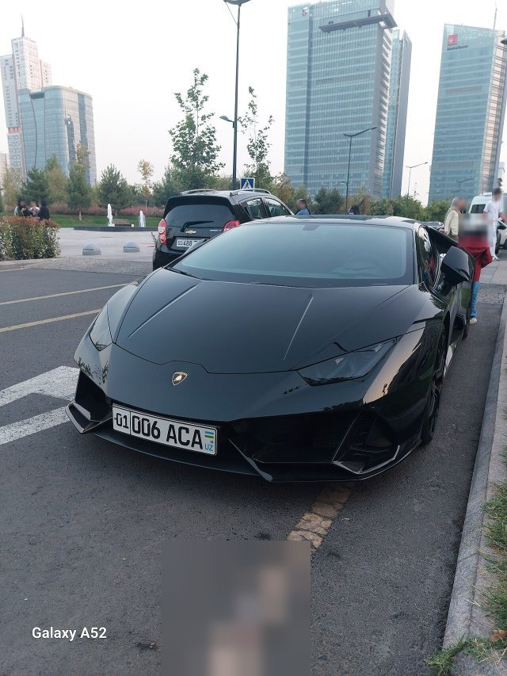
- **jury:jury_006** _uz_car_: Chevrolet Captiva at night, phone photo with motion blur; Uzbek plate partly legible: routed 'unknown' (expected street/closeup/gate); visible plate not read. Licence CC0, https://commons.wikimedia.org/wiki/File:Captiva_4.jpg
  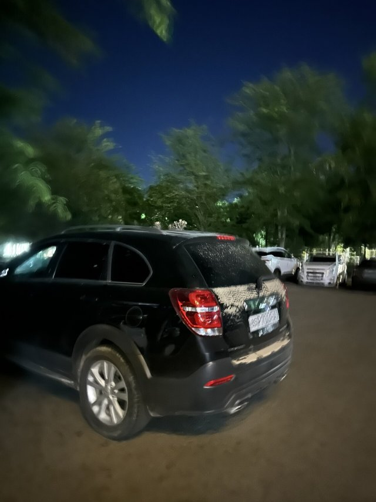
- **jury:jury_016** _tricky_: Soviet postage stamp (Tashkent): printed drawing with tiny cars: visit created without a vehicle. Licence Public domain, https://commons.wikimedia.org/wiki/File:1950_CPA_1486.jpg
  
- **jury:jury_017** _tricky_: dyno power chart with a small motorcycle picture: routed 'motorcycle' (expected unknown); visit created without a vehicle. Licence CC BY-SA 4.0, https://commons.wikimedia.org/wiki/File:Ducati-Monster-1200-S-Dyno-Curve.webp
  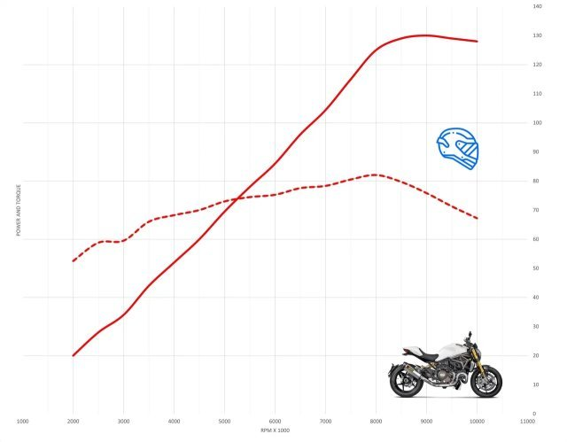
- **jury:jury_018** _tricky_: 1930s Ford advertisement: drawing of a car on a lift plus text: routed 'bay' (expected unknown). Licence Public domain, https://commons.wikimedia.org/wiki/File:1934-02_OBRAS_P13.jpg
  
- **jury:jury_019** _document_: scanned newspaper column (document): routed 'closeup' (expected unknown). Licence Public domain, https://commons.wikimedia.org/wiki/File:Stolen_Automobile_Kills_One_Child_in_The_Daily_Item_of_Port_Chester,_New_York_on_February_25,_1919.jpg
  
- **jury:jury_020** _tricky_: 1:18 scale model of a Ferrari 250 GTO on white (toy, not a vehicle): visit created without a vehicle. Licence CC BY-SA 2.0 de, https://commons.wikimedia.org/wiki/File:Ferrari_250_GTO,_CMC-Model_1-18_(vorn_links_2017-03-23).JPG
  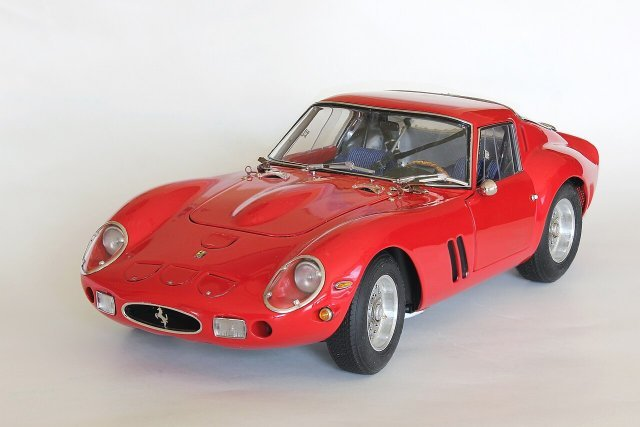
- **jury:jury_021** _tricky_: toy shop window with many small car models: visit created without a vehicle. Licence CC BY 4.0, https://commons.wikimedia.org/wiki/File:Shop_window_with_collection_of_toys,_dolls,_car_models_etc._in_Munich,_Germany_(2023).jpg
  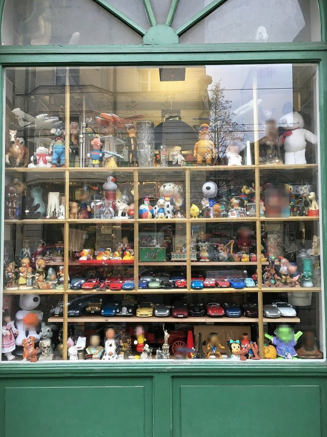
- **jury:jury_022** _tricky_: pen drawing of an early car on a postcard: routed 'closeup' (expected unknown). Licence Public domain, https://commons.wikimedia.org/wiki/File:Illustration_of_car_(NBY_5627).jpg
  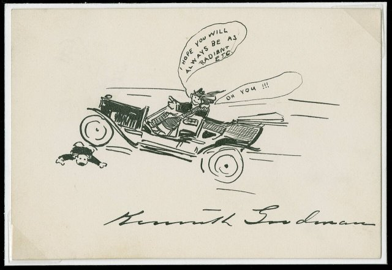
- **jury:jury_038** _parking_gate_: multi-storey car park interior with parked cars: routed 'unknown' (expected gate/street/bay). Licence CC BY-SA 4.0, https://commons.wikimedia.org/wiki/File:Interior_of_Rupert_Street_parking_garage_-_DSC_8057.jpg
  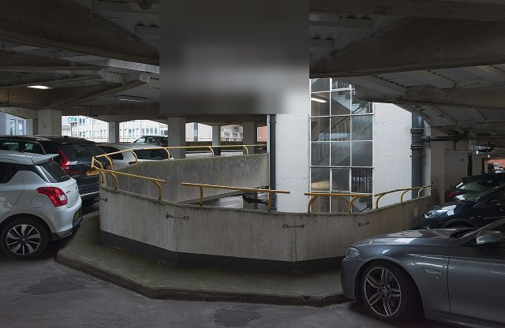
- **jury:jury_072** _night_rain_: foggy car park at night, lamps only, no vehicle visible: visit created without a vehicle. Licence CC BY-SA 4.0, https://commons.wikimedia.org/wiki/File:Foggy_night_at_the_parking_lot.jpg
  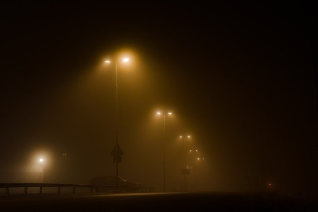
- **jury:jury_078** _non_car_: bicycle parked by a graffiti door (bicycle is not a vehicle class): routed 'motorcycle' (expected unknown/street). Licence CC BY-SA 4.0, https://commons.wikimedia.org/wiki/File:Parked_bicycle_with_graffitied_building_facade_and_doors_in_Amsterdam.jpg
  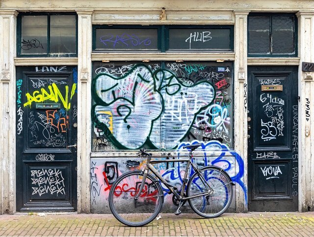
- **jury:jury_085** _video_: timelapse filmed from inside a car going through an automatic wash; no vehicle visible from outside: visit created without a vehicle. Licence CC BY-SA 4.0, https://commons.wikimedia.org/wiki/File:Timelapse-wasstraat_van_Slingelandtstraat.webm
  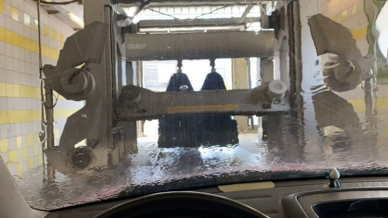
- **jury:jury_086** _video_frame_: frame at 8s of jury_085: timelapse filmed from inside a car going through an automatic wash; no vehicle visible from outside: visit created without a vehicle. Licence CC BY-SA 4.0, https://commons.wikimedia.org/wiki/File:Timelapse-wasstraat_van_Slingelandtstraat.webm
  
- **jury:jury_088** _video_frame_: frame at 25s of jury_087: supermarket car park behind a wall, low resolution (633 px): routed 'unknown' (expected gate/street). Licence CC BY-SA 4.0, https://commons.wikimedia.org/wiki/File:Estacionamiento_de_un_Supermercado_Ley,_Mazatl%C3%A1n,_11_de_junio_de_2022.webm
  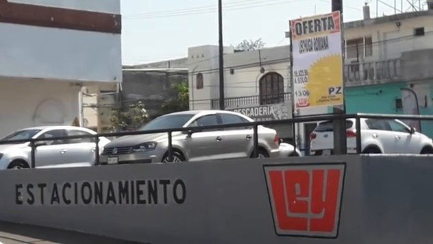
- **jury:jury_093** _video_: night traffic jam in heavy rain, Mymensingh: auto-rickshaws, dark: routed 'unknown' (expected street). Licence CC0, https://commons.wikimedia.org/wiki/File:%E0%A6%AE%E0%A6%AF%E0%A6%BC%E0%A6%AE%E0%A6%A8%E0%A6%B8%E0%A6%BF%E0%A6%82%E0%A6%B9%E0%A7%87%E0%A6%B0_%E0%A6%9C%E0%A7%8D%E0%A6%AF%E0%A6%BE%E0%A6%AE_%E0%A6%93_%E0%A6%AC%E0%A7%83%E0%A6%B7%E0%A7%8D%E0%A6%9F%E0%A6%BF.webm
  
- **jury:jury_094** _video_frame_: frame at 11s of jury_093: night traffic jam in heavy rain, Mymensingh: auto-rickshaws, dark: routed 'unknown' (expected street); no visit although a vehicle is present. Licence CC0, https://commons.wikimedia.org/wiki/File:%E0%A6%AE%E0%A6%AF%E0%A6%BC%E0%A6%AE%E0%A6%A8%E0%A6%B8%E0%A6%BF%E0%A6%82%E0%A6%B9%E0%A7%87%E0%A6%B0_%E0%A6%9C%E0%A7%8D%E0%A6%AF%E0%A6%BE%E0%A6%AE_%E0%A6%93_%E0%A6%AC%E0%A7%83%E0%A6%B7%E0%A7%8D%E0%A6%9F%E0%A6%BF.webm
  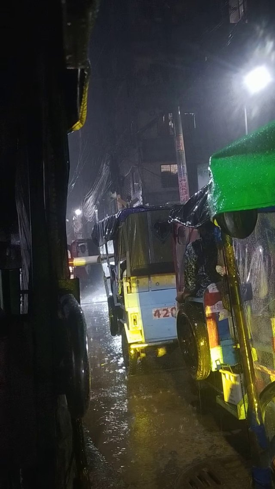

### e2e.synthetic

- **missed_car_floor_ep06_test_bay1_000207** _missed_car_floor_: ep06_test bay1 frame 207: ground truth car_present=True (raised=False); best in-zone vehicle confidence none. Renders are stylised Kenney models; the detector is COCO-pretrained RF-DETR (default pipeline).
  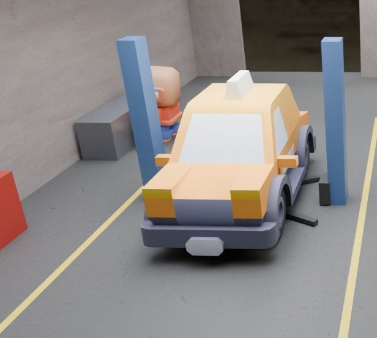
- **missed_car_floor_ep06_test_bay1_000270** _missed_car_floor_: ep06_test bay1 frame 270: ground truth car_present=True (raised=False); best in-zone vehicle confidence none. Renders are stylised Kenney models; the detector is COCO-pretrained RF-DETR (default pipeline).
  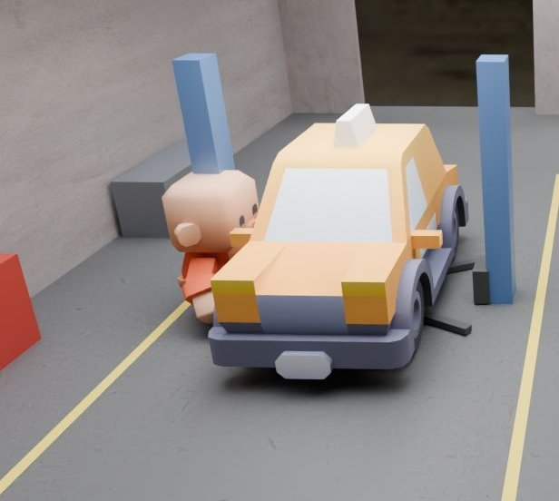
- **missed_car_floor_ep06_test_bay1_000625** _missed_car_floor_: ep06_test bay1 frame 625: ground truth car_present=True (raised=False); best in-zone vehicle confidence none. Renders are stylised Kenney models; the detector is COCO-pretrained RF-DETR (default pipeline).
  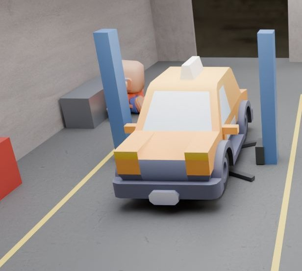
- **missed_car_lifted_ep08_test_bay1_000360** _missed_car_lifted_: ep08_test bay1 frame 360: ground truth car_present=True (raised=True); best in-zone vehicle confidence none. Renders are stylised Kenney models; the detector is COCO-pretrained RF-DETR (default pipeline).
  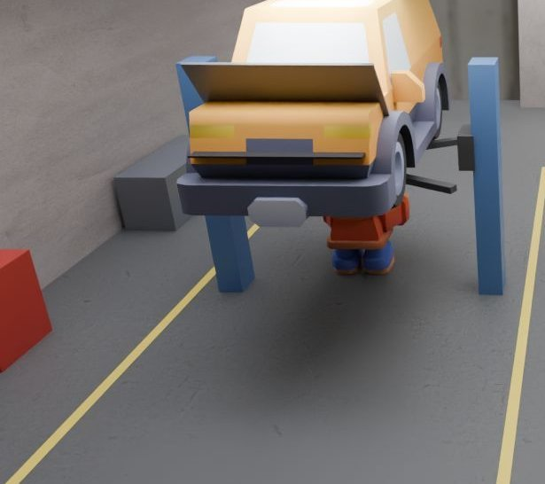
- **missed_car_lifted_ep08_test_bay2_000334** _missed_car_lifted_: ep08_test bay2 frame 334: ground truth car_present=True (raised=True); best in-zone vehicle confidence none. Renders are stylised Kenney models; the detector is COCO-pretrained RF-DETR (default pipeline).
  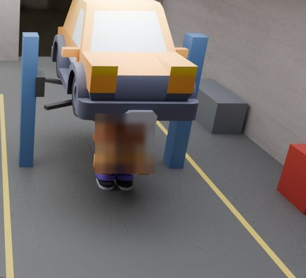
- **missed_car_lifted_ep09_test_bay2_000791** _missed_car_lifted_: ep09_test bay2 frame 791: ground truth car_present=True (raised=True); best in-zone vehicle confidence none. Renders are stylised Kenney models; the detector is COCO-pretrained RF-DETR (default pipeline).
  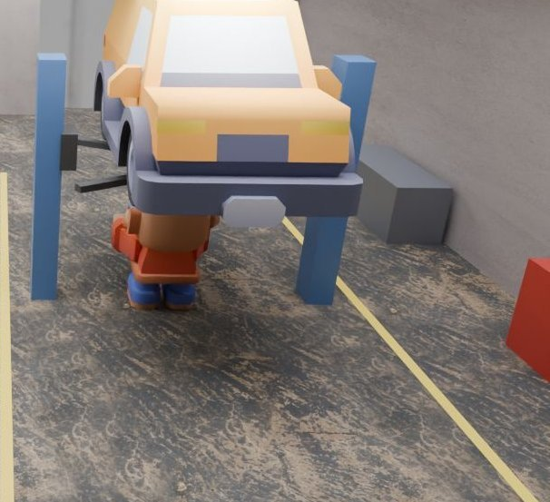

### flow.det.detrac_test_s5.rfdetr-large.cloudy

- **flow_det_detrac_test_s5_cloudy_0** _cloudy misses_: rfdetr-large on MVI_40855 (cloudy): 17 of 36 GT vehicles missed at IoU 0.5 / score >= 0.4, 0 false positives. Red = missed GT, cyan = detected GT, yellow = false positive, grey = ignored region.
  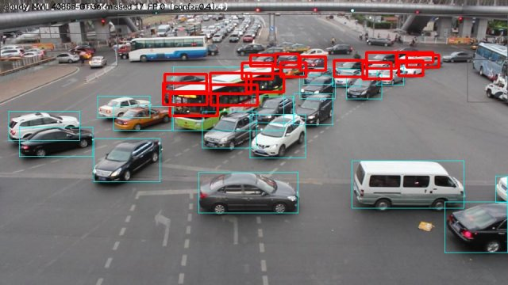
- **flow_det_detrac_test_s5_cloudy_1** _cloudy misses_: rfdetr-large on MVI_40714 (cloudy): 14 of 40 GT vehicles missed at IoU 0.5 / score >= 0.4, 3 false positives. Red = missed GT, cyan = detected GT, yellow = false positive, grey = ignored region.
  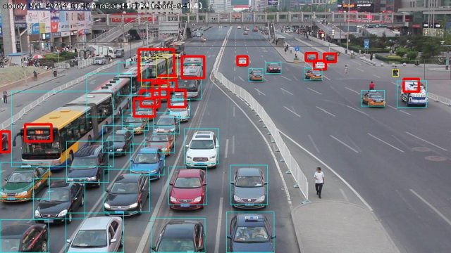
- **flow_det_detrac_test_s5_cloudy_2** _cloudy misses_: rfdetr-large on MVI_39501 (cloudy): 9 of 12 GT vehicles missed at IoU 0.5 / score >= 0.4, 0 false positives. Red = missed GT, cyan = detected GT, yellow = false positive, grey = ignored region.
  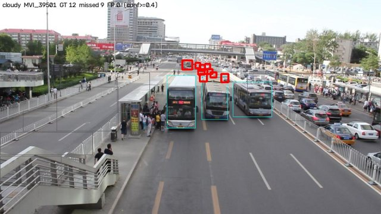

### flow.det.detrac_test_s5.rfdetr-large.night

- **flow_det_detrac_test_s5_night_0** _night misses_: rfdetr-large on MVI_40761 (night): 9 of 10 GT vehicles missed at IoU 0.5 / score >= 0.4, 1 false positives. Red = missed GT, cyan = detected GT, yellow = false positive, grey = ignored region.
  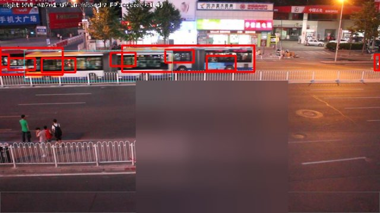
- **flow_det_detrac_test_s5_night_1** _night misses_: rfdetr-large on MVI_40772 (night): 9 of 27 GT vehicles missed at IoU 0.5 / score >= 0.4, 0 false positives. Red = missed GT, cyan = detected GT, yellow = false positive, grey = ignored region.
  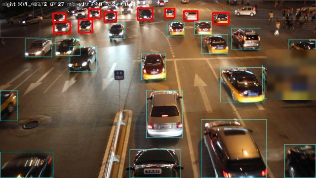
- **flow_det_detrac_test_s5_night_2** _night misses_: rfdetr-large on MVI_40775 (night): 6 of 20 GT vehicles missed at IoU 0.5 / score >= 0.4, 0 false positives. Red = missed GT, cyan = detected GT, yellow = false positive, grey = ignored region.
  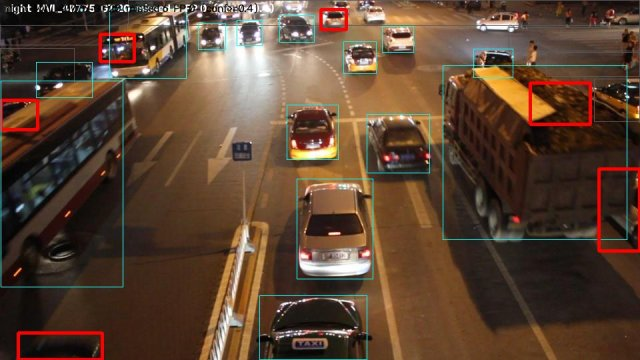

### flow.det.detrac_test_s5.rfdetr-large.rainy

- **flow_det_detrac_test_s5_rainy_0** _rainy misses_: rfdetr-large on MVI_40864 (rainy): 15 of 35 GT vehicles missed at IoU 0.5 / score >= 0.4, 1 false positives. Red = missed GT, cyan = detected GT, yellow = false positive, grey = ignored region.
  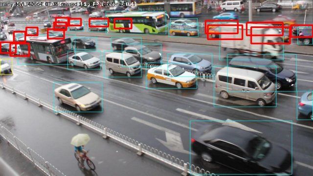
- **flow_det_detrac_test_s5_rainy_1** _rainy misses_: rfdetr-large on MVI_40903 (rainy): 14 of 29 GT vehicles missed at IoU 0.5 / score >= 0.4, 3 false positives. Red = missed GT, cyan = detected GT, yellow = false positive, grey = ignored region.
  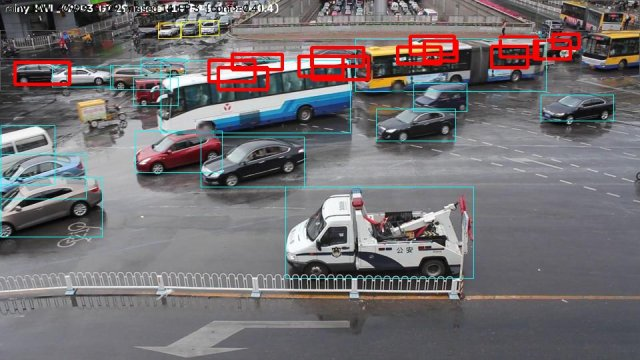
- **flow_det_detrac_test_s5_rainy_2** _rainy misses_: rfdetr-large on MVI_40892 (rainy): 13 of 20 GT vehicles missed at IoU 0.5 / score >= 0.4, 1 false positives. Red = missed GT, cyan = detected GT, yellow = false positive, grey = ignored region.
  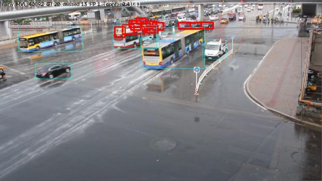

### flow.det.detrac_test_s5.rfdetr-large.sunny

- **flow_det_detrac_test_s5_sunny_0** _sunny misses_: rfdetr-large on MVI_39031 (sunny): 9 of 12 GT vehicles missed at IoU 0.5 / score >= 0.4, 0 false positives. Red = missed GT, cyan = detected GT, yellow = false positive, grey = ignored region.
  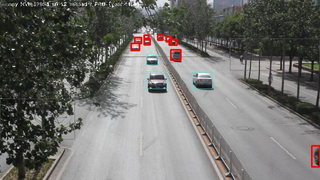
- **flow_det_detrac_test_s5_sunny_1** _sunny misses_: rfdetr-large on MVI_39311 (sunny): 8 of 18 GT vehicles missed at IoU 0.5 / score >= 0.4, 3 false positives. Red = missed GT, cyan = detected GT, yellow = false positive, grey = ignored region.
  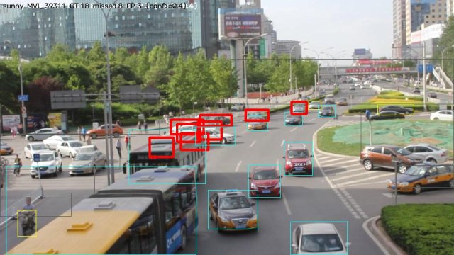
- **flow_det_detrac_test_s5_sunny_2** _sunny misses_: rfdetr-large on MVI_39361 (sunny): 6 of 13 GT vehicles missed at IoU 0.5 / score >= 0.4, 0 false positives. Red = missed GT, cyan = detected GT, yellow = false positive, grey = ignored region.
  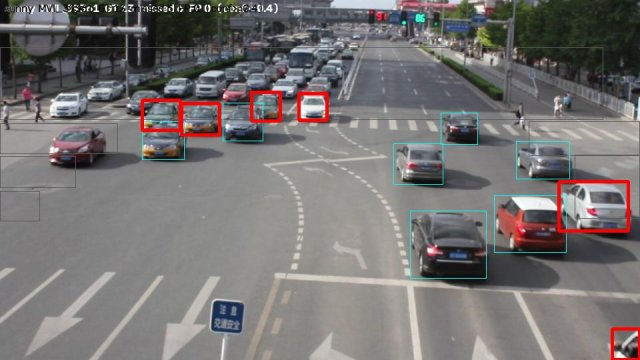

### flow.occ.cnrext.rfdetr-large+tile.rainy

- **flow_occ_cnrext_rainy_0_rfdetr-large+tile** _occupancy: after tiling_: rfdetr-large+tile on cnrext:rainy/2016-02-12/cam7/2016-02-12_1025.jpg: 1 of 46 slots wrong (conf>=0.05, overlap>=0.4). Red = occupied slot predicted vacant, yellow = vacant predicted occupied, green = correct occupied, blue = correct vacant.
  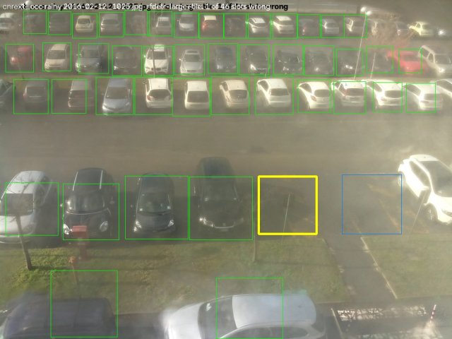
- **flow_occ_cnrext_rainy_1_rfdetr-large+tile** _occupancy: after tiling_: rfdetr-large+tile on cnrext:rainy/2015-12-22/cam1/2015-12-22_1618.jpg: 9 of 35 slots wrong (conf>=0.05, overlap>=0.4). Red = occupied slot predicted vacant, yellow = vacant predicted occupied, green = correct occupied, blue = correct vacant.
  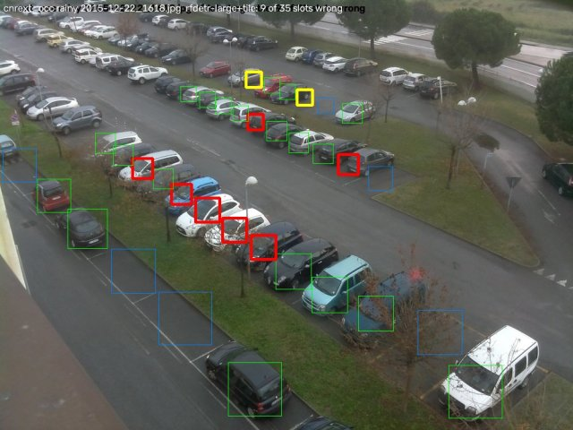

### flow.occ.cnrext.rfdetr-large.rainy

- **flow_occ_cnrext_rainy_0_rfdetr-large** _occupancy: small cars missed without tiling_: rfdetr-large on cnrext:rainy/2016-02-12/cam7/2016-02-12_1025.jpg: 10 of 46 slots wrong (conf>=0.2, overlap>=0.4). Red = occupied slot predicted vacant, yellow = vacant predicted occupied, green = correct occupied, blue = correct vacant.
  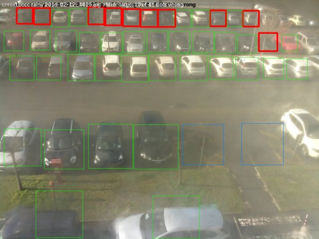
- **flow_occ_cnrext_rainy_1_rfdetr-large** _occupancy: small cars missed without tiling_: rfdetr-large on cnrext:rainy/2015-12-22/cam1/2015-12-22_1618.jpg: 10 of 35 slots wrong (conf>=0.2, overlap>=0.4). Red = occupied slot predicted vacant, yellow = vacant predicted occupied, green = correct occupied, blue = correct vacant.
  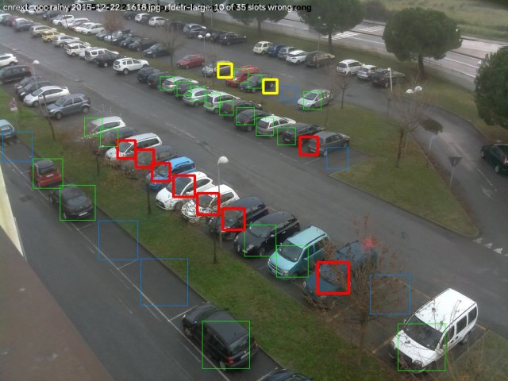

### flow.occ.pklot.rfdetr-large+tile.rainy

- **flow_occ_pklot_rainy_0_rfdetr-large+tile** _occupancy: after tiling_: rfdetr-large+tile on pklot:PUCPR/rainy/2012-10-25_08_58_20.jpg: 1 of 100 slots wrong (conf>=0.1, overlap>=0.3). Red = occupied slot predicted vacant, yellow = vacant predicted occupied, green = correct occupied, blue = correct vacant.
  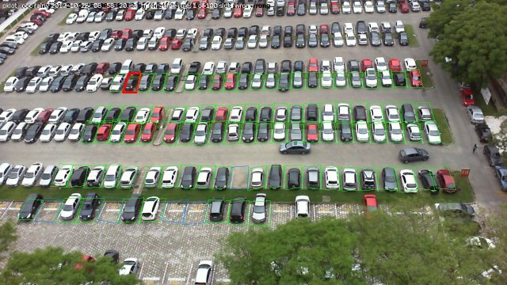
- **flow_occ_pklot_rainy_1_rfdetr-large+tile** _occupancy: after tiling_: rfdetr-large+tile on pklot:PUCPR/rainy/2012-10-25_09_23_22.jpg: 0 of 100 slots wrong (conf>=0.1, overlap>=0.3). Red = occupied slot predicted vacant, yellow = vacant predicted occupied, green = correct occupied, blue = correct vacant.
  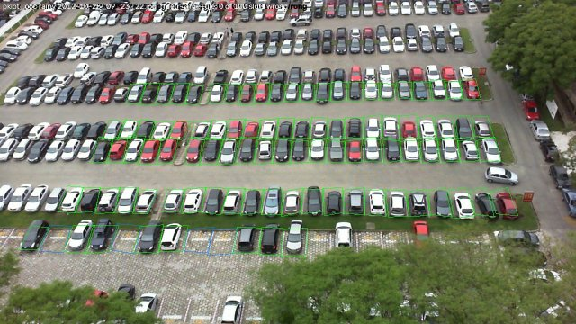

### flow.occ.pklot.rfdetr-large+tile.sunny

- **flow_occ_pklot_sunny_0_rfdetr-large+tile** _occupancy: after tiling_: rfdetr-large+tile on pklot:PUCPR/sunny/2012-09-19_10_03_27.jpg: 0 of 100 slots wrong (conf>=0.1, overlap>=0.3). Red = occupied slot predicted vacant, yellow = vacant predicted occupied, green = correct occupied, blue = correct vacant.
  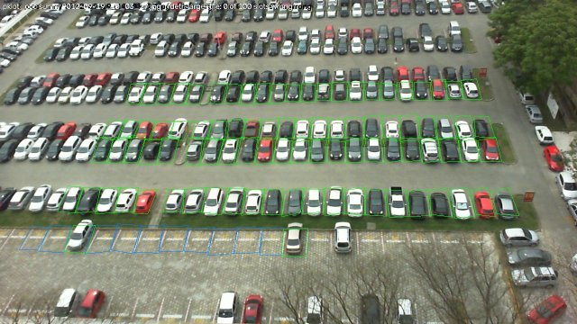
- **flow_occ_pklot_sunny_1_rfdetr-large+tile** _occupancy: after tiling_: rfdetr-large+tile on pklot:PUCPR/sunny/2012-09-19_07_55_52.jpg: 0 of 100 slots wrong (conf>=0.1, overlap>=0.3). Red = occupied slot predicted vacant, yellow = vacant predicted occupied, green = correct occupied, blue = correct vacant.
  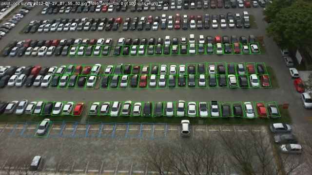

### flow.occ.pklot.rfdetr-large.rainy

- **flow_occ_pklot_rainy_0_rfdetr-large** _occupancy: small cars missed without tiling_: rfdetr-large on pklot:PUCPR/rainy/2012-10-25_08_58_20.jpg: 74 of 100 slots wrong (conf>=0.2, overlap>=0.15). Red = occupied slot predicted vacant, yellow = vacant predicted occupied, green = correct occupied, blue = correct vacant.
  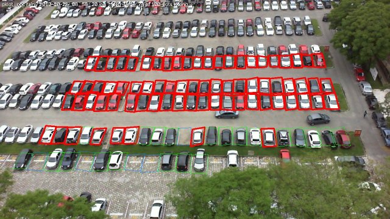
- **flow_occ_pklot_rainy_1_rfdetr-large** _occupancy: small cars missed without tiling_: rfdetr-large on pklot:PUCPR/rainy/2012-10-25_09_23_22.jpg: 74 of 100 slots wrong (conf>=0.2, overlap>=0.15). Red = occupied slot predicted vacant, yellow = vacant predicted occupied, green = correct occupied, blue = correct vacant.
  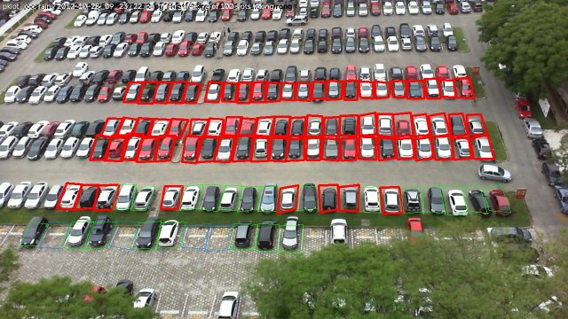

### flow.occ.pklot.rfdetr-large.sunny

- **flow_occ_pklot_sunny_0_rfdetr-large** _occupancy: small cars missed without tiling_: rfdetr-large on pklot:PUCPR/sunny/2012-09-19_10_03_27.jpg: 63 of 100 slots wrong (conf>=0.2, overlap>=0.15). Red = occupied slot predicted vacant, yellow = vacant predicted occupied, green = correct occupied, blue = correct vacant.
  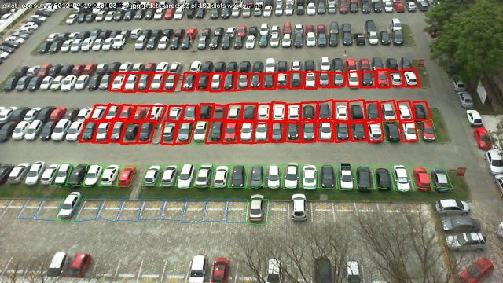
- **flow_occ_pklot_sunny_1_rfdetr-large** _occupancy: small cars missed without tiling_: rfdetr-large on pklot:PUCPR/sunny/2012-09-19_07_55_52.jpg: 59 of 100 slots wrong (conf>=0.2, overlap>=0.15). Red = occupied slot predicted vacant, yellow = vacant predicted occupied, green = correct occupied, blue = correct vacant.
  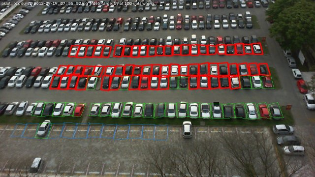

### ident.e2e

- **uz_rf:valid/AAE0181237_car-front_2025-12-21_21-55-33_jpg.rf.55aad8eb8bfc7b82364cf3e765b162ca.jpg** _misread text_: verified label 40J035QA vs prediction '40D035QA' (plate pixelated here on purpose)
  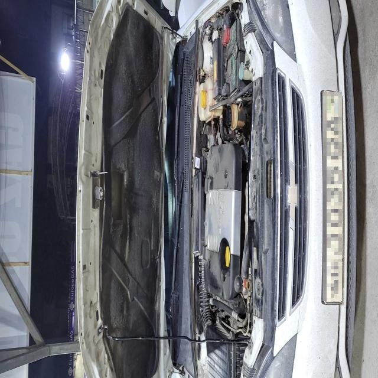
- **uz_rf:valid/AAF2341946_car-front_2025-12-20_14-55-29_jpg.rf.7f633792725a308755a5da668b8ad3ed.jpg** _misread text_: verified label 60V039JA vs prediction '60U039JA' (plate pixelated here on purpose)
  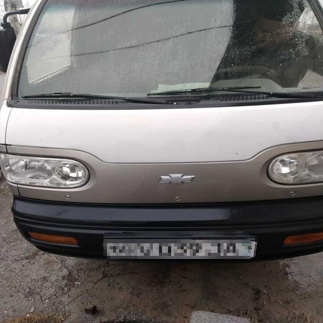
- **uz_rf:valid/AAF3062913_car-front_2025-12-03_16-44-38_jpg.rf.a022de974f71c1467fbfcec03f58e977.jpg** _misread text_: verified label 90R430NA vs prediction '90K430NA' (plate pixelated here on purpose)
  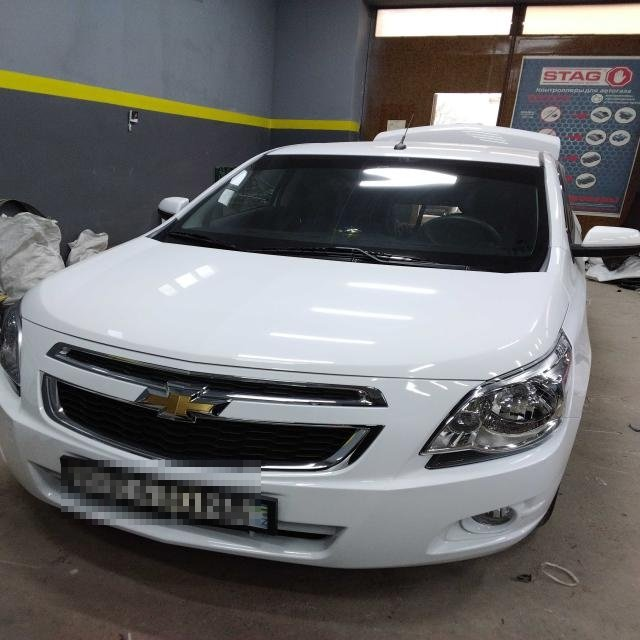
- **uz_rf:valid/AAF4207854_car-rear_2025-12-22_18-29-46_jpg.rf.b5d940e4f2ac8c5f233bddeb0637c19f.jpg** _misread text_: verified label 40X789FA vs prediction '40X769FA' (plate pixelated here on purpose)
  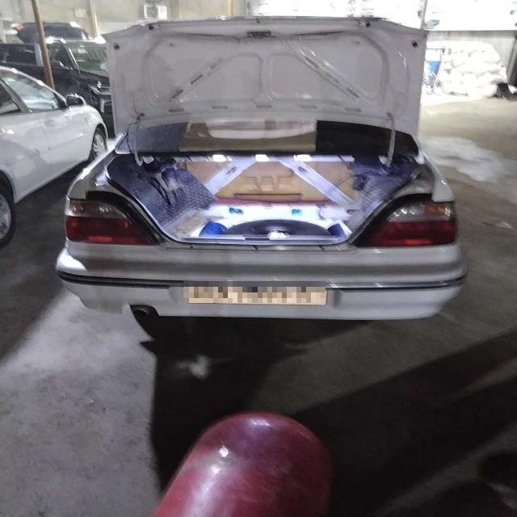

### inspect

- **inspect:dmg_B_syndcar_false_positive_02**: dmg B syndcar false positive 02
  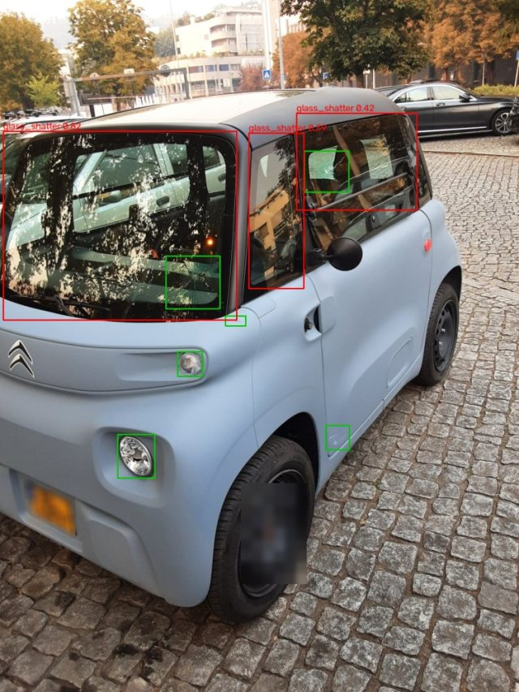
- **inspect:dmg_B_syndcar_missed_damage_00**: dmg B syndcar missed damage 00
  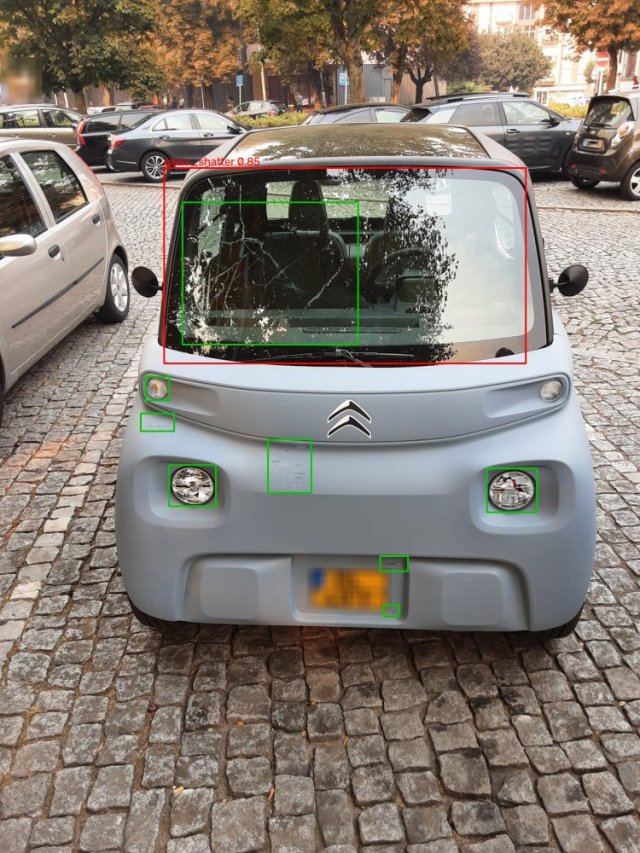
- **inspect:dmg_B_syndcar_wrong_class_04**: dmg B syndcar wrong class 04
  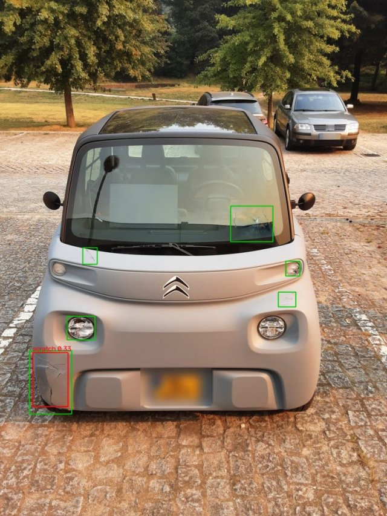
- **inspect:dot_date_code_wrong_00**: dot date code wrong 00
  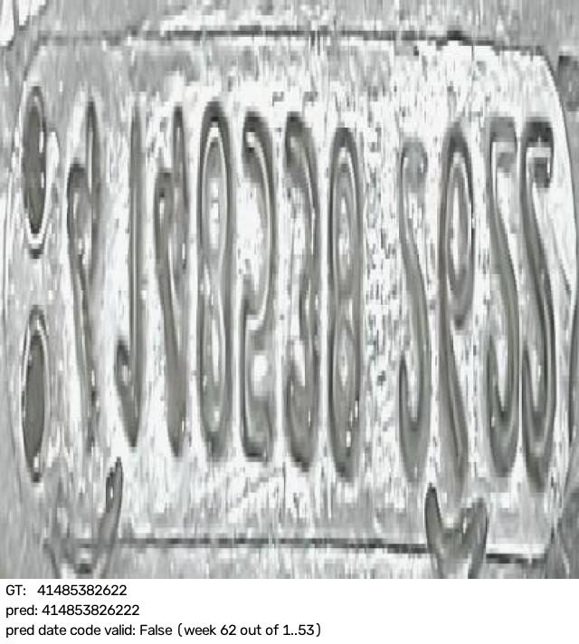
- **inspect:dot_date_code_wrong_02**: dot date code wrong 02
  
- **inspect:dot_string_wrong_00**: dot string wrong 00
  
- **inspect:dot_string_wrong_01**: dot string wrong 01
  
- **inspect:dot_string_wrong_02**: dot string wrong 02
  
- **inspect:tyre_sameer_defective_predicted_good_00**: tyre sameer defective predicted good 00
  
- **inspect:tyre_sameer_good_predicted_defective_00**: tyre sameer good predicted defective 00
  
- **inspect:tyre_warcoder_defective_predicted_good_00**: tyre warcoder defective predicted good 00
  
- **inspect:tyre_warcoder_good_predicted_defective_00**: tyre warcoder good predicted defective 00
  

### ops/car_present

- **ops_car_present_-OJPETY9Bis_035\|A** _false alarm_: car_present: hand label 0, predicted p=0.84 (false alarm); clip -OJPETY9Bis, bay A
  
- **ops_car_present_JIEX2ruxZKM_044\|A** _false alarm_: car_present: hand label 0, predicted p=0.93 (false alarm); clip JIEX2ruxZKM, bay A
  

### ops/hood_open

- **ops_hood_open_2mhugD9KYjI_009\|A** _missed_: hood_open: hand label 1, predicted p=0.23 (missed); clip 2mhugD9KYjI, bay A
  
- **ops_hood_open_JIEX2ruxZKM_002\|B** _missed_: hood_open: hand label 1, predicted p=0.11 (missed); clip JIEX2ruxZKM, bay B
  

### ops/person_at_car

- **ops_person_at_car_JIEX2ruxZKM_020\|B** _false alarm_: person_at_car: hand label 0, predicted p=0.97 (false alarm); clip JIEX2ruxZKM, bay B
  
- **ops_person_at_car_e4O3X9gli1s_024\|A** _false alarm_: person_at_car: hand label 0, predicted p=0.96 (false alarm); clip e4O3X9gli1s, bay A
  

### ops/person_under_car

- **ops_person_under_car_-OJPETY9Bis_055\|A** _missed_: person_under_car: hand label 1, predicted p=0.03 (missed); clip -OJPETY9Bis, bay A
  
- **ops_person_under_car_2mhugD9KYjI_037\|A** _missed_: person_under_car: hand label 1, predicted p=0.02 (missed); clip 2mhugD9KYjI, bay A
  

### ops/raised

- **ops_raised_2mhugD9KYjI_018\|B** _false alarm_: raised: hand label 0, predicted p=0.96 (false alarm); clip 2mhugD9KYjI, bay B
  
- **ops_raised_JIEX2ruxZKM_042\|B** _false alarm_: raised: hand label 0, predicted p=0.88 (false alarm); clip JIEX2ruxZKM, bay B
  

### ops/wheel_off

- **ops_wheel_off_BZsVY9FUUOo_024\|A** _missed_: wheel_off: hand label 1, predicted p=0.12 (missed); clip BZsVY9FUUOo, bay A
  
- **ops_wheel_off_e4O3X9gli1s_043\|A** _missed_: wheel_off: hand label 1, predicted p=0.18 (missed); clip e4O3X9gli1s, bay A
  

### ops/work

- **ops_work_BZsVY9FUUOo_036\|A** _missed_: work: hand label 1, predicted p=0.22 (missed); clip BZsVY9FUUOo, bay A
  
- **ops_work_wWSNERw5oME_050\|align** _missed_: work: hand label 1, predicted p=0.16 (missed); clip wWSNERw5oME, bay align
  

### router.so400m.blend

- **flow_router_00** _router: street -> unknown_: held-out source coco_street (coco_val2017): true scene 'street', router answered 'unknown' with p=0.99. Faces blurred with seen.blur.
  
- **flow_router_01** _router: street -> unknown_: held-out source coco_street (coco_val2017): true scene 'street', router answered 'unknown' with p=0.98. Faces blurred with seen.blur.
  
- **flow_router_02** _router: closeup -> unknown_: held-out source commons_engines (wikimedia_commons): true scene 'closeup', router answered 'unknown' with p=0.52. Faces blurred with seen.blur.
  
- **flow_router_03** _router: closeup -> unknown_: held-out source commons_wheels (wikimedia_commons): true scene 'closeup', router answered 'unknown' with p=0.52. Faces blurred with seen.blur.
  
- **flow_router_04** _router: wash -> bay_: held-out source rf_washing_car (roboflow:um-84bee/washing-car (via ops lane)): true scene 'wash', router answered 'bay' with p=0.91. Faces blurred with seen.blur.
  
- **flow_router_05** _router: wash -> bay_: held-out source rf_washing_car (roboflow:um-84bee/washing-car (via ops lane)): true scene 'wash', router answered 'bay' with p=0.91. Faces blurred with seen.blur.
  
- **flow_router_06** _router: wash -> unknown_: held-out source rf_washing_car (roboflow:um-84bee/washing-car (via ops lane)): true scene 'wash', router answered 'unknown' with p=0.52. Faces blurred with seen.blur.
  
- **flow_router_07** _router: wash -> unknown_: held-out source rf_washing_car (roboflow:um-84bee/washing-car (via ops lane)): true scene 'wash', router answered 'unknown' with p=0.51. Faces blurred with seen.blur.
  
- **flow_router_08** _router: street -> motorcycle_: held-out source coco_street (coco_val2017): true scene 'street', router answered 'motorcycle' with p=0.72. Faces blurred with seen.blur.
  
- **flow_router_09** _router: street -> motorcycle_: held-out source coco_street (coco_val2017): true scene 'street', router answered 'motorcycle' with p=0.61. Faces blurred with seen.blur.
  

### sim.noise_test.hmm_fitted

- **decoder_low_accuracy_acc70_sim2000_0000** _decoder_low_frame_accuracy_: Synthetic visit sim2000_0000 at 70% per-frame accuracy (~10 s errors): onsets drift by tens of seconds and short work/idle structure is lost; key-event F1 at +-10 s is 0.36 at this setting.
  
- **decoder_sustained_errors_60s_acc80_sim2000_0002** _decoder_sustained_errors_: Synthetic visit sim2000_0002, simulated per-frame accuracy 80% with errors lasting ~60 s: the HMM cannot tell a minute-long wrong prediction from a real state change, so spurious or merged lift/bonnet/idle segments appear. Grid result: key-event F1 0.38 at this setting (vs 0.66 with ~10 s errors).
  

## 7. Datasets and licences

Several datasets are non-commercial or research-only: fine for this prototype, a paid pilot needs re-licensing or own pilot data. Public datasets contain real faces and plates; no identifiable face is shown in this report.

| lane | dataset (as reported) | kind |
|---|---|---|
| e2e | Seen jury set v1 (96 inputs, Wikimedia Commons CC/PD) | real |
| e2e | bay_v1: 14 bay clips | synthetic |
| e2e | renders/bay_v1: 25 sampled frames each of ep00_train, ep02_train, ep06_test, ep08_test | synthetic |
| flow | NDISPark | real |
| flow | NDISPark (train 112 + validation 30 images, all day) | real |
| flow | UA-DETRAC test | real |
| flow | WIDER FACE val | real |
| flow | cnrext | real |
| flow | cocoval_person | real |
| flow | detrac_test_s5 | real |
| flow | pklot | real |
| ident | AUTO.RIA OCR KG | real |
| ident | AUTO.RIA OCR KZ | real |
| ident | AUTO.RIA OCR RU | real |
| ident | CCPD2019 ccpd_challenge | real |
| ident | CCPD2019 ccpd_db | real |
| ident | CCPD2019 ccpd_weather | real |
| ident | Roboflow Uzbek_Plates valid originals | real |
| ident | Roboflow Uzbek_Plates valid originals + synthetic degradation | synthetic |
| ident | RodoSol-ALPR (cars only, Kaggle mirror) | real |
| ident | synthetic UZ (ours) | synthetic |
| ident | synthetic UZ tracks (ours) | synthetic |
| inspect | CarDD (HF FiftyOne mirror) | real |
| inspect | HF kadireks/cardamagepanel-originals (licence: other) | real |
| inspect | Humans in the Loop Car Damages (CC0) | real |
| inspect | Humans in the Loop Car Parts (CC0) | real |
| inspect | Kaggle lplenka/coco-car-damage-detection-dataset (CC0) | real |
| inspect | Kaggle maxfinkenbeiner/tyrecv-two-views-are-all-you-need (MIT label) | real |
| inspect | Kaggle sameersambhare1/tyre-condition-classification-dataset (CC BY-SA 4.0) | real |
| inspect | Kaggle sameersambhare1/tyre-condition-classification-dataset (CC BY-SA 4.0) + TyreNet good/defective in training (CC BY 4.0) | real |
| inspect | Kaggle warcoder tyre-quality (CC BY 4.0), TyreNet near-duplicates removed | real |
| inspect | Kaggle warcoder/tyre-quality-classification (CC BY 4.0) | real |
| inspect | Mendeley TyreNet (CC BY 4.0) | real |
| inspect | Roboflow Universe jijo/car-damage-new v2 (CC BY label, provenance unknown) | real |
| inspect | Roboflow Universe tyreai/ocr-yphpv v3 (CC BY label) | real |
| inspect | Roboflow subhams-workspace-l47ut/dot-code-6shg0 (CC BY label) | real |
| inspect | SYNDCAR (Mendeley hzpj48krdt, CC BY 4.0) | real |
| inspect | SYNDCAR (Mendeley hzpj48krdt, CC BY 4.0) | synthetic |
| inspect | TyreNet held-out 20 % (in-source) | real |
| inspect | Ultralytics carparts-seg (CC BY 4.0) | real |
| inspect | VehiDE (Kaggle copy of official release) | real |
| ops | 6 public YouTube clips, hand-labelled bay ROIs | real |
| ops | 96 hand-labelled frames from K700 val + CrossTask/COIN test videos | real |
| ops | coin | real |
| ops | crosstask | real |
| ops | crosstask+coin | real |
| ops | k700 | real |
| ops | ops CCTV real-domain set (6 clips) | real |
| ops | rf_car_condition | real |
| ops | rf_car_hood_open | real |
| ops | rf_car_open_hood | real |
| router | Lane G jury set (Wikimedia Commons) | real |
| router | Seen jury set v1 (96 inputs, Wikimedia Commons CC/PD) | real |
| router | router set (public sources) | real |
| sim | sim.scenario MISMATCH config (durations x1.6, pauses x1.9, absences x2, uniform job mix), 120 visits | synthetic |
| sim | sim.scenario v0.1.0 default config, 120 visits | synthetic |

**app** (`docs/lanes/app_sources.md`):

| name | licence | used for |
|---|---|---|
| Uzbek_Plates v1, image `AAF0119214_car-front_…` (Damas van, front) | CC BY 4.0 (dataset README on the box: `data/raw/ident_uz/roboflow_uzbek_plates/README.dataset.txt`) | demo input "Car with an Uzbek plate"; recorded backup run |
| "Chery A1 - service shop in Ukraine (7)", ANT Berezhnyi | CC BY 3.0 (from `data/raw/ops_commons/meta.csv`) | demo input "Service bay: car on a lift" |
| "Classic Mustang at Garage, West Miami Florida August 2024", Phillip Pessar | CC BY 2.0 (from `data/raw/ops_commons/meta.csv`) | demo input "Garage bay, car raised" |
| UA-DETRAC test sequence MVI_39051, frames 1–300, re-encoded to a 12 s H.264 mp4 (25 fps, 960×540) | CC BY-NC-SA 3.0 | demo video for the in-browser sampler; recorded backup run |
| `flower.jpg` from scikit-learn sample images (vultilion on Flickr) | CC BY 2.0 (scikit-learn `datasets/images/README.txt`) | demo "not a car" input (unknown path) |
| RF-DETR Base (COCO), `rf-detr-base.pth` | Apache-2.0 | vehicle + person detection in the served pipeline |
| fast-alpr default plate detector `yolo-v9-t-384-license-plates-end2end` (open-image-models) | MIT (repo) | plate detection in the served pipeline |
| fast-plate-ocr `cct-xs-v2-global-model` | MIT (repo) | plate OCR in the served pipeline (not Uzbek-tuned) |

**eval** (`docs/lanes/eval_sources.md`):

| name | licence | used for |
|---|---|---|
| Seen jury set v1 (96 inputs: 82 photos, 7 videos, 7 frames cut from those videos) | per file, recorded in `eval/jury/jury.jsonl`: CC BY 2.0/3.0/4.0, CC BY-SA 2.0/3.0/4.0, CC0, public domain | test only (jury-style end-to-end test); held out in `eval/manifests/jury.jsonl` |
| RF-DETR base, COCO-pretrained (via `seen.baseline`, rfdetr 1.11.2) | Apache-2.0 (code and weights, per repo) | speed benchmark (PyTorch, ONNX Runtime, TensorRT); baseline pipeline under test |
| fast-alpr 0.4.0: `yolo-v9-t-384-license-plate-end2end` detector + `cct-xs-v2-global-model` OCR | library MIT; model weights: licence not stated on the hub page (not checked) | speed benchmark; baseline pipeline under test |
| OpenCV YuNet face detector `face_detection_yunet_2023mar.onnx` | MIT | extra face blur on every failure-gallery image |
| OpenCV Haar cascades (frontal, profile), bundled with opencv-python | Intel open-source licence (BSD-style), per the XML headers | extra face blur on every failure-gallery image |
| NVIDIA TensorRT 10.15 libraries (`tensorrt_cu13_libs` wheel, only libnvinfer/plugin/onnxparser + sm120/ptx builder resources kept, on the NVMe at `seen_fast/eval/trt` (1.2 GB)) | NVIDIA TensorRT licence (proprietary, redistribution restricted) | speed table only (ONNX Runtime TensorRT EP, FP16) |

**flow** (`docs/lanes/flow_sources.md`):

| name | licence | used for |
|---|---|---|
| UA-DETRAC (HF reformat `abhineet123/ua_detrac`, frames + boxes) | Original licence **not found** (official site is down). The uploader tagged the HF repo `cc-by-4.0`, which does not override the original terms. Treat as **evaluation / research only**. | test (40 official test sequences: detection AP per weather, tracking), train (60 sequences, fine-tuning) |
| UA-DETRAC original XML annotations (weather label per sequence, vehicle type, ignored regions, speed) | the uploader's note says CC-BY-NC-SA and that it is a private mirror; original licence not found | weather labels (`sence_weather`), vehicle types for fine-tuning classes, ignored regions, speeds |
| NDISPark | ODC-By 1.0 (record + COCO json) | day (train split, 112 images) vs night (validation split, 30 images with boxes; test split 117 images with vehicle counts only); fine-tune on day split |
| PKLot | CC BY 4.0 | slot occupancy test and threshold calibration (PUCPR, UFPR04, UFPR05; sunny/cloudy/rainy), frames for router "street" |
| CNRPark+EXT (CNR-EXT full frames, slot boxes, labels) | ODbL 1.0 (project page) | slot occupancy cross-dataset test and calibration (sunny/overcast/rainy), router "street" frames |
| MIO-TCD localization | CC BY-NC-SA 4.0 | **cut**: download (3.7 GB) was too slow on the shared drive and stopped at 1.6 GB, see notes |
| COCO val2017 | annotations CC BY 4.0; images are Flickr photos with mixed CC licences | person-AP regression check (zero-shot vs fine-tuned), router "street"/"motorcycle"/"unknown" images (never used to train a detector) |
| WIDER FACE (val, via HF `CUHK-CSE/wider_face`) | non-commercial research (HF card: cc-by-nc-nd-4.0) | face-blur recall (test only) |
| Wikimedia Commons categories (repair shops, lifts, tyre shops, garages, car washes, boom barriers, car-park entrances, gatehouses, checkpoints, Ducati, scooters, car hoods/wheels/engines, a few non-car searches) | per file: CC BY / CC BY-SA / CC0 / public domain etc. The exact licence, author and page URL of every image are in `data/prep/flow/router/manifest.jsonl` | router training + held-out evaluation |
| Stanford Cars (HF `tanganke/stanford_cars`) | Stanford Cars: research use, no explicit licence on the mirror | router "closeup" (whole-car photos) |
| RF-DETR Nano/Small/Medium/Base/Large (COCO) | Apache-2.0 for these sizes (the XLarge/2XLarge sizes are under a separate licence and are not used) | vehicle + person detector (zero-shot and fine-tuned) |
| Ultralytics YOLO11x, YOLO26x (COCO) | AGPL-3.0 | zero-shot comparison only, not shipped |
| SigLIP2 so400m-patch14-384, base-patch16-384 | Apache-2.0 | scene router (zero-shot + linear probe on frozen embeddings) |
| YuNet `face_detection_yunet_2023mar.onnx` | MIT | face blur |
| OC-SORT (algorithm: Cao et al., CVPR 2023) | MIT; `lanes/flow/tracker.py` is our own re-implementation | tracker |
| ByteTrack (via `supervision`) | MIT | tracker baseline |

**ident** (`docs/lanes/ident_sources.md`):

| name | licence | used for |
|---|---|---|
| AUTO.RIA OCR crops: Kazakhstan `autoriaNumberplateOcrKz-2022-11-29` (9,922 crops), Kyrgyzstan `...Kg-2022-11-30` (31,917), Russia `...Ru-2021-09-01` (57,120) | **not stated** on the dataset page or in the zips (code repo is GPL-3.0) | OCR train + val (train/val splits of each zip), OCR test (native `test` split of each zip: KZ 279, KG 1,068, RU 2,845) |
| AUTO.RIA OCR SU `...Su-2023-03-10` | not stated | downloaded, **not used** (labels are mostly Cyrillic; deleted) |
| Roboflow Universe **Uzbek_Plates** (`suxrobs-workspace/uzbek_plates`, version 1) | CC BY 4.0 (the `roboflow` licence field of the export) | detector train/val/test (boxes), real-UZ OCR test (301 original images, text labels made by us, see notes), pseudo-labelled OCR training crops (train split only) |
| Mendeley Data "Dataset Of Central Asia vehicle number plate with Annotations" (v2) | CC BY 4.0 | **background photos only** for plate compositing: the zip has 502 JPEGs in per-country folders without any annotation file, and in the Uzbek folder the plates are blurred by the seller, so it cannot serve as plate ground truth |
| Wikimedia Commons, Uzbekistan car/plate categories + keyword searches (per-file licences in `data/raw/ident_uz/commons/meta.jsonl` on the box) | per file: CC BY-SA 4.0 / CC BY 4.0 / CC BY-SA 3.0 / CC0 / public domain / CC BY 2.0 etc. (counted in the notes) | background photos for compositing; qualitative checks |
| **CCPD2019** (Chinese City Parking Dataset) subsets `ccpd_db`, `ccpd_weather`, `ccpd_challenge`, `ccpd_base` | MIT (GitHub licence of the CCPD repo); the HF mirror states no licence | detection robustness: night/bright/uneven illumination (DB), weather, challenge; Chinese plate formats (wrong script), so used for detection and compositing backgrounds only, never OCR |
| **RodoSol-ALPR** (Kaggle mirror `tewjinglai/robosol`: only `cars-br` and `cars-me`, 5,001 + 5,000 images; the motorcycle subsets are not in this mirror) | academic/non-commercial research use under the authors' licence agreement (`pdfs/license-agreement.pdf` in the original repo); the Kaggle mirror itself states no licence | detection + OCR test (block-split test part), night/rain subset by measured luminance, composite backgrounds (train part) |
| Unidata licence-plate sample (Kaggle `unidpro/license-plate-detection-dataset`, 3.7 MB) | commercial dataset sample, licence not read in detail | downloaded, has no Uzbek images (Argentina, France, Mexico, Portugal only); **not used**, deleted |
| Kaggle `valixonovilyosbek/cars-that-are-common-in-uzbekistan` | MIT (uploader) | inspected via file listing only: it is a Cityscapes-based Roboflow export, not Uzbek plates; **not used** |
| GitHub `sardor-asatillaev/uzlpr`, `bekhzod-olimov/Synthethic-Uzbek-Car-Registration-Plates-Generator`, `IzzatulloOne/plate-recognition-uz` | NOASSERTION / none stated / MIT | read only: plate-format rules (`plate_rules.py` regexes), series statistics sanity check; nothing from platesmania.com was downloaded; no code or glyph images copied |
| fast-plate-ocr `cct-s-v2-global-model` (ONNX + Keras weights `cct_s_v2_global.keras`), `global-plates-mobile-vit-v2-model` | MIT | baseline numbers; `cct_s_v2_global.keras` is the initialisation of our fine-tuning |
| fast-alpr detector `yolo-v9-t-384-license-plate-end2end` (open-image-models) | MIT (training data of the weights not stated) | baseline detector numbers |
| RF-DETR (Nano/Small) COCO-pretrained backbone | Apache-2.0 | initialisation of the plate detector (see notes) |
| Qwen3-VL-4B-Instruct | Apache-2.0 | second independent reader for pre-labelling the real-UZ OCR test set (labels then verified by Claude, an AI, pending human spot-check) |

**inspect** (`docs/lanes/inspect_sources.md`):

| name | licence | used for |
|---|---|---|
| VehiDE (Kaggle copy of the official 13,945-image release, JSON train 11,621 + validation 2,324) | Kaggle page label "Apache 2.0" (uploader); the paper states no licence. **Treat as unclear.** | damage: train/val (train JSON) and in-source test (official validation) |
| Humans in the Loop "Car Parts and Car Damages" | CC0 1.0 | damage half (814 imgs): train/val/test; parts half (998 imgs): parts train/val/test |
| CarDD (via the Hugging Face FiftyOne mirror `harpreetsahota/CarDD`, 2,816 images = the official training portion) | **Research use only; prior consent from the PIC Lab (CAS) required; any commercial use incl. "testing commercial systems" needs authorisation; no transfer/distribution to third parties without authorisation** (CarDD_license.pdf shipped in the mirror, signed by Voxel51, not by us). Obtained via the mirror at the integrator's instruction. | damage: train (model B only) + in-source test (`cardd_test`) + cross-source test for model A (`cardd_trainpart`) |
| Ultralytics carparts-seg (origin Roboflow `car-seg`, Gianmarco Russo) | CC BY 4.0 (docs page) | parts: train/val/test (pooled and re-split by pHash cluster) |
| TyreNet (Mendeley 32b5vfj6tc) | CC BY 4.0 | tyre condition: train/val/in-source test |
| TyreAI OCR (Roboflow `tyreai/ocr-yphpv` v3, 4,054 images, 39 character classes) | CC BY 4.0 (Roboflow label) | DOT character reader: train/val/test (pHash-cluster split) |
| Roboflow `dots-tracking/tire-dot-finder` v5 (83) and `kumbhar-saket/tyre-sidewall-text-label` v5 ('dot' class only, train split) | CC BY 4.0 (Roboflow label) | DOT region detector: train/val |
| SYNDCAR | CC BY 4.0 | damage (4 classes, boxes) and parts (28 classes) cross-source test; damage->part assignment. **Photos of ONE vehicle model (Citroen Ami, two vehicle IDs) with digitally generated damage (our reading; the page does not describe the method)** |
| Kaggle Coco Car Damage | CC0 | class-agnostic damage test (70 annotated images; the 8 'test' images ship without annotations) |
| Roboflow `jijo/car-damage-new` v2 (HF export `JijoJS/car-damage-new1`) | CC BY 4.0 (Roboflow label); provenance unknown | dent/scratch cross-source test (416x416 aspect-stretched) |
| CarDamagePanel (CMU 24-679 project, 565 imgs, 21 panels) | "other" (not specified) | parts cross-source test |
| Kaggle `warcoder/tyre-quality-classification` | CC BY 4.0 (Kaggle label) | tyre condition cross-dataset test (after removing TyreNet near-duplicates) |
| Kaggle `sameersambhare1/tyre-condition-classification-dataset` | CC BY-SA 4.0 | tyre condition cross-dataset test (NEW + SERVICEABLE = good, UNUSABLE = defective, our mapping) |
| Roboflow `subhams-workspace-l47ut/dot-code-6shg0` (97) | CC BY 4.0 (Roboflow label) | DOT region detector cross-source test |
| YOLO11m-seg / YOLO11s / YOLO26 COCO-pretrained weights (Ultralytics) | **AGPL-3.0** (code and weights) | initialisation + training framework for damage, parts, DOT region and DOT characters. Commercial deployment needs an Ultralytics licence or a re-train on an Apache-2.0 detector (RF-DETR) |
| DINOv2 ViT-B/14 (`timm/vit_base_patch14_dinov2.lvd142m`) | Apache-2.0 (weights and code, Meta AI) | frozen feature extractor of the tyre condition classifier |

**ops** (`docs/lanes/ops_sources.md`):

| name | licence | used for |
|---|---|---|
| Kinetics-700-2020 (clips via HF mirror `atalaydenknalbant/Kinetics-700`, annotation CSVs from S3) | Annotations CC BY 4.0 (secondary sources; official statement not found); videos are YouTube uploads (mirror tag "other") | train (train split) / test (K700 validation split) for `work`; teacher-labelled frames for the other states |
| CrossTask (Change a Tire, Jack Up a Car, Add Oil to Your Car + 5 related car tasks) | Code BSD-3-Clause; no data licence stated; videos YouTube | train/test split by video: `raised`, `wheel_off` (derived from step spans), `work` proxy (inside/outside steps), `hood_open` (Add Oil steps) |
| COIN (ChangeCarTire, UseJack, ReplaceTyreValveStem, ReplaceCarFuse, PolishCar, ReplaceAWiperHead) | Annotations CC BY-NC 4.0; videos YouTube | same as CrossTask |
| Roboflow `carhoodopen/car-hood-open` v4 | CC BY 4.0 (uploader label) | train (train+valid) / test (RF test split) for `hood_open`; hood open/closed detector |
| Roboflow `vehicles-ztmmv/car-open-hood` | CC BY 4.0 (uploader label) | train / test (RF test split) for `hood_open` |
| Roboflow `deep-learning-ocos/car-condition-detection` | CC BY 4.0 (uploader label) | test only (cross-project `hood_open`) |
| Roboflow `um-84bee/washing-car` | CC BY 4.0 (uploader label) | train for `washing`, `hood_open` (fixed wash-yard cameras) |
| Ultralytics Carparts-Seg (from Roboflow car-seg by G. Russo) | Docs page: none stated; Roboflow source CC BY 4.0 | wheel part detector; parked-car negatives |
| Wikimedia Commons "Stationary automobile service lifts" (41 files, 24 kept after hand screening) | Per file: CC BY-SA 4.0/3.0/2.0, CC BY 3.0/2.0, public domain (see `lanes/ops/labels/commons_labels.csv`) | train for `raised` (hand-labelled); 7 files are jury items and are removed by `eval.manifest.filter_train` |
| Public workshop CCTV / timelapse clips: `e4O3X9gli1s` (Vianor, CC BY), `-OJPETY9Bis` (Revolution Automotive, CC BY), `JIEX2ruxZKM`, `wWSNERw5oME`, `2mhugD9KYjI`, `BZsVY9FUUOo` (standard YouTube licence) | as listed | TEST ONLY (hand-labelled bay ROIs); never trained on; videos kept on the box, not in the repo |
| `Bh4IqT2Wq-s` (Williams Auto Group) | standard YouTube licence | downloaded, not used (close tripod shot, not a bay view) |
| DINOv2 ViT-L/14 (`facebook/dinov2-large`) | Apache-2.0 | frozen crop-embedding backbone (image-only pretraining, no Kinetics) |
| RF-DETR Base (COCO) via `seen.baseline.PretrainedDetector` | Apache-2.0 | vehicle/person context boxes for training features and CCTV eval |
| Ultralytics YOLO11s (COCO-pretrained init) | AGPL-3.0 | init for wheel / hood part detectors (if trained) |
| Qwen3-VL-8B-Instruct | Apache-2.0 | zero-shot baseline on the CCTV test frames; teacher labels for training frames that have no human/derived label |

**sim** (`docs/lanes/sim_sources.md`):

| name | licence | used for |
|---|---|---|
| Kenney Car Kit | CC0 1.0 | synthetic renders (cars, wheels): train + test |
| Kenney Mini Characters | CC0 1.0 | synthetic renders (proxy mechanics): train + test |
| Poly Haven HDRIs (auto_service, autoshop_01, garage, skylit_garage, machine_shop_02, empty_workshop) | CC0 1.0 | lighting and background of renders; skylit_garage held out for test |
| Poly Haven textures (concrete_floor_02, concrete_floor_painted, concrete_floor_worn_001, painted_plaster_wall) | CC0 1.0 | floor and wall materials |
| Blender 5.0.1 | GPL-3.0 (outputs are ours) | rendering |
| Scenario engine (own code, `sim/scenario.py`) | project licence | all synthetic timelines, work orders, noise test |
