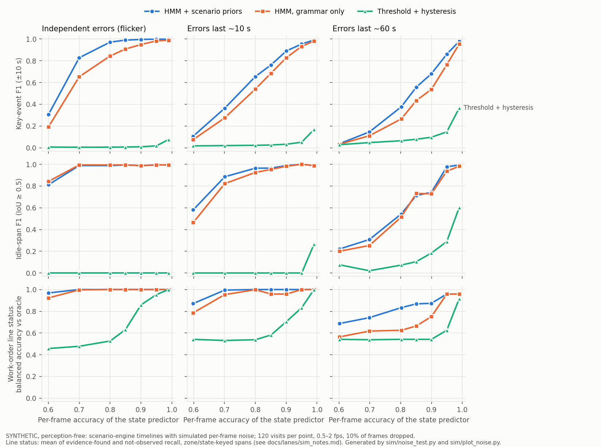
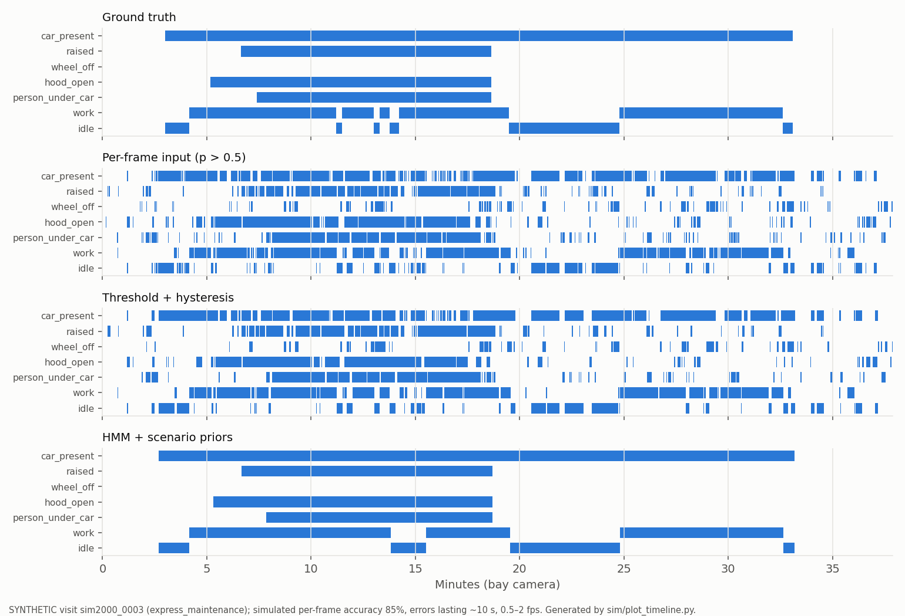

# Lane E: scenario engine, temporal decoding, synthetic data (notes)

**Everything in this lane is synthetic.** None of these numbers show accuracy on real CCTV. They show:
- how the event logic behaves on visits with exact ground truth;
- how good per-frame perception (Lane C) has to be.

## What was built

| Part | File | Status |
|---|---|---|
| Scenario engine: stage grammar, 5 job types, duration priors, work orders with phantom (paid, not done) lines, per-second ground truth | `sim/scenario.py` | done |
| `continue_visit(visit, work_order)`: simulated future, all added events `source="simulated"`, observed events untouched, ETA p10/p50/p90 on the `ready` event | `sim/scenario.py` | done; ETA not better than a constant (below) |
| Temporal decoder: composite-state HMM (30 states), CTMC transitions for irregular sampling, scenario duration priors, forward-backward confidences | `seen/hmm.py` | done |
| Visit engine on top of the decoder: state, idle, zone, ready and handover events; hysteresis fallback flag; zone-polygon filter | `seen/visit_engine.py` | done, same `build_visit` signature |
| Perception-free noise test + curves | `sim/noise_test.py`, `sim/plot_noise.py`, `sim/plot_timeline.py` | done |
| Blender 2-bay scene, 29 visits / 14,472 frames, exact ground truth, held out by camera / HDRI / car | `sim/blender/*` | done (Cycles, GPU1) |
| Synthetic end-to-end evaluation, re-runnable as lanes deliver | `sim/eval_synthetic.py` | runs; with today's pipeline it fails at the detector (below) |
| Unit tests (CPU, 34 tests) | `tests/test_hmm.py`, `tests/test_visit_engine.py`, `tests/test_scenario.py` | passing |

## Scenario engine
- **Stage grammar:** gate → reception (walk-around) → waiting → bay → [wash, p = 0.6] → ready → handover → exit.
- **Job mix:**
  - express maintenance 35 % (ICE: oil + filter; EV share 30 %: HV battery and coolant)
  - tyre change / rotation 20 %
  - brake pads 15 %
  - chassis diagnostics on the lift 15 %
  - repair with a parts wait 15 % (median 45 min, the car idle in the bay)
- **Optional lines:** air filter, coolant, 12 V battery, cabin filter, OBD scan, wipers, brake fluid, wheel alignment, suspension tightening.
- **How a job is planned:** each line contributes steps that need a configuration (raised, wheel off, bonnet, person at or under the car). The planner inserts lift, wheel and bonnet transitions.
- **Inside work steps:**
  - short pauses: exponential work chunks with mean 150 s, then a ~20 s pause; the person leaves in 40 % of pauses
  - long technician absences: p = 0.12 per step, median 10 min
- **Work orders:**
  - performed lines
  - the wash is on the order in 70 % of washes
  - in 25 % of orders, one phantom line that is paid but not performed
- **Duration priors** (lognormal median / log-sd, all ASSUMPTIONS): e.g.
  - waiting for a bay: 15 min / 1.0
  - drain and filter: 11 min / 0.35
  - brake pads: 25 min / 0.35
  - parts wait: 45 min / 0.7
  - ready-zone wait: 30 min / 0.9
  - handover: 4 min / 0.5

  They are loosely anchored on `research/service_ops_kpis.md`: Toyota TSM's "about half of servicing time is stagnation", ~1 h express service, J.D. Power's 22 min handover, ~20 % workshop idle. Resulting bay stays (median): express 34 min, tyres 32, brakes 46, chassis 38, repair 102 min.
- **Ground-truth labels mean "what a perfect camera labeller would mark".** Work inside the cabin (cabin filter) is invisible, so it counts as idle. This is a real limit of camera evidence, kept on purpose.

## Temporal decoder (`seen/hmm.py`)
- **Latent state:** composite physical state = car, raised, wheel off, bonnet, person (none / at / under), work, washing. The grammar allows only legal combinations (30 states). Zone kinds mask out impossible states, e.g. no lift in the wash.
- **Transitions:** a continuous-time Markov chain, P(dt) = expm(Q·dt). This handles 0.5–2 fps input, dropped frames and gaps exactly.
- **Fitted priors:** Q is fitted on 600 scenario visits (seed 1000), per zone kind (`sim/priors/hmm_rates.json`, regenerate with `python -m sim.scenario --fit-priors`), with pseudo-counts on grammar moves.
- **Duration priors (HSMM-lite):** exponential dwell times allow implausible 20 s "lift lowered" blips. After Viterbi, interior segments shorter than 0.5 × the 1st percentile of that label's scenario segment durations are flipped, shortest first, and the grammar is re-imposed. Slow labels never toggle mid-visit in the scenario; for those I assume a gap under 120 s is not real.
- **Emissions:** each available label probability is an independent observation, softened as p' = eps/2 + (1−eps)·p and tempered by a weight.
  - Shipped: eps = 0.3, weight = 0.2, prune scale 0.5. They were chosen on dev seeds (seed 1500, 40 visits; `runs/sim/noise_test/tune.json`).
  - On the final re-tune the best five settings were within 0.01 key-F1 of each other, so the choice is not sensitive.
  - The strong tempering is there because real per-frame errors are correlated in time. Its cost: slower onsets on weak, flickery evidence.
  - Detector-derived `car_present` gets weight 1.0 (a fixed choice).
- **Unconfigured zones** (`frame` / `other`, e.g. a jury clip) use the generic grammar (all moves at 1/300 s, no duration pruning). The fitted priors describe service-centre zones only.
- **Fallbacks:**
  - `SEEN_DECODER=baseline`: the original hysteresis. Its state events are identical to the old code; a regression test checks this.
  - `SEEN_HMM_RATES=generic`: grammar only.
- **Events:** `state_started/ended` (all states except `idle`), `idle_started/ended` (car present, no work, ≥ 300 s, `SEEN_IDLE_THRESHOLD_S`; bay / frame / other zones only, and only when work or idle evidence exists), `entered_zone/left_zone` (named zones), `ready` / `handed_over` (car arrives in / leaves a `ready` zone).
- **Confidence** is the forward-backward posterior. A label only yields events if a predictor supplied it in ≥ 20 % of frames.
- **Without a state predictor:** `car_present` comes from the vehicle detector. Only boxes whose bottom-centre lies inside `Zone.polygon` count, when a polygon is given.
- **Evidence model names** follow the pipeline's role-keyed versions; a missing key falls back to `unknown-model`.

## Noise test (perception-free)
- **Method** (`sim/noise_test.py`):
  - Ground-truth timelines of 120 test visits (seed 2000).
  - Each zone camera (bay, wash, ready) is sampled at a random 0.5–2 fps, with 10 % of frames dropped.
  - Each label gets a score (2y−1)·m + AR(1) noise. m is set so that per-frame accuracy = a. The noise time constant is 0 s (flicker), 10 s or 60 s (sustained errors).
  - The reported probability is the calibrated posterior.
  - Decoders compared: threshold + hysteresis (old baseline), HMM grammar-only, HMM + scenario priors.
- **Metrics:**
  - Key-event F1 at ±10 s / ±30 s. Key events = slow states (car, lift, wheel, bonnet, washing) + idle + zone + ready / handover.
  - "Fine" events (person at / under the car, work) toggle at every 20 s pause in the ground truth, so they are scored separately. I moved `person_under_car` from key to fine after seeing that its ground truth toggles at every pause, like `person_at_car`.
  - Idle segment P/R (IoU ≥ 0.5).
  - Work-order line status vs "oracle": the same `verify` run on ground-truth events.
- CIs are visit-level bootstrap (500).




Operating points (errors lasting ~10 s, n = 120 visits, 95 % CI):

| Per-frame accuracy | Decoder | Key-event F1 ±10 s | ±30 s | Median onset error | Idle P / R (IoU ≥ .5) | Line status vs oracle (keyed spans) | Not-done lines flagged |
|---|---|---|---|---|---|---|---|
| 0.70 | hysteresis | 0.02 | 0.03 | 3.4 s | – / 0.00 | 0.94 | 0.08 [0.00, 0.27] |
| 0.70 | HMM + priors | 0.36 [0.33, 0.40] | 0.60 | 6.7 s | 0.85 / 0.93 | 0.99 | 1.00 |
| 0.80 | hysteresis | 0.02 | 0.03 | 1.1 s | – / 0.00 | 0.96 | 0.08 [0.00, 0.27] |
| 0.80 | HMM + priors | 0.66 [0.63, 0.68] | 0.84 | 3.0 s | 0.95 / 0.98 | 1.00 | 1.00 |
| 0.90 | hysteresis | 0.03 | 0.03 | 0.7 s | – / 0.00 | 0.97 | 0.42 [0.14, 0.69] |
| 0.90 | HMM + priors | 0.89 [0.87, 0.91] | 0.98 | 1.3 s | 0.99 / 0.99 | 1.00 | 1.00 |

Further results (all in `docs/lanes/sim_noise_grid.json`; selected points with CIs in `sim_results.json`):
- **Flicker (independent errors):** HMM key F1 at ±10 s is 0.83 at 70 % and 0.97 at 80 %.
- **Sustained errors (~60 s):** 0.38 at 80 %, 0.68 at 90 %, 0.86 at 95 %.
- **Robustness at 85 % / ~10 s:**
  - drops 0 / 30 / 50 % → 0.78 / 0.74 / 0.71
  - fixed 0.5 fps → 0.73; fixed 2 fps → 0.76
- **Prior mismatch** (durations ×1.6, pauses ×1.9, absences ×2, uniform job mix) at 80 %: HMM + priors 0.64 vs 0.66 matched; grammar-only 0.55; hysteresis 0.02.
- **Grammar-only HMM:** always below the fitted HMM, by 0.05–0.15 key F1. The priors help, but most of the gain comes from the grammar + CTMC.
- **Hysteresis baseline:** never produces an idle span ≥ 5 min, because work flicker splits every span. Its event F1 stays below 0.2 up to 99 % frame accuracy.
- **Camera-evidence ceiling:** even with perfect perception, the line status matches "actually performed" for only 94 % of camera-verifiable lines. A phantom line whose operations look like the rest of the job gets "evidence found"; e.g. brake pads on a tyre job = wheel off + work.
- **Bug in shipped `seen/workorder.verify`:** it keys open spans by operation only (see Requests). With the shipped function, line status vs oracle for the HMM is 0.78–0.88 instead of 1.00. Both numbers are in the results; the keyed variant is `sim/metrics.verify_keyed`.

**What this means for Lane C (target):**
- With errors that last ~10 s, ≥ 85 % per-frame accuracy per state gives:
  - key-event F1 0.76 (±10 s) / 0.91 (±30 s)
  - idle detection P/R ≥ 0.94
  - correct work-order statuses
- ≥ 90 % gives 0.89 / 0.98.
- If errors last a minute (e.g. long occlusions), ≥ 95 % is needed.
- Below 70 % the timeline is not usable.
- Calibrated probabilities matter: the decoder treats them as likelihoods.

## Continuation (`continue_visit`) and ETA
- **Mechanics:**
  - Finds the phase (arrival / bay / after bay / wash / ready / done) and the open states.
  - Matches the observed bay-configuration history to the planned steps of the work-order lines, giving progress and time spent in the current step.
  - Samples 200 Monte-Carlo continuations. A parts wait and an unordered wash are sampled with the probabilities implied by the job mix.
  - Returns the median-ETA path, with p10/p50/p90 in the `ready` event payload.
  - The pipeline calls it without `now`, so simulated events start after the last observed event.
- **ETA test** (perfect observation of a prefix cut at 20–80 % of the bay stay, 120 visits):
  - MAE 14.0 min [11.7, 16.6] vs 12.4 [10.4, 14.5] for a constant median ETA that uses test information.
  - p10–p90 coverage 0.61 [0.53, 0.69].
  - Without visits that carry a phantom line: 11.9 vs 12.3 min, coverage 0.68.
- **Conclusion:** the ETA is no better than a constant under our own generator. Do not claim ETA prediction. The continuation is fine for the twin's dashed "what happens next" view.

## Blender synthetic visits
See `sim/blender/README.md` for the method, assets, licences and claims.
- 10 episodes, 29 visits, 14,472 frames, 1280×720, 1 frame per 4 simulated s.
- Cycles + OptiX on GPU1.
- Held out by camera / HDRI / car model (`docs/lanes/sim_splits.md`).
- Render cost: ~1–1.5 s per frame per worker on the shared GPU1 (Cycles 32 spp + OptiX denoise).
- On integrator request, test episodes ep10–ep12 (10 more visits; test = 21 visits) render only every 4th frame at 16 spp, about 1,700 frames. Completed; all 39 visits (21 test) are rendered.
- Eevee was tried first, but it rendered through EGL on GPU0 (the training GPU) despite the GPU pin. It was stopped and replaced by Cycles; the Eevee frames were deleted.

## End-to-end on renders (`sim/eval_synthetic.py`, test split: 7 episodes, 21 visits, 14 bay clips, 15,410 bay frames)
**Setup:**
- `seen.pipeline.default_pipeline()` as deployed today: RF-DETR COCO + fast-alpr. No state predictor yet.
- Each bay is cropped by its ROI and passed with its projected zone polygon. `build_visit` uses the HMM.

**Result: the chain fails at the detector. This is a measured failure, not a decoder result.**

| Metric (synthetic, test split) | Value |
|---|---|
| Car-present cue (vehicle box in zone, conf ≥ 0.5) frame accuracy | 0.38 [0.37, 0.39]. About the empty-bay rate: cars are almost never found (0 of the raised-car frames) |
| Key-event F1 ±10 s (all states / states the pipeline reports) | 0.00 / 0.00 |
| Work-order line status vs oracle | 0.18 [0.10, 0.29] (no evidence at all; matches only the lines the oracle also marks not observed) |
| Pipeline time | 36.8 ms per crop (detector 24.3, plate 12.5) on the shared GPU1 |

**Why** (`sim/detector_probe.py`, 117 rendered cars):
- COCO RF-DETR **localises every car** (IoU > 0.3: 117/117, CI [0.97, 1.00]).
- It labels them toilet / bed / tv / airplane / train / truck at median confidence 0.12–0.22.
- Only 3/117 (2.6 % [0.9, 7.3]) are a vehicle class at ≥ 0.4.

The Kenney low-poly cars are too stylised for a detector trained on real photos. So the renders test the event
logic, not perception. The script is ready to re-run as lanes deliver:
`python -m sim.eval_synthetic --renders $SEEN_ROOT/renders/bay_v1 --split test --state-predictor lanes.ops.predict:get_predictor --tag lane_c`.

Lane C can use the train split (6 episodes, 18 visits) and its exact labels:
- per-frame states: `gt_frames.jsonl`
- car / person / removed-wheel boxes: `labels.jsonl`

Only the renders' realism limits how far that transfers to real footage.

## Known limits
- The duration priors, job mix and idle threshold are assumptions. The HMM priors are fitted to them, so noise-test numbers for the fitted HMM are optimistic. The mismatch test shows only a modest drop, but real dealer timing will differ more.
- The noise model (Gaussian score + AR(1)) is not Lane C's real error structure. Real errors depend on state and scene: occlusion when a person is under the car, lighting.
- `FramePred.states` is per frame, not per zone. A camera covering two bays needs per-bay crops (as `eval_synthetic` does) or per-zone states.
- The HMM uses exponential dwell + pruning, not a full HSMM. Tempering slows onsets on weak evidence. The fitted priors suppress implausibly short bay visits (< ~7 min) in `bay` zones (documented behaviour, unit-tested).
- Renders: toy cars, proxy bonnet panel, cartoon proxy people, no rain or night, ground truth ambiguous for ~25 s around lift motion.

## For the deck
- "Temporal decoding was tested on 120 synthetic visits with exact ground truth (scenario engine; simulated per-frame errors). With 85–90 % per-frame accuracy:
  - key events are found within ±10 s at F1 0.76–0.89;
  - idle periods ≥ 5 min are found with P/R ≥ 0.94;
  - simple thresholding fails (F1 < 0.05)."

  Label it SYNTHETIC.
- "Requirement we derived for the bay-state model: ≥ 85–90 % per-frame accuracy, calibrated probabilities."
- Camera evidence has a ceiling. Even perfect perception confirms an unperformed paid line in ~6 % of lines, when its visible operations coincide with other work (e.g. brake pads vs tyre change). Show these as "evidence found", never "done".
- Blender renders:
  - 29 synthetic visits, CC0 assets (Kenney, Poly Haven), Blender 5.0.1 Cycles;
  - held out by camera, HDRI and car model;
  - generation method declared in `sim/blender/README.md`.
- Synthetic end-to-end numbers are reported apart from real ones and never blended.
- Honest limit of our renders: today's COCO detector does not recognise the stylised cars. It localises all of them but calls them "toilet" or "bed" at about 0.2 confidence, so the rendered end-to-end run finds no bay events. The renders validate the event logic and ground truth, not perception accuracy. Do not quote a synthetic end-to-end accuracy until a state predictor runs on them.
- Do not claim ETA prediction (no better than a constant in our test). Do not claim idle-time accuracy on real footage: thresholds and priors need pilot calibration.
- Simulated continuation events are dashed and labelled "simulated" in the twin; every such event has `source="simulated"`.

## Requests to integrator
1. **Bug, `seen/workorder.py::operation_spans`:** open spans are keyed by operation only.
   - When the bay camera still reports the car while the wash camera already does, the second `state_started` overwrites the first; `car_in_bay` collapses to the overlap.
   - The same happens with `work` and `person_at_car` (both map to `person_at_car`).
   - Fix: key open spans by (operation, zone id, state), as in `sim/metrics.py::operation_spans_keyed`.
   - Effect in the noise test: HMM line status vs oracle 0.78 → 1.00 at 90 % accuracy.
2. `verify()` counts state events from any zone. `car_present` in reception or ready counts as `car_in_bay`. Restrict evidence to bay / wash (and frame / other) zones.
3. `FramePred.states` is per frame. For multi-bay cameras, consider per-zone states (e.g. `states_by_zone: {zone_id: {...}}`).
4. Pass the end-of-input time to `continue_visit(visit, work_order, now=start_time + last_frame.t_s)`, so the continuation starts at the end of the clip rather than at the last event.
5. The serve image must include `sim/` (scenario engine) and `sim/priors/hmm_rates.json`. Without the priors file, `seen/hmm.py` falls back to the generic grammar.
6. Web: new event types are now emitted (`entered_zone`, `left_zone`, `idle_started/ended` with `payload.duration_s`, `ready`, `handed_over`). `idle` is no longer emitted as a `state_started` event.
7. `docs/deck_notes.md`: add the "For the deck" lines above.

## Reproduce
```
python -m sim.scenario --fit-priors                       # priors (seed 1000, 600 visits)
python -m sim.noise_test --tune                           # decoder hyper-parameters (dev seed 1500)
python -m sim.noise_test --n 120                          # grid -> runs/sim/noise_test (about 35 min on 9 CPU workers)
python -m sim.plot_noise runs/sim/noise_test docs/lanes/sim_noise_curves.png
python -m sim.plot_timeline docs/lanes/sim_timeline_example.png --visit 3
python -m pytest tests/test_hmm.py tests/test_visit_engine.py tests/test_scenario.py
```
Blender and end-to-end: see `sim/blender/README.md`.

## Current state / next steps (keep current; resume cold from here)
- **Done:**
  - scenario engine, HMM decoder, visit engine, 34 CPU tests
  - noise test: `runs/sim/noise_test` on the box; copies in `docs/lanes/sim_results.json`, `sim_noise_grid.json`, curves
  - renders ep00–ep09 (14,472 frames)
  - e2e test-split run on ep06–ep09: `runs/sim/eval_synthetic/default_pipeline` (detector fails, see above)
  - detector probe: `runs/sim/detector_probe`
  - failure gallery: `docs/lanes/failures/sim/`
- **Renders live on the NVMe:** `/home/amirkhon/seen_fast/sim/bay_v1` (≈1.5 GB of the 8 GB budget). Assets: `/home/amirkhon/seen_fast/sim/sim_assets`.
- **All renders finished** (ep00–ep12; ep10–ep12 at every 4th frame). The e2e run on the full 21-visit test split is done (numbers above). Running: `logs/sim_stage_back.log`, the copy from NVMe to `$SEEN_ROOT/renders/bay_v1`.
- **Next commands (from the Mac repo root):**
  1. (done 2026-10-11) Re-run the e2e on the full 21-visit test split:
     `scripts/sync.sh && scripts/box.sh --gpu 1 --bg sim_e2e_test -- python -m sim.eval_synthetic --renders /home/amirkhon/seen_fast/sim/bay_v1 --split test --tag default_pipeline`
     Then `scripts/sync.sh pull runs/sim/eval_synthetic/default_pipeline/component_results.json /tmp/` and replace the `e2e.synthetic.default_pipeline.test` entry in `docs/lanes/sim_results.json`.
  2. (started) Copy the final renders to the HDD in one sequential pass:
     `scripts/box.sh --bg sim_stage_back -- bash sim/blender/stage_nvme.sh back bay_v1` (→ `$SEEN_ROOT/renders/bay_v1`).
     Keep the NVMe copy while Lane C trains or evaluates on it; delete it afterwards.
  3. When Lane C's state predictor lands, re-run step 1 with `--state-predictor lanes.ops.predict:get_predictor --tag lane_c`.
